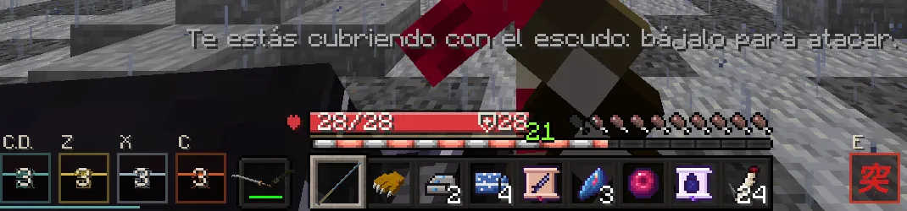

# Combate

Combos con clic izquierdo, formas con clic derecho y con Z, X y C, bloqueo, esquiva y el golpe crítico con la E. Lo demás es saber cuándo usar cada cosa.

## Lo básico

| Acción | Tecla | Para qué |
|---|---|---|
| Atacar | ++"Clic izq."++ | Encadena golpes para hacer combos. |
| Forma de respiración | ++"Clic der."++ | Tu técnica: mucho más daño contra demonios. |
| Técnicas del Cuerpo y formas de otras respiraciones | ++z++ · ++x++ · ++c++ | Desde los rangos Kanoe, Hinoto y Kinoe ([ver](respiraciones.md#las-teclas-z-x-y-c)). |
| Golpe crítico | ++e++ | Cuando sale «Pulsa E», tras tres golpes seguidos al mismo demonio. |
| Bloquear / parar | ++f++ | Mantén para bloquear. Púlsalo **justo antes** del golpe para hacer una parada. |
| Esquivar | ++alt++ izq. | Una voltereta rápida. |
| Fijar objetivo | ++g++ | La cámara sigue al enemigo. |
| Parkour | ++shift++ en el aire · ++ctrl++ en una pared | Agarrarte, deslizarte, rodar al caer, correr por paredes. |

Siempre peleas en **modo combate**, lleves lo que lleves en la mano: cada golpe tiene su animación y su ritmo, y pulsar más
deprisa no pega más. Para picar un bloque (o golpear el poste y la roca de un entrenamiento), míralo y pica como siempre.

## La katana

- Con tu **katana nichirin**, el combo del clic izquierdo va un **70 % más rápido**: unos dos golpes por segundo.
- **Pegas corriendo**: el tajo va con los brazos y tus piernas siguen corriendo, sin perder el sprint. Para alcanzar a un
  demonio que huye, corre y pega.
- Quieto, el tajo te acerca un paso al enemigo, como siempre.

## Cubrirse o atacar

- Con el bloqueo o la parada puestos (++f++) **no sale ninguna técnica**: ni formas ni artes de sangre.
- **El escudo levantado también es cubrirse**: con él arriba no sale ninguna técnica (ni el clic derecho, ni ++z++, ++x++ y
  ++c++), ni en el medio segundo después de bajarlo: «Te estás cubriendo con el escudo: bájalo para atacar.». Vale para
  cazadores y para demonios.
- Mientras sale una técnica (o justo después) no puedes cubrirte, levantar el escudo ni esquivar: «Con una técnica en marcha
  no puedes cubrirte.». Con un arma de una mano y el escudo en la otra, el clic derecho lanza la forma y el escudo no sube
  hasta que acaba.
- Tras cada técnica tienes **4 segundos para recuperarte**, contados desde que **acaba**: mientras dura no sale otra, con
  ninguna tecla. Vale para cazadores y para demonios.
- Cada forma y cada arte siguen con **su propia espera**: los 4 s son solo la pausa antes de la siguiente técnica.

<figure markdown="span">
  { loading=lazy }
  <figcaption>Con el escudo arriba, la Z no lanza nada: o te cubres o atacas.</figcaption>
</figure>

### Las técnicas contra la guardia

La guardia ya no para gratis una técnica. Cuando te cubres (++f++) de una forma, un arte o la habilidad de un arma, cada
técnica hace una tirada:

- Con un arma en la mano, **a veces te rompe la guardia** (un 35 % de las veces). Si no, **la aguantas, pero te cuesta**
  un tercio largo de tu estamina: «Aguantas la técnica, pero te cuesta…».
- La guardia de brazos de un demonio (con las manos vacías) **la rompe siempre**.
- Si se rompe, te quedas aturdido un instante (ese golpe se para igual): «¡La técnica te rompe la guardia!».
- **La parada a tiempo sigue ganando**: si pulsas ++f++ justo antes del golpe, no hay tirada.
- Vale para los dos bandos y también para las técnicas de los jefes y de los cazadores del Cuerpo.

## El golpe crítico

<ol class="pasos" markdown>
<li markdown>**Da tres golpes seguidos al mismo demonio** con la katana (clic izquierdo, también corriendo), sin dejar pasar más de 1,5 segundos entre uno y otro.</li>
<li markdown>Aparece **«Pulsa E»** junto a la mira: tienes **2,5 segundos** para pulsar ++e++.</li>
<li markdown>Tu cazador **atraviesa al demonio** con la katana en una escena corta. Si le queda vida, la pelea sigue.</li>
</ol>

<figure markdown="span">
  { loading=lazy }
  <figcaption>El golpe crítico: cuánto le has quitado y cuánta vida le queda.</figcaption>
</figure>

{ align=right width="96" loading=lazy }

- Quita como **tres golpes en uno** a los demonios (más cuanto mejor sea tu katana) y **4 de vida** a un jugador demonio.
  A los jefes, como cualquier golpe, no más de un cuarto de su vida.
- Una vez cada **30 segundos**: el icono **突**, junto a tus teclas (o a la derecha de la barra de objetos), cuenta los segundos hasta el siguiente. Si aún no toca, en vez del aviso ves cuánto falta.
- Solo cuentan los **golpes normales que entran**: las formas, las teclas Z, X y C, un golpe bloqueado o esquivado no suman. Cada
  demonio lleva su cuenta.
- Vale contra los demonios de la noche, los jefes, los jugadores demonio (fuera del dojo), los Kabocha-oni de Halloween y el
  [muñeco del dojo](../social/duelos.md#el-muneco-de-practica).
- Los demonios jugadores tienen el suyo, el [mordisco](../demonio/combate.md#el-mordisco). **Si los dos os dais los tres
  golpes a la vez**, os sale el aviso a los dos y se lleva la escena **el primero que pulsa la E**; al otro se le cierra:
  «¡Se te ha adelantado!».
- Sin el aviso, la ++e++ abre el inventario como siempre (mientras te sujetan en una escena así, no).

## El daño

- Tu **katana nichirin** pega más que una espada normal.
- Las **formas** hacen **2,5 veces más daño contra demonios** (y un 3 % más por cada rango del Cuerpo); a los que no son
  jefes, un 20 % más todavía. Cada forma pega algo más que la anterior de su respiración y **ninguna mata de un golpe**
  ([ver](respiraciones.md#cada-forma-un-poco-mas-fuerte)).
- Los demonios de la noche tienen un **tope de daño** por golpe: ningún demonio normal te mata de un golpe con la vida llena.
- Las técnicas (las tuyas y las de los jefes) **no dañan** a los personajes del servidor, a los aldeanos ni a la decoración.

## El remate

Cuando das el golpe final a un demonio, a veces lo verás como una escena de película: bandas negras, el tiempo que se
detiene mientras te pones en guardia, el salto a través del demonio y su cabeza saliendo por los aires mientras el cuerpo
se deshace en ceniza.

- A los **jefes**, siempre, con una tarjeta final con su nombre y el tuyo. A los **demonios de la noche**, de vez en cuando.
- Mientras dura no puedes moverte ni pegar, pero **nadie puede hacerte daño**.
- Acabas **detrás del demonio**, como en la escena, solo si ahí hay sitio; si no, el tajo vuela hasta su cuello.
- Los efectos son los de **tu respiración**. Si el golpe final lo da un Pilar que te acompaña, es él quien corta la cabeza.
- Quien peleaba contigo contra el jefe también lo ve con cámara; los demás que estén cerca, en el mundo.
- Si estás en plena pelea con otro jugador (con la [marca de combate](#la-marca-de-combate)), el demonio muere sin la
  película.

## Curarte

- Tras recibir un golpe, la curación **lenta** (comida, regeneración, reliquias) se **para 4 segundos**. Las curaciones
  instantáneas (pociones de curación) sí funcionan siempre.
- Los **remedios** son pociones con nombre propio que dan algunas misiones y mostradores: su efecto viene escrito.
- Tu vida crece con tu rango: **un corazón más por cada rango** del Cuerpo (un Hashira lleva diez de más;
  [ver](rangos.md#la-escalera)).
- En el rango Hashira, o con cualquier rango si tienes un [rango VIP del Cuerpo](../vip.md#la-marca-de-cada-pilar), tienes la
  **Marca del Cazador** (++h++): 20 s de regeneración fuerte ([ver](rangos.md#la-marca-del-cazador)).
- Desde Kinoto, el **Segundo Aliento** de la [Senda del Cazador](rangos.md#la-senda-del-cazador): si un demonio te deja por
  debajo de un cuarto de tu vida, 5 s de **Regeneración II** (una vez cada 2 minutos).
- La Marca y el Segundo Aliento curan aunque te acaben de golpear.

## Reliquias

Las **reliquias** son objetos únicos que se ganan en la historia. Llevan «✦ Reliquia» en su descripción y funcionan
mientras las llevas encima (en un duelo no cuentan). No van ligadas: se pueden regalar o vender.

| Reliquia | Efecto |
|---|---|
| Máscara de Zorro | Puesta en la cabeza, de noche: visión nocturna. |
| Adorno de Satoko | Suerte. |
| Frasco de Tamayo | Con menos de un tercio de vida, regeneración. |
| Tambor de Kyogai | Te empujan un 30 % menos. |
| Hilo Rojo de Rui | Ninguna caída te hace daño. |
| Tsuba de Rengoku | El fuego no te quema. |
| Diadema del Dios de los Festivales | Puesta: los demonios cercanos brillan a través de las paredes. |
| Hoja Oxidada de Yoriichi | Golpes más rápidos. |
| Vasija Rota de Gyokko | Respiras bajo el agua. |
| Tsuba del Trueno | Corres un 6 % más deprisa. |

## PvP

- **Entre cazadores** solo hay combate en **duelo**, en el [dojo](../social/duelos.md). Allí los dos entráis iguales y
  nadie pierde nada (con los mismos topes de daño que fuera).
- **Demonios contra cazadores**: en todo el mapa, salvo en los refugios (bosques de glicinas y la casa de los Kamado), las
  [zonas seguras](../mundo/noche.md#zonas-seguras) y las casas o parcelas que su inquilino ha dejado
  [sin PvP](../economia/casas.md#pvp-en-tu-casa), y contra cazadores que aún no tienen su katana.
- Fuera del dojo, en PvP la **armadura cuenta la mitad** y nadie cae de una ráfaga: como mucho **5 de vida por golpe**, **7 por
  segundo** y, de un mismo rival, **12 cada 10 segundos** (lo que pase entra muy rebajado). Cuenta todo lo suyo: sus técnicas, lo que
  invoca, el frío, el veneno o la marchitez que te deje y la caída si te lanzó por los aires. Dos rivales a la vez son más peligrosos que uno.
- Las **formas** tienen topes algo más altos cuanto mayor es su número (la última, hasta 12 por golpe), pero una forma entera no
  quita más del 90 % de tu vida.
- Las **artes de un demonio jugador** te pegan un **20 % más** (menos las del linaje del Hielo, el de Doma), y sus topes suben
  lo mismo: hasta **6** por golpe, **8,4** por segundo y **14,4** cada 10 segundos. También en los duelos del dojo. Su zarpazo,
  su mordisco y sus armas, como siempre.
- Entre jugadores, lo que te deja sin pelear (lentitud fuerte, debilidad, ceguera, náusea, quedarte clavado) dura **2 segundos** como mucho.
- Las prendas de la Aldea te protegen algo de las **artes de un demonio jugador**: de un 1 % a un 4 % por prenda, según su
  nivel ([ver](../economia/aldea.md#contra-las-artes-de-un-demonio-jugador)).
- **Al conectarte** tienes **30 segundos** en los que nada puede hacerte daño (tampoco el sol, si eres demonio); se acaban en
  cuanto atacas, lanzas una técnica o empiezas un duelo. Sale **como mucho una vez cada 15 minutos**, contados desde la última
  vez que la tuviste: si te sales y vuelves a entrar antes, entras sin ella (el chat te dice cuántos minutos faltan). Y si te
  fuiste en plena pelea y vuelves antes de 10 minutos, tampoco la tienes.
- Los demonios ponen **precio a tu cabeza**, con la misma cuenta que la cabeza de un demonio: **300** y **60 más por cada punto
  de fama**, hasta **3.000** (de Mizunoto y sin fama, no vale nada). Tu fama sube **3** por cada demonio jugador con precio que
  cazas y **1** por cada 10 demonios de la noche (como mucho 2 al día), y baja un punto con cada día del mundo. El demonio que te
  mata cobra tu precio y tu fama vuelve a cero ([ver](../demonio/combate.md#cabezas-con-precio)).

### La marca de combate

Cuando cruzas un golpe con otro jugador, se lo des tú o te lo dé él (también con una flecha, un arte o lo que invoca),
**los dos** entráis en combate durante **30 segundos**, aunque el golpe no haga daño o lo pare la guardia. Cada golpe nuevo
vuelve a empezar la cuenta. En los duelos del dojo no hay marca.

- Lo ves en una franja **encima de tu barra de vida**: «⚔ EN COMBATE» con los segundos que quedan (los cinco últimos
  laten). Al acabar, «✓ FUERA DE COMBATE» en verde.
- Mientras dura no puedes viajar, hablar con los personajes, retar a duelo ni ir a mirar uno, sentarte, jugar en una
  [mesa](../social/juegos.md), cambiar de sangre ni quitar el PvP de tu casa.
- **Una zona segura o una casa sin PvP no te protegen** mientras la llevas: dentro te pueden pegar y tú puedes pegar. Al
  acabarse estando dentro, te avisa: «ya estás a salvo».
- **Salirse en plena pelea no salva**: si sales del juego con la marca, **mueres al salir** y la muerte es de ese jugador
  (cuenta como una muerte en PvP de verdad, con aviso para todos). Tampoco te libran entrar con tu cuenta desde otro
  ordenador, esperar turno para un duelo ni una escena.

## Si mueres

No pierdes el inventario ni el dinero, pero **sí una parte de los méritos** que has ganado desde tu rango:

- El **15 %** si te mata un demonio jugador (también si te sales en plena pelea con él). El mismo demonio no te lo vuelve a
  cobrar en 30 minutos: la siguiente vez cuesta como cualquier otra muerte.
- El **7 %** si mueres de otra cosa: un demonio de la noche, un jefe, una caída…
- **Nunca bajas de rango.** Si ya tienes los méritos del siguiente rango y solo te faltan días de servicio, esos no se
  pierden, ni lo que tengas en reserva.
- El chat te lo dice: «La muerte te ha costado 15 méritos (te ha matado …). Tu rango se queda.»

Verás caer a tu personaje (la espada se le escapa de la mano, los ojos se le cierran) y **despertarás vendado en una cama
del Hospital de Tokio**: los Kakushi te han traído hasta allí. Mientras despiertas nadie puede hacerte daño. Si tienes
prisa, **mantén ESPACIO** un segundo para saltar cualquiera de las dos escenas.
