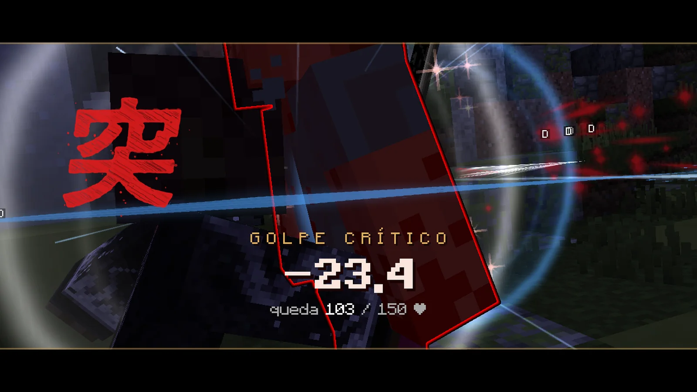
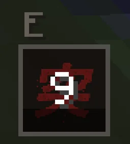

# Combate

Combos con clic izquierdo, formas con clic derecho y con Z, X y C, bloqueo, esquiva y el golpe crítico con la E. Lo demás es saber cuándo usar cada cosa.

## Lo básico

| Acción | Tecla | Para qué |
|---|---|---|
| Atacar | ++"Clic izq."++ | Encadena golpes para hacer combos. |
| Forma de respiración | ++"Clic der."++ | Tu técnica: mucho más daño contra demonios. |
| Formas de otras respiraciones | ++z++ · ++x++ · ++c++ | Desde los rangos Kanoe, Hinoto y Kinoe ([ver](respiraciones.md#las-teclas-z-x-y-c)). |
| Golpe crítico | ++e++ | Cuando sale «Pulsa E», tras tres golpes seguidos al mismo demonio. |
| Bloquear / parar | ++f++ | Mantén para bloquear. Púlsalo **justo antes** del golpe para hacer una parada. |
| Esquivar | ++alt++ izq. | Una voltereta rápida. |
| Fijar objetivo | ++g++ | La cámara sigue al enemigo. |
| Parkour | ++shift++ en el aire · ++ctrl++ en una pared | Agarrarte, deslizarte, rodar al caer, correr por paredes. |

Siempre peleas en **modo combate**, lleves lo que lleves en la mano: cada golpe tiene su animación y su ritmo, y pulsar más
deprisa no pega más. Para picar un bloque (o golpear el poste y la roca de un entrenamiento), míralo y pica como siempre.

## La katana

- Con tu **katana nichirin**, el combo del clic izquierdo va un **70 % más rápido**: unos dos golpes por segundo.
- **Pegas corriendo**: el tajo va con los brazos y tus piernas siguen corriendo, sin perder el sprint. Para alcanzar a un
  demonio que huye, corre y pega.
- Quieto, el tajo te acerca un paso al enemigo, como siempre.

## Cubrirse o atacar

- Con el bloqueo o la parada puestos (++f++) **no sale ninguna técnica**: ni formas ni artes de sangre.
- Mientras sale una técnica no puedes cubrirte ni esquivar.
- Tras cada técnica tienes **4 segundos para recuperarte**, contados desde que **acaba**: mientras dura no sale otra, con
  ninguna tecla. Vale para cazadores y para demonios.
- Cada forma y cada arte siguen con **su propia espera**: los 4 s son solo la pausa antes de la siguiente técnica.

## El golpe crítico

<ol class="pasos" markdown>
<li markdown>**Da tres golpes seguidos al mismo demonio** con la katana (clic izquierdo, también corriendo), sin dejar pasar más de 1,5 segundos entre uno y otro.</li>
<li markdown>Aparece **«Pulsa E»** junto a la mira: tienes **2,5 segundos** para pulsar ++e++.</li>
<li markdown>Tu cazador **atraviesa al demonio** con la katana en una escena corta. Si le queda vida, la pelea sigue.</li>
</ol>

<figure markdown="span">
  { loading=lazy }
  <figcaption>El golpe crítico: cuánto le has quitado y cuánta vida le queda.</figcaption>
</figure>

{ align=right width="96" loading=lazy }

- Quita como **tres golpes en uno** a los demonios (más cuanto mejor sea tu katana) y **6 de vida** a un jugador demonio.
  A los jefes, como cualquier golpe, no más de un cuarto de su vida.
- Una vez cada **30 segundos**: el icono **突**, junto a tus teclas (o a la derecha de la barra de objetos), cuenta los segundos hasta el siguiente. Si aún no toca, en vez del aviso ves cuánto falta.
- Solo cuentan los **golpes normales que entran**: las formas, las teclas Z, X y C, un golpe bloqueado o esquivado no suman. Cada
  demonio lleva su cuenta.
- Vale contra los demonios de la noche, los jefes, los jugadores demonio (fuera del dojo), los Kabocha-oni de Halloween y el
  [muñeco del dojo](../social/duelos.md#el-muneco-de-practica).
- Sin el aviso, la ++e++ abre el inventario como siempre.

## El daño

- Tu **katana nichirin** pega más que una espada normal.
- Las **formas** hacen **2,5 veces más daño contra demonios** (y un 3 % más por cada rango del Cuerpo); a los que no son
  jefes, un 20 % más todavía. Cada forma pega algo más que la anterior de su respiración y **ninguna mata de un golpe**
  ([ver](respiraciones.md#cada-forma-un-poco-mas-fuerte)).
- Los demonios de la noche tienen un **tope de daño** por golpe: ningún demonio normal te mata de un golpe con la vida llena.
- Las técnicas (las tuyas y las de los jefes) **no dañan** a los personajes del servidor, a los aldeanos ni a la decoración.

## El remate

Cuando das el golpe final a un demonio, a veces lo verás como una escena de película: bandas negras, el tiempo que se
detiene mientras te pones en guardia, el salto a través del demonio y su cabeza saliendo por los aires mientras el cuerpo
se deshace en ceniza.

- A los **jefes**, siempre, con una tarjeta final con su nombre y el tuyo. A los **demonios de la noche**, de vez en cuando.
- Mientras dura no puedes moverte ni pegar, pero **nadie puede hacerte daño**.
- Acabas **detrás del demonio**, como en la escena, solo si ahí hay sitio; si no, el tajo vuela hasta su cuello.
- Los efectos son los de **tu respiración**. Si el golpe final lo da un Pilar que te acompaña, es él quien corta la cabeza.
- Quien peleaba contigo contra el jefe también lo ve con cámara; los demás que estén cerca, en el mundo.

## Curarte

- Tras recibir un golpe, la curación **lenta** (comida, regeneración, reliquias) se **para 4 segundos**. Las curaciones
  instantáneas (pociones de curación) sí funcionan siempre.
- Los **remedios** son pociones con nombre propio que dan algunas misiones y mostradores: su efecto viene escrito.
- Desde el rango Kinoe tienes la **Marca del Cazador** (++h++): 20 s de regeneración fuerte.

## Reliquias

Las **reliquias** son objetos únicos que se ganan en la historia. Llevan «✦ Reliquia» en su descripción y funcionan
mientras las llevas encima (en un duelo no cuentan). No van ligadas: se pueden regalar o vender.

| Reliquia | Efecto |
|---|---|
| Máscara de Zorro | Puesta en la cabeza, de noche: visión nocturna. |
| Adorno de Satoko | Suerte. |
| Frasco de Tamayo | Con menos de un tercio de vida, regeneración. |
| Tambor de Kyogai | Te empujan un 30 % menos. |
| Hilo Rojo de Rui | Ninguna caída te hace daño. |
| Tsuba de Rengoku | El fuego no te quema. |
| Diadema del Dios de los Festivales | Puesta: los demonios cercanos brillan a través de las paredes. |
| Hoja Oxidada de Yoriichi | Golpes más rápidos. |
| Vasija Rota de Gyokko | Respiras bajo el agua. |
| Tsuba del Trueno | Corres un 6 % más deprisa. |

## PvP

- **Entre cazadores** solo hay combate en **duelo**, en el [dojo](../social/duelos.md). Allí los dos entráis iguales y
  nadie pierde nada (con los mismos topes de daño que fuera).
- **Demonios contra cazadores**: en todo el mapa, salvo en los refugios (bosques de glicinas y la casa de los Kamado) y
  contra cazadores que aún no tienen su katana.
- Fuera del dojo, en PvP la **armadura cuenta la mitad** y nadie cae de una ráfaga: como mucho **5 de vida por golpe**, **7 por
  segundo** y, de un mismo rival, **12 cada 10 segundos** (lo que pase entra muy rebajado). Cuenta todo lo suyo: sus técnicas, lo que
  invoca, el frío, el veneno o la marchitez que te deje y la caída si te lanzó por los aires. Dos rivales a la vez son más peligrosos que uno.
- Las **formas** tienen topes algo más altos cuanto mayor es su número (la última, hasta 12 por golpe), pero una forma entera no
  quita más del 90 % de tu vida.
- Entre jugadores, lo que te deja sin pelear (lentitud fuerte, debilidad, ceguera, náusea, quedarte clavado) dura **2 segundos** como mucho.
- **Al conectarte** tienes **30 segundos** en los que nada puede hacerte daño (tampoco el sol, si eres demonio); se acaban en
  cuanto atacas, lanzas una técnica o empiezas un duelo. Si te fuiste en plena pelea y vuelves antes de 10 minutos, no los tienes.
- **Salirse en plena pelea no salva**: si te desconectas con un golpe dado o recibido de otro jugador en los últimos
  **30 segundos**, mueres al salir y la muerte es de ese jugador (cuenta como una muerte en PvP de verdad, con aviso para todos).
  En los duelos no pasa.

## Si mueres

No pierdes el inventario ni el dinero. Verás caer a tu personaje (la espada se le escapa de la mano, los ojos se le
cierran) y **despertarás vendado en una cama del Hospital de Tokio**: los Kakushi te han traído hasta allí. Mientras
despiertas nadie puede hacerte daño. Si tienes prisa, **mantén ESPACIO** un segundo para saltar cualquiera de las dos
escenas.
