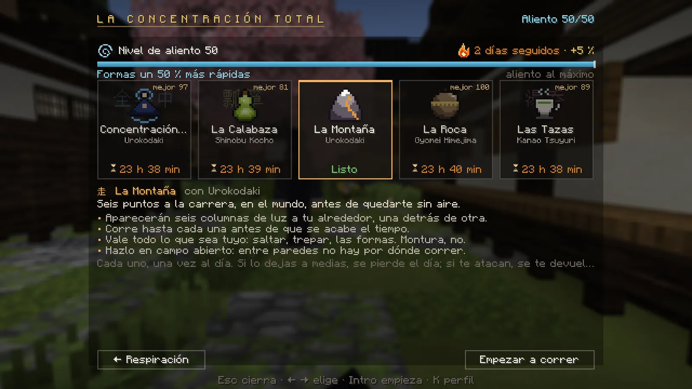
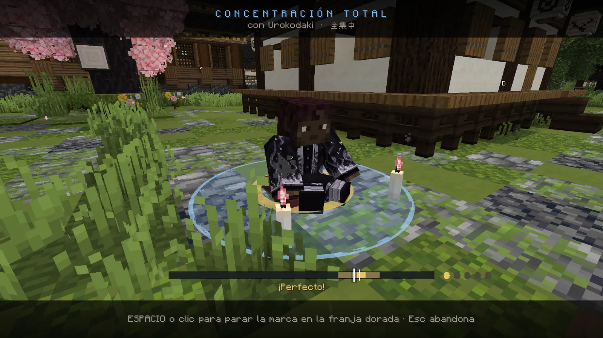
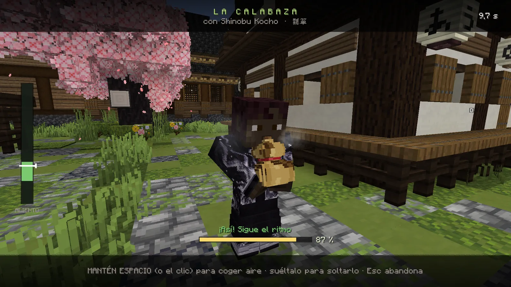
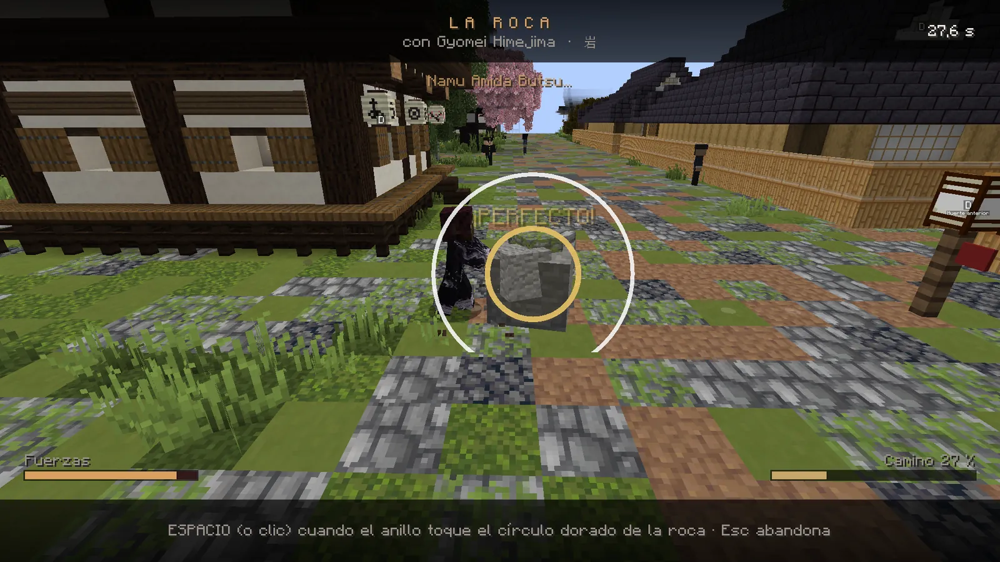
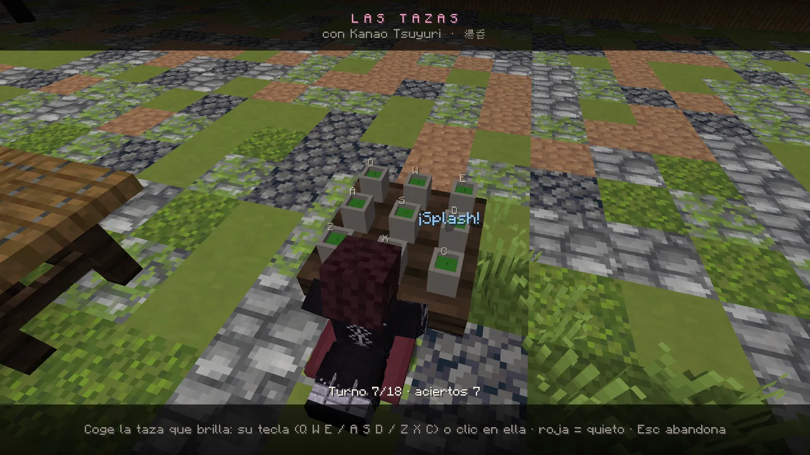
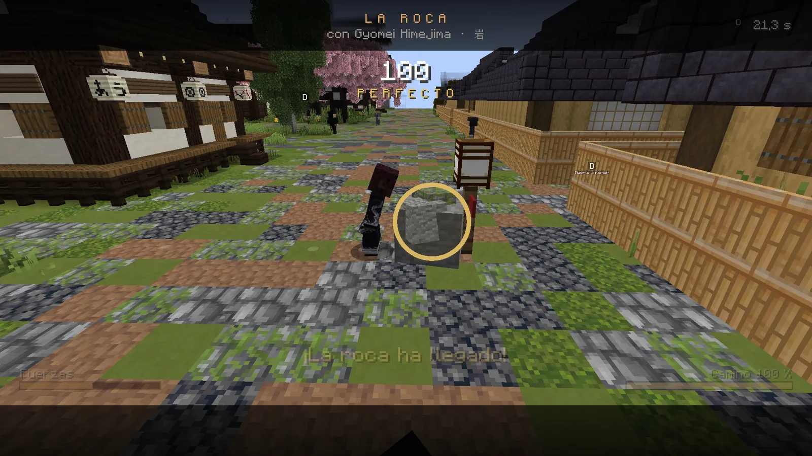

# Entrenar el aliento

Cinco minijuegos que haces en el mundo, uno de cada al día. Con cada nivel de aliento, todas tus formas vuelven un 1 % antes, hasta un 50 %.

## Cómo se abre

- **K → Respiración → «肺 Entrenar aliento»**, o escribe **`/entrenar`**.
- Elige un juego con las flechas y pulsa **Empezar** (o ++enter++).
- Al entrar al servidor te avisa si tienes entrenamientos listos.

<figure markdown="span">
  { loading=lazy }
  <figcaption>El menú: tu nivel de aliento, tu racha de días seguidos y los cinco juegos con el tiempo que falta para repetir cada uno.</figcaption>
</figure>

## Los cinco juegos

| Juego | Qué haces en el mundo | Controles |
|---|---|---|
| **Concentración Total** | Te sientas a meditar entre dos velas. | ++space++ o clic para parar la marca **dentro de la franja dorada**. Cinco rondas; la franja se estrecha. |
| **La Calabaza** | Soplas una calabaza hasta reventarla. | **Mantén** ++space++ (o el clic) para coger aire y **suéltalo** para soplar, siguiendo la franja verde. Reviéntala antes de 25 s. |
| **La Montaña** | Seis columnas de luz aparecen a tu alrededor. | Corre hasta cada una antes de quedarte sin tiempo. Vale saltar y trepar; montura no. |
| **La Roca** | Empujas un peñasco por un camino hasta una linterna. | Pulsa ++space++ cuando el anillo **toque el círculo** de la roca. Si pulsas a lo loco, te cansas. |
| **Las Tazas** | De rodillas ante una mesa con nueve tazas. | Coge la que **brilla** con su tecla (++q++ ++w++ ++e++ / ++a++ ++s++ ++d++ / ++z++ ++x++ ++c++) o con un clic. Si se pone **roja, no toques**. |

<figure markdown="span">
  { loading=lazy }
  <figcaption>Concentración Total: para la marca en la franja dorada.</figcaption>
</figure>
<figure markdown="span">
  { loading=lazy }
  <figcaption>La Calabaza: sigue el ritmo hasta reventarla.</figcaption>
</figure>
<figure markdown="span">
  { loading=lazy }
  <figcaption>La Roca: empuja justo cuando el anillo toca el círculo.</figcaption>
</figure>
<figure markdown="span">
  { loading=lazy }
  <figcaption>Las Tazas: coge la que brilla y no toques la roja.</figcaption>
</figure>

## Qué ganas

- Al acabar te dan una **nota** (de *NO CUENTA* a *PERFECTO*) y **puntos de aliento**: de 2 a 20 según la nota.
- **Racha:** cada día seguido entrenando suma un 5 % más de puntos, hasta un +50 %.
- Con los puntos subes de **nivel de aliento** (hasta el 50). Cada nivel hace que **todas tus formas** esperen un 1 %
  menos. La dificultad de los juegos sube con tu nivel.

<figure markdown="span">
  { loading=lazy }
  <figcaption>Al terminar, la nota y los puntos de aliento que ganas.</figcaption>
</figure>

## Reglas

- Cada juego **una vez cada 24 horas**. El intento se gasta al **empezar**.
- Hazlo tranquilo: no puedes haber recibido golpes en los últimos 15 s ni tener un enemigo encima.
- Ponte de pie en **suelo firme**, fuera del agua. **La Roca** necesita un camino llano de diez pasos y **La Montaña**,
  campo abierto.
- Si te alejas del sitio o abandonas, **pierdes ese juego hasta mañana**. Si te interrumpe un enemigo, se te devuelve el intento.

!!! tip "Entrenamientos que pide una misión"
    Algunas misiones te piden entrenar. Si ese juego ya lo hiciste hoy, puedes repetirlo igualmente para la misión:
    no suma aliento, pero cuenta para el paso.
