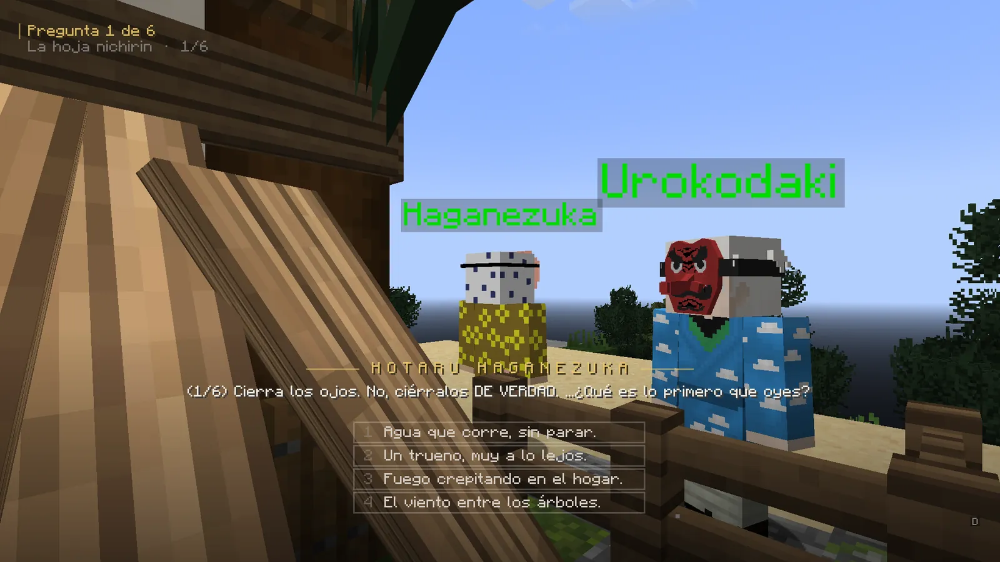
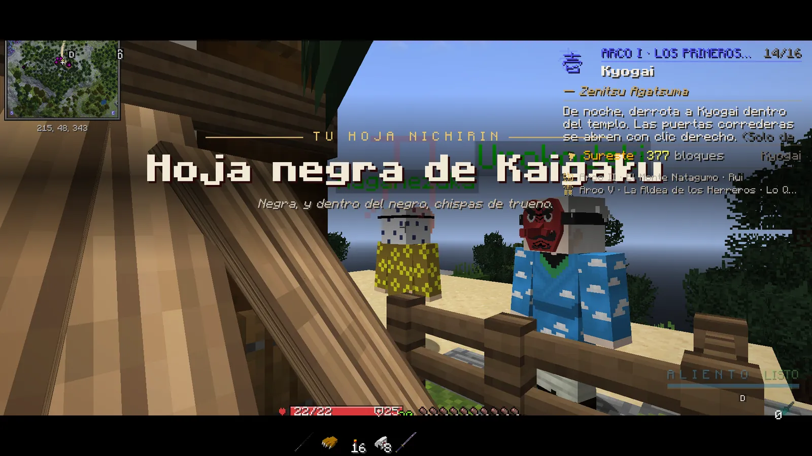

# Tu katana nichirin

En DemonCraft las katanas no se compran ni se encuentran: se ganan. La tuya te la forja un herrero cuando tu maestro te da por preparado.

## Cómo la consigues

1. Durante tu formación, tu maestro te da una **Katana de Aprendiz**: sirve para golpear, pero **no lanza formas**.
2. Cuando superas tu prueba, el herrero **Haganezuka** te hace **seis preguntas**. Contesta sin pensar: tus respuestas
   deciden **cómo será tu hoja**.
3. Te entrega tu **hoja personal**, «Nichirin de *tu nombre*», con su propio diseño y color.

<figure markdown="span">
  { loading=lazy }
  <figcaption>Las seis preguntas del herrero: cada respuesta orienta el diseño de tu hoja.</figcaption>
</figure>
<figure markdown="span">
  { loading=lazy }
  <figcaption>Al terminar, la tarjeta con tu hoja. Cada jugador tiene la suya.</figcaption>
</figure>

!!! tip "Si cierras las preguntas a medias"
    No pasa nada: vuelve a hablar con el herrero y sigue donde lo dejaste (la tarjeta de misión te lo recuerda).

## Qué te da tener tu katana

- **Lanzar formas** de respiración (con la katana en la mano principal).
- **Retar a duelos** en el dojo y entrar al **Mercado**.
- **Defenderte de los demonios jugadores**: hasta que no la tienes, no pueden atacarte (ni tú a ellos).
- La katana **no decide tu respiración**: lanza las formas de la que tengas activa. Pero si su diseño **resuena** con
  tu respiración, sus formas esperan un 10 % menos.

## Las katanas solo se ganan

Solo puedes llevar tu hoja personal, tus hojas personalizadas, la Katana de Aprendiz y la del kit de tu rango VIP
(mientras tengas ese rango). Cualquier otra katana se retira sola: *«Esa katana no es tuya…»*.

**Hojas personalizadas:** con un lingote de **metal nichirin premium** puedes tirar en la **Caja Premium** (K → Caja)
y te sale una de cinco hojas (Abismo, Ceniza Blanca, Tormenta Negra, Jade o Sakura). Son solo aspecto: lanzan las
formas de tu respiración igual que tu hoja.

## Si pierdes tu katana: la reforja

Habla con **Haganezuka** (en el hogar de tu maestro) o con **Hotaru Haganezuka** (en la Aldea de los Herreros): se abre
la **Forja** (si tienen una misión para ti, agáchate y háblales).

| Qué | Precio |
|---|---|
| Tu hoja personal | **4.000** la primera vez; sube un 50 % cada vez que la reforjas (máximo 12.000). |
| La Katana de Aprendiz (si aún no tienes hoja) | 1.500 |

- Solo **una reforja al día**, y no si ya llevas esa hoja encima. Necesitas un hueco libre.
- Tu katana trae **Reparación** (*Mending*): la experiencia la va reparando sola.
- Tu katana **se gasta**: si se queda **rota** no lanza formas, pero no desaparece. Hotaru te la repara y también la
  **templa** para que pegue más. [Ver la Aldea de los Herreros](../economia/aldea.md).
- Los herreros no forjan para demonios.

!!! info "La funda"
    La katana que llevas encima sin empuñarla va **enfundada en la cintura**; al empuñarla, la funda pasa a la otra mano.
