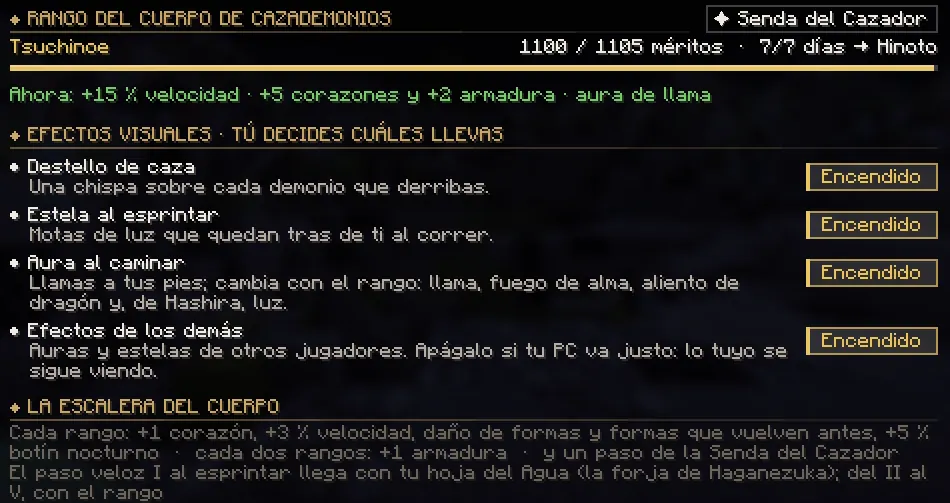
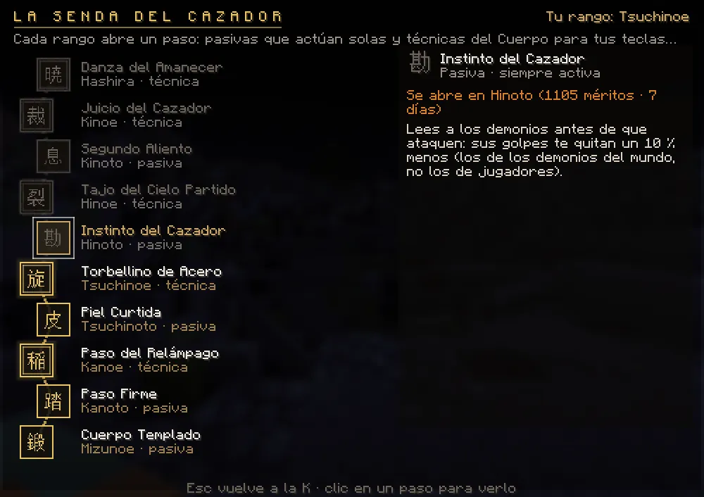
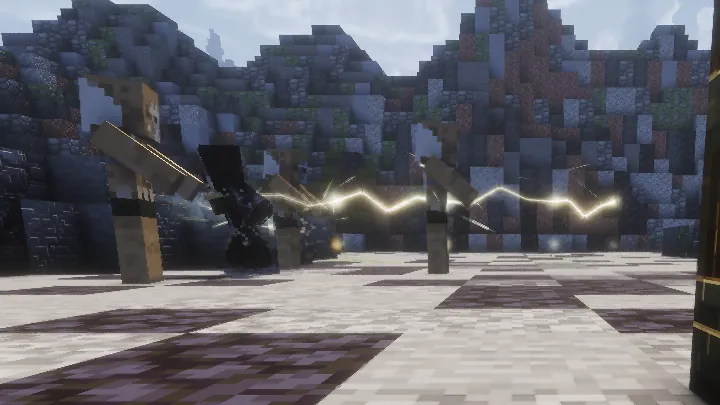
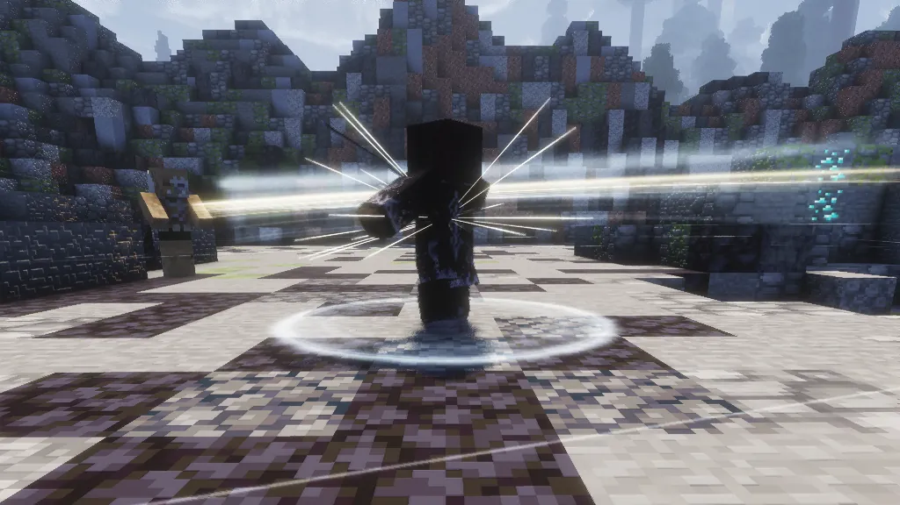
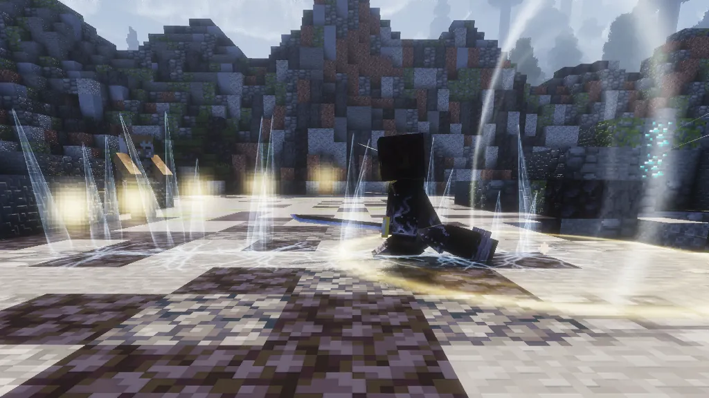
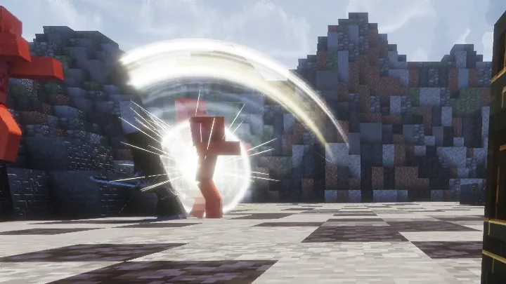
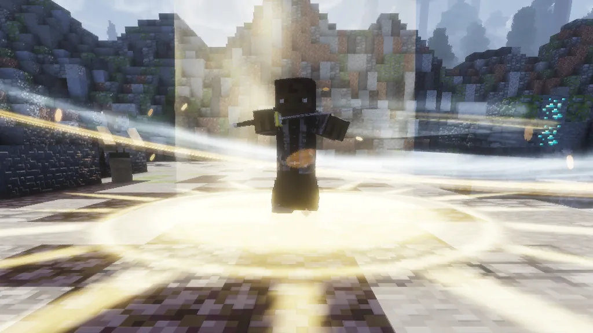

# Rangos del Cuerpo

Subes de rango con <strong>méritos</strong> (lo que haces) y <strong>días de servicio</strong> (lo que juegas). Los dos hacen falta. Cada rango te da más vida y abre un paso de la <strong>Senda del Cazador</strong>.

## La escalera

| Rango | Méritos | Días | Qué estrena |
|---|---|---|---|
| 癸 Mizunoto | 0 | 0 | El primer paso. |
| 壬 Mizunoe | 65 | 1 | Senda: Cuerpo Templado |
| 辛 Kanoto | 165 | 2 | +1 armadura · Senda: Paso Firme · *Destello de caza* |
| 庚 Kanoe | 325 | 3 | Salto de cazador I · **tecla ++z++** · técnica **Paso del Relámpago** · *Estela al esprintar* |
| 己 Tsuchinoto | 520 | 4 | +1 armadura · paso veloz II · Senda: Piel Curtida · *Aura al caminar* |
| 戊 Tsuchinoe | 780 | 5 | Técnica **Torbellino de Acero** |
| 丁 Hinoto | 1.105 | 7 | +1 armadura · paso veloz III · salto II · **tecla ++x++** · Senda: Instinto del Cazador |
| 丙 Hinoe | 1.495 | 9 | Técnica **Tajo del Cielo Partido** |
| 乙 Kinoto | 1.950 | 11 | +1 armadura · paso veloz IV · Senda: Segundo Aliento |
| 甲 Kinoe | 2.600 | 14 | Salto III · **tecla ++c++** · sin daño de caída · técnica **Juicio del Cazador** |
| 柱 Hashira | 3.900 | 18 | +1 armadura · paso veloz V · técnica **Danza del Amanecer** · **despierta la Marca del Cazador** · título «Pilar» |

**Además, cada rango** te da **un corazón más** (un Hashira lleva diez de más), un 3 % más de velocidad, un 3 % más de daño
de tus formas contra demonios, un 3 % menos de espera de las formas y un 5 % más de botín nocturno. Lo que pone «Senda» y
las técnicas son los pasos de la [Senda del Cazador](#la-senda-del-cazador). Las teclas ++z++, ++x++ y ++c++ son para las
técnicas del Cuerpo y las formas de otras respiraciones ([ver](respiraciones.md#las-teclas-z-x-y-c)). Desde **Kinoe**,
**ninguna caída te hace daño** (en el tatami de un duelo, sí: allí los dos sois iguales).

Desde la actualización 1.5, cada rango pide un **30 % más de méritos** que antes. Nadie baja: el rango que ya tienes se queda.

## Días de servicio

- Un **día de servicio** cuenta cuando juegas **30 minutos** dentro del mismo día (hora de España). No hace falta que
  sean días seguidos.
- El tiempo **sin moverte** (ausente) no cuenta.
- Al cumplir uno te avisa: *«☀ Día de servicio cumplido: llevas N días en el Cuerpo…»*.

!!! info "¿Por qué no me suben los méritos?"
    Si ya tienes los méritos del siguiente rango pero te faltan días, tus méritos se quedan en el tope. Lo que ganes
    **una sola vez** (misiones, encargos) se guarda en **reserva** y se te suma al ascender. Lo **repetible** (demonios,
    encargos del día) se pierde mientras estés en el tope. Juega 30 minutos ese día y ascenderás solo.

## Cómo se ganan méritos

| Qué | Méritos |
|---|---|
| Matar un demonio | +1 |
| Matar un demonio con nombre (de noche) | +4 |
| Cobrar un encargo del día | +3 |
| Derrotar al jefe de una Luna de Sangre | +15 |
| Cazar a un jugador demonio con precio | +8 |
| Terminar un encargo | entre 5 y 14 |
| Terminar una cadena de misiones (historia, Pilar, campaña) | entre 8 y 32 |

!!! warning "Morir cuesta méritos"
    Al morir pierdes una parte de los méritos que has ganado desde tu rango: el **15 %** si te mata un demonio jugador y el
    **7 %** si mueres de otra cosa. **Nunca bajas de rango**, y los méritos que ya pagan el siguiente rango (mientras esperas
    tus días de servicio) no se pierden, ni lo que tengas en reserva. [Ver cómo](combate.md#si-mueres).

## Efectos visuales

En **K → Rango** eliges qué efectos llevas: **Destello de caza** (una chispa al derribar un demonio), **Estela al
esprintar** y **Aura al caminar** (que cambia de aspecto en los rangos altos). Y si tu PC va justo, apaga
**«Efectos de los demás»** para no ver las auras de otros jugadores.

<figure markdown="span">
  { loading=lazy }
  <figcaption>K → Rango: méritos, días de servicio, lo que ya te da tu rango, los efectos visuales y, arriba a la derecha, la «✦ Senda del Cazador».</figcaption>
</figure>

## La Senda del Cazador

Cada rango del Cuerpo abre un **paso** de la Senda: cinco **pasivas**, que actúan solas, y cinco **técnicas del Cuerpo**,
movimientos propios con su animación que pones en tus teclas ++z++, ++x++ y ++c++. No se compra ni se elige: llega con el
rango. Lo ves en **K → Rango → «✦ Senda del Cazador»**: el camino de Mizunoe a Hashira, en dorado lo que ya tienes; con un clic
en un paso, qué hace y cuándo se abre.

<figure markdown="span">
  { loading=lazy }
  <figcaption>La Senda de un Tsuchinoe: en dorado, sus cinco primeros pasos; a la derecha, el siguiente y lo que le falta.</figcaption>
</figure>

### Las pasivas

| Rango | Pasiva | Qué hace |
|---|---|---|
| 壬 Mizunoe | **Cuerpo Templado** | Un corazón más por cada rango del Cuerpo: un Hashira lleva diez de más. |
| 辛 Kanoto | **Paso Firme** | Los golpes te empujan menos (+15 % de resistencia al empuje). |
| 己 Tsuchinoto | **Piel Curtida** | +2 de dureza de armadura. |
| 丁 Hinoto | **Instinto del Cazador** | Los golpes de los demonios del mundo (los de la noche y los jefes) te quitan un 10 % menos. |
| 乙 Kinoto | **Segundo Aliento** | Si un demonio te deja por debajo de un cuarto de tu vida, **Regeneración II** durante 5 s (una vez cada 2 minutos). |

El Instinto y el Segundo Aliento solo valen contra los demonios del mundo: no contra un demonio jugador (ni contra lo que
invoca) ni en el dojo.

### Las técnicas del Cuerpo

| Rango | Técnica | Qué hace | Espera |
|---|---|---|---|
| 庚 Kanoe | **Paso del Relámpago** | Te agachas, desapareces y reapareces **nueve bloques** más allá: el rastro de luz corta y frena todo lo que atraviesas. | 14 s |
| 戊 Tsuchinoe | **Torbellino de Acero** | Dos vueltas con la hoja: la primera **atrae** a los que te rodean y la segunda los **despide**. | 16 s |
| 丙 Hinoe | **Tajo del Cielo Partido** | Saltas y caes con la hoja por delante: la onda **abre el suelo** en línea recta (ocho bloques; no atraviesa muros) y levanta lo que pilla. | 18 s |
| 甲 Kinoe | **Juicio del Cazador** | Fijas al enemigo que tienes delante (hasta diez bloques), te lanzas sobre él, **tres cortes cruzados** y un tajo final que lo despide. | 24 s |
| 柱 Hashira | **Danza del Amanecer** | La técnica de los Pilares: giras en el sitio dentro de un **remolino de luz** que arrastra hacia ti lo que alcanza, y lo cierras con un **tajo de sol**. | 45 s |

- Cada tecla se abre con su rango (++z++ en Kanoe, ++x++ en Hinoto y ++c++ en Kinoe) y las tres se comparten con las formas de
  tus otras respiraciones: tres teclas para cinco técnicas, así que eliges. Lo que ya hubiera en esa tecla se sustituye.
- Van como una forma: cada una con su espera (la de la tabla, que baja con tu rango y tu aliento entrenado), los 4 s para
  recuperarte después y nada con la guardia o el escudo arriba ([ver](combate.md#cubrirse-o-atacar)).
- Pegan como las formas: mucho más a los demonios. A un demonio jugador, solo el daño y con los topes del PvP de siempre.

Para ponerlas en una tecla:

<ol class="pasos" markdown>
<li markdown>**Abre la Senda** (K → Rango → «✦ Senda del Cazador») y elige una técnica que ya tengas.</li>
<li markdown>**Pulsa «Poner en Z», «Poner en X» o «Poner en C».** También se ponen en K → Respiración → «Teclas Z · X · C», en «Técnicas del Cuerpo».</li>
<li markdown>**Con tu katana nichirin en la mano principal**, pulsa la tecla.</li>
</ol>

<figure markdown="span">
  { loading=lazy }
  <figcaption>Paso del Relámpago: reapareces más allá y el rastro de luz corta lo que había en medio.</figcaption>
</figure>
<figure markdown="span">
  { loading=lazy }
  <figcaption>Torbellino de Acero: dos vueltas con la hoja.</figcaption>
</figure>
<figure markdown="span">
  { loading=lazy }
  <figcaption>Tajo del Cielo Partido: al caer, la onda abre el suelo en línea recta.</figcaption>
</figure>
<figure markdown="span">
  { loading=lazy }
  <figcaption>Juicio del Cazador: el tajo final, tras los tres cortes cruzados.</figcaption>
</figure>
<figure markdown="span">
  { loading=lazy }
  <figcaption>Danza del Amanecer: el remolino de luz del alba, la técnica de los Pilares.</figcaption>
</figure>

## La Marca del Cazador

Pulsa ++h++: durante **20 segundos** recibes **Regeneración II**. Después necesita **2 minutos** de descanso. Despierta en el
rango más alto, **Hashira**, y al llegar te lo dice el chat: *«La Marca del Cazador ya es tuya: despiértala con la tecla H.»*
Antes de Hashira: *«La Marca del Cazador despierta en el rango Hashira. Todavía no.»* (antes de la actualización 1.4
despertaba en Kinoe).

- **Con un rango VIP del Cuerpo** (los cinco Pilares, La Bestia, Ceniza Oscura u Oscuridad Carmesí) es tuya **con cualquier
  rango**, y trae además el poder de tu pilar: [la marca de cada pilar](../vip.md#la-marca-de-cada-pilar).
- **En el tatami del dojo no despierta**: *«En el tatami la Marca duerme: los dos pelean igualados.»*
- Lo que esa tecla daba antes con algunas hojas en cualquier rango (pegabas solo y desviabas lo que te tiraban) ya no le
  sale a nadie.

!!! demonio "Si te conviertes en demonio"
    Tu rango del Cuerpo se queda **congelado** (no lo pierdes). Mientras seas demonio no ganas méritos ni tienes sus
    ventajas (tampoco la Senda ni la Marca); si vuelves a ser humano, lo recuperas tal cual.
