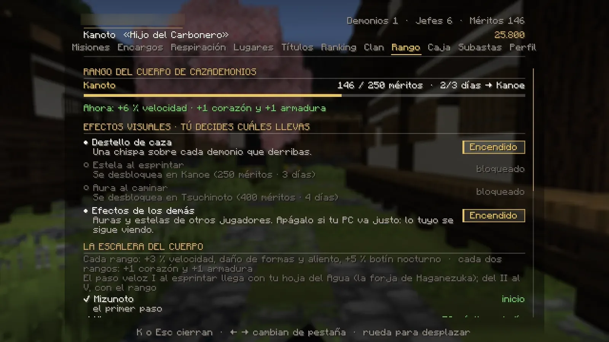

# Rangos del Cuerpo

Subes de rango con <strong>méritos</strong> (lo que haces) y <strong>días de servicio</strong> (lo que juegas). Los dos hacen falta.

## La escalera

| Rango | Méritos | Días | Qué estrena |
|---|---|---|---|
| 癸 Mizunoto | 0 | 0 | El primer paso. |
| 壬 Mizunoe | 50 | 1 | — |
| 辛 Kanoto | 125 | 2 | +1 corazón y +1 armadura · *Destello de caza* |
| 庚 Kanoe | 250 | 3 | Salto de cazador I · *Estela al esprintar* · **tecla ++z++** |
| 己 Tsuchinoto | 400 | 4 | +1 corazón y +1 armadura · paso veloz II · *Aura al caminar* |
| 戊 Tsuchinoe | 600 | 5 | — |
| 丁 Hinoto | 850 | 7 | +1 corazón y +1 armadura · paso veloz III · salto II · **tecla ++x++** |
| 丙 Hinoe | 1.150 | 9 | — |
| 乙 Kinoto | 1.500 | 11 | +1 corazón y +1 armadura · paso veloz IV |
| 甲 Kinoe | 2.000 | 14 | Salto III · **despierta la Marca del Cazador** · **tecla ++c++** · sin daño de caída |
| 柱 Hashira | 3.000 | 18 | +1 corazón y +1 armadura · paso veloz V · título «Pilar» |

**Además, cada rango** te da un 3 % más de velocidad, un 3 % más de daño de tus formas contra demonios, un 3 % menos de
espera de las formas y un 5 % más de botín nocturno. Las teclas ++z++, ++x++ y ++c++ son para formas de otras respiraciones
([ver](respiraciones.md#las-teclas-z-x-y-c)).

## Días de servicio

- Un **día de servicio** cuenta cuando juegas **30 minutos** dentro del mismo día (hora de España). No hace falta que
  sean días seguidos.
- El tiempo **sin moverte** (ausente) no cuenta.
- Al cumplir uno te avisa: *«☀ Día de servicio cumplido: llevas N días en el Cuerpo…»*.

!!! info "¿Por qué no me suben los méritos?"
    Si ya tienes los méritos del siguiente rango pero te faltan días, tus méritos se quedan en el tope. Lo que ganes
    **una sola vez** (misiones, encargos) se guarda en **reserva** y se te suma al ascender. Lo **repetible** (demonios,
    encargos del día) se pierde mientras estés en el tope. Juega 30 minutos ese día y ascenderás solo.

## Cómo se ganan méritos

| Qué | Méritos |
|---|---|
| Matar un demonio | +1 |
| Matar un demonio con nombre (de noche) | +4 |
| Cobrar un encargo del día | +3 |
| Derrotar al jefe de una Luna de Sangre | +15 |
| Cazar a un jugador demonio con precio | +8 |
| Terminar un encargo | entre 5 y 14 |
| Terminar una cadena de misiones (historia, Pilar, campaña) | entre 8 y 32 |

!!! warning "Morir cuesta méritos"
    Al morir pierdes una parte de los méritos que has ganado desde tu rango: el **15 %** si te mata un demonio jugador y el
    **7 %** si mueres de otra cosa. **Nunca bajas de rango**, y los méritos que ya pagan el siguiente rango (mientras esperas
    tus días de servicio) no se pierden, ni lo que tengas en reserva. [Ver cómo](combate.md#si-mueres).

## Efectos visuales

En **K → Rango** eliges qué efectos llevas: **Destello de caza** (una chispa al derribar un demonio), **Estela al
esprintar** y **Aura al caminar** (que cambia de aspecto en los rangos altos). Y si tu PC va justo, apaga
**«Efectos de los demás»** para no ver las auras de otros jugadores.

<figure markdown="span">
  { loading=lazy }
  <figcaption>K → Rango: méritos, días de servicio, ventajas de ahora, efectos visuales y la escalera completa.</figcaption>
</figure>

## La Marca del Cazador

Desde el rango **Kinoe**, pulsa ++h++: durante **20 segundos** recibes **Regeneración II**. Después necesita
**2 minutos** de descanso. Antes de Kinoe: *«La Marca del Cazador despierta en el rango Kinoe. Todavía no.»*

Desde **Kinoe**, además, **ninguna caída te hace daño** (en el tatami de un duelo, sí: allí los dos sois iguales).

!!! demonio "Si te conviertes en demonio"
    Tu rango del Cuerpo se queda **congelado** (no lo pierdes). Mientras seas demonio no ganas méritos ni tienes sus
    ventajas; si vuelves a ser humano, lo recuperas tal cual.
