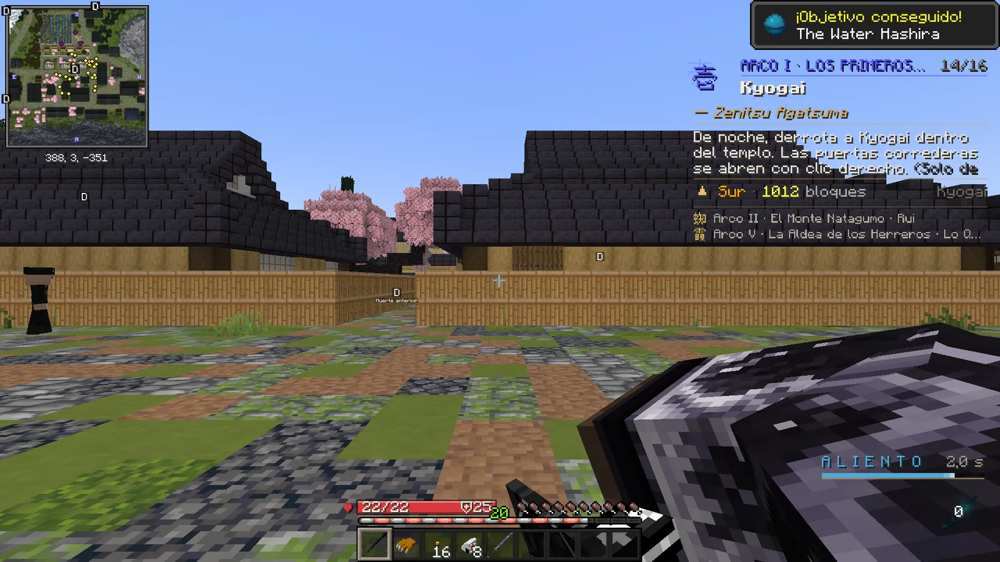

# Respiraciones y formas

La respiración es tuya, no de la katana. Tienes una <strong>activa</strong> y cada respiración tiene sus <strong>formas</strong>: las técnicas que lanzas en combate.

## Cómo se lanza una forma

<ol class="pasos" markdown>
<li markdown>**Coge tu katana nichirin en la mano principal** (la derecha). Con la katana en la otra mano no sale nada.</li>
<li markdown>**Elige la forma con ++r++** (++shift+r++ para volver a la anterior). Abajo aparece cuál tienes elegida y qué le falta a la siguiente.</li>
<li markdown>**Clic derecho** para lanzarla.</li>
<li markdown>**Espera a recuperar el aliento**: la barra «ALIENTO» de abajo a la derecha cuenta los segundos hasta que pone **LISTO**.</li>
</ol>

<figure markdown="span">
  { loading=lazy }
  <figcaption>La 1ª forma del Agua. Abajo a la derecha, la barra del aliento ya cuenta la espera.</figcaption>
</figure>

!!! info "Si la forma no llega a salir, no gastas aliento"
    Si estabas a mitad de otro movimiento, el servidor lo detecta: *«La forma no ha salido… no has gastado aliento»*.
    Con un combo a medias, el clic derecho se guarda y la forma sale al terminar el golpe.

## El aliento

- Es **un solo reloj para ti**, no uno por katana: cada forma lo vacía durante su espera.
- Cada forma tiene su espera; las más altas, más larga.
- La espera **baja** con tu **rango del Cuerpo** (un 3 % por rango), con tu **nivel de aliento** (hasta un 50 % menos,
  [entrenando](entrenamiento.md)) y si tu katana **resuena** con tu respiración (un 10 % menos).
- Salir y volver a entrar no la recupera.

<figure markdown="span">
  { loading=lazy }
  <figcaption>La barra del aliento (abajo a la derecha) solo se ve con una katana nichirin en la mano.</figcaption>
</figure>

## Cómo se abren las formas

Las formas de cada respiración van **en orden**: la primera que no cumples cierra todas las siguientes. Lo que puede
pedir cada una:

| Requisito | Qué significa |
|---|---|
| **Un paso de misión** | Se abre al completar ese paso de la historia de su maestro. |
| **Cacerías** | Demonios y jefes que hayas matado tú (las arañas del Monte Natagumo no cuentan). |
| **Días de servicio** | A partir de la 4ª forma. Un día cuenta cuando juegas 30 minutos en el mismo día. |
| **Maestría** | La última forma del Agua, la Llama y la Niebla se aprende con un Pilar. |
| **Rango de apoyo** | Desde la **7ª** forma de cada lista hace falta un [rango VIP](../vip.md) (cualquiera menos el Amanecer, que es solo de aspecto). |

En **K → Respiración** ves el estado de cada forma: **bloqueada**, **disponible** (y lo que le falta, por ejemplo
*45/60 cacerías*), **desbloqueada**, **elegida** («En tu hoja») o **activa** («En curso»).

<figure markdown="span">
  { loading=lazy }
  <figcaption>K → Respiración: el árbol con todas las respiraciones. A la derecha, la elegida con sus formas y lo que le falta a cada una.</figcaption>
</figure>

## Las respiraciones

Tu **primera respiración** es la del **Agua**, que te enseña tu maestro. Las demás te las enseñan los **Pilares** y
otros maestros en sus propias misiones. En K → Respiración, cada una dice quién la enseña y dónde buscarle.

| Respiración | Formas | | Respiración | Formas |
|---|---|---|---|---|
| 水 Agua | 11 | | 風 Viento | 9 |
| 雷 Trueno | 6 | | 岩 Roca | 5 |
| 雷 Trueno: Estilo de Zenitsu | 5 | | 獣 Bestia | 6 |
| 炎 Llama | 6 | | 花 Flor | 4 |
| 音 Sonido | 3 | | 神 Hinokami Kagura | 12 |
| 霞 Niebla | 7 | | 日 Sol | 13 |
| 恋 Amor | 5 | | 灰 Ceniza *(rango Ceniza Oscura)* | 5 |
| 蟲 Insecto | 4 | | 紅 Oscuridad Carmesí *(rango Oscuridad Carmesí)* | 5 |
| 蛇 Serpiente | 5 | | | |

!!! cazador "Algunas misiones piden una respiración concreta"
    Si una misión está bloqueada porque te falta una respiración, la K te dice cuál y quién te la enseña. Las
    respiraciones que te presta un rango VIP **no cuentan** para esos requisitos: hay que aprenderlas.

## Cambiar de respiración activa

1. **K → Respiración** y elige la que quieras en el árbol.
2. Pulsa **«Activar esta respiración»** (o ++enter++).

- Entre un cambio y otro hay que esperar **2 minutos**. En un duelo no se puede cambiar.
- **No pierdes nada**: tus formas de cada respiración se quedan como estaban.
- Tu katana se sigue viendo igual: por dentro pasa a ser la hoja de tu nueva respiración.

!!! tip "Trucos"
    - Si tu katana **resuena** con tu respiración (lo pone en su descripción: *«Resuena con: …»*), sus formas esperan un 10 % menos.
    - Las técnicas **no dañan** a los personajes del servidor, a los aldeanos ni a la decoración: puedes usarlas en la ciudad sin miedo.
    - Un **demonio no respira**: con una katana en la mano solo corta.
