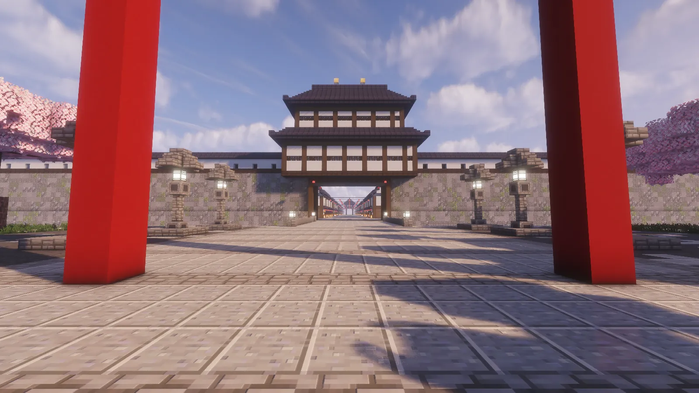
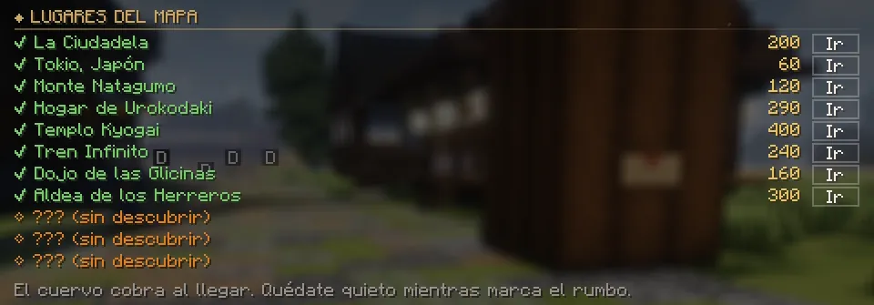
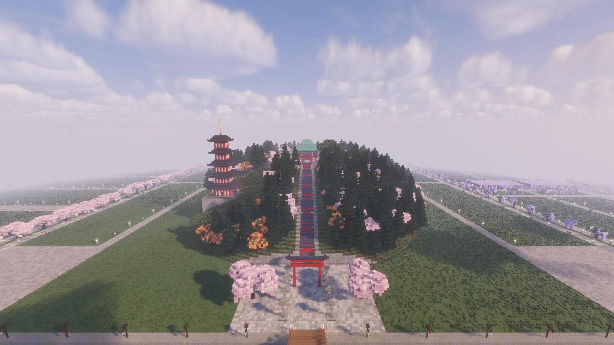
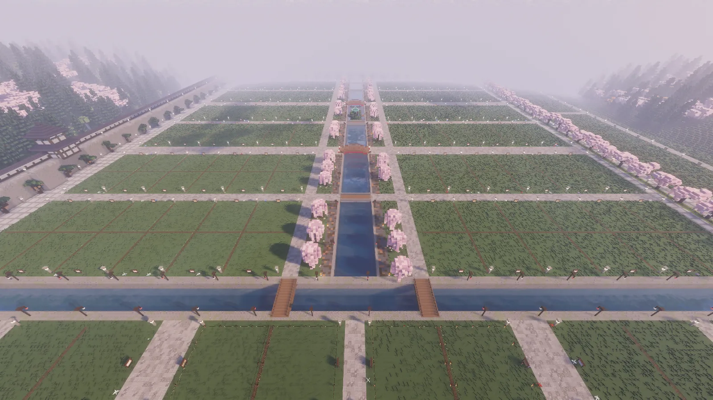
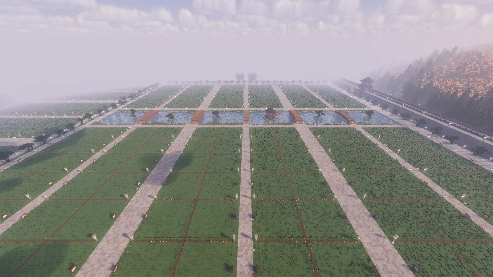
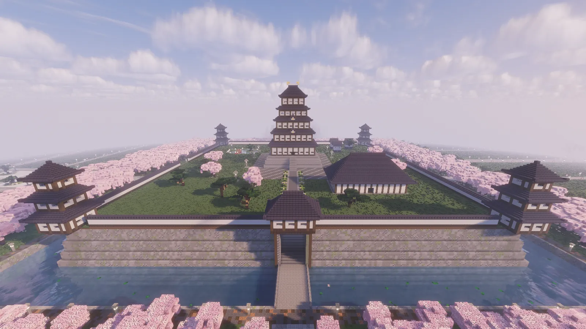
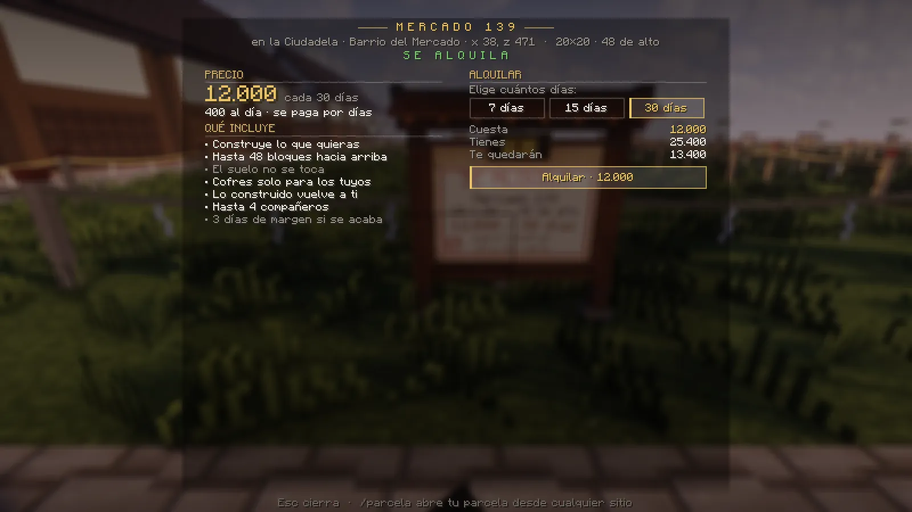
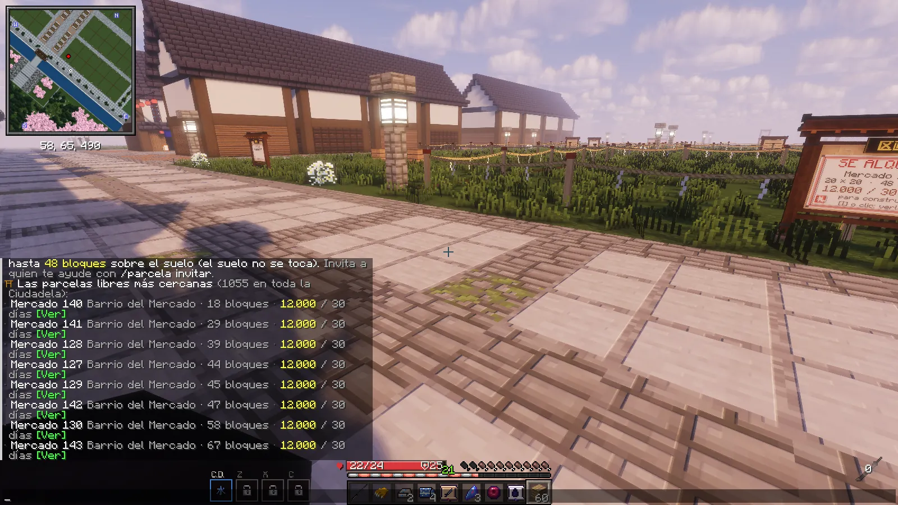
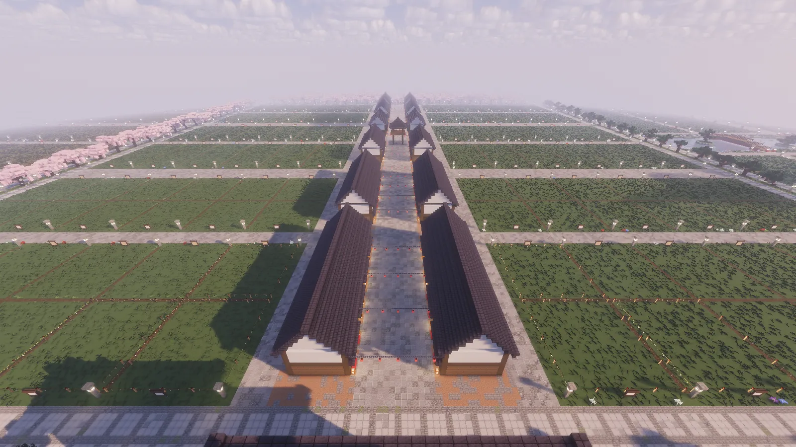

# La Ciudadela

Un mundo aparte: una gran ciudad japonesa amurallada con <strong>1056 parcelas</strong> de 20 × 20 para construir tu casa y un <strong>Mercado</strong> donde trabajar. Es una ciudad libre de daños: allí nada te ataca y nadie te puede herir.

<figure markdown="span">
  { loading=lazy }
  <figcaption>La llegada: la Gran Puerta, con la calle del Mercado al fondo.</figcaption>
</figure>

## Cómo se va

No hay que desbloquear nada: está abierta a todos, cazadores y demonios, desde el principio.

<ol class="pasos" markdown>
<li markdown>**K → Lugares → La Ciudadela → Ir.** Sale la primera de la lista. También vale escribir **`/ciudadela`**.</li>
<li markdown>**Quédate quieto 3 segundos** mientras el cuervo marca el rumbo, como en cualquier [viaje](../mundo/viajar.md).</li>
<li markdown>**Llegas a la Gran Puerta**, mirando a la ciudad, y se te cobra el viaje.</li>
</ol>

<figure markdown="span">
  { loading=lazy }
  <figcaption>K → Lugares: la Ciudadela, la primera, con su precio y el botón Ir.</figcaption>
</figure>

- Cada viaje entre los dos mundos cuesta **200**, a la ida y a la vuelta (con un [rango VIP](../vip.md), la mitad).
- Las reglas de siempre: **45 segundos** entre un viaje y otro, nada de viajar recién golpeado ni con la
  [marca de combate](../cazador/combate.md#la-marca-de-combate), y si aún no tienes cuervo te lleva un arriero.
- **Para volver**, **`/ciudadela salir`** (a Tokio) o K → Lugares → cualquier lugar del mundo normal: desde la Ciudadela todos
  cuestan lo mismo, 200. Estando dentro, la Ciudadela no sale en la lista.

!!! demonio "Los demonios también van"
    Con la **biwa de Nakime**, de noche, como a cualquier sitio. Si Nakime aún no te ha abierto su puerta, te lleva el **carro de un
    arriero**, también solo de noche (de día, solo si el sol ya no te quema): escribe `/ciudadela`, porque sin la biwa tu K no tiene
    botones (te sale «La Ciudadela · /ciudadela»). Dentro el sol no quema: un demonio construye también de día.

## Una ciudad libre de daños

- **Nadie recibe daño** dentro: ni de otro jugador, ni de una criatura, ni del fuego, el agua, el hambre o una caída mientras
  construyes.
- **No entra nada hostil**: ni monstruos, ni los demonios y los cazadores de la noche. Las mascotas y los personajes, sí.
- Es una [zona segura](../mundo/noche.md#zonas-seguras): las técnicas no hacen efecto sobre nadie y el PvP de una parcela no se
  puede poner.
- Ni la noche de los demonios, ni las patrullas, ni la Luna de Sangre, ni los jefes de las misiones llegan aquí.
- Si te sales por el borde de la ciudad o caes por debajo del suelo, vuelves a tu último sitio seguro.

## Los barrios

Una muralla con foso rodea nueve barrios, separados por avenidas. Al cruzar la Gran Puerta, la calle de los farolillos rojos
que tienes delante es la del **[Mercado](oficios.md)**.

| Barrio | Qué tiene | Parcelas |
|---|---|---|
| **Cerezo** | El canal de los cerezos | 144 |
| **Santuario** | La colina de los mil torii, el santuario y la pagoda | 48 |
| **Glicina** | Las cúpulas de glicinas | 144 |
| **Pino** | El jardín zen y su templo | 144 |
| **El Castillo** | El castillo de cinco pisos en el centro, con su foso y sus jardines | — |
| **Bambú** | El bosque de bambú | 144 |
| **Arce** | Los arces rojos y la cascada | 144 |
| **Mercado** | La calle de los puestos y las tiendas | 144 |
| **Lago** | El lago, el pabellón y los puentes | 144 |

<figure markdown="span">
  { loading=lazy }
  <figcaption>Santuario: la colina de los mil torii y la pagoda.</figcaption>
</figure>
<figure markdown="span">
  { loading=lazy }
  <figcaption>Cerezo: el canal y sus puentes.</figcaption>
</figure>
<figure markdown="span">
  { loading=lazy }
  <figcaption>Lago: el pabellón y los puentes.</figcaption>
</figure>
<figure markdown="span">
  { loading=lazy }
  <figcaption>El Castillo, en el centro de la ciudad.</figcaption>
</figure>

## Alquilar una parcela

Son [parcelas para construir](../economia/casas.md#parcelas-para-construir) como las del mundo normal, con las mismas reglas:

- **20 × 20 bloques y 48 de alto**, para construir lo que quieras desde cero. El suelo no se toca.
- **12.000 cada 30 días** (400 al día), por días reales, con pago automático, 3 días de mora y hasta 4 compañeros.
- Se reconocen por su **valla de estacas** con la cuerda de paja. Junto al borde está su **cartel**: «SE ALQUILA», su nombre,
  el tamaño y el precio. Clic derecho en el cartel (o la **I** junto a él), eliges **7, 15 o 30 días** y **Alquilar**.
- **`/ciudadela libres`**: dentro de la Ciudadela, las 8 libres más cercanas con su botón **[Ver]**; fuera, cuántas quedan en cada
  barrio. Dentro, `/parcela lista` hace lo mismo.
- **Una parcela por jugador entre los dos mundos**: si ya tienes una en el mundo normal, no puedes alquilar otra en la Ciudadela.
  Tu casa no cuenta: puedes tener una casa y una parcela.
- Tu parcela de la Ciudadela se lleva con **`/parcela`**, como cualquier otra. **`/parcela ir`** te lleva hasta ella con el
  cuervo (desde el mundo normal, 200).

<figure markdown="span">
  { loading=lazy }
  <figcaption>El cartel de una parcela libre: su barrio, su tamaño y los días que quieres pagar.</figcaption>
</figure>
<figure markdown="span">
  { loading=lazy }
  <figcaption><code>/ciudadela libres</code>: las más cercanas, con su botón [Ver].</figcaption>
</figure>

<figure markdown="span">
  { loading=lazy }
  <figcaption>Las parcelas a los dos lados de la calle del Mercado.</figcaption>
</figure>

## El Mercado y sus oficios

En la calle del Mercado hay **20 puestos** donde trabajar: cocina ramen, pan, té y dulces para los clientes, o haz recados
llevando cajas a las tiendas. Y si en un puesto cocina otro jugador, puedes pedirle un plato. [Ver los oficios](oficios.md).
