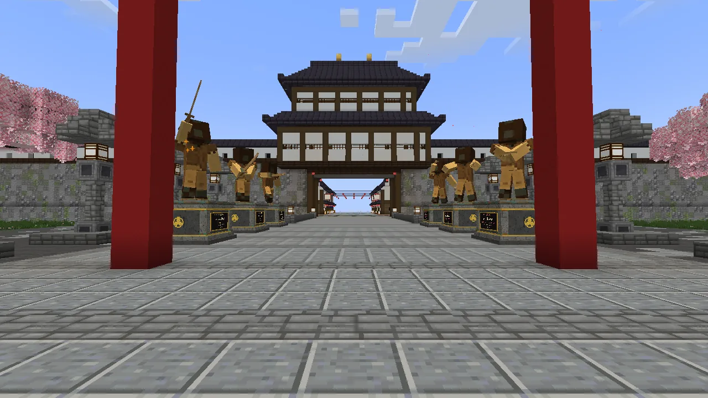
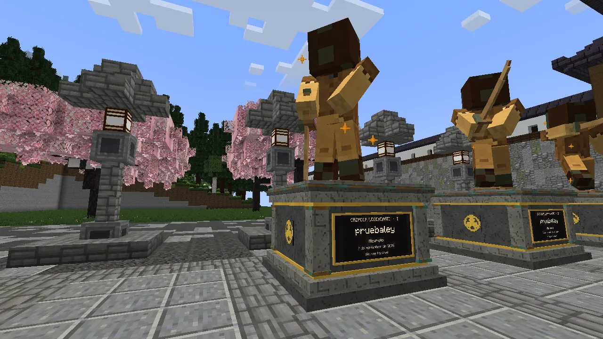
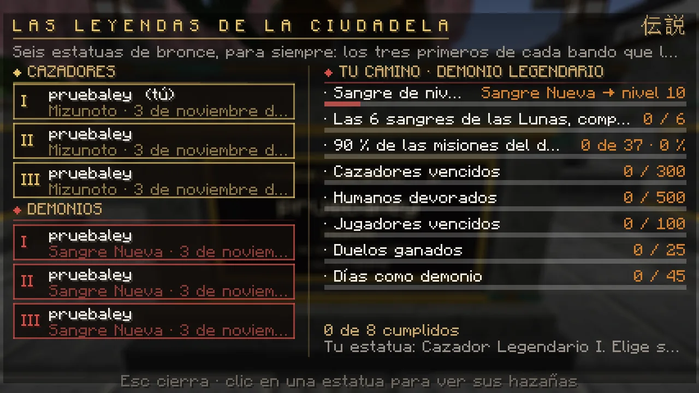
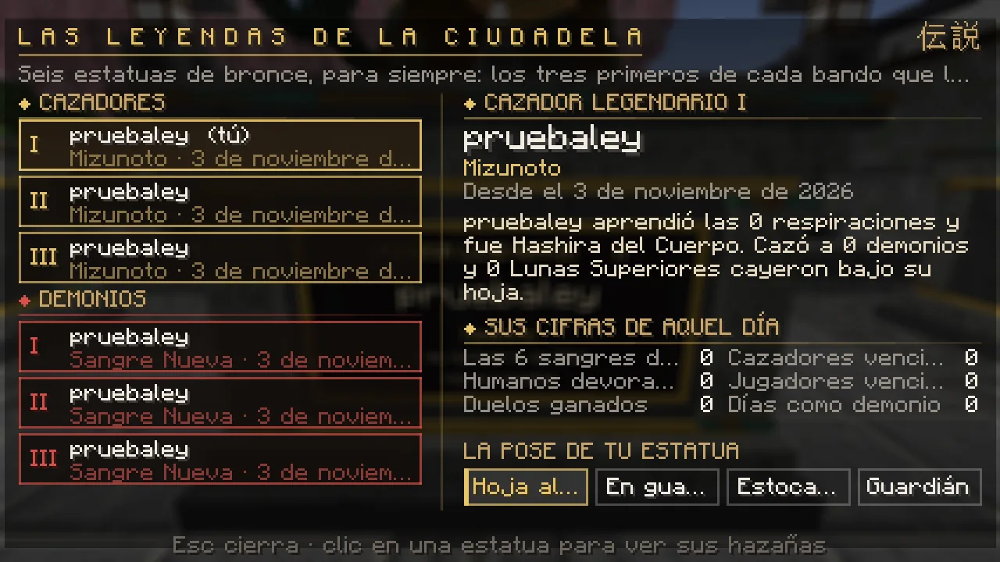
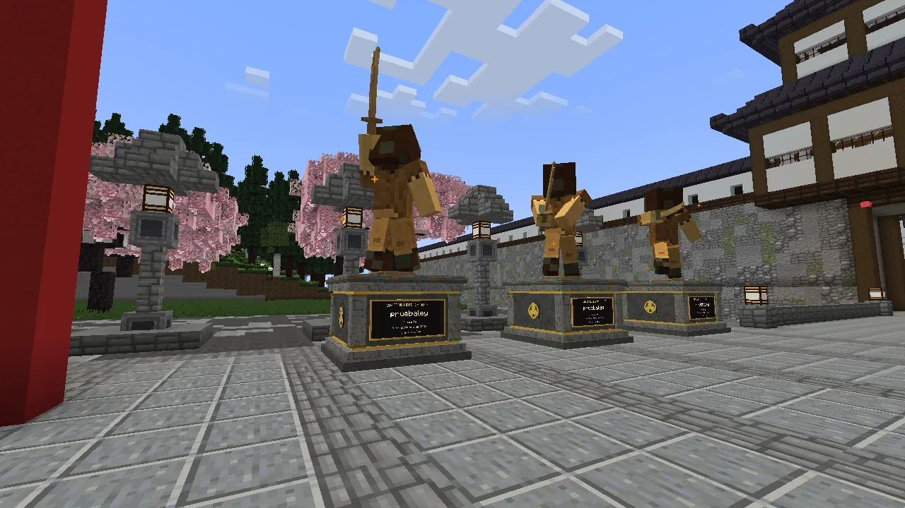
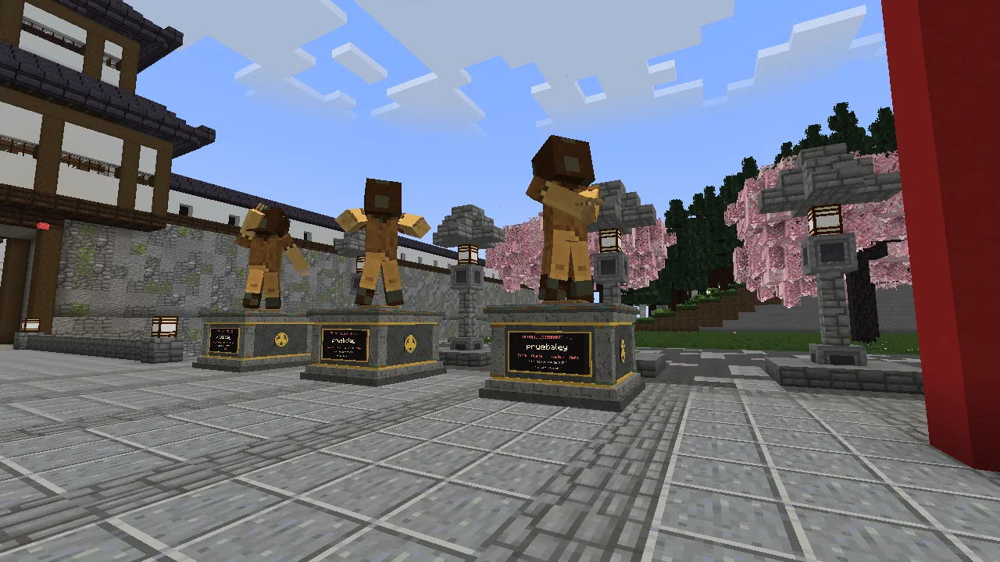

# Las Leyendas de la Ciudadela

A la entrada de la Ciudadela, entre el gran torii y el puente del foso, hay seis pedestales: tres para los cazadores y tres para los demonios. Solo los <strong>seis primeros</strong> que lo consigan todo tendrán ahí su estatua de bronce. <strong>Para siempre.</strong>

<figure markdown="span">
  { loading=lazy }
  <figcaption>Nada más llegar a la Ciudadela: los cazadores a la izquierda, los demonios a la derecha.</figcaption>
</figure>
<figure markdown="span">
  { loading=lazy }
  <figcaption>Cada estatua lleva tu skin en bronce, al doble de tu tamaño, y una placa con tu nombre.</figcaption>
</figure>

## Qué es

- **Seis puestos:** Cazador Legendario I, II y III y Demonio Legendario I, II y III.
- **El primero de cada bando** que cumpla todo lo de abajo se queda con el primer puesto libre de su lado, en ese mismo momento. Cuando los tres
  de un lado tienen dueño, ese lado se cierra.
- **Tu estatua:** tu skin de ese día en bronce, al doble de tu tamaño, en la pose que elijas. En la placa, tu título, tu nombre, tu rango (con tu
  respiración o tu sangre) y la fecha. Se queda aunque cambies de nombre, de skin o de bando.
- **Y además:** el título **«Cazador Legendario»** (o **«Demonio Legendario»**), un anuncio a todo el servidor y una ceremonia: el velo que
  cubre tu pedestal sube al cielo y aparece tu estatua.

## Lo que hace falta

=== "Cazador"

    | Requisito | Cuánto |
    |---|---|
    | Rango | **Hashira** |
    | Respiraciones | **todas** las que se aprenden (15) |
    | Maestrías | **las tres** (Agua, Llama y Niebla) |
    | Misiones | el **90 %** de las del Cuerpo |
    | Demonios cazados | **4000** |
    | Jefes vencidos | **50** |
    | Lunas Superiores vencidas | **18** |
    | Jugadores vencidos | **150** |
    | Duelos ganados | **50** |
    | Días de servicio | **30** |

=== "Demonio"

    | Requisito | Cuánto |
    |---|---|
    | Sangre | **nivel 10** |
    | Sangres | **las seis sangres de las Lunas**, completas (el [Árbol de la Sangre](../demonio/index.md)) |
    | Misiones | el **90 %** de las del demonio |
    | Cazadores vencidos | **150** |
    | Humanos devorados | **2000** |
    | Jugadores vencidos | **300** |
    | Duelos ganados | **50** |
    | Días como demonio | **30** |

Las misiones que cuentan son las de tu bando, sin las secretas, las de la cura y los sucesos. **No hace falta hacer nada más:** el servidor lo mira
solo cada poco rato. El personal del servidor no gana puestos.

## El Salón de las Leyendas

Con **`/leyendas`** o con **clic derecho en cualquier pedestal** se abre el Salón:

- **A la izquierda**, los seis puestos: de quién es cada uno y desde cuándo, o si sigue libre.
- **A la derecha, tu camino:** cada requisito con lo que llevas y su barra. Lo que ya tienes sale en verde.
- **Pincha una estatua** para ver su historia y las cifras que tenía el día que la ganó.
- **Si la estatua es tuya**, aquí eliges su pose: *Al cielo*, *Guardia*, *Estocada* o *Guardián* si eres cazador; *Soberano*, *Garras*,
  *Furia* o *Acecho* si eres demonio.

<figure markdown="span">
  { loading=lazy }
  <figcaption>El Salón: los seis puestos y lo que te falta, fila a fila.</figcaption>
</figure>
<figure markdown="span">
  { loading=lazy }
  <figcaption>La historia de una estatua y, si es la tuya, su pose.</figcaption>
</figure>

<figure markdown="span">
  { loading=lazy }
  <figcaption>Los cazadores: la katana al cielo, en guardia y la estocada.</figcaption>
</figure>
<figure markdown="span">
  { loading=lazy }
  <figcaption>Los demonios: el soberano, las garras y la furia.</figcaption>
</figure>

## Cómo llegar

Están en la **plaza de llegada de la [Ciudadela](index.md)**: **K → Lugares → La Ciudadela** (o `/ciudadela`) y, nada más llegar, delante de
ti, al pasar el gran torii. De noche, cada pedestal ilumina su estatua.

??? question "¿Y si cambio de skin después?"
    La estatua guarda la skin que llevabas el día que la ganaste. Si quieres que lleve la de ahora, pídeselo al personal estando conectado.

??? question "¿Se puede perder el puesto?"
    No. Es para siempre.
