# Los oficios del Mercado

En la calle del Mercado de la <a href="../">Ciudadela</a> hay <strong>20 puestos</strong> donde trabajar: cuatro cocinas y las oficinas de recados. Cocinas para los clientes con el teclado y el ratón, cobras por cada plato y subes de nivel. Cazadores y demonios.

<figure markdown="span">
  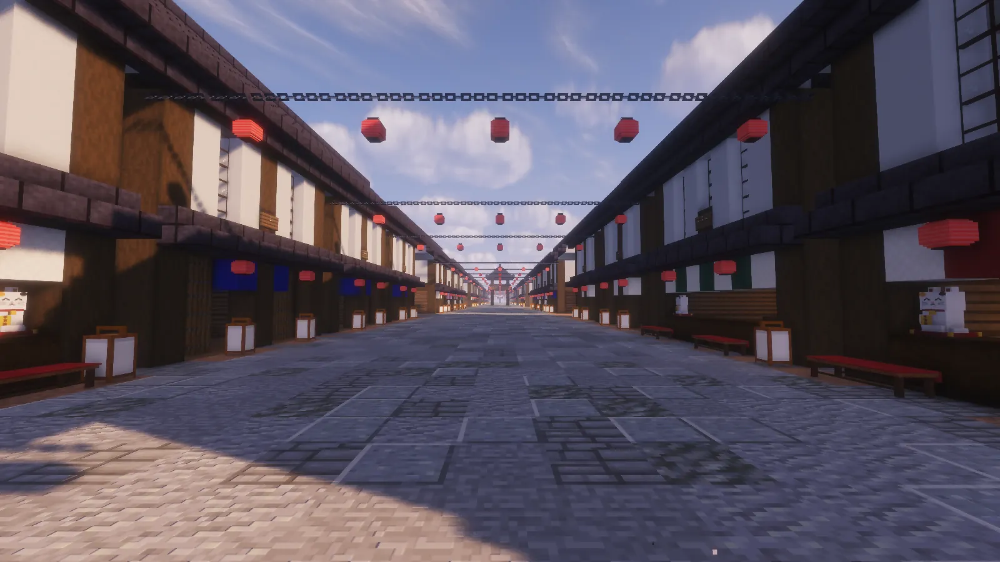{ loading=lazy }
  <figcaption>La calle del Mercado: los puestos, con su mostrador abierto a la calle, a los dos lados.</figcaption>
</figure>

## Los puestos

Al cruzar la Gran Puerta de la Ciudadela, la calle de los farolillos rojos que tienes delante es la del Mercado. Cada puesto
tiene su **mostrador abierto a la calle**, con la cortina (el noren) del color de su oficio.

| Oficio | Puestos | Qué se hace |
|---|---|---|
| 麺 **Fideos** | 4 | Ramen: cocer los fideos, echar el caldo y poner los ingredientes |
| パン **Panadería** | 3 | Amasar, rellenar y hornear (el pan se dora de verdad en la bandeja) |
| 茶 **Casa de Té** | 4 | Calentar el agua, infusionar y batir el matcha |
| 菓子 **Dulces** | 6 | Dango, daifuku, taiyaki y mochi: el mazo, el relleno, el molde |
| 使い **Recados** | 3 | Llevar pilas de cajas a las tiendas de la calle sin que se caigan |

## Empezar un turno

<ol class="pasos" markdown>
<li markdown>**Clic derecho al mostrador** de un puesto donde no trabaje nadie, desde la calle. Se abre su **panel**: tu nivel y tu rango en ese oficio, lo que llevas ganado hoy, el oficio del día, las recetas que sabes hacer (con lo que pagan) y los mejores de la semana.</li>
<li markdown>**Empezar el turno.** Te pone detrás del mostrador, mirando a la calle.</li>
<li markdown>**Llegan los clientes**, andando por la calle (uno cada pocos segundos, como mucho tres a la vez). Al llegar piden: su plato flota encima de su cabeza con un anillo de **paciencia** que se va vaciando.</li>
<li markdown>**Elige un pedido** de la cola de abajo con su número (++1++, ++2++, ++3++) o con un clic, y cocínalo. Mientras cocinas, la paciencia de ese cliente se para.</li>
<li markdown>**Acaba cuando quieras** con ++esc++ (te pregunta) o `/oficios dejar`. Vuelves a la calle, delante del mostrador.</li>
</ol>

<figure markdown="span">
  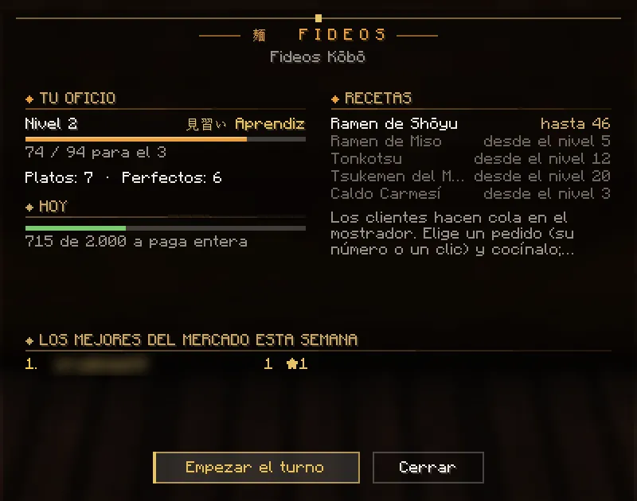{ loading=lazy }
  <figcaption>El panel: tu nivel, lo de hoy, las recetas y los mejores de la semana.</figcaption>
</figure>
<figure markdown="span">
  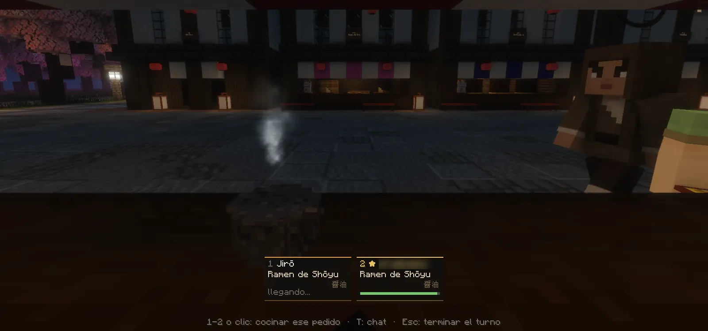{ loading=lazy }
  <figcaption>El turno: la cola abajo (en dorado, el pedido de un jugador).</figcaption>
</figure>

- El turno también acaba si **se te van tres clientes seguidos** enfadados, si sales del juego o si dejas la Ciudadela.
- Si alguien ya trabaja en un puesto, su mostrador te enseña su **[carta](#el-restaurante-pedirle-a-otro-jugador)**: busca otro
  puesto libre del mismo oficio.
- De noche, a veces, llega un **demonio** que pide un plato de sangre (lo sabes hacer desde el nivel 3).

!!! warning "Si al darle al mostrador no se abre nada"
    Tu juego tiene el pack de antes de la 1.6. Cierra Minecraft del todo y ábrelo con el
    [launcher](../empezar/index.md): se actualiza solo. Si juegas con otro launcher, baja el modpack nuevo.

## Cocinar

Cada receta son de **3 a 5 pasos**, y cada paso es uno de estos cinco juegos. Arriba ves la receta, los pasos que llevas y para
quién es; abajo, lo que hay que hacer.

| Juego | Qué haces | Por ejemplo |
|---|---|---|
| **Punto** | ++space++ (o clic) cuando la marca que va y viene está en la franja | cocer los fideos, hornear, calentar el agua |
| **Llenar** | Mantén ++space++ y suelta en la raya; si te pasas, se derrama | el caldo, el relleno, infusionar el té |
| **Secuencia** | Las teclas ++w++ ++a++ ++s++ ++d++ que salen, en orden (cada una es un ingrediente) | los ingredientes del ramen, servir el té |
| **Ritmo** | ++a++ y ++d++ por turnos (o ++space++), cuando la nota llega a la línea dorada | amasar, machacar el mochi con el mazo |
| **Batir** | El ratón en círculos, a la velocidad justa (las vueltas por segundo, en la franja) | el matcha, teñir el mochi de sakura |

Cuanto más alto es tu nivel y más difícil la receta, más estrechas son las franjas, más rápidas las marcas y más teclas salen.
Mientras cocinas, en el mostrador se ve todo de verdad (la olla, el caldo que sube, el pan que se dora o se quema, la espuma del
matcha), y los demás jugadores lo ven desde la calle.

<figure markdown="span">
  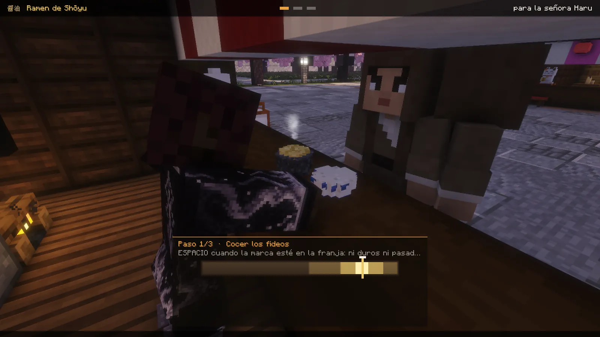{ loading=lazy }
  <figcaption>Punto: cocer los fideos, ni duros ni pasados.</figcaption>
</figure>
<figure markdown="span">
  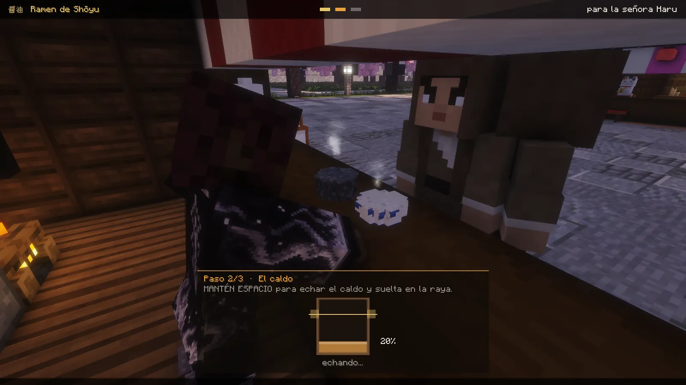{ loading=lazy }
  <figcaption>Llenar: el caldo, hasta la raya.</figcaption>
</figure>
<figure markdown="span">
  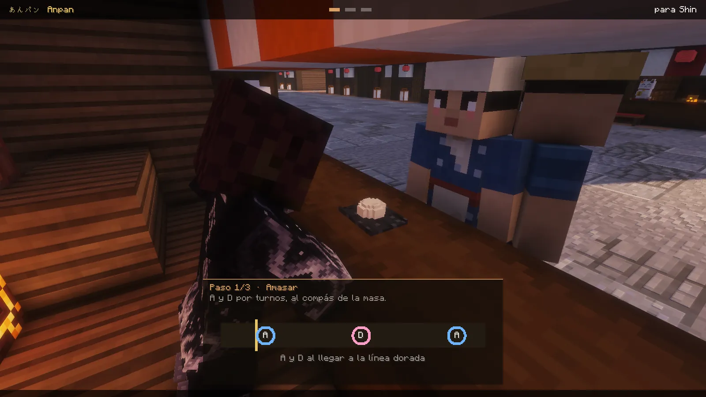{ loading=lazy }
  <figcaption>Ritmo: amasar, A y D al compás.</figcaption>
</figure>
<figure markdown="span">
  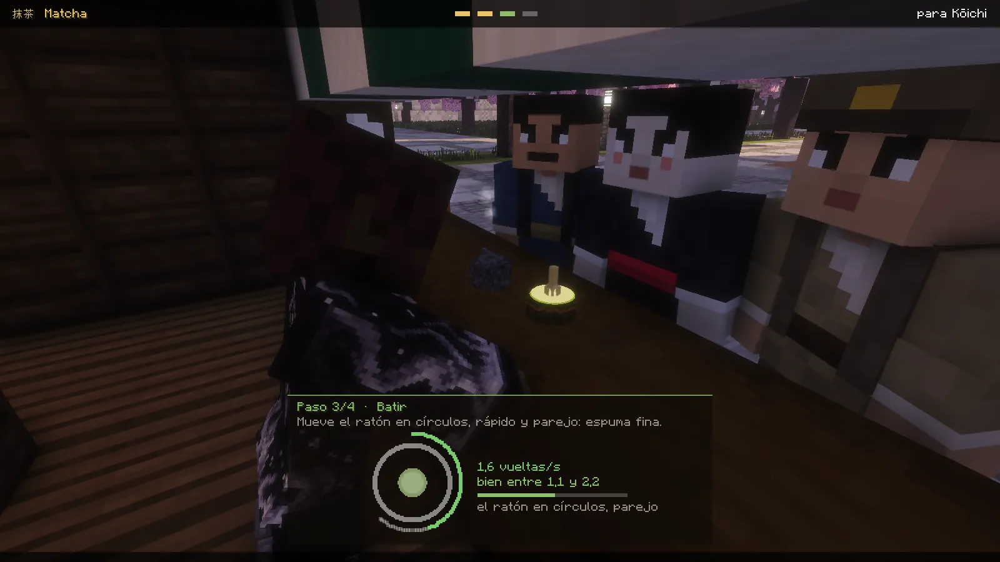{ loading=lazy }
  <figcaption>Batir: el ratón en círculos, parejo.</figcaption>
</figure>
<figure markdown="span">
  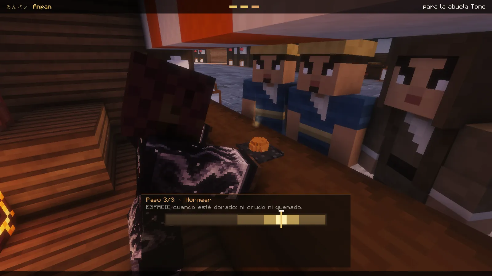{ loading=lazy }
  <figcaption>Hornear: espacio cuando esté dorado, ni crudo ni quemado.</figcaption>
</figure>
<figure markdown="span">
  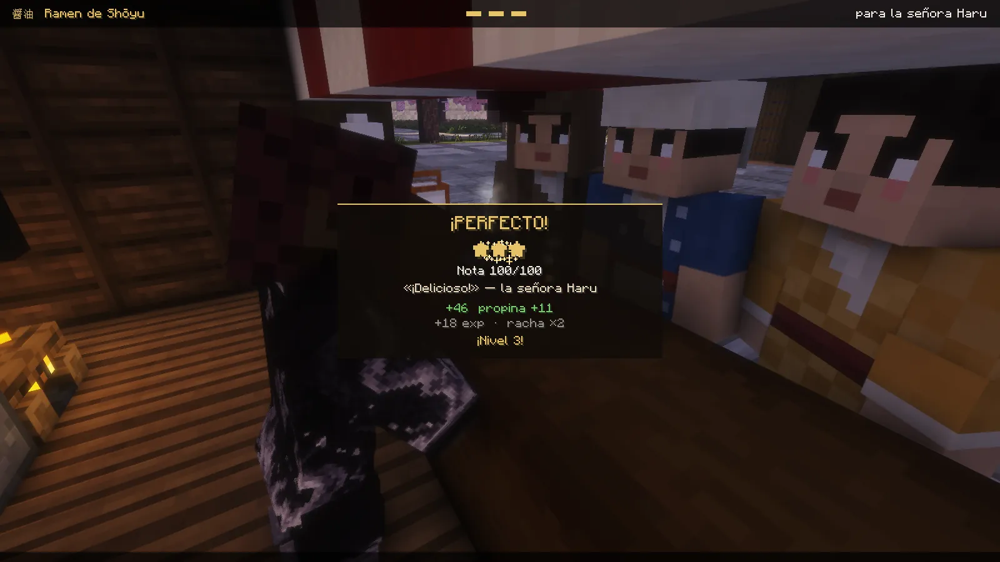{ loading=lazy }
  <figcaption>Al servir: las estrellas, la nota, lo que dice el cliente, la paga y la propina.</figcaption>
</figure>

## La nota y la paga

- Cada plato lleva una **nota de 0 a 100**: ★★★ desde 90, ★★ desde 70 y ★ desde 40.
- **Cuanto mejor la nota, más cobras**: del 40 % al 130 % de lo que vale el plato. Con 100, un plato del primer tramo paga
  **46**, del segundo **72**, del tercero **104** y del cuarto **156**.
- **La propina**, con 70 o más: más cuanto antes sirves y con tu **racha** (cada plato bien hecho seguido suma un 4 %, hasta
  un 40 % más).
- **El oficio del día** (uno distinto cada día, el mismo para todos; lo ves en el panel) paga y da experiencia **un 25 % más**.
- **El tope del día**: hasta **2.000** cobras la paga entera; después, una cuarta parte, hasta **3.000** en total. Llegado ahí
  ya no cobras, pero la experiencia, el Pase Estelar y la semana siguen contando. Se vuelve a empezar a las 0:00 (hora de
  Madrid). Lo que te paga otro jugador por un plato no cuenta para el tope.
- **El Pase Estelar**: cada plato con 70 o más y cada recado entregado dan **8** de experiencia del [pase](../pase.md).

## Las recetas

Cada oficio tiene cuatro recetas que se abren con el nivel y un plato de sangre para los clientes demonio.

| Nivel | 麺 Fideos | パン Panadería | 茶 Casa de Té | 菓子 Dulces |
|---|---|---|---|---|
| 1 | Ramen de Shōyu | Anpan | Sencha | Dango Tricolor |
| 5 | Ramen de Miso | Melonpan | Matcha | Daifuku |
| 12 | Tonkotsu | Karē-pan | Gyokuro | Taiyaki |
| 20 | Tsukemen del Maestro | Shokupan de Ginza | Ceremonia del Té | Mochi de Sakura |
| 3 (de sangre) | Caldo Carmesí | Pan de Sangre | Té Carmesí | Mochi de Sangre |

## El restaurante: pedirle a otro jugador

Cuando otro jugador trabaja en un puesto, puedes pedirle un plato:

<ol class="pasos" markdown>
<li markdown>**Clic derecho a su mostrador** desde la calle (o `/oficios carta` delante de él): sale **la carta**, con lo que sabe cocinar y su precio.</li>
<li markdown>**Pide y paga por adelantado.** Tu pedido entra en su cola, en dorado. Quédate cerca mientras lo cocina.</li>
<li markdown>**Bien hecho (40 o más)**, te lo comes y quedas **«Bien comido»**: más experiencia del Pase Estelar (un 10 %) durante 8 minutos por tramo del plato, hasta 2 horas.</li>
<li markdown>**Si quieres, deja propina**: un 10, un 25 o un 50 % de lo que pagaste.</li>
</ol>

- Los precios: **120, 180, 260 y 380** según el tramo del plato. Todo lo que pagas es para quien cocina.
- Un demonio solo puede pedir los platos de sangre.
- **Si sale mal**, si te alejas o te desconectas, o si se acaba su turno, **se te devuelve todo**.
- Para quien cocina, el pedido de un jugador da **un 50 % más de experiencia**.

<figure markdown="span">
  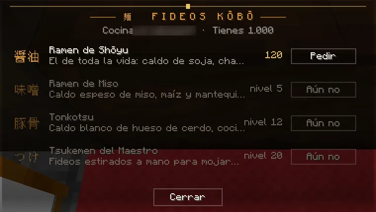{ loading=lazy }
  <figcaption>La carta: lo que sabe cocinar y su precio.</figcaption>
</figure>
<figure markdown="span">
  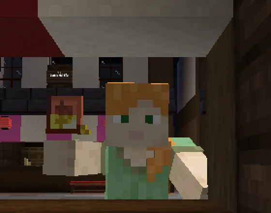{ loading=lazy }
  <figcaption>Te lo comes en el mostrador.</figcaption>
</figure>
<figure markdown="span">
  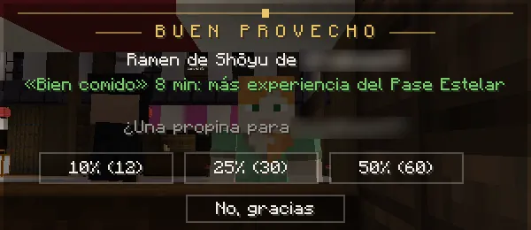{ loading=lazy }
  <figcaption>«Bien comido» y la propina.</figcaption>
</figure>

## Los recados

<ol class="pasos" markdown>
<li markdown>**Clic derecho al mostrador** de una oficina de recados (desde la calle) y **Empezar los recados**.</li>
<li markdown>**Te dan una pila de cajas** (de 1 a 5; más cuanto más nivel) para una tienda de la calle, con su tiempo. Una columna de luz marca su puerta, y arriba ves la dirección, los metros y el tiempo que te queda.</li>
<li markdown>**Llévala sin que se caiga.** Girar, ir de lado, correr y saltar la inclinan, y a veces sopla el viento: muévete hacia donde cae para enderezarla. La barra «Pila» te dice cómo va.</li>
<li markdown>**Entrégala** en la puerta: cobras por cajas y distancia (un 30 % más si llegas con tiempo de sobra) y te dan el siguiente.</li>
</ol>

Si la pila se cae, ese recado se pierde. Los recados cuentan para el mismo tope del día que las cocinas.

<figure markdown="span">
  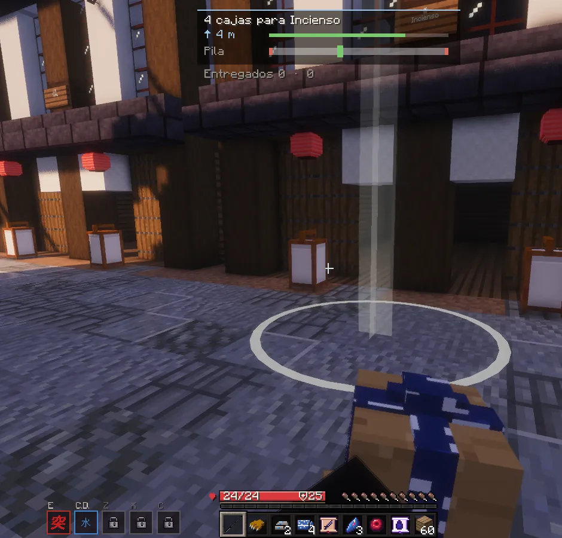{ loading=lazy }
  <figcaption>Un recado: arriba, el destino, los metros y la pila; la columna de luz marca la puerta.</figcaption>
</figure>

## Niveles, rangos y títulos

- **30 niveles en cada oficio**, cada uno por separado. Subes con cada plato (más con mejor nota) y cada recado.
- **El rango**: 見習い Aprendiz, 手伝い Ayudante (nivel 5), 職人 Oficial (10), 師匠 Maestro (18), 名人 Gran Maestro (25) y
  伝説 Leyenda (30).
- **Los títulos**: «Oficial de los Fideos» (o del Pan, del Té, de los Dulces, de los Recados) en el nivel 10, «Gran Maestro…» en el
  25 y **«Leyenda del Mercado»** al llegar al 30 en cualquier oficio. Se ponen en K → Títulos.

## Los mejores de la semana

Cada plato bien hecho (40 o más) y cada recado entregado te suman uno; los perfectos desempatan. La semana va de lunes a domingo
(hora de Madrid). Los cinco primeros salen en el panel de cada puesto y los tres primeros, con tu puesto, en **`/oficios`**.

## Comandos

| Comando | Qué hace |
|---|---|
| `/oficios` | Tu nivel en cada oficio, lo que llevas hoy, los puestos libres u ocupados y los mejores de la semana |
| `/oficios carta` | La carta del puesto que tienes delante (para pedirle a quien cocina) |
| `/oficios dejar` | Acabar tu turno o tus recados |
