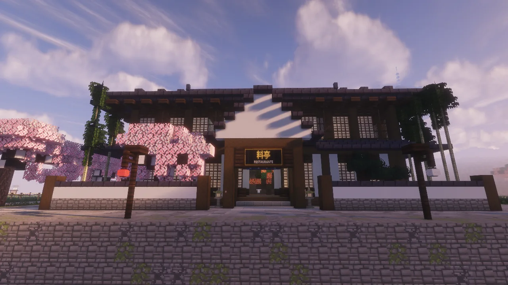
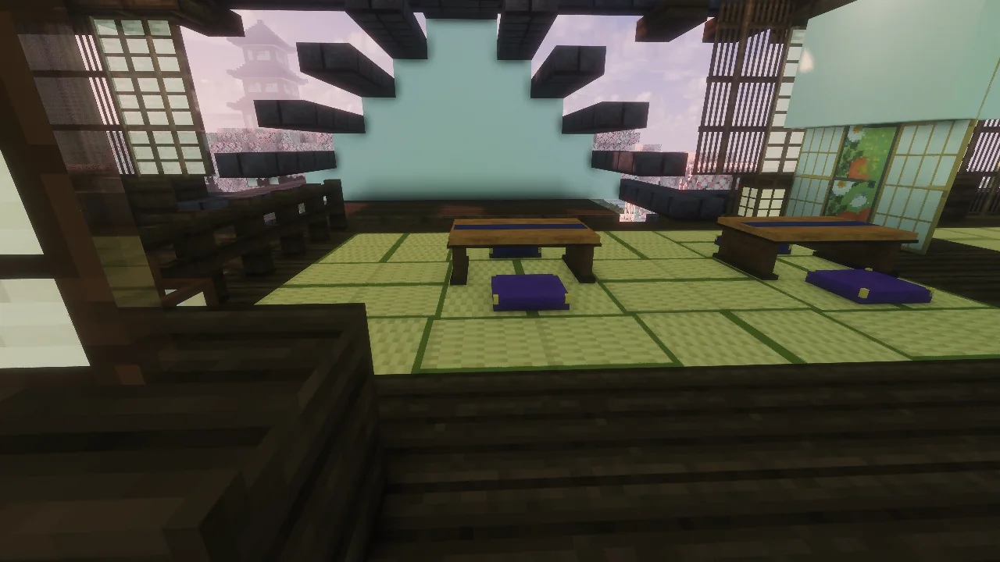
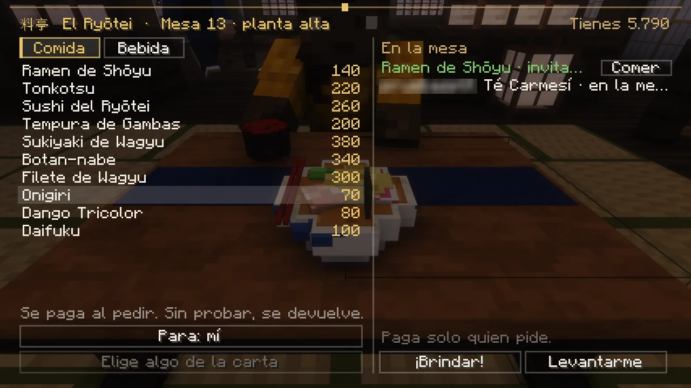

# El Ryōtei, el restaurante

Un restaurante de dos plantas (料亭, <em>ryōtei</em>) para sentarse a la mesa con quien quieras, pedirle a la camarera y comer y beber juntos, sin prisa y sin que nada te interrumpa.

<figure markdown="span">
  { loading=lazy }
  <figcaption>El Ryōtei, con su rótulo 料亭, de cara al río.</figcaption>
</figure>
<figure markdown="span">
  { loading=lazy }
  <figcaption>Los zashiki de tatami de la planta alta.</figcaption>
</figure>

## Cómo llegar

- **K → Lugares → El Ryōtei**, o **`/restaurante`** (el mismo [viaje](../mundo/viajar.md) de siempre).
- **Andando:** desde la Gran Puerta de la [Ciudadela](index.md), sube por el Mercado hasta la avenida, gira al oeste hasta la avenida de los cerezos y sigue al norte hasta el puente rojo. Cruza el río: lo tienes delante, con su rótulo 料亭.

## Cómo te atienden

<ol class="pasos" markdown>
<li markdown>**Siéntate:** clic derecho en una mesa libre. Te sientas en el cojín libre más cercano. Hay mesas para 2, 4 y 6, zashiki de tatami arriba y la barra de sake abajo.</li>
<li markdown>**La camarera viene a tu mesa.** Sentado, clic derecho (a la mesa, a ella o a donde estés mirando): se abre **la carta y la cuenta**.</li>
<li markdown>**Pide:** elige algo y mira el botón de abajo: siempre dice **quién paga y cuánto**.</li>
<li markdown>**Te lo traen a la mesa.** Cuando esté, pulsa **Comer** o **Beber** en la cuenta: tu personaje come bocado a bocado, y tú puedes seguir hablando.</li>
<li markdown>**Levántate** con ++shift++ o con el botón *Levantarme*.</li>
</ol>

<figure markdown="span">
  { loading=lazy }
  <figcaption>A la izquierda, la carta (Comida y Bebida); a la derecha, lo que hay en la mesa; abajo, para quién es y los botones de brindar y levantarte.</figcaption>
</figure>

La carta va de 40 a 380, con comida (ramen, sushi, tempura, sukiyaki, onigiri, dulces…) y bebida (té, sake, umeshu, ramune…). Un demonio tiene su propia carta de la noche.

Cada plato llena el hambre poco a poco y, al acabarlo, te deja **Bien comido** un rato (más experiencia del [Pase Estelar](../pase.md#como-se-sube)). No da ninguna ventaja en combate, y las peleas entre jugadores, los duelos y el dojo no lo tienen en cuenta.

## Pagar o invitar

Cada uno paga lo suyo. Si quieres invitar, en la carta pulsa **Para:** y elige a alguien de tu mesa, o **toda la mesa** para una ronda. **Paga solo quien invita**, y el botón lo dice antes de pulsarlo.

La persona invitada recibe un mensaje con **[Aceptar]** y **[No, gracias]** (también puede contestar desde su carta) y tiene 30 segundos. Si dice que no o no contesta, el dinero te vuelve. Si en la mesa hay un demonio, le sirven su plato de la carta de la noche al mismo precio.

## La regla del dinero

- **Se paga al pedir**, y queda apartado hasta que lo pruebes.
- **El primer bocado o trago lo gasta:** a partir de ahí está pagado, aunque te levantes sin acabar.
- **Hasta el primer bocado** (en la cocina, de camino o intacto en la mesa), si quien lo iba a comer se levanta, se desconecta, muere o el servidor se reinicia, **se devuelve entero, una sola vez, a quien lo pagó** (al que invitó, si era una invitación).
- Si quien invita se levanta antes de que le acepten, la invitación se cancela y le vuelve el dinero. Lo que ya se ha aceptado sigue siendo un regalo.

## Comer juntos

- **¡Brindar!** (en la cuenta, con alguien más en la mesa y algo de beber delante): toda la mesa levanta la copa y chocan. *¡Kanpai!*
- **`/mesa <texto>`:** hablas solo con los de tu mesa.
- Se ve lo que tiene cada uno delante, y a cada uno comer y beber.
- Hasta **tres** cosas en la mesa para cada persona (lo que aún no ha llegado también cuenta). En cuanto acabas una, puedes pedir otra.

!!! tip "¿Buscas el restaurante de los jugadores?"
    En los [puestos del Mercado](oficios.md#el-restaurante-pedirle-a-otro-jugador) cocinan otros jugadores: allí le pides a quien esté trabajando. En el Ryōtei te atiende la camarera.
