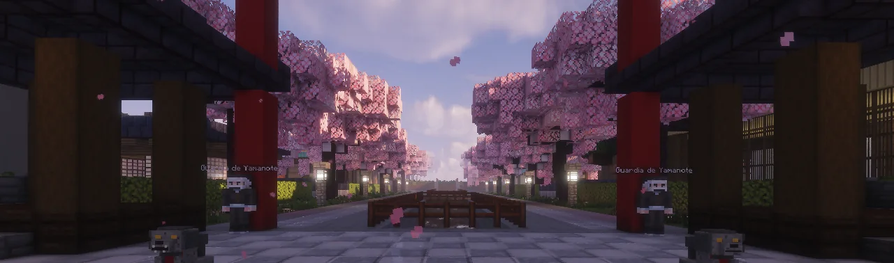
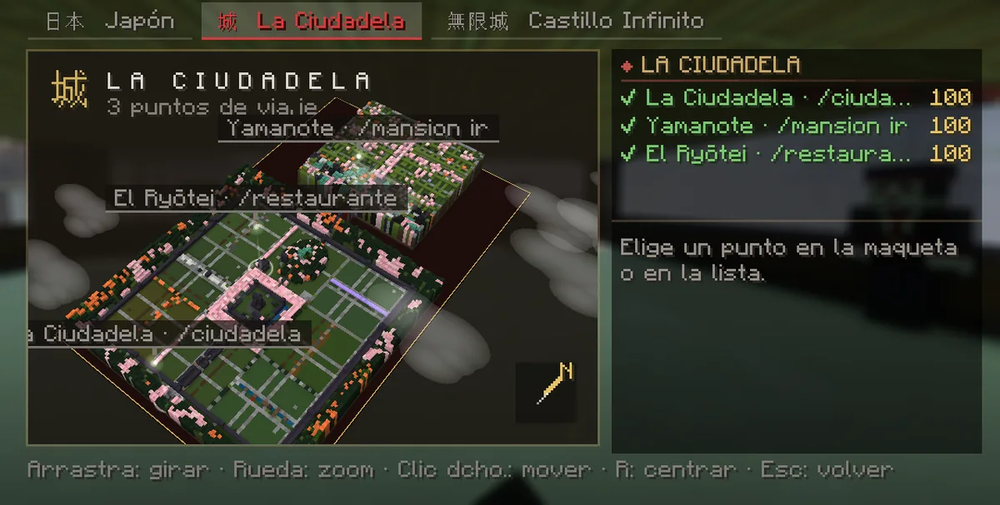
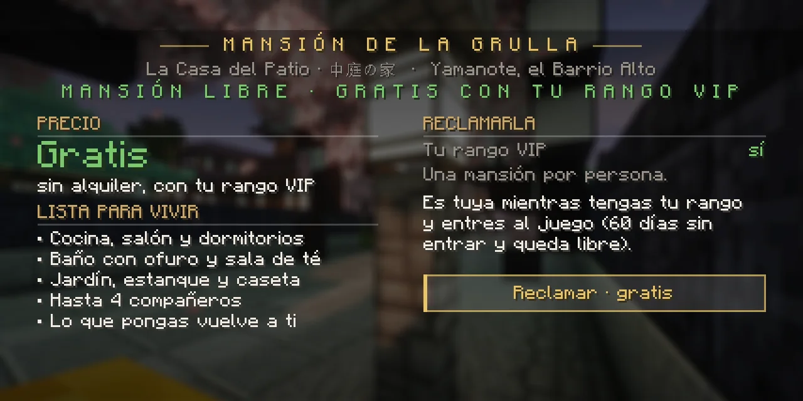
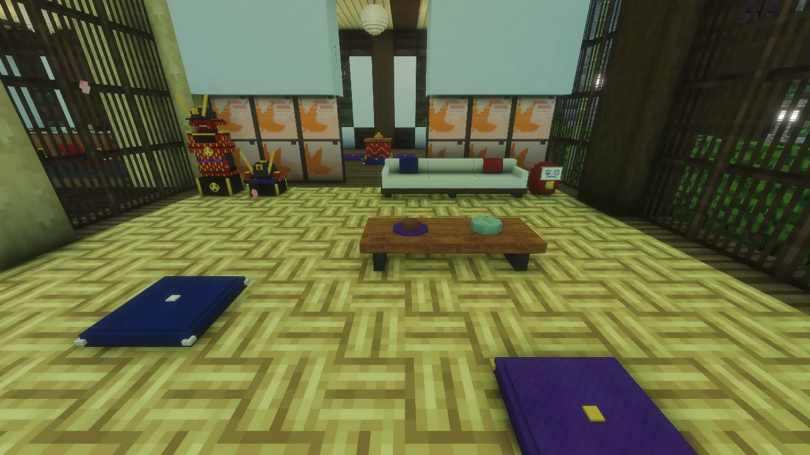

# Yamanote, el barrio de las mansiones

<strong>Yamanote</strong> (山の手, «el Barrio Alto») es el barrio de la Ciudadela reservado a quien tiene un <strong>rango VIP de pago</strong>, de cazador o de demonio: cincuenta mansiones modernas y japonesas, listas para entrar a vivir y gratis mientras tengas tu rango. No hay alquiler.

<figure markdown="span">
  { loading=lazy }
  <figcaption>Yamanote: faroles, torii rojos y la Avenida de los Cerezos.</figcaption>
</figure>

## Cómo se llega

- **Andando:** sal de la [Ciudadela](index.md) por la **Puerta Norte** y sube el **Camino de los Torii**, las escalinatas entre torii rojos que cruzan los montes. Al otro lado baja a la **Plaza del Gran Torii**.
- **De viaje:** **K → Lugares → Yamanote**, con las mismas reglas que cualquier otro [viaje](../mundo/viajar.md). Desde el mundo normal cuesta lo mismo que la Ciudadela (200; con VIP, la mitad); dentro de la Ciudadela, según la distancia.
- **`/mansion ir`** te lleva a tu mansión si tienes una; si no, a la plaza.

A la plaza puede venir todo el mundo a mirar. **Del Gran Torii para dentro** solo pasan los VIP, quienes viven allí y sus invitados: a los demás los guardias los devuelven a la plaza.

<figure markdown="span">
  { loading=lazy }
  <figcaption>K → Lugares → La Ciudadela: en su maqueta están Yamanote y el Ryōtei.</figcaption>
</figure>

## Reclamar la tuya

<ol class="pasos" markdown>
<li markdown>**Con un rango VIP de pago, cruza el Gran Torii y pasea:** la Avenida de los Cerezos con su canal, las calles en terrazas, las plazas y los jardines.</li>
<li markdown>**Busca una placa que diga «LIBRE».** Cada mansión tiene la suya en la tapia, junto a su portal. Clic derecho en ella (o la tecla ++i++ cerca de ella) para ver cómo se llama y qué casa es.</li>
<li markdown>**Pulsa «Reclamar».** Es tuya al momento, gratis. Si la miras de lejos, primero tienes que ir hasta su placa.</li>
</ol>

<figure markdown="span">
  { loading=lazy }
  <figcaption>Una mansión libre: gratis con tu rango, lo que trae y el botón de reclamarla.</figcaption>
</figure>

Hay ocho casas distintas (La Casa del Patio, La Nube, El Palacio Sukiya, Las Terrazas, La Casa del Agua, La Torre de la Luna, La Casa del Bambú y El Almacén Blanco), cada una con sus variantes de jardín, madera y tejado. **Una mansión por persona**, además de la [casa y la parcela](../economia/casas.md) que tengas.

**`/mansion lista`** te dice las libres más cercanas.

!!! info "Cualquier rango VIP, también el Amanecer"
    Vale **cualquier rango VIP**, de cazador o de demonio, también el [Amanecer](../vip.md#amanecer-el-rango-de-aspecto).

## Lo que trae

Todo funciona desde el primer día:

| Dónde | Qué |
|---|---|
| Cocina | **Fogón** para cocinar (carne, pescado, patatas y todo lo que se haga al fuego), **encimeras** para fabricar y **nevera de cedro**, que guarda 27 pilas |
| Dormitorios | Futones y **tansu**, el armario grande: 54 pilas |
| Baño | **Ofuro** humeante en el que sentarte, banqueta y lavabo |
| Sala de té | **Irori** con sus brasas y su hervidor, cojines y juego de té |
| Salón y comedor | Sofá bajo, kotatsu, biombos, lámparas de papel |
| Estudio | Escritorio, estantería y tokonoma con su rollo |
| Jardín | Jardín zen, estanque con **carpas koi**, shishi-odoshi, cerezos, faroles |
| Para los animales | La caseta del perro con su comedero y su bebedero, y el rincón del gato ([tu mascota](../economia/mascotas.md) los usa) |

<figure markdown="span">
  { loading=lazy }
  <figcaption>El salón de una de las mansiones, listo para entrar a vivir.</figcaption>
</figure>

Y lo que es solo para ti: al entrar, el nombre de tu mansión en grande con su sonido. De día caen pétalos; de noche salen las luciérnagas.

## Vivir allí

- **Cámbiala a tu gusto:** coloca y quita lo que quieras dentro de tu mansión, en la casa y en el jardín. Lo que pongas tú lo recuperas al quitarlo, como siempre.
- **Lo que venía con la mansión** también se quita (solo el dueño, con su rango VIP). Lo recoges como una **pieza de la mansión**: se ve igual y se llama igual («Tōrō de Piedra (de la mansión)»), y la vuelves a poner donde quieras **dentro de tu mansión** con el clic derecho. Así mueves los muebles, abres una pared o cambias el jardín. Es de la mansión: no se pone fuera de ella ni se vende.
- **No se quitan:** la capa de abajo del terreno (debajo no hay nada), la placa de la mansión y lo que la sostiene, y lo que toca el agua del estanque (se saldría).
- Si un día la dejas, lo tuyo y lo que haya en la nevera y los armarios va a tu **buzón** (K → Subastas → Buzón), las piezas de la mansión vuelven a ella y la mansión vuelve a estar como el primer día.
- **Compañeros** (hasta 4): **`/mansion vivir <jugador>`** para que viva contigo. Se apaña como en cualquier casa: `/mansion aceptar`, `/mansion rechazar`, `/mansion quitar <jugador>`, `/mansion salir`.
- **Visitas:** **`/mansion invitar <jugador>`** deja pasar a alguien sin VIP durante **2 horas**.
- **Macetas y mascota:** caben [30 macetas](../economia/plantas.md#donde-se-ponen) y [una mascota](../economia/mascotas.md).
- En Yamanote, como en toda la Ciudadela, no hay daño.

## Cuánto dura

No se paga, pero la casa es de quien la usa:

- Cada vez que entras al juego **con tu rango**, el plazo vuelve a **60 días**.
- Si **pierdes el rango**, te quedan como mucho **15 días** para renovarlo.
- Si pasan **60 días sin que entres**, la mansión se queda libre.

Te avisamos antes de que se acabe. Si se acaba, todo lo tuyo va al buzón y la mansión vuelve a estar como el primer día, lista para otro. Puedes dejarla tú cuando quieras desde su menú.

## Órdenes

| Orden | Qué hace |
|---|---|
| `/mansion` | El menú de tu mansión (o de la que tienes delante) |
| `/mansion ir` | A tu mansión, a la que te han invitado o a la plaza |
| `/mansion lista` | Las libres más cercanas |
| `/mansion ver <id>` | El menú de esa mansión |
| `/mansion invitar <jugador>` | De visita, 2 horas |
| `/mansion vivir <jugador>` | A vivir contigo |
| `/mansion aceptar` · `rechazar` | Responder a una invitación para vivir |
| `/mansion quitar <jugador>` | Que deje de vivir contigo |
| `/mansion salir` | Dejar de vivir en la de otro |
