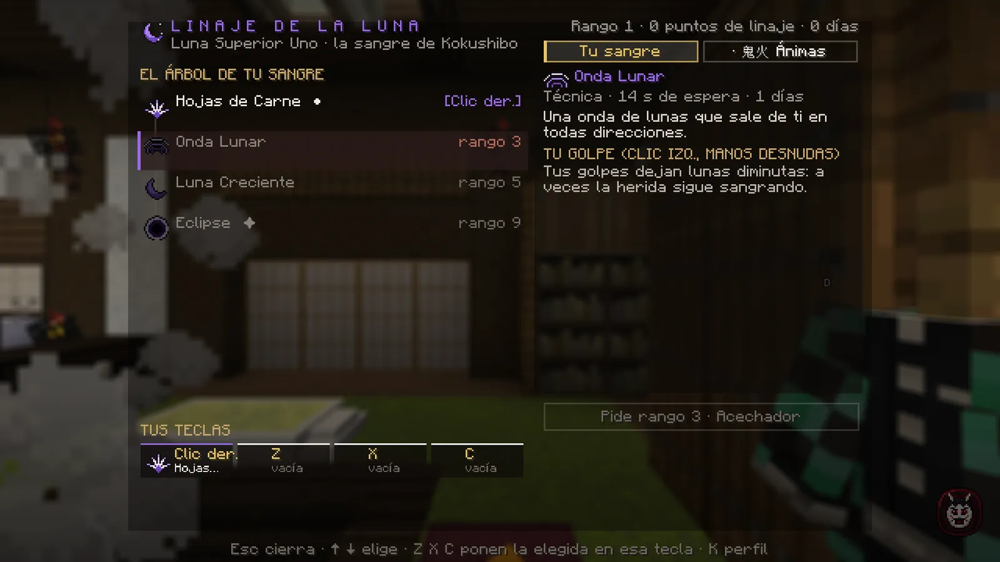
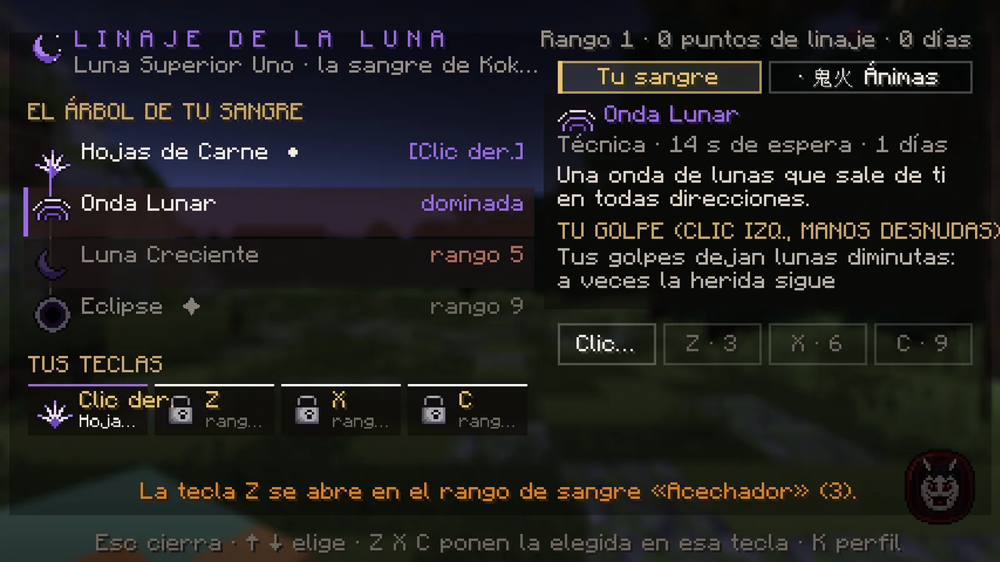
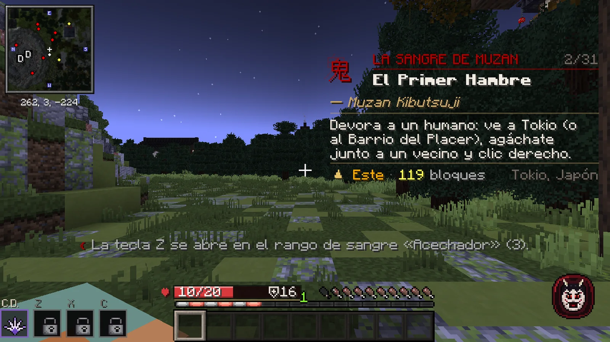
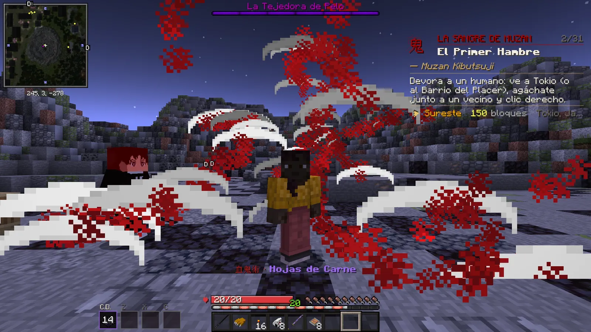
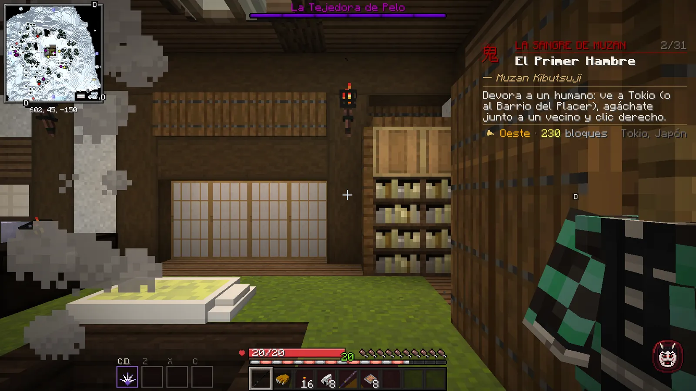

# Linajes y artes de sangre

Tu linaje es el tipo de sangre que te dio Muzan. De él salen tus <strong>artes</strong>: las técnicas del demonio, que lanzas con el clic derecho y las teclas Z, X y C.

## Tu linaje

Lo deciden tus respuestas a las **seis preguntas** de Muzan y **no se cambia** jugando. Hay seis:

| Linaje | Estilo |
|---|---|
| 月 **Linaje de la Luna** | Filos de carne y ondas de lunas que cortan a distancia. |
| 氷 **Linaje del Hielo** | Hielo que congela, lotos helados y aliados de cristal. |
| 破 **Linaje del Puño** | Puñetazos a distancia, contragolpes y movimientos rápidos. |
| 喜怒哀楽 **Linaje de las Emociones** | Rayos, abanicos, lanzas y alas. |
| 壺 **Linaje de las Vasijas** | Peces (como mucho dos a la vez; se van si te desconectas), agujas y prisiones de agua. |
| 妓 **Linaje de los Hermanos** | Hoces de sangre voladoras y cintas. |

Cada linaje tiene además su **golpe a mano desnuda** (clic izquierdo) con un efecto propio.

## Aprender artes (K → Artes)

<figure markdown="span">
  { loading=lazy }
  <figcaption>K → Artes: las artes de tu linaje (con el rango que piden), la ficha de la elegida y, abajo, «Tus teclas».</figcaption>
</figure>

- Tu **arte principal** llega sola y ya está en el clic derecho.
- Para aprender las siguientes necesitas: la anterior de tu linaje, el **rango de sangre** que pide, unos **días
  jugados como demonio** y **1 punto de linaje** (se ganan al subir de rango y con la historia).
- Las **artes mayores** (marcadas con ✦) piden además superar la **prueba de tu linaje**, bastante **miedo** y un
  **loto negro**.

## Ponerlas en las teclas

En **K → Artes**, elige un arte que ya sepas (con el ratón o ++arrow-up++ ++arrow-down++) y pulsa ++z++, ++x++ o ++c++
(o los botones *Clic der.*, *Z*, *X*, *C*) para ponerla en esa tecla. Cada arte va en una sola tecla.

### Las teclas se abren con tu rango

El clic derecho lo tienes desde el principio. Las otras tres se abren con tu **rango de sangre**:

| Tecla | Se abre en el rango |
|---|---|
| ++z++ | 3 · Acechador |
| ++x++ | 6 · Demonio Mayor |
| ++c++ | 9 · Luna Superior |

Hasta entonces, la tecla lleva un **candado** y, si la pulsas, te dice en qué rango se abre. Al subir de rango, un aviso te
dice qué tecla se ha abierto.

<figure markdown="span">
  { loading=lazy }
  <figcaption>K → Artes: «Z · 3», «X · 6» y «C · 9», el rango de sangre que abre cada tecla.</figcaption>
</figure>
<figure markdown="span">
  { loading=lazy }
  <figcaption>Con candado: «La tecla Z se abre en el rango de sangre «Acechador» (3)».</figcaption>
</figure>

## Lanzarlas

| Tecla | Lanza |
|---|---|
| ++"Clic der."++ **con la mano vacía** | El arte de la casilla *Clic der.*, apuntando al aire o a un enemigo (no sobre bloques, personajes ni agachado). |
| ++z++ · ++x++ · ++c++ | El arte de cada tecla. |

<figure markdown="span">
  { loading=lazy }
  <figcaption>«Hojas de Carne», el arte principal del Linaje de la Luna.</figcaption>
</figure>
<figure markdown="span">
  { loading=lazy }
  <figcaption>Abajo a la izquierda, la barra de artes: C.D. (clic derecho), Z, X y C, con su espera.</figcaption>
</figure>

- Cada arte tiene su **espera**, que baja con tu rango de sangre. Peleando contra un jugador, las esperas son algo más largas.
- No puedes lanzar dos artes a la vez: entre dos técnicas cualesquiera pasan **2,5 segundos**.
- **O te cubres o atacas**: con el bloqueo puesto no sale ningún arte, y mientras sale una no puedes cubrirte ni esquivar.
- Tras un arte que te lanza por los aires, la caída no te hace daño durante unos segundos.

!!! vip "Señor de las Ánimas"
    El rango de apoyo de demonio **Señor de las Ánimas** te presta un linaje extra con cinco artes propias, que conviven
    con las de tu linaje y van en las mismas teclas. Con su **farol** en la mano, el arte del clic derecho no alcanza a
    ningún jugador a más de **6 bloques**. [Ver los rangos VIP](../vip.md).
