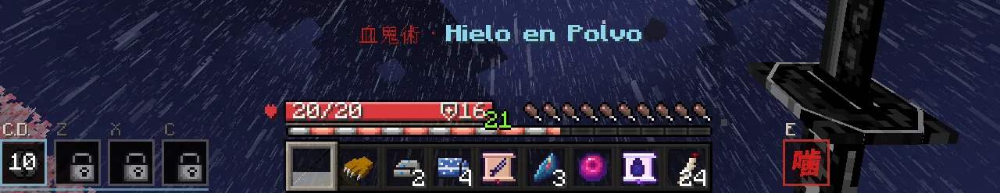
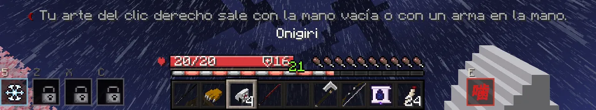
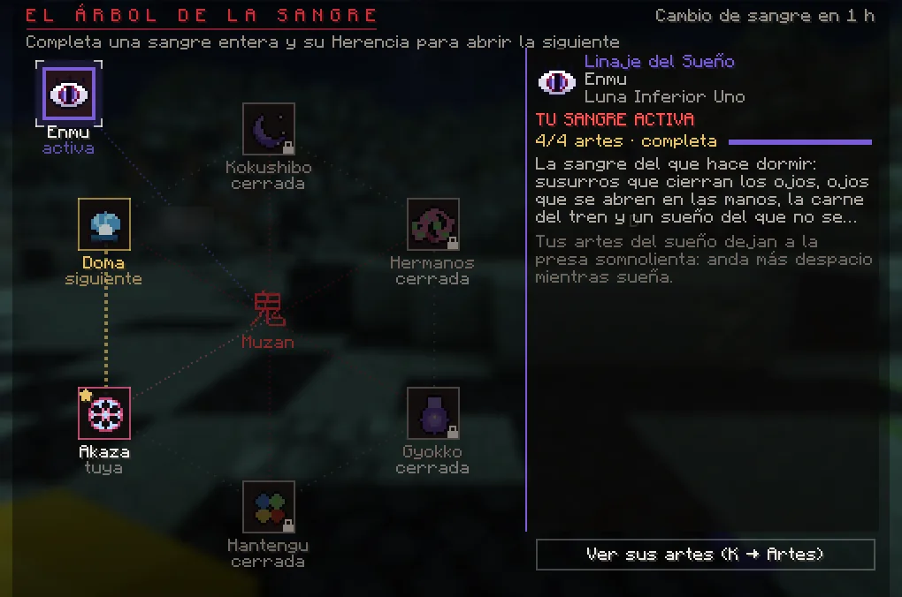
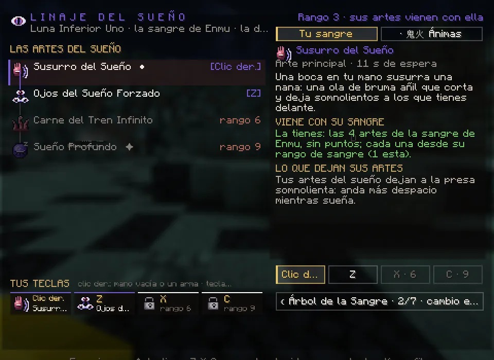
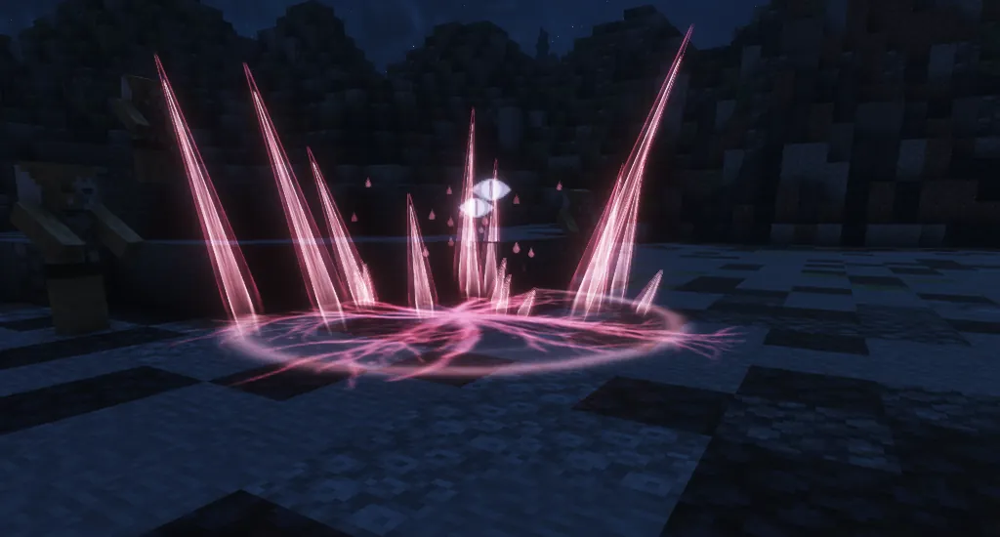

# Linajes y artes de sangre

Tu linaje es el tipo de sangre que te dio Muzan. De él salen tus <strong>artes</strong>: las técnicas del demonio, que lanzas con el clic derecho (con la mano vacía o con un arma) y las teclas Z, X y C.

## Tu linaje

Tu primera sangre la deciden tus respuestas a las **seis preguntas** de Muzan. Hay seis, una por cada Luna Superior, y las
demás se pueden heredar después con el [Árbol de la Sangre](#el-arbol-de-la-sangre):

| Linaje | Su Luna | Estilo |
|---|---|---|
| 月 **Linaje de la Luna** | Kokushibo | Filos de carne y ondas de lunas que cortan a distancia. |
| 氷 **Linaje del Hielo** | Doma | Hielo que congela, lotos helados y aliados de cristal. |
| 破 **Linaje del Puño** | Akaza | Puñetazos a distancia, contragolpes y movimientos rápidos. |
| 喜怒哀楽 **Linaje de las Emociones** | Hantengu | Rayos, abanicos, lanzas y alas. |
| 壺 **Linaje de las Vasijas** | Gyokko | Peces (como mucho dos a la vez; se van si te desconectas), agujas y prisiones de agua. |
| 妓 **Linaje de los Hermanos** | Gyutaro y Daki | Hoces de sangre voladoras y cintas. |

Cada linaje tiene además su **golpe a mano desnuda** (clic izquierdo) con un efecto propio.

**Hielo en Polvo**, el arte principal del Linaje del Hielo, **frena**: mientras lo soplas, lo que pelea a tu alrededor (a
3,5 bloques) va con **Lentitud II** hasta 2 segundos después de la última bocanada, y a quien respiraba una forma se le corta.
No hace daño: es un arte para frenar.

Los **Niños de Cristal** del Linaje del Hielo te obedecen: solo van a por lo que tú has golpeado o lo que os ha hecho daño a
ti o a ellos en los últimos 10 segundos (nunca a por quien no puedes atacar). En un duelo, solo a por tu rival.

## Aprender artes (K → Artes)

<figure markdown="span">
  { loading=lazy }
  <figcaption>K → Artes: las artes de tu linaje (con el rango que piden), la ficha de la elegida y, abajo, «Tus teclas».</figcaption>
</figure>

- Tu **arte principal** llega sola y ya está en el clic derecho.
- Para aprender las siguientes necesitas: la anterior de tu linaje, el **rango de sangre** que pide, unos **días
  jugados como demonio** y **1 punto de linaje** (se ganan al subir de rango y con la historia).
- Las **artes mayores** (marcadas con ✦) piden además superar la **prueba de tu linaje**, bastante **miedo** y un
  **loto negro**.

## Ponerlas en las teclas

En **K → Artes**, elige un arte que ya sepas (con el ratón o ++arrow-up++ ++arrow-down++) y pulsa ++z++, ++x++ o ++c++
(o los botones *Clic der.*, *Z*, *X*, *C*) para ponerla en esa tecla. Cada arte va en una sola tecla.

### Las teclas se abren con tu rango

El clic derecho lo tienes desde el principio. Las otras tres se abren con tu **rango de sangre**:

| Tecla | Se abre en el rango |
|---|---|
| ++z++ | 3 · Acechador |
| ++x++ | 6 · Demonio Mayor |
| ++c++ | 9 · Luna Superior |

Hasta entonces, la tecla lleva un **candado** y, si la pulsas, te dice en qué rango se abre. Al subir de rango, un aviso te
dice qué tecla se ha abierto.

<figure markdown="span">
  { loading=lazy }
  <figcaption>K → Artes: «Z · 3», «X · 6» y «C · 9», el rango de sangre que abre cada tecla.</figcaption>
</figure>
<figure markdown="span">
  { loading=lazy }
  <figcaption>Con candado: «La tecla Z se abre en el rango de sangre «Acechador» (3)».</figcaption>
</figure>

## Lanzarlas

| Tecla | Lanza |
|---|---|
| ++"Clic der."++ **con la mano vacía o con un arma** | El arte de la casilla *Clic der.*, apuntando al aire o a un enemigo (no sobre bloques, personajes ni agachado). Su tecla se puede cambiar ([ver](#cambiar-su-tecla)). |
| ++z++ · ++x++ · ++c++ | El arte de cada tecla. |

<figure markdown="span">
  { loading=lazy }
  <figcaption>«Hojas de Carne», el arte principal del Linaje de la Luna.</figcaption>
</figure>
<figure markdown="span">
  { loading=lazy }
  <figcaption>Abajo a la izquierda, la barra de artes: C.D. (clic derecho), Z, X y C, con su espera.</figcaption>
</figure>

- Cada arte tiene su **espera**, que baja con tu rango de sangre. Es la misma peleando contra un jugador que contra
  cualquier otro.
- No puedes lanzar dos artes seguidas: tras cada una tienes **4 segundos para recuperarte**, contados desde que **acaba**. Cada
  arte sigue con su propia espera.
- **O te cubres o atacas**: con el bloqueo puesto (también con los brazos) o con un **escudo** levantado no sale ningún arte, y
  mientras sale una no puedes cubrirte ni esquivar ([el escudo](combate.md#el-escudo)).
- Tras un arte que te lanza por los aires, la caída no te hace daño durante unos segundos.

### El arte del clic derecho, también con un arma

El arte de la casilla *Clic der.* sale con la mano derecha **vacía** o con un **arma** en ella. Así no tienes que guardar la
espada en plena pelea.

- **Sale** con las espadas (tu nichirin, las [armas de sangre](combate.md#las-armas-de-sangre), también las de la Caja de Sangre
  y las del Pase Estelar, la Espada de Kokushibo, la Kyokoku Kamusari, el cuchillo, el kunai y las espadas de siempre), los
  abanicos (también los de hielo de Douma), las hoces y las **hachas**.
- **No sale** con nada más: comida, bloques, pociones, el arco, el escudo, herramientas u objetos de arte. Con eso en la mano,
  el clic derecho hace lo de siempre (comer, poner un bloque, tensar el arco).
- **La otra mano:** con un arma de una mano en la derecha y, en la izquierda, la carne humana, un escudo o un arco, el clic
  derecho es para la izquierda, como antes: comes ([también en plena pelea](combate.md#comer-en-plena-pelea)) o te cubres. Con
  la katana, que se lleva a dos manos, sale el arte.
- Como siempre, un clic sobre un personaje, una puerta o un cofre es para ellos, y agachado no sale. Lo mismo si tienes a
  otro jugador en la mira y pegado a ti: el clic es para él y el arte no sale (con [su propia tecla](#cambiar-su-tecla), sí).
  ++z++, ++x++ y ++c++ no cambian.

<figure markdown="span">
  { loading=lazy }
  <figcaption>Con la katana en la mano, el clic derecho lanza el arte (aquí, «Hielo en Polvo») y la casilla C.D. cuenta su espera.</figcaption>
</figure>

### Cambiar su tecla

En *Opciones → Controles → Teclas*, categoría **DemonCraft**, está **«Arte del clic derecho (demonio)»**. De serie pone
**«Clic derecho»**: el de siempre.

- Ponle otra tecla (una letra o un botón lateral del ratón) y **esa lanza el arte**; el clic derecho vuelve a ser solo el de
  usar. Con su tecla, el arte sale mires a donde mires: no abre puertas ni habla con nadie.
- Sale igual: con la mano vacía o con un arma. Con otra cosa en la mano, no sale y te avisa: *«Tu arte del clic derecho sale
  con la mano vacía o con un arma en la mano.»*
- La barra de artes y K → Artes enseñan la tecla que hayas elegido. **Reiniciar** la devuelve al clic derecho.

<figure markdown="span">
  { loading=lazy }
  <figcaption>Opciones → Controles, categoría DemonCraft: «Arte del clic derecho (demonio)», de serie en el clic derecho.</figcaption>
</figure>

<figure markdown="span">
  { loading=lazy }
  <figcaption>Con su tecla en el 5 (la barra de artes lo enseña) y un onigiri en la mano: no sale y te avisa.</figcaption>
</figure>

### Contra los cazadores jugadores

Tus artes pegan **un 20 % más** a un cazador jugador, y sus topes del PvP suben lo mismo: hasta **6** por golpe, **8,4** por
segundo y **14,4** cada 10 segundos de un mismo rival (para todo lo demás, 5, 7 y 12). Vale también en el dojo y contra el
[muñeco de práctica](../social/duelos.md#el-muneco-de-practica), y para las artes del Señor de las Ánimas y las del
[Sueño](#el-linaje-del-sueno). **Menos las del Linaje del Hielo** (Doma), que ya estaban equilibradas. El zarpazo, el
mordisco y las armas no cambian.

!!! vip "Señor de las Ánimas"
    El rango de apoyo de demonio **Señor de las Ánimas** te presta un linaje extra con cinco artes propias, que conviven
    con las de tu linaje y van en las mismas teclas. Con su **farol** en la mano, el arte del clic derecho no alcanza a
    ningún jugador a más de **6 bloques**. [Ver los rangos VIP](../vip.md).

## El Árbol de la Sangre

Tu sangre no es la única que puedes llevar: las seis Lunas tienen la suya y puedes **heredarlas una a una**. Y, aparte, está
la de Enmu ([ver](#el-linaje-del-sueno)).

- Ábrelo con **`/sangre`** o en **K → Artes → «☾ Árbol de la Sangre»**. Las seis sangres de las Lunas están en corro y, aparte,
  la de Enmu; cada una dice si es la que usas, si ya es tuya, si es **la siguiente** que puedes heredar o si aún está cerrada
  (y qué te falta). El botón de K → Artes cuenta las tuyas de siete.
- **El orden**: Gyutaro y Daki → Gyokko → Hantengu → Akaza → Doma → Kokushibo, y vuelta a empezar. Empiezas por la tuya (la
  que te dio Muzan) y sigues el corro desde ahí.
- **Para heredar la siguiente**, primero **completa entera** la anterior (todas sus artes aprendidas, también las mayores)
  y después termina la cadena de la nueva, **su herencia**: la Luna de esa sangre te busca de noche, al aire libre. Hay
  pistas que seguir, gente que devorar, una pelea, una decisión que cambia lo que pasa y un cazador con nombre que irá a por
  ti. Al final la sangre despierta y es tuya, con su título y un recuerdo.
- Al heredarla **no se activa sola**. Para usar otra de tus sangres, elígela en el árbol y pulsa **«☾ Activar esta
  sangre»**. Entre un cambio y otro hay que esperar **una hora**; si tienes una **Ficha de Sangre**, puedes activarla al
  momento («☾ Activar ya (1 Ficha)»).
- **Cada sangre guarda lo suyo**: sus artes aprendidas, sus teclas y sus puntos de linaje. Si vuelves a una, está como la
  dejaste. Tu rango de sangre y tu árbol de K → Sangre no cambian.
- No se cambia en plena pelea, en un duelo, en una escena ni con un arte en marcha.

| Sangre | Su herencia |
|---|---|
| 妓 Linaje de los Hermanos (Gyutaro y Daki) | «Dos que Comparten Sangre» |
| 壺 Linaje de las Vasijas (Gyokko) | «El Ceramista y el Pez» |
| 喜怒哀楽 Linaje de las Emociones (Hantengu) | «Las Cuatro Voces» |
| 破 Linaje del Puño (Akaza) | «El Camino del Más Fuerte» |
| 氷 Linaje del Hielo (Doma) | «El Paraíso de la Eterna Dicha» |
| 月 Linaje de la Luna (Kokushibo) | «La Sangre de la Luna Uno» (y, al terminarla, la [Espada de Kokushibo](combate.md#la-espada-de-kokushibo)) |
| 夢 Linaje del Sueño (Enmu) | «La Sangre del Sueño» (fuera del corro: tras «El Banquete de Enmu», con la sangre en el rango 4; [ver](#el-linaje-del-sueno)) |

!!! tip "Es un camino largo"
    Completar una sangre entera pide subir de rango y de edad, su prueba de linaje y lotos negros; y cada herencia, unas
    cuantas noches. Lo que pase en ellas lo descubrirás jugando.

## La sangre de Enmu: el Linaje del Sueño {#el-linaje-del-sueno}

La sangre de **Enmu**, la Luna Inferior Uno, es **una sangre más de tu [Árbol de la Sangre](#el-arbol-de-la-sangre)**, como la
de Akaza o la de Doma, pero **fuera del corro**: no sigue el orden de las seis Lunas ni lo cambia, y para ganarla no hace falta
completar ninguna otra. Sus cuatro artes duermen a quien las recibe.

- **Cómo se consigue:** tras «El Banquete de Enmu» de tu historia, y con tu sangre en el rango **4 (Devorador)**, se abre la
  cadena **«La Sangre del Sueño»** (K → Misiones): Enmu te busca de noche, lejos de las glicinas. Al terminarla: *«SANGRE
  DESPERTADA · Linaje del Sueño»*, y es tuya para siempre, con el título «Soñador de la Luna Inferior».
- **Cómo se usa:** como cualquier otra sangre. En el árbol (`/sangre` o K → Artes → «☾ Árbol de la Sangre»), elígela y pulsa
  **«☾ Activar esta sangre»**, con la hora de espera entre cambios (o una Ficha de Sangre).
- **Sus artes vienen con ella**, sin puntos de linaje ni pruebas: cada una se usa desde su rango de sangre. La primera vez van
  solas a las teclas que ya tienes abiertas.
- **Mientras la llevas activa, sus artes sustituyen a las de tu otra sangre** (no se suman). Al volver a la otra, sus artes y
  sus teclas están como las dejaste. Un arte del Sueño puesto en la tecla de otra sangre no sale.
- **En el árbol**, su nodo va aparte, arriba a la izquierda, unido a Muzan. Dice «cerrada» (y el panel, lo que te falta),
  «su cadena» cuando ya puedes empezarla, la etapa en la que vas, y «tuya» o «activa». Con ella activa, K → Artes enseña
  «Las artes del Sueño».

| Arte | Tecla | Rango de sangre | Qué hace |
|---|---|---|---|
| **Susurro del Sueño** | ++"Clic der."++ | Desde el 1 | Tres olas de bruma en cono delante de ti: cortan y dejan **somnolientos** (andan más despacio). |
| **Ojos del Sueño Forzado** | ++z++ | 3 · Acechador | Tres ojos se abren a tu alrededor durante 7 segundos: cada segundo, uno lanza un rayo de sueño a lo más cercano (a 10 bloques). |
| **Carne del Tren Infinito** | ++x++ | 6 · Demonio Mayor | Donde miras (hasta 12 bloques), tres oleadas de tentáculos de carne que golpean, levantan y no dejan moverse. |
| **Sueño Profundo** | ++c++ | 9 · Luna Superior | La espiral del sueño se abre sobre quien miras (hasta 14 bloques): tras un segundo de nana, quien siga dentro **se duerme** y despierta dentro de una pesadilla. |

<figure markdown="span">
  { loading=lazy }
  <figcaption>El Árbol de la Sangre: la de Enmu, aparte, arriba a la izquierda, y aquí activa.</figcaption>
</figure>
<figure markdown="span">
  { loading=lazy }
  <figcaption>K → Artes con la sangre de Enmu activa: «Las artes del Sueño», que vienen con su sangre, y el rango que pide cada una.</figcaption>
</figure>
<figure markdown="span">
  { loading=lazy }
  <figcaption>«Carne del Tren Infinito»: los tentáculos brotan donde miras.</figcaption>
</figure>

### El sueño

- Dormido **no se mueve, no ataca, no lanza técnicas, no se cubre, no rueda ni usa objetos**. A un jugador se le cierran los
  ojos y, si intenta algo: *«Estás dormido: no puedes hacer nada hasta que despiertes.»*
- Dura **2 segundos** a un jugador, **3** a una criatura y **1** a un jefe, y duerme como mucho a tres a la vez. Al despertar,
  la pesadilla le golpea y le aparta.
- Después, ese jugador tiene **10 segundos** en los que nadie le puede volver a dormir.
- Solo duerme a quien tienes a la vista (no a través de una pared) y, a un jugador, solo donde le podrías atacar
  ([ver el PvP](combate.md#pelear-contra-cazadores-pvp)).
