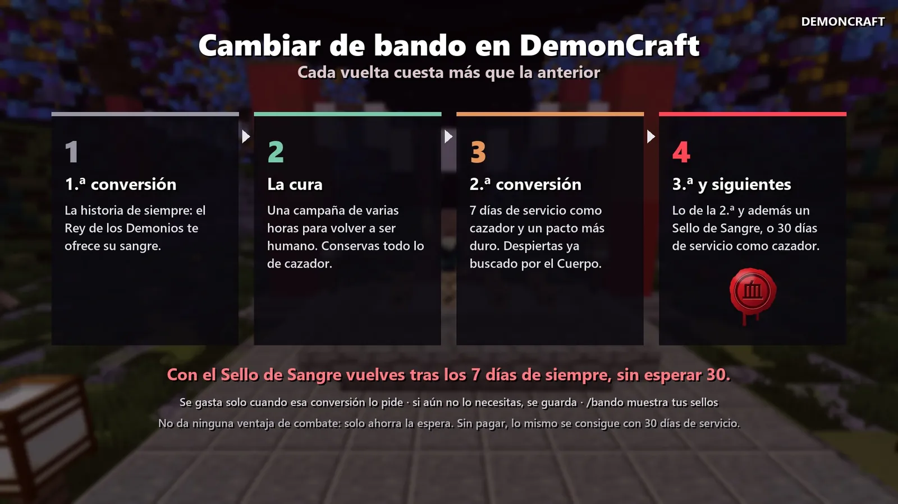

# Volver a ser humano

Ser demonio no tiene por qué ser para siempre. Hay una médica que sabe curar la sangre de Muzan… si demuestras que de verdad quieres volver.

## Cómo empieza

Cuando hayas avanzado algo en tu historia de demonio, **Yushiro** te encontrará **de noche en Tokio**. Desde ahí
empieza una **campaña larga** con varias partes y pruebas. Una de ellas es el **ayuno**: pasar amaneceres **sin
devorar a nadie** (si devoras, el ayuno vuelve a empezar).

Antes de la última noche hacen falta **días de servicio como demonio** (3 la primera vez, 7 las siguientes) y un
**loto negro**. Lo que pasa por el camino lo descubrirás tú.

## Qué conservas y qué pierdes

| Conservas (vuelve tu cazador) | Pierdes (todo lo del demonio) |
|---|---|
| Tus misiones del Cuerpo, tu rango, méritos y días | Rango y edad de la sangre |
| Respiraciones y formas | El árbol de sangre, las artes, el linaje y las sangres heredadas (si vuelves a ser demonio, puedes heredarlas otra vez) |
| Dinero, casa, clan, puntos del dojo y títulos | Notoriedad y miedo |
| Tu inventario de cazador y tu **uniforme** | Misiones del demonio, ofrendas y carne |
| Tus rangos VIP | — |

Los trofeos y recuerdos de tu vida de demonio se convierten en un **«Diario de una Noche Larga»**. Además ganas el
título **«Humano Otra Vez»** y hay un epílogo especial con tu antiguo maestro.

## Cada vuelta cuesta más

| Cambio | Qué pide |
|---|---|
| 1.ª vez demonio | La oferta de Muzan y su pacto. |
| 1.ª cura | La campaña de la cura y 3 días como demonio. |
| 2.ª vez demonio | **7 días de servicio como cazador** desde la cura y una misión extra («El Pacto Roto»). Despiertas ya con notoriedad. |
| 2.ª cura y siguientes | La campaña, 7 días como demonio y una prueba más dura. |
| 3.ª vez demonio y siguientes | Lo anterior y **un Sello de Sangre** (o 30 días como cazador desde la última cura). |

Cada vida de demonio empieza desde el rango de sangre 1.

<figure markdown="span">
  { loading=lazy }
  <figcaption>El resumen de los cambios de bando. El Sello de Sangre te ahorra esperar 30 días desde la tercera conversión.</figcaption>
</figure>

## El comando `/bando`

Escribe **`/bando`** en cualquier momento para ver:

- en qué estado estás (cazador, en el pacto, demonio, buscando la cura, curándote…);
- tu historia de cambios (conversiones, curas, sellos);
- y **lo que te falta**: si eres humano, si Muzan puede volver; si eres demonio, la cura paso a paso con ✔ y ✘.
