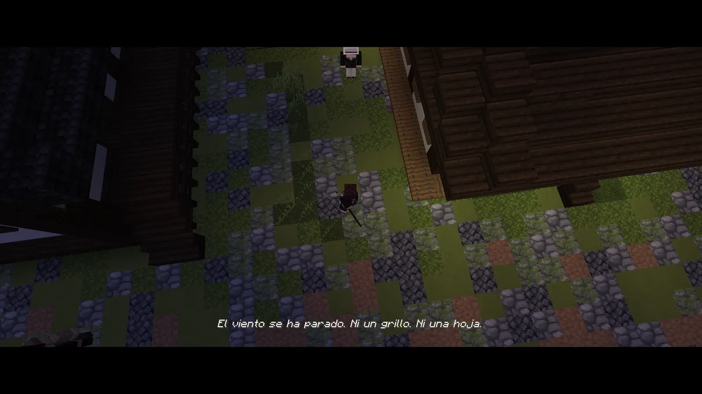
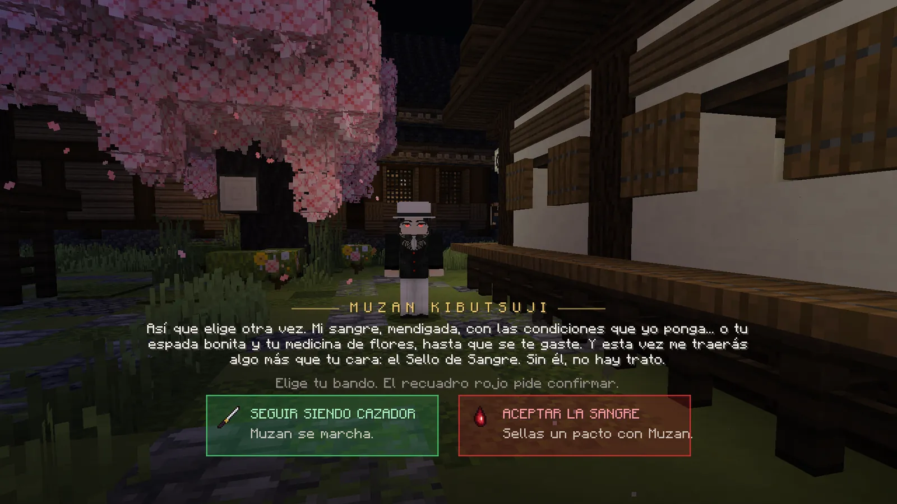
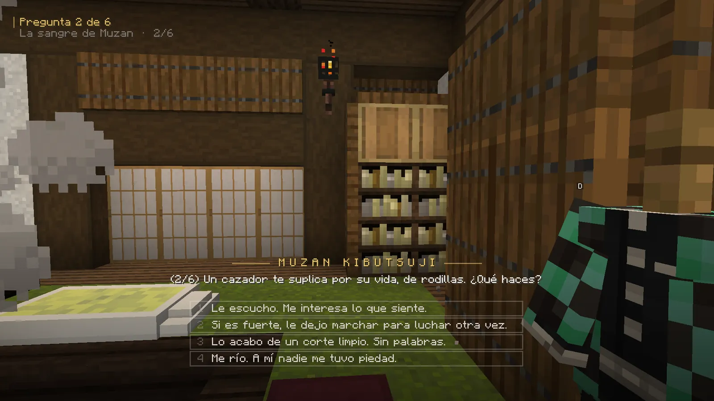

# El camino del demonio

Un cazador puede pasarse al otro bando. No se pide ni se busca: una noche, alguien te ofrece su sangre. La decisión es tuya, y tiene vuelta atrás… aunque cuesta.

## La oferta

Cuando ya eres un cazador del Cuerpo de verdad (bien avanzada tu formación), **Muzan** puede aparecer delante de ti
una noche. Solo viene si:

- es **plena noche** y estás **al aire libre**, lejos de las glicinas;
- estás **tranquilo**: sin pelear, sin montura, sin duelo y sin bichos persiguiéndote;
- llevas un rato jugando y no te ha visitado ya esa noche.

<figure markdown="span">
  { loading=lazy }
  <figcaption>Un hombre con sombrero blanco aparece en mitad del camino…</figcaption>
</figure>
<figure markdown="span">
  { loading=lazy }
  <figcaption>La elección final. El recuadro rojo pide un segundo clic para confirmar.</figcaption>
</figure>

- **«Seguir siendo cazador»** (verde): se marcha. Volverá otra noche (como mucho **3 visitas**).
- Si le dices que no en la **tercera** visita, no vuelve nunca: ganas el título **«Voluntad de Hierro»** y 10 méritos.
- **«Aceptar la sangre»** (rojo): tienes que pulsarlo **dos veces**. Empieza un **pacto**: unas misiones que haces aún
  como humano. Al final, Muzan te hace **seis preguntas** que deciden tu **linaje** y despiertas convertido en demonio.

<figure markdown="span">
  { loading=lazy }
  <figcaption>Las seis preguntas de Muzan deciden tu linaje: a qué Luna se parecerá tu sangre y qué artes tendrás.</figcaption>
</figure>

## Qué cambia al ser demonio

!!! danger "Lo malo"
    - **El sol te quema** a cielo abierto. Al principio mueres en unos segundos; con los rangos aguantas más y en los
      más altos eres inmune.
    - **La comida humana no te sirve**: necesitas **carne humana**. El hambre baja más rápido.
    - **No respiras**: con una katana en la mano solo cortas. Sin cuervo, sin uniforme del Cuerpo (se guarda y vuelve si
      te curas), sin méritos ni Caja del Cuartel.
    - **El Cuerpo te persigue**: cuanto más llamas la atención, más patrullas y cazadores con nombre.
    - Un golpe de **nichirin** o una forma te impide regenerarte un rato.

!!! tip "Lo bueno"
    - **Regeneración propia** de noche o bajo techo (desde el rango de sangre 4).
    - **Más corazones y velocidad** con cada rango de sangre. Visión nocturna.
    - **Artes de sangre**: clic derecho con la mano vacía, ++z++, ++x++ y ++c++.
    - Los demonios de la noche **no te atacan**.
    - Viajas con la **biwa de Nakime** y tienes el castillo como refugio.

!!! demonio "Lo de cazador no se pierde"
    Tus misiones, tu rango, tus respiraciones, tu dinero, tu clan y tu casa se quedan **congelados**. Si un día te curas,
    vuelves a ser el cazador que eras. [Cómo volver a ser humano](cura.md).

## Tu primera noche

<ol class="pasos" markdown>
<li markdown>**Mira tu K.** Ahora tiene las pestañas **Sangre** y **Artes**. Tu arte principal ya está en el clic derecho.</li>
<li markdown>**Aliméntate y crece.** Devora vecinos (agachado + clic derecho), recoge **lotos de sangre** y caza cazadores del Cuerpo. [Cómo se gana sangre](sangre.md).</li>
<li markdown>**Antes del alba, busca techo.** En tus primeros rangos el sol te mata en unos diez segundos.</li>
<li markdown>**Sigue tu historia** en K → Misiones: los demonios que te necesitan vienen a ti de noche.</li>
</ol>

-   **[Sangre, rangos y árbol](sangre.md)**

    Cómo creces: rangos de sangre, edades, ritos, el árbol de sangre, el miedo y la notoriedad.

-   **[Linajes y artes](artes.md)**

    Tus artes de sangre, cómo aprenderlas y cómo ponerlas en las teclas.

-   **[La vida de un demonio](vida.md)**

    Dinero, tiendas, Mercado, la biwa de Nakime, clanes y encargos de la noche.

-   **[Volver a ser humano](cura.md)**

    La cura: qué pide, qué conservas y cuánto cuesta cada vuelta.

