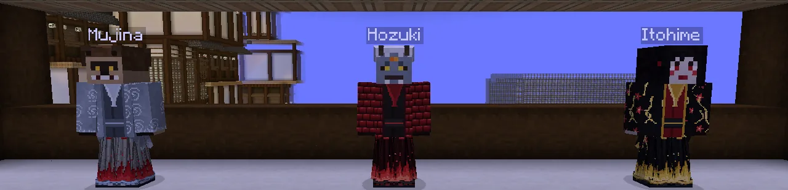
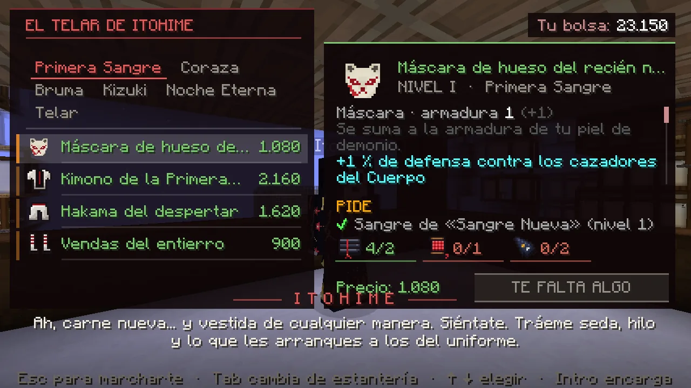
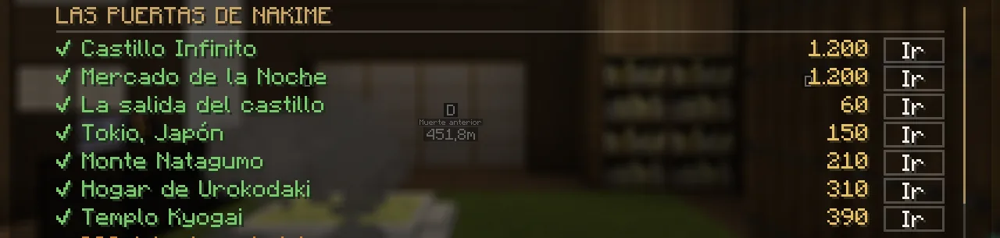
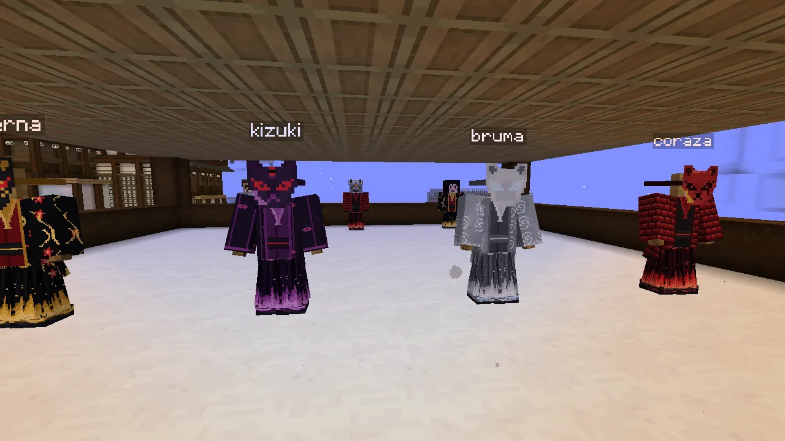
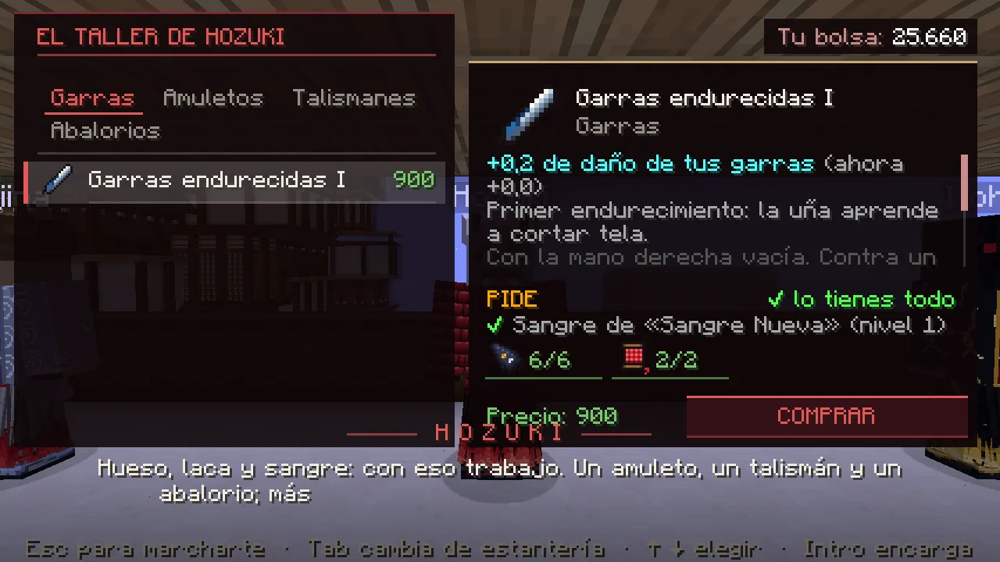

# El Mercado de la Noche: tu equipo de demonio

Los cazadores tienen la Aldea de los Herreros; los demonios, el <strong>Mercado de la Noche</strong>, en el Castillo Infinito. Allí se compran y se encargan la ropa, las armas de sangre, los amuletos, la botica y el endurecimiento de tus garras. Lo básico se compra; lo fuerte pide <strong>pergaminos</strong> que les arrancas a los cazadores.

## Dónde está y cómo llegar

Está en la sala del castillo **donde despiertas**. Desde cualquier sitio: **K → Lugares → «Mercado de la Noche»** y la biwa
de Nakime te deja delante de los mercaderes. Como todo viaje con la biwa, solo **de noche**; desde fuera cuesta lo mismo que ir
al castillo y **desde dentro del castillo es gratis**.

## Los tres mercaderes

| Mercader | Qué te ofrece |
|---|---|
| **Itohime**, la costurera | La **ropa**: cinco conjuntos de máscara, kimono, hakama y vendas. Y su telar: hilo de sangre y seda negra. |
| **Hozuki**, el tallista de hueso | **Endurecer tus garras** (5 niveles), las **armas de sangre** y los **amuletos, talismanes y abalorios** (se lleva uno de cada clase). |
| **Mujina**, el buhonero | **Materiales**, algún **pergamino** a la venta y la **botica**: vendas de mortaja, frascos de sangre, antídotos y más. |

Háblales con **clic derecho**. La pantalla es como la de la Aldea: estanterías (clic o ++tab++), lo que da cada pieza, lo que
pide (*«4/2»* = llevas 4, pide 2) y el probador. Pulsa **ENCARGAR** (o ++enter++).

<figure markdown="span">
  { loading=lazy }
  <figcaption>Mujina, Hozuki e Itohime, vestidos con lo que venden.</figcaption>
</figure>
<figure markdown="span">
  { loading=lazy }
  <figcaption>El telar de Itohime (aquí, con la Primera Sangre puesta: un 10 % más barato).</figcaption>
</figure>
<figure markdown="span">
  { loading=lazy }
  <figcaption>K → Lugares: el Mercado de la Noche entre las puertas de Nakime.</figcaption>
</figure>

## Los cinco conjuntos (Itohime)

Cada pieza da **armadura** —que se suma a la de tu piel de demonio— y **defensa contra los cazadores del Cuerpo** (el golpe de
un cazador te quita ese tanto menos). Con **2 y 4 piezas del mismo conjunto** ganas habilidades. Donde un cazador pide rango, tú
pides **nivel de sangre**.

| Conjunto | Precio de las piezas | Pide | Con 2 piezas | Con 4 piezas |
|---|---|---|---|---|
| **Primera Sangre** | 1.000 – 2.400 | nivel 1 (Sangre Nueva) | +3 % de velocidad | los mercaderes te cobran un 10 % menos y, a la sombra y fuera de combate, recuperas vida |
| **Coraza de Sangre** | 3.500 – 8.000 | nivel 4 (Devorador) y su pergamino | el fuego no te quema | +15 % de firmeza y **el cazador que te golpea se desangra** |
| **Velo de Bruma** | 3.500 – 8.000 | nivel 4 y su pergamino | el veneno no te afecta | +4 % de velocidad y **el cazador que te golpea se pierde en la bruma** |
| **Kizuki** | 10.000 – 22.000 | nivel 6 (Demonio Mayor) y un **pergamino raro** por pieza | de noche ves brillar a los cazadores y el hambre te pesa menos | con poca vida te sale un **escudo** (cada 2 minutos) |
| **Noche Eterna** | 25.000 – 55.000 | nivel 8 (Luna Inferior) y un **pergamino legendario** por pieza | golpeas más fuerte a los cazadores de élite y con nombre, y **los desangras** | un **golpe mortal de un cazador te deja en pie** con un escudo (cada 5 minutos) |

<figure markdown="span">
  { loading=lazy }
  <figcaption>Noche Eterna, Kizuki, Bruma y Coraza.</figcaption>
</figure>

### Contra las formas de un cazador jugador

Además, cada pieza te da **resistencia a las formas de respiración de un cazador jugador** (fuera del dojo): un 1 % por pieza
de la Primera Sangre, un 2 % de la Coraza y del Velo de Bruma, un 3 % del Kizuki y un 4 % de la Noche Eterna. Con un conjunto
entero, del **4 %** al **16 %**, y el **Ojo de la Luna Superior** (el amuleto legendario) suma un 2 % más: como mucho, un
**18 %**. Solo frena sus formas: su golpe normal y su golpe crítico entran igual. Lo pone la ficha de cada pieza.

## Tus garras (Hozuki)

Hozuki te **endurece las garras**: cinco niveles, cada uno **+0,2 de daño** a mano desnuda. Cuesta 1.000, 2.500, 5.000, 9.000 y
15.000 con materiales; piden nivel de sangre 1, 2, 4, 6 y 8, y los dos últimos el **Pergamino de las garras de Doma**, que te
da Doma al terminar el Rito de la Caza. Es tuyo: no depende de ningún objeto. Y también **templa tus armas de sangre**: +0,3
de daño por nivel.

<figure markdown="span">
  { loading=lazy }
  <figcaption>El taller de Hozuki: las garras y, en las otras estanterías, amuletos, talismanes y abalorios.</figcaption>
</figure>

## Las armas de sangre (Hozuki)

En la estantería **Armas** del taller de Hozuki se forjan cuatro armas para demonios. Cada una con su sonido, su estela y su
salpicadura de sangre; las dos espadas, con su funda.

| Arma | Precio | Pide | Daño | Cómo pelea | Contra los cazadores del Cuerpo |
|---|---|---|---|---|---|
| **Hoz de Sangre** | 2.400 y materiales | nivel 2 (Hambriento) | 6,5 | espada: guardia y parada | les desangra 3 segundos |
| **Espada Sangrienta** | 9.000 y materiales | nivel 4 (Devorador) | 7,5 | katana: guardia y parada | la hoja bebe: medio corazón por tajo |
| **Kanabō del Oni** | 24.000 y materiales | nivel 6 (Demonio Mayor) y un **pergamino raro** | 11, lento | guardia, sin parada | les aplasta (se frenan 1,5 s) y alcanza a tres |
| **Espada Sangrienta de la Luna Carmesí** | 60.000 y materiales | nivel 8 (Luna Inferior) y un **pergamino legendario** | 8 | katana: guardia y parada | les desangra y bebe un corazón por tajo |

- Las espadas sangrientas pegan lo mismo que las nichirin de los cazadores y con su mismo ritmo, también corriendo.
- **Con un arma en la mano no hay garras**, y cubriéndote con ella no salen artes. Cómo se pelea con ellas:
  [El combate del demonio](combate.md#las-armas-de-sangre).
- Son **de demonio**: en manos de un humano ni pegan ni cubren (tampoco si te curas).
- La **Espada de Kokushibo** no se vende: es la recompensa de su sangre ([ver](combate.md#la-espada-de-kokushibo)).

## De dónde salen los materiales y los pergaminos

| Dónde | Qué |
|---|---|
| Romper cazadores de las **patrullas** del Cuerpo | jirones de uniforme, esquirlas de nichirin; los de élite, además hilo de sangre y gotas de marechi |
| Los **pergaminos raros y legendarios** | también de las patrullas, muy de vez en cuando (más en los de élite y con la Luna de Sangre). Si llevas muchos sin uno, te toca seguro |
| La **Luna de Sangre** | la primera élite de cada Luna: una tsuba de Pilar y, a veces, un pergamino |
| Los **cazadores con nombre** que salen a por ti | tsubas y gotas; un **Pilar**, además un pergamino raro |
| Inosuke · Kanawo · Uzui | el pergamino de la Coraza · el de la Bruma · el del cascabel de hueso |
| La historia | al abrirte Nakime su puerta, seda y polvo de hueso; al acabar los Ritos, hilo y el pergamino de las garras |
| Devorar, los lotos y los encargos de la noche | polvo de hueso, jirones, pétalos de loto y gotas |
| **Mujina** | los materiales corrientes, a la venta |

Si ya habías hecho algo de lo de arriba antes de que abriera el Mercado, te llega una vez al entrar.

## Conviene saber

- Lo que encargas queda **ligado a ti** (no se tira ni se vende, vuelve contigo al morir) y la ropa y las armas **no se
  rompen**. Los pergaminos **sin estudiar** sí se pueden vender en el Mercado entre jugadores.
- Todo lo de *«contra cazadores»* (la defensa, los escudos, desangrar, la bruma, lo que hacen las armas) vale **contra los
  cazadores del Cuerpo (NPC)**, no contra jugadores. Contra otro jugador cuenta lo demás: la armadura, la velocidad, no
  quemarte o no envenenarte y la [resistencia a sus formas](#contra-las-formas-de-un-cazador-jugador). Los cazadores tienen lo
  mismo en la Aldea: el combate entre jugadores sigue igualado.
- Si te curas, lo conservas, pero a un humano no le hace nada. Si vuelves a ser demonio, vuelve a servirte.
