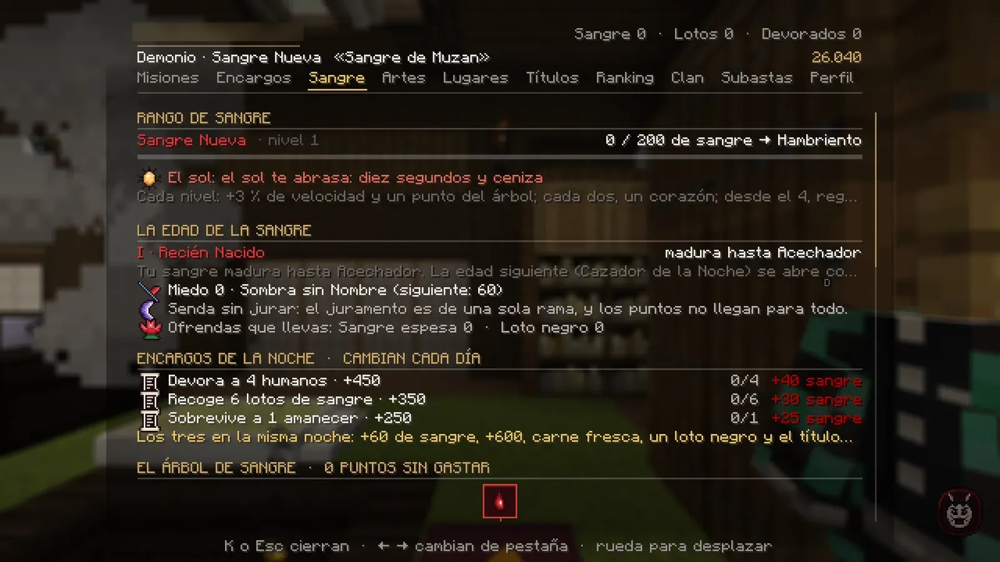

# Sangre, rangos y árbol

Un demonio no sube de rango con méritos: crece con la <strong>sangre</strong> que consigue cada noche.

## Cómo se gana sangre

| Cómo | Sangre | Notas |
|---|---|---|
| **Devorar** a un vecino (agachado + clic derecho, 2,5 s quieto) | +25 | Te llena el hambre y te cura. Es un **crimen**: sube tu notoriedad. |
| **Lotos de sangre**: de noche florecen cerca de ti y brillan; pásales por encima | +12 | Se marchitan al amanecer. |
| **Cazadores del Cuerpo** que patrullan | +8 (élite +16) | A veces sueltan **sangre espesa**, y suman a tu [paga de la noche](vida.md#la-paga-de-la-noche). |
| **Un cazador jugador** | +60 | Si su cabeza tiene [precio](combate.md#cabezas-con-precio), cobras además ese dinero y su 20 % en sangre. |
| **Misiones** y **encargos de la noche** | Variable | Los encargos de la noche cambian cada día (K → Sangre). |

- **Saciedad:** las 5 primeras comidas de cada noche dan la sangre entera; las 5 siguientes, la mitad; después, muy poca.
- En **Luna de Sangre**, la sangre que cazas cuenta **doble**.
- Si estás en un **clan**, cada demonio del clan conectado recibe además un 10 % de lo que cazas.

## Los rangos de sangre

| Rango | Sangre | | Rango | Sangre |
|---|---|---|---|---|
| 1 · Sangre Nueva | 0 | | 6 · Demonio Mayor | 2.750 |
| 2 · Hambriento | 200 | | 7 · Luna Menguante | 4.000 |
| 3 · Acechador | 500 | | 8 · Luna Inferior | 5.500 |
| 4 · Devorador | 1.000 | | 9 · Luna Superior | 7.500 |
| 5 · Sombra de la Noche | 1.750 | | 10 · Sangre de Muzan | 10.000 |

Cada rango te da más velocidad, un **punto del árbol** y un **punto de linaje**; cada dos rangos, un corazón más.
Los rangos **3**, **6** y **9** abren además tus teclas ++z++, ++x++ y ++c++ ([ver](artes.md#las-teclas-se-abren-con-tu-rango)).
Desde el rango 4 te regeneras solo de noche o bajo techo.

**El sol** (a cielo abierto, de día y sin lluvia):

| Rangos | Daño del sol |
|---|---|
| 1-2 | 2 de vida por segundo: mueres en unos 10 segundos |
| 3-4 | 1 por segundo |
| 5-6 | 0,5 por segundo |
| 7-8 | 0,25 por segundo, y solo en las horas centrales del día |
| 9-10 | Inmune |

## Las edades de la sangre

Tu sangre no madura sin límite: cada **edad** tiene un tope. Lo que ganas de más **espera** (no se pierde) hasta que
superas el **rito** de la edad siguiente. La K te avisa: *«Tu sangre está quieta…»*.

| Edad | Rangos | Se entra con | Pide para empezar el rito |
|---|---|---|---|
| I · Recién Nacido | 1-3 | La sangre de Muzan | — |
| II · Cazador de la Noche | 4-6 | El Rito del Hambre | Avanzar tu historia |
| III · Sangre Vieja | 7-8 | El Rito de la Caza | El rito anterior + **4 días de servicio** como demonio |
| IV · Sangre de Luna | 9-10 | El Rito de la Luna | El rito anterior + **8 días de servicio** como demonio |

## El árbol de sangre (K → Sangre)

- **Tres ramas** (Sangre, Sombra y Carne) de seis escalones cada una: más vida, regeneración, velocidad, salto,
  invisibilidad, daño a mano desnuda…
- Los **puntos** salen de tus rangos y de algunos pasos de tu historia. **No llegan para todo**: elige.
- El **5.º escalón es un juramento**: solo puedes jurar una rama. El **6.º** es la culminación de esa rama y tiene un precio.
- Haz **clic en un nodo** para aprenderlo. Al pasar el ratón ves qué pide (y lo que te falta, sin marcar).
- **Renegar de la sangre** (botón en K → Sangre) te devuelve los puntos para repartirlos de nuevo. Cuesta **3 lotos negros**.

!!! info "No lo confundas con el Árbol de la Sangre"
    Este árbol (K → Sangre) son tus nodos. El **Árbol de la Sangre** (`/sangre`, o K → Artes) son las seis sangres de las
    Lunas, que puedes ir heredando: [ver](artes.md#el-arbol-de-la-sangre).

<figure markdown="span">
  { loading=lazy }
  <figcaption>K → Sangre: tu rango y edad, el sol, el miedo, las ofrendas, los encargos de la noche y el árbol de sangre.</figcaption>
</figure>

## Miedo y notoriedad

- **Miedo:** tu fama entre los demonios. Solo sube (rangos, cazas, ritos…). Da títulos y lo piden los nodos altos del árbol.
- **Notoriedad:** lo que sabe el Cuerpo de ti. Sube con cada **crimen** (devorar, matar a un cazador jugador) y baja
  sola con el paso de los días del mundo.
    - Con cada crimen, los cuervos avisan a los cazadores conectados de dónde te han visto.
    - Desde **notoriedad 3**, de noche te buscan **patrullas** del Cuerpo.
    - Tu cabeza tiene **precio** y sales en el tablón **«Se busca»** de Tokio. Si un cazador te mata, cobra y tu notoriedad vuelve a 0.

## Materiales del demonio

- **Sangre espesa** y **lotos negros**: se ganan cazando, con los encargos de la noche, en la Luna de Sangre y en la
  historia. Se gastan en el árbol, en las artes mayores y en los ritos. **Guárdalos.**
- **Trofeos**: recuerdos de los cazadores con nombre que derrotas. No se venden.

## Al morir

Reapareces en el castillo y pierdes una parte de la sangre que has ganado desde tu rango (**nunca bajas de rango**):

- El **15 %** si te mata un cazador jugador (también si te sales en plena pelea con él). El mismo cazador no te lo vuelve a
  cobrar en 30 minutos: la siguiente vez cuesta como cualquier otra muerte.
- El **7 %** si mueres de otra cosa: el sol, un cazador del Cuerpo, una caída…
- El chat te lo dice: «La muerte te ha costado … de sangre (…). El nivel se queda.»

A los cazadores les pasa lo mismo con sus méritos.
