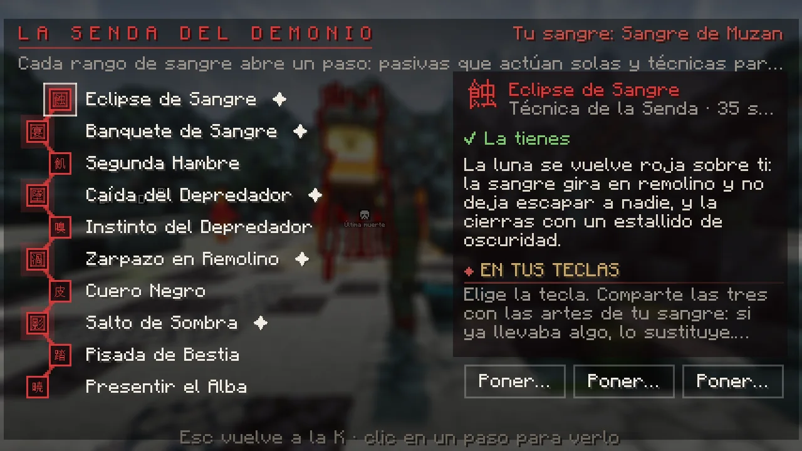
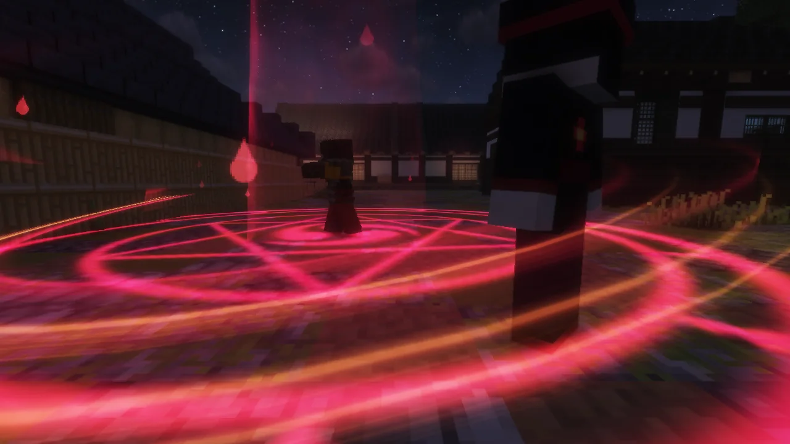

# La Senda del Demonio

Tu sangre aprende sola. Cada <strong>rango de sangre</strong> abre un paso de tu Senda: <strong>cinco pasivas</strong> que actúan sin que hagas nada y <strong>cinco técnicas</strong> de tu propio cuerpo para las teclas Z, X y C. No se compra nada ni se gasta nada: llegas al rango y es tuyo.

La ves en **K → Sangre → «✦ Senda del Demonio»**, arriba a la derecha de la pestaña. Es el espejo de la [Senda del Cazador](../cazador/rangos.md#la-senda-del-cazador): los dos bandos tienen las mismas cifras en sus pasivas de combate y técnicas de la misma fuerza en los mismos rangos.

<figure markdown="span">
  { loading=lazy }
  <figcaption>Tu Senda: a la izquierda, los diez pasos; a la derecha, el elegido y los botones para ponerlo en una tecla.</figcaption>
</figure>

!!! info "No la confundas"
    No es lo mismo que el [árbol de sangre](sangre.md#el-arbol-de-sangre-k-sangre) de K → Sangre (el de los puntos y los juramentos) ni que el [Árbol de la Sangre](artes.md#el-arbol-de-la-sangre) de `/sangre` (el de las seis sangres): esos siguen igual y la Senda no les quita nada.

## Los diez pasos

| Rango de sangre | Paso | Qué es | Qué hace |
|---|---|---|---|
| 1 · Sangre Nueva | **Presentir el Alba** | pasiva | Un minuto antes de que amanezca, tu sangre te avisa. Hasta que el sol ya no pueda contigo. |
| 2 · Hambriento | **Pisada de Bestia** | pasiva | +15 % de resistencia al empuje. |
| 3 · Acechador | **Salto de Sombra** | técnica | Te hundes en tu sombra y brotas nueve bloques más allá: el zarpazo se lleva a lo que cruzas. |
| 4 · Devorador | **Cuero Negro** | pasiva | +2 de dureza de armadura. |
| 5 · Sombra de la Noche | **Zarpazo en Remolino** | técnica | Dos vueltas con las garras abiertas: la primera atrae, la segunda despide. |
| 6 · Demonio Mayor | **Instinto del Depredador** | pasiva | Los cazadores del Cuerpo (los del mundo, no los jugadores) te quitan un 10 % menos. |
| 7 · Luna Menguante | **Caída del Depredador** | técnica | Saltas hacia lo que miras y caes a plomo: el suelo se abre en círculo y brotan púas de sangre. |
| 8 · Luna Inferior | **Segunda Hambre** | pasiva | Al bajar de un cuarto de la vida por un cazador del Cuerpo, Regeneración II 5 s (una vez cada 2 minutos). |
| 9 · Luna Superior | **Banquete de Sangre** | técnica | Te lanzas sobre la presa que tienes delante: dos desgarros y un mordisco que te cierra parte de las heridas. |
| 10 · Sangre de Muzan | **Eclipse de Sangre** | técnica | La luna se vuelve roja sobre ti: la sangre gira en remolino, no deja escapar a nadie y lo cierras con un estallido. |

## Cómo se usan las técnicas

<ol class="pasos" markdown>
<li markdown>**Abre K → Sangre → «✦ Senda del Demonio»** y haz clic en la técnica.</li>
<li markdown>**Pulsa «Poner en Z», «X» o «C».** Si la tecla ya llevaba un arte de tu sangre, la sustituye; otro clic en la tecla marcada la quita.</li>
<li markdown>**Las teclas se abren con tu rango**, como siempre: la ++z++ en el rango 3, la ++x++ en el 6 y la ++c++ en el 9. Son tres teclas para cinco técnicas y todas tus artes: tú eliges.</li>
</ol>

Las técnicas de la Senda **se quedan en su tecla aunque cambies de sangre**: no son de ninguna sangre, son tuyas. El clic derecho sigue siendo solo para las artes de tu sangre.

Salen con la mano como la lleves. Cuentan como cualquier arte: tienen su espera, comparten la recuperación de 4 s entre arte y arte, no salen si te estás cubriendo y, cerca de un duelo del dojo, quien no pelea no las puede lanzar.

| Técnica | Espera en su rango | A un jugador | Lo que tienes que saber |
|---|---|---|---|
| Salto de Sombra | 13 s | un golpe | Te mueve en línea recta. Si chocas con un muro, te paras. |
| Zarpazo en Remolino | 14 s | dos golpes | A 4 bloques a tu alrededor. A los jugadores no los mueve: solo el daño. |
| Caída del Depredador | 15 s | un golpe | El salto no se corrige en el aire: quien se aparta a tiempo se salva. En el borde hace menos daño. |
| Banquete de Sangre | 19 s | tres golpes | Necesitas una presa a 10 bloques, de frente. Si se te escapa (una perla, un muro de por medio), el golpe va al aire. Solo cura lo que muerdes de verdad, y en el tatami no cura. |
| Eclipse de Sangre | 35 s | cuatro golpes | Te quedas en el sitio casi 3 segundos: si el rival te ve venir, puede cortarte. |

<figure markdown="span">
  { width="760" loading=lazy }
  <figcaption>Eclipse de Sangre, la técnica del rango 10.</figcaption>
</figure>

## Preguntas

**¿Tengo que comprar algo o aprenderlo?** No. Al subir de rango ya lo tienes; el mensaje del rango te dice qué paso se abre.

**¿Gasta puntos de linaje o del árbol?** No.

**¿Y si me curo y vuelvo a ser humano?** La Senda es del demonio: se va con la sangre (las teclas se vacían y las pasivas se quitan). Si vuelves a ser demonio, tu rango de entonces la abre otra vez.

**¿Un cazador tiene algo parecido?** Sí: la [Senda del Cazador](../cazador/rangos.md#la-senda-del-cazador), en K → Rango.
