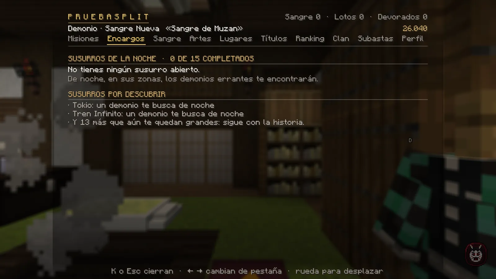
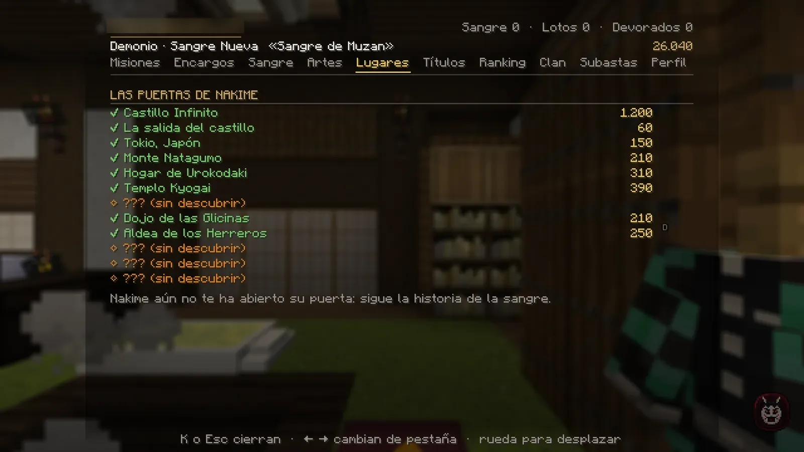

# La vida de un demonio

## Tus misiones

- **La historia del demonio** está en K → Misiones. Los demonios que te necesitan **vienen a ti**: de noche al aire libre, o a cualquier hora en el castillo.
- **Susurros de la noche** (K → Encargos): encargos de demonios errantes que te encuentran de noche en sus zonas.
- **Encargos de la noche** (K → Sangre): **tres tareas** que cambian cada día (devorar, recoger lotos, sobrevivir a un amanecer). Se cobran solas al cumplirlas.
- **Las herencias** del [Árbol de la Sangre](artes.md#el-arbol-de-la-sangre): la Luna de la sangre siguiente te busca de noche cuando puedes heredarla.
- **Los cazadores con nombre** que piden tus misiones solo salen a por ti en **la misión que sigues** (la de tu tarjeta). Si te
  espera uno en otra, te lo dice una vez por noche: para que venga, síguela en K → Misiones ([ver](combate.md#los-cazadores-del-cuerpo)).

| Encargo de la noche | Premio |
|---|---|
| Devora a varios humanos | +40 de sangre y 450 |
| Recoge lotos de sangre | +30 de sangre y 350 |
| Sobrevive a un amanecer | +25 de sangre y 250 |
| **Los tres en un día** | +60 de sangre, 600, carne, **un loto negro** y el título «Noctámbulo» |

<figure markdown="span">
  { loading=lazy }
  <figcaption>K → Encargos de un demonio: los susurros de la noche y las zonas donde te buscan.</figcaption>
</figure>

## Dinero, tiendas y Mercado

- El dinero es el mismo que el de los cazadores y **se conserva** al convertirte. Tus misiones, tus encargos de la noche, tu
  **paga de la noche** y las [cabezas de los cazadores](combate.md#cabezas-con-precio) pagan.
- **Tiendas:** al demonio solo le venden *«lo de casa»* (Hogar, Materiales, Casa Taisho y los
  [muebles](../economia/tiendas.md#los-muebles-japoneses)). Ni comida ni provisiones.
- **Mercado:** se abre tras tu primer rito (el Rito del Hambre), o desde el principio si ya tenías tu katana como cazador.
- Sin Caja del Cuartel ni forja: son cosas del Cuerpo. Tu equipo está en el [Mercado de la Noche](mercado.md).

### La paga de la noche

Lo que llevan encima los cazadores del Cuerpo que rompes: el espejo de la recompensa nocturna del cazador.

- Cada **cazador de patrulla** suma **35** a tu paga de la noche; uno de **élite**, **70**. En la barra lo ves: «+35 por un
  cazador del Cuerpo (esta noche: …)».
- **Racha**: si encadenas cazadores con menos de 45 segundos entre uno y otro, cada uno vale un 10 % más (hasta ×1,5). Con la
  **Luna de Sangre**, el doble.
- **Se cobra al amanecer** (o al salir del juego), con un **5 % más por cada rango de sangre** por encima del primero y el
  +25 % de un [rango VIP](../vip.md): «☾ Amanece. Has roto a 2 cazadores del Cuerpo. Lo que llevaban encima te deja +81.»
- No cuentan los cazadores con nombre (pagan en su misión) ni los que salen en las misiones y encargos.

## Viajar: la biwa de Nakime

Cuando avances en tu historia, **Nakime** te abre su puerta y **K → Lugares** pasa a ser **«Las puertas de Nakime»**:
viajas a los lugares que ya descubriste, al **Castillo Infinito** y a la **salida del castillo**.

- Solo **de noche** (o de día si el sol ya no te quema). Quédate quieto 3 segundos.
- Cobra como el cuervo de los cazadores (más caro cuanto más lejos, con un tope). **Salir del castillo es gratis.**
- Hay que esperar 90 segundos entre viajes.

<figure markdown="span">
  { loading=lazy }
  <figcaption>«Las puertas de Nakime»: los lugares con su precio. Hasta que Nakime te abre la puerta, sigue tu historia.</figcaption>
</figure>

## El castillo

- Es tu **refugio**: reapareces allí al morir y es donde te visitan las Lunas.
- Si entras al servidor de día y el sol te quemaría, el castillo te recoge.
- Para salir, usa **«La salida del castillo»** en K → Lugares, o espera a que Nakime te deje fuera de noche.

## Clanes, duelos y PvP

- Puedes estar en un **clan** con cazadores. Los grados del demonio tienen sus propios nombres (Siervo, Colmillo, Veterano, Luna del Clan).
- Cada demonio del clan conectado recibe un **10 %** de la sangre que cazas.
- **Duelos** en el dojo: desde tu primer rito (o si ya tenías katana). Peleas con tus artes y tus garras de nacimiento, sin
  sol ni regeneración.
- **PvP libre** contra cazadores que ya tengan su katana, fuera de los refugios, las zonas seguras y las casas sin PvP, con
  los mismos topes de daño que ellos (como mucho 5 por golpe, 7 por segundo y 12 cada 10 segundos de un mismo rival).
- Tus garras, tu carne de demonio, el mordisco, la guardia con los brazos y las armas de sangre:
  [El combate del demonio](combate.md).

## Tu ropa

El **uniforme del Cuerpo** se guarda al convertirte y no te lo puedes poner (*«La tela del Cuerpo te quema»*). Te lo
devuelven si te curas.
