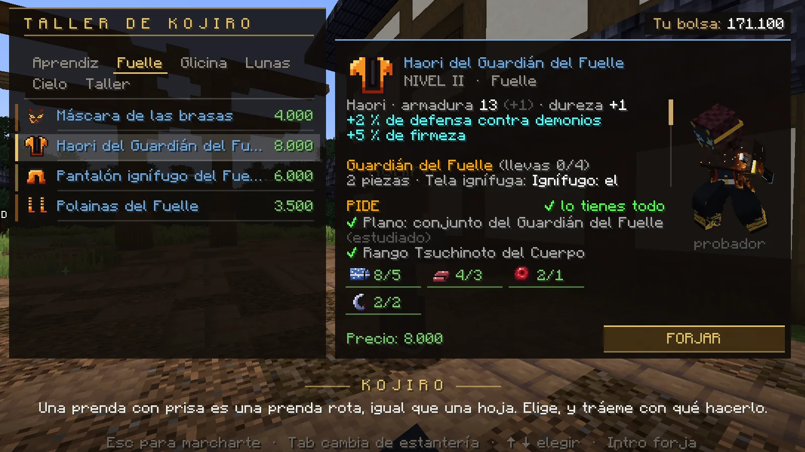
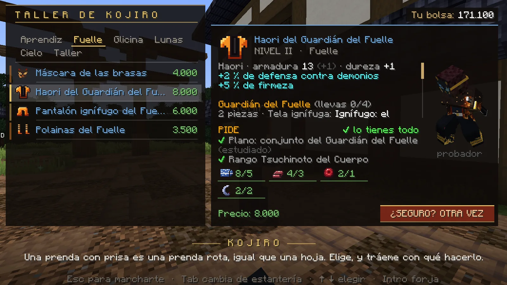
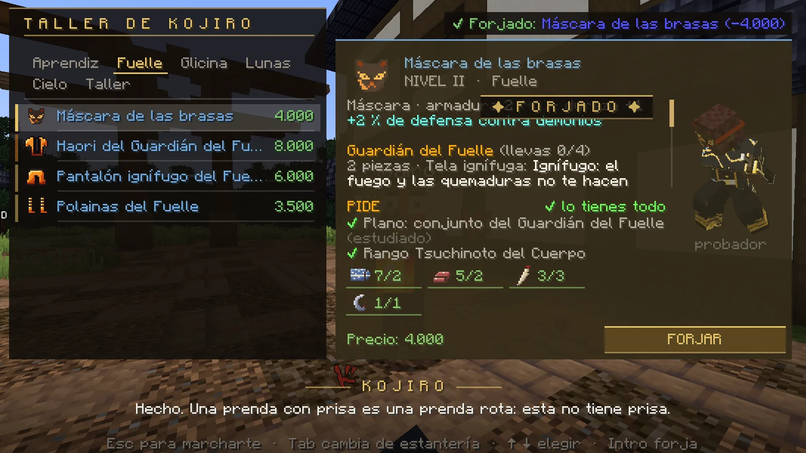
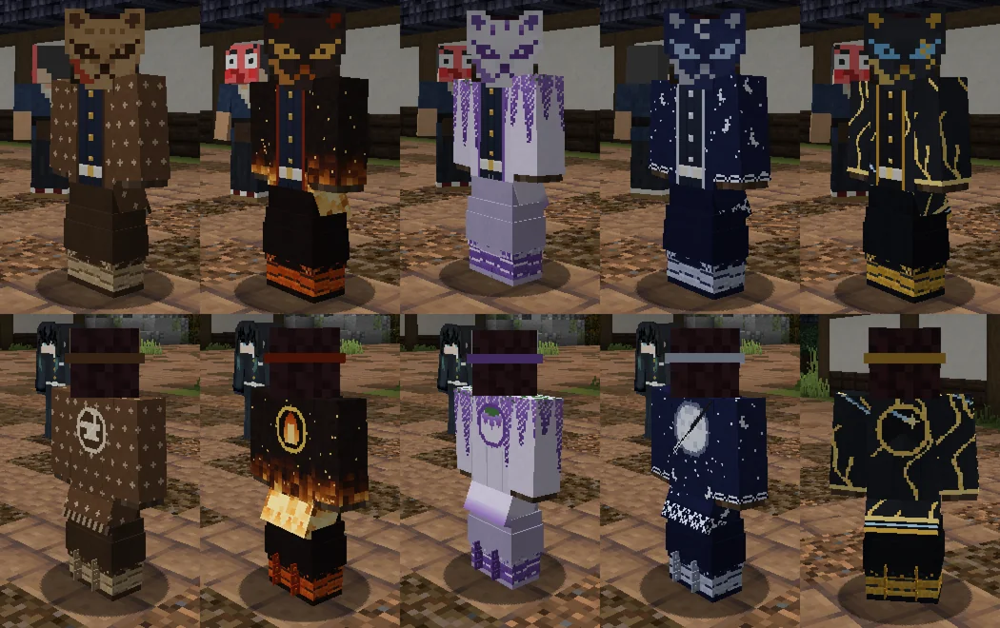
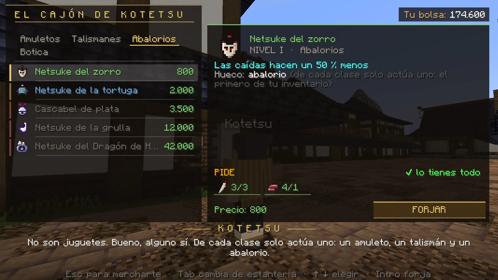
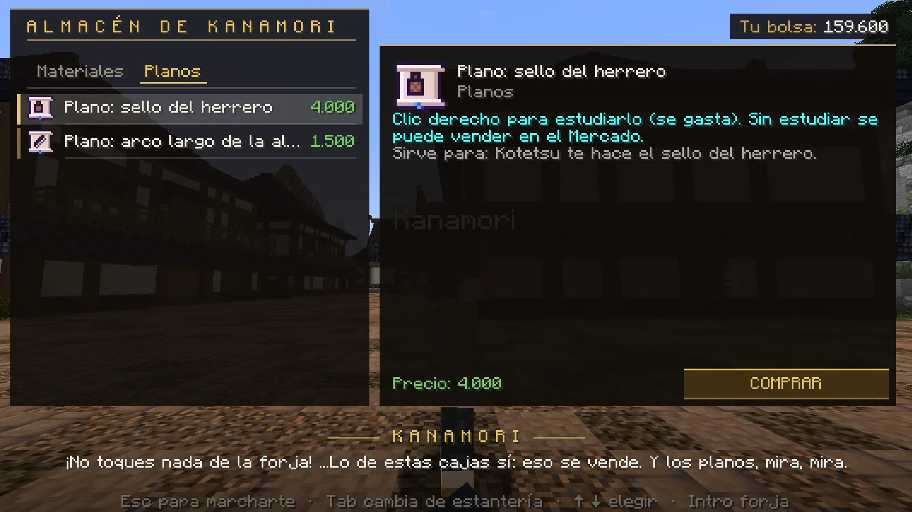
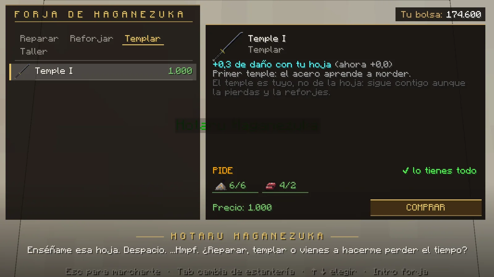
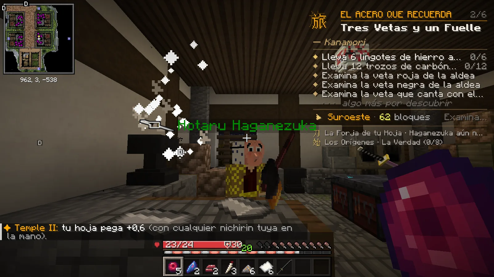

# La Aldea de los Herreros: tu equipo

La armadura, las máscaras, los amuletos y las mejoras de tu katana se consiguen en un solo sitio: la <strong>Aldea de los Herreros</strong>. Lo básico se compra; lo fuerte pide <strong>planos</strong> que sueltan los demonios.

## Los cuatro artesanos

| Artesano | Qué te ofrece |
|---|---|
| **Kojiro** | Las **prendas**: cinco conjuntos de máscara, haori, pantalón y polainas. También su taller: lingotes de acero, núcleos, tela y el arco de la Aldea. |
| **Kotetsu** | **Amuletos, talismanes y abalorios**, y la **botica**: vendas, antídotos, píldoras y elixires para las peleas. |
| **Kanamori** | **Materiales** y **planos** a la venta. |
| **Hotaru Haganezuka** | Tu katana: **reparar**, **templar** (más daño), reforjar y piedras de afilar. Trabaja en su yunque y lo verás forjar. |

Háblales con **clic derecho**. Si alguno tiene una misión pendiente contigo, de pie te habla de la misión: **agáchate
(++shift++) y háblale** para ver su tienda.

!!! demonio "Si eres demonio"
    Los artesanos de la Aldea no atienden a demonios: tu equipo está en el [Mercado de la Noche](../demonio/mercado.md),
    en el Castillo Infinito.

<figure markdown="span">
  { loading=lazy }
  <figcaption>El taller de Kojiro: a la derecha, lo que da la pieza, lo que pide y el probador con la prenda puesta.</figcaption>
</figure>
<figure markdown="span">
  { loading=lazy }
  <figcaption>Lo de 5.000 o más pide pulsar dos veces.</figcaption>
</figure>
<figure markdown="span">
  { loading=lazy }
  <figcaption>¡Forjado! La pieza va directa a tu inventario.</figcaption>
</figure>

## Cómo se forja

1. Elige una **estantería** (clic o ++tab++) y una **pieza** (clic o las flechas).
2. Mira la ficha: qué da, y en **PIDE** lo que necesitas — el plano, el rango y los materiales con lo que llevas encima
   (*«6/2»* = llevas 6, pide 2). En verde lo que tienes; en rojo lo que te falta. Pasa el ratón por un material para ver su nombre.
3. Si es una prenda, el **probador** te enseña con ella puesta.
4. Pulsa **FORJAR** (o ++enter++). Si no puedes, el botón te dice por qué: *«BLOQUEADO»* (te falta el plano o el rango)
   o *«TE FALTA ALGO»* (materiales, dinero o hueco).

Lo que forjas queda **ligado a ti**: no se tira ni se vende, y vuelve contigo al morir. Las prendas **no se rompen**.

## Los cinco conjuntos

Cada pieza da **armadura** y **defensa contra demonios** (el golpe de un demonio te quita ese tanto menos). Con **2 y 4 piezas
del mismo conjunto** ganas habilidades. La defensa y las habilidades no funcionan en el dojo ni contra otros jugadores: solo
contra los demonios que no son jugadores. Contra un demonio jugador cuenta la armadura y
[la resistencia a sus artes](#contra-las-artes-de-un-demonio-jugador).

| Conjunto | Precio de las piezas | Pide | Con 2 piezas | Con 4 piezas |
|---|---|---|---|---|
| **Aprendiz de la Aldea** | 1.000 – 2.400 | rango Mizunoe | +3 % de velocidad | los artesanos te cobran un 10 % menos y recuperas vida fuera de combate |
| **Guardián del Fuelle** | 3.500 – 8.000 | rango Tsuchinoto y su plano | el fuego no te quema | +15 % de firmeza y **quien te golpea arde** |
| **Viento de Glicina** | 3.500 – 8.000 | rango Tsuchinoto y su plano | el veneno no te afecta | +4 % de velocidad y **quien te golpea se envenena de glicina** |
| **Cazador de Lunas** | 10.000 – 22.000 | rango Hinoto y un **plano raro** por pieza | ves de noche y los demonios brillan | con poca vida te sale un **escudo** (cada 2 minutos) |
| **Hierro del Cielo** | 25.000 – 55.000 | rango Kinoto y un **plano legendario** por pieza | golpeas más fuerte a los jefes y **quemas** al golpear | un **golpe mortal te deja con vida** y un escudo (cada 5 minutos) |

<figure markdown="span">
  { loading=lazy }
  <figcaption>De izquierda a derecha: Aprendiz, Fuelle, Glicina, Lunas y Hierro del Cielo.</figcaption>
</figure>

Los planos del **Guardián del Fuelle** y del **Viento de Glicina** te los dan dos jefes de la historia la primera vez que los
vences. Los materiales salen de jugar: ceniza y colmillos de los demonios de la noche, acero y núcleos de los demonios con
nombre, esquirlas de las Lunas y de las cacerías, y lo básico en las tiendas de la Aldea.

### Contra las artes de un demonio jugador

Además, cada pieza te da **resistencia a las artes de sangre de un demonio jugador** (fuera del dojo): un 1 % por pieza del
Aprendiz, un 2 % del Fuelle y de la Glicina, un 3 % del Cazador de Lunas y un 4 % del Hierro del Cielo. Con un conjunto entero,
del **4 %** al **16 %**, y el **Omamori del Sol Naciente** (el amuleto legendario) suma un 2 % más: como mucho, un **18 %**.
Vale también contra lo que sus artes invocan (los peces, los niños de cristal…), pero no contra su zarpazo ni su mordisco. Lo
pone la ficha de cada pieza. Los demonios tienen lo mismo contra tus formas.

## Amuletos, talismanes y abalorios (Kotetsu)

Puedes llevar **uno de cada clase** encima (en el inventario): si llevas dos de la misma clase, solo funciona el primero.

| Clase | Ejemplos |
|---|---|
| **Amuletos** | más velocidad, limpiarte de efectos, más armadura; los raros te curan al matar un demonio, y el legendario te cura al golpear con poca vida |
| **Talismanes** | más suerte con los planos, ver a los demonios, que tu katana se gaste menos; los raros envenenan de glicina y el legendario te deja ver a los demonios de lejos |
| **Abalorios** | que las caídas te hagan menos daño, más firmeza; los raros te hacen saltar más y el legendario devuelve parte del golpe a quien te pega |

<figure markdown="span">
  { loading=lazy }
  <figcaption>El cajón de Kotetsu: amuletos, talismanes, abalorios y la botica.</figcaption>
</figure>

## Los planos raros y legendarios

Lo más fuerte (el Cazador de Lunas, el Hierro del Cielo y los accesorios raros y legendarios) pide **planos** que no se
venden: los sueltan los **demonios de la noche, muy de vez en cuando**. Cuantos más cazas, más cerca estás.

- Cada demonio de la noche que cazas tiene un **1,2 %** de soltar un plano raro y un **0,08 %** de soltar uno **legendario**.
  Uno **con nombre**, el triple; en una noche de **Luna de Sangre**, el doble.
- La **Luna Inferior** de la Luna de Sangre da a cada cazador que cobra un **30 %** de un plano raro y un **1,5 %** de uno
  legendario. Vencer por primera vez a cada Luna Superior de la historia te da uno raro.
- **La red:** si cazas **150 demonios** seguidos sin un plano raro (o **1.200** sin uno legendario), ese último te lo da seguro, y
  de uno que aún no tienes.
- Desde la actualización 1.5, los legendarios son **mucho más difíciles**: antes eran un 0,3 % por demonio (un 6 % con la Luna
  Inferior) y seguros a los 400.
- Cuando alguien encuentra uno **legendario**, se entera todo el servidor.
- Los talismanes del **rastreador** y de los **Mil Ojos** te dan más suerte (más probabilidad; la red no cambia).
- Para usar un plano, **clic derecho** sobre él: lo aprendes y se gasta. Si te sale uno **repetido**, no lo estudies:
  **véndelo en el [Mercado](mercado.md)**.
- Si llevas el inventario lleno, el plano (o el material) te espera en tu
  [consigna](objetos.md#el-botin-que-no-te-cabe-la-consigna): te llega al hacer hueco, o con `/botin`.

<figure markdown="span">
  { loading=lazy }
  <figcaption>Kanamori vende algunos planos sencillos; los raros y legendarios solo se consiguen cazando.</figcaption>
</figure>

## Tu katana: reparar y templar (Hotaru Haganezuka)

- Tu katana **se gasta** al usarla. Si se queda **rota**, no lanza formas y pega muy poco, pero no desaparece: llévasela a
  Hotaru y te la repara. Tu katana trae **Reparación** (*Mending*): la experiencia también la arregla. Las **piedras de afilar**
  le devuelven parte del filo donde estés.
- **Templar** sube el daño de tu hoja (+0,3 por nivel, hasta 5 niveles: de 1.000 a 15.000 más materiales). El temple es
  **tuyo**: lo conservas aunque pierdas la katana o te forjen otra.

<figure markdown="span">
  { loading=lazy }
  <figcaption>La forja de Hotaru: reparar, reforjar, templar y su taller.</figcaption>
</figure>
<figure markdown="span">
  { loading=lazy }
  <figcaption>Al forjar, el artesano trabaja la pieza en su yunque delante de todos.</figcaption>
</figure>

!!! demonio "Si eres demonio"
    Los artesanos de la Aldea trabajan para el Cuerpo: a un demonio no le atienden.
