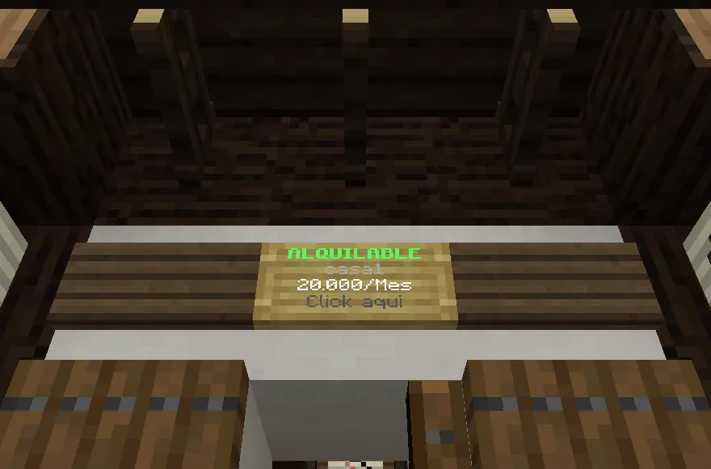
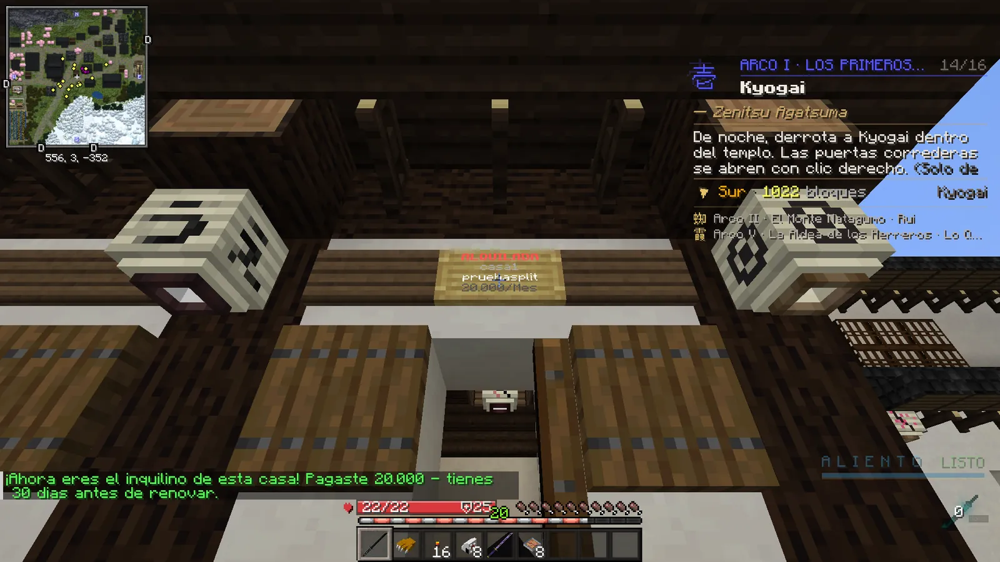

# Casas de alquiler

Tu casa es el único sitio del mapa donde puedes construir, decorar y guardar cosas en cofres. El tutorial te da el dinero para la primera.

## Cómo se alquila

<figure markdown="span">
  { loading=lazy }
  <figcaption>Una casa libre tiene un cartel verde «ALQUILABLE» con su nombre y su precio.</figcaption>
</figure>
<figure markdown="span">
  { loading=lazy }
  <figcaption>Al alquilarla, el cartel pasa a «ALQUILADA» con tu nombre.</figcaption>
</figure>

1. Busca en Tokio una casa con el cartel verde **«ALQUILABLE»**.
2. Haz **clic derecho en el cartel**, o escribe **`/rentar <nombre>`** con el nombre que pone el cartel (por ejemplo `/rentar casa1`).
3. Se cobra **en el momento**: *«¡Ahora eres el inquilino de esta casa! Pagaste 20.000 - tienes 30 dias antes de renovar.»*

!!! warning "El clic en el cartel cobra sin preguntar"
    En una casa libre, el clic en su cartel la alquila al instante. Asegúrate de que es la que quieres.

## Precio y renovación

- **20.000 cada 30 días reales.** Solo **una casa** por jugador.
- Solo se puede **renovar en los últimos 3 días**: haz clic en tu cartel o usa `/rentar <nombre>` y se suman 30 días.
  Antes de eso, el cartel te dice cuántos días te quedan (sin cobrarte nada).
- Si estás conectado cuando vence y tienes dinero, **se renueva sola**.
- Con 3 días o menos te avisa al entrar: *«Te quedan N día(s) para pagar la casa…»*.

## Qué puedes hacer dentro

- **Colocar bloques** y quitar los que pusiste tú. El edificio en sí no se desmonta.
- Poner y usar **cofres, barriles, hornos**, mesa de trabajo, yunque y afiladora: **solo funcionan en tu casa**.
- Colgar **cuadros y marcos**, poner **soportes de armadura** y colocar tu **Trofeo del Dojo**.
- Los demás pueden entrar (las puertas funcionan para todos), pero **no tocan nada**.
- No se pueden usar cubos de agua ni de lava.

## Si se acaba el alquiler

Si cuando vence no estás conectado o no tienes dinero, **pierdes la casa**: vuelve a como estaba y queda libre para
otro. **Lo tuyo no se pierde**: el contenido de cofres, los bloques que pusiste, los marcos y el trofeo van a tu
**buzón del Mercado** (K → Subastas → Buzón).

!!! tip "Para no perderla"
    Entra en los últimos 3 días y renueva. No hay forma de dejar la casa antes ni de recuperar lo pagado.
