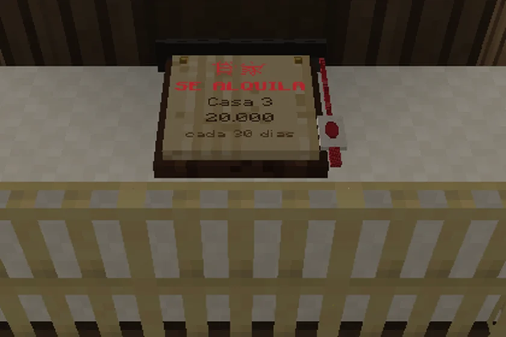
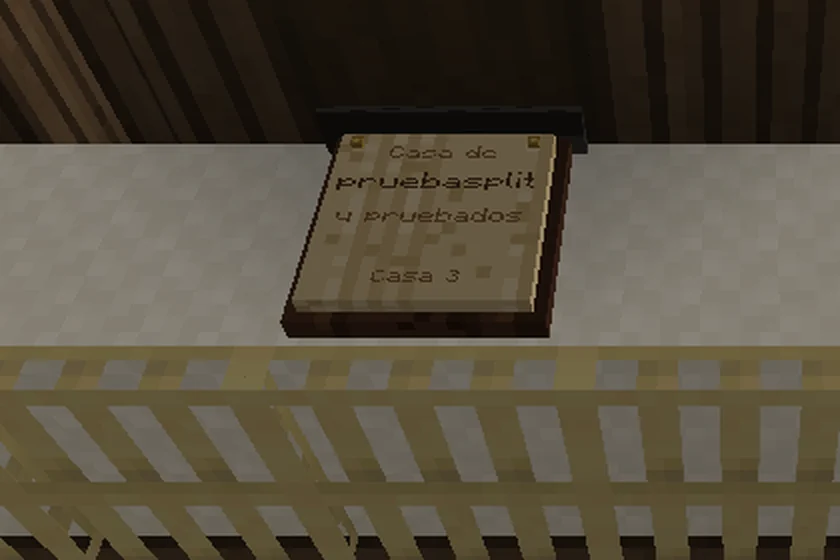
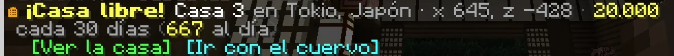
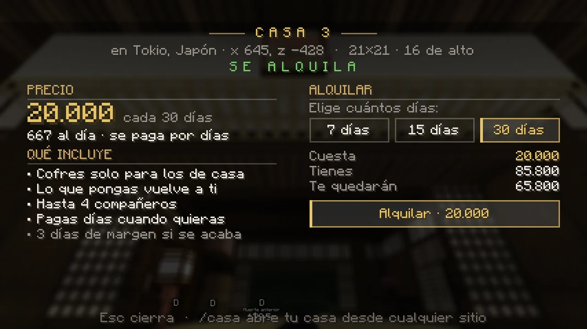
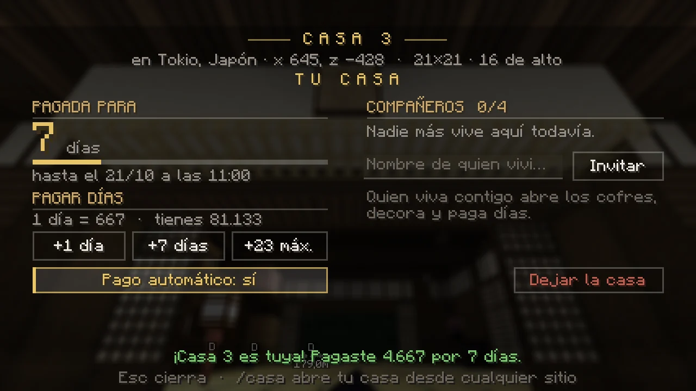
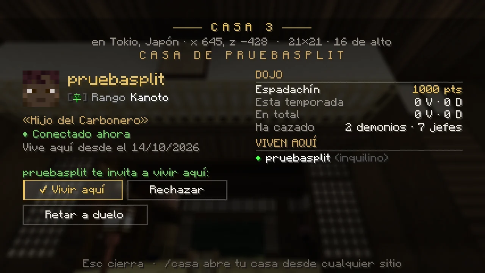

# Casas y parcelas de alquiler

Tu casa (y tu parcela, si tienes una) es el único sitio del mapa donde puedes construir, decorar y guardar cosas en cofres. El tutorial te da el dinero para la primera casa.

## La placa de la puerta

Cada casa tiene junto a la puerta una **placa de madera**. Si está libre, lleva colgada una tira de papel roja y dice
**«SE ALQUILA»**, el nombre de la casa y su precio; si está alquilada, dice **de quién es** (y con quién vive).

<figure markdown="span">
  { loading=lazy }
  <figcaption>Una casa libre: «SE ALQUILA», su nombre y su precio.</figcaption>
</figure>
<figure markdown="span">
  { loading=lazy }
  <figcaption>Una casa alquilada: el nombre de quien vive en ella.</figcaption>
</figure>

Acércate a la placa y pulsa **I** (o haz clic derecho en ella): se abre la **pantalla de la casa**. Desde cualquier sitio,
`/casa ver <casa>`.

## Cómo se alquila

1. Busca una casa con la placa de **«SE ALQUILA»**. Cuando una queda libre, el chat lo avisa con dos botones:
   **[Ver la casa]** e **[Ir con el cuervo]**.

    { loading=lazy }

2. Ponte en la casa o junto a su placa y pulsa **I**.
3. Elige cuántos días (**7, 15 o 30**), mira lo que cuesta y lo que te quedará, y pulsa **Alquilar**. Te pide confirmar.

<figure markdown="span">
  { loading=lazy }
  <figcaption>Una casa libre: su precio, lo que cuesta al día y los días que quieres pagar.</figcaption>
</figure>

- **20.000 cada 30 días reales** (667 al día). Son días del calendario: cuentan también mientras no juegas.
- Solo **una casa** por jugador (la tuya o la de alguien con quien vives).

## Pagar más días

En la pantalla de tu casa (pulsa **I** dentro de ella o junto a su placa, o escribe **`/casa`** desde cualquier sitio) ves
cuántos días te quedan y puedes **pagar +1, +7 o hasta el máximo**: como mucho, **30 días pagados por delante**. También con
`/casa pagar <días>`.

<figure markdown="span">
  { loading=lazy }
  <figcaption>Tu casa: los días que quedan, pagar más días, el pago automático y tus compañeros.</figcaption>
</figure>

- Con el **pago automático** (viene puesto), si se acaba lo pagado mientras estás conectado, se cobra solo. Se quita con
  `/casa automatico no`.
- Con 3 días o menos pagados te avisa al entrar.

## Si se acaba lo pagado

No la pierdes en ese momento: tienes **3 días de mora**. La casa sigue siendo tuya, al entrar te avisa en rojo de lo que
debes y, con el pago automático y dinero, se cobra sola al conectarte. Pasados esos 3 días, la casa vuelve a como estaba y
queda libre. **Lo tuyo no se pierde**: lo que colocaste, los marcos, el trofeo y el contenido de los cofres van a tu
**buzón del Mercado** (K → Subastas → Buzón).

## Vivir con otros jugadores

- **`/casa invitar <jugador>`**: le llega una invitación con **[✔ Aceptar]** y **[✖ Rechazar]** (tiene 2 minutos). Hasta
  **4 compañeros**.
- Tus compañeros **abren los cofres, colocan y quitan lo suyo y pagan días**. Solo tú invitas, quitas (`/casa quitar <jugador>`)
  y dejas la casa.
- Un compañero se va con **`/casa salir`**; lo que colocó se queda en la casa.
- Al acabar el alquiler, lo que puso cada uno vuelve a **su** buzón.

## La casa de otro jugador

Si abres la placa de una casa alquilada ves la **ficha de quien vive allí**: su rango, su título, su clan, si está conectado,
su puntuación en el **Dojo** y los demonios y jefes que ha cazado. Desde ahí puedes **retarle a duelo**.

<figure markdown="span">
  { loading=lazy }
  <figcaption>La casa de otro: su ficha y su puntuación en el Dojo.</figcaption>
</figure>

## Qué puedes hacer dentro

- **Colocar bloques** y quitar los que pusiste tú. El edificio en sí no se desmonta.
- Poner y usar **cofres, barriles, hornos**, mesa de trabajo, yunque y afiladora: **solo funcionan en la casa en la que vives**.
- Colgar **cuadros y marcos**, poner **soportes de armadura** y colocar tu **Trofeo del Dojo**.
- Decorarla con los **[muebles japoneses](tiendas.md#los-muebles-japoneses)** de la tienda de Kohei (faroles, biombos, bonsáis,
  cojines para sentarse, un torii…) y poner tus **[mesas de juego](../social/juegos.md)**.
- Los demás pueden entrar (las puertas funcionan para todos), pero **no tocan nada**.
- No se pueden usar cubos de agua ni de lava.

## PvP en tu casa

En tu casa (y en tu parcela) **decides tú** si se puede pelear dentro:

- **`/casa pvp no`** (o `/parcela pvp no`, o el botón **«☮ PvP dentro»** de su pantalla) la convierte en una **zona segura**:
  desde dentro no se pega a nadie y a quien está dentro no se le puede pegar, ni con artes ni con lo que dejan (lentitud,
  veneno…). **`/casa pvp si`** lo vuelve a poner.
- Solo lo cambia el **inquilino**, no los compañeros. Viene **puesto** (como en el resto del mapa) y vuelve a ponerse cuando
  la casa queda libre.
- Se ve en la **placa** de la puerta («☮ sin PvP»), en el cartel de la parcela, en su pantalla y en el rótulo al entrar:
  «… · ☮ sin PvP: aquí no se pelea».
- **La marca de combate manda**: quien entra en plena pelea (con la franja «⚔ EN COMBATE») no está a salvo hasta que se le
  acaba, y con la marca no puedes quitar el PvP («En combate no se quita el PvP»). Tampoco se cambia dos veces en 10 segundos.
  [Ver la marca](../cazador/combate.md#la-marca-de-combate).
- Es solo entre jugadores: las patrullas del Cuerpo y los demonios de la noche no lo miran.
- Con el PvP puesto, dentro se pelea como en el resto del mapa: un demonio y un cazador sí; dos cazadores, solo en el dojo.

## Dejar la casa

**`/casa dejar`** (o el botón **Dejar la casa**): lo de dentro va a los buzones y la casa queda libre para otro.
**No se devuelve lo pagado.**

## Parcelas para construir

Una **parcela** es un trozo de suelo vacío que se alquila igual que una casa, pero **para construir lo que quieras desde
cero**. Cuando queda una libre, el chat lo avisa («¡Parcela libre!») con sus botones para verla o ir con el cuervo, y
**`/parcela lista`** te enseña las libres.

- **Se reconocen** por su valla de estacas con la punta roja, unidas por una cuerda de paja con tiras de papel. Junto al
  borde está su **cartel**: si está libre, «SE ALQUILA», su tamaño, su altura y su precio por 30 días; si no, de quién es y
  con quién la comparte. Clic derecho en el cartel o la **I** junto a él para verla.
- **Se alquila y se paga como una casa**: por días reales, con pago automático, 3 días de mora y compañeros. Todo con
  **`/parcela`**, que funciona igual que `/casa` (`ver`, `ir`, `info`, `pagar`, `automatico`, `invitar`, `quitar`, `salir`,
  `dejar`, `pvp`…).
- Puedes tener **una casa y una parcela** a la vez.
- **Se construye hacia arriba**: desde un bloque por encima del suelo hasta su techo (cada parcela tiene su altura; de serie,
  48 bloques). El suelo no es de nadie: ni se rompe ni se cava. Al acercarte a un borde o al techo de la tuya, una rejilla
  dorada te marca el límite.
- **Tus compañeros** ponen bloques, abren los cofres, pagan días y quitan lo suyo (y lo que no puso nadie, como la arena que
  cayó o un árbol). Con **permiso de obra** quitan también lo de los demás: **`/parcela obras <jugador> si|no`** o el botón
  «Obras» de cada compañero en tu pantalla.
- No vale lo que se sale de la parcela o se extiende: dinamita, hielo, fuego que se propaga, enredaderas… Los pistones no
  empujan nada fuera del borde y un árbol que crecería por fuera no crece.
- **Al acabar** (la dejas o pasa la mora), **todo lo de dentro va al buzón** de quien lo puso, en pilas, y la parcela queda
  vacía para el siguiente.
