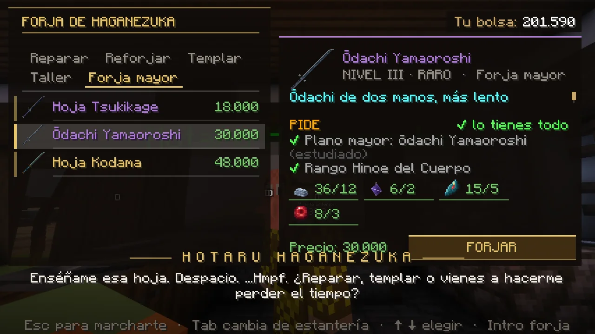
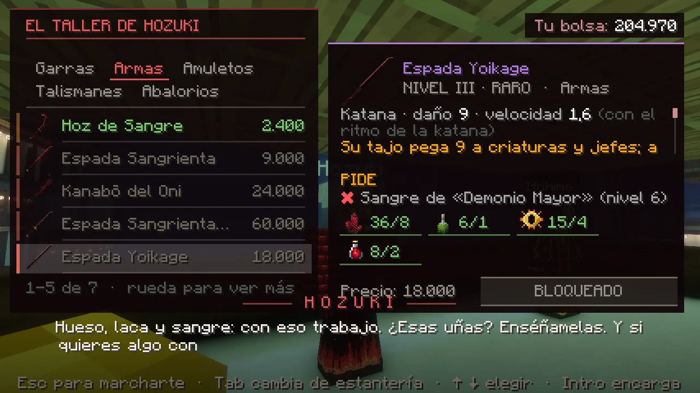
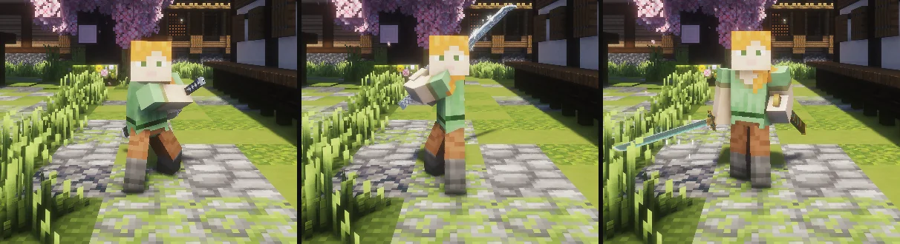
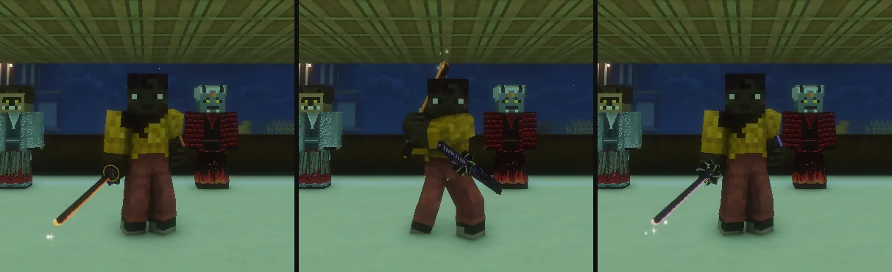

# La forja mayor

Lo mejor que se puede fabricar. No se compra ni se cambia en ningún sitio: se hace con materiales que hay que <strong>lotear jugando</strong>. Los cazadores lo piden en la <a href="../aldea/">Aldea de los Herreros</a> y los demonios, en el <a href="../../demonio/mercado/">Mercado de la Noche</a>.

Los dos bandos tienen lo mismo, con otro nombre y otra forma: mismo precio, mismos materiales y las mismas horas de espera. Cuenta con unas dos semanas de juego normal para la mejor arma y con un mes para tenerlo todo. No hay atajos: ni el [trueque](trueque.md) ni las tiendas venden estos materiales.

## Los materiales

| Cazador | Demonio | De dónde sale |
|---|---|---|
| **Mena de tsukigane** | **Coágulo negro** | Los enemigos de la noche, de vez en cuando (mena: los demonios de la noche; coágulo: los cazadores de las patrullas). Los de nombre y la élite, cuatro veces más; en Luna de Sangre, el doble. La primera vez que vences a un jefe: de 1 a 3. Cada [Calamidad](../eventos/calamidades.md) en la que ayudes: 3 (el golpe final, 5). Los [Sucesos](../misiones/sucesos.md), a veces; los secretos, 2 seguros. |
| **Escama de Calamidad** | **Ponzoña de Calamidad** | Cada Calamidad en la que ayudes: 1 (el golpe final, 2). La Luna de Sangre, a veces. Los Sucesos, muy de vez en cuando (los secretos, bastante más). Los de nombre y la élite, muy de vez en cuando. La primera victoria sobre una Luna Superior o un Pilar: 1. |
| **Plano mayor** | **Pergamino mayor** | Una Calamidad o la Luna de Sangre, a veces; un Suceso secreto, a veces; los de nombre y la élite, muy de vez en cuando. Al demonio, también los cazadores de patrulla, muy de vez en cuando. Hay dos de cada bando: se estudian con clic derecho y, sin estudiar, se pueden vender en el Mercado. |

**La mala suerte tiene un tope.** Si llevas 100 demonios (o 60 cazadores de patrulla) sin ver una mena o un coágulo, el siguiente es seguro. Lo mismo con las escamas (40 Sucesos o Lunas sin ninguna; ayudar a vencer a una Calamidad te da una siempre) y con los planos (80 Sucesos, Lunas o Calamidades).

**Refinar.** Las armas y los accesorios no piden la mena en bruto:

- **Lingote de tsukigane**: Kojiro (Taller). 5 menas, 1 lingote de acero y 150.
- **Cristal de coágulo**: Mujina (Materiales). 5 coágulos, 1 hilo de sangre y 150.

Lo que no te quepa va a tu [consigna](objetos.md#el-botin-que-no-te-cabe-la-consigna) (`/botin`): nunca se queda en el suelo.

## Las armas

Se piden a **Hotaru Haganezuka** (estantería *Forja mayor*) y a **Hozuki** (estantería *Armas*). Se paga al encargarlas y **se tarda horas de verdad**: el reloj corre aunque te desconectes. Al volver a entrar te avisa si ya está lista, y se recoge en la misma estantería.

<figure markdown="span">
  { loading=lazy }
  <figcaption>La estantería <em>Forja mayor</em>: lo que pide cada hoja y lo que llevas (en verde, lo que tienes).</figcaption>
</figure>
<figure markdown="span">
  { loading=lazy }
  <figcaption>La estantería <em>Armas</em> de Hozuki, en el Mercado de la Noche.</figcaption>
</figure>

| Cazador | Demonio | Pide | Dinero | Materiales (lingotes o cristales · escamas o ponzoñas · esquirlas superiores o tsubas de Pilar · núcleos o viales) | Horas |
|---|---|---|---|---|---|
| **Hoja Tsukikage** | **Espada Yoikage** | Rango Hinoto / sangre de nivel 6 | 18.000 | 8 · 1 · 4 · 2 | 8 |
| **Ōdachi Yamaoroshi** | **Zanbatō Hitokui** | Rango Hinoe / nivel 7, y su plano | 30.000 | 12 · 2 · 5 · 3 | 16 |
| **Hoja Kodama** | **Espada Urami** | Rango Kinoto / nivel 8, y su plano | 48.000 | 16 · 3 · 6 · 3 y una lágrima de Luna o un loto negro | 24 |

Qué hace cada una **contra los enemigos del mundo** (no contra jugadores):

| Arma | Tajo | Lo suyo |
|---|---|---|
| Tsukikage / Yoikage | 9 | Cada tercer tajo seguido, un 25 % más. |
| Yamaoroshi / Hitokui (a dos manos, velocidad 1,2) | 10,5 | El golpe los deja lentos un segundo y medio y, cada 8 s, sacude a tres de alrededor (3 de daño y un empujón). Tiene guardia, pero no parada. |
| Kodama / Urami | 9,5 | El tajo hace eco en dos enemigos cercanos: un 25 % de lo que has pegado, hasta 4. |

**Entre jugadores no cuentan nada de esto.** En un duelo, en el dojo o contra otro jugador pegan como una katana corriente de su bando: las habilidades y el daño de más se quedan para la caza. Un cazador sigue lanzando las formas de su respiración con cualquiera de sus tres hojas.

<figure markdown="span">
  { loading=lazy }
  <figcaption>Del cazador: Tsukikage, Yamaoroshi y Kodama.</figcaption>
</figure>

<figure markdown="span">
  { loading=lazy }
  <figcaption>Del demonio: Yoikage, Hitokui y Urami.</figcaption>
</figure>

## Los accesorios

Se piden a **Kotetsu** (Talismanes y Amuletos) y a **Hozuki**. También son encargos.

| Cazador | Demonio | Hace | Pide | Horas |
|---|---|---|---|---|
| **Ofuda del Buscador** | **Ofuda del Carroñero** | +30 % de suerte con el botín, y la red de la mena o del coágulo se llena el doble de rápido | Rango Tsuchinoe / nivel 5. 9.000, 3 lingotes o cristales, 3 esencias o tintas y 4 papeles | 6 |
| **Omamori del Viento Alto** | **Amuleto de la Cacería** | +3 % de defensa contra el otro bando, +5 % de firmeza y, al derribar a un enemigo, corres más durante seis segundos (cada 10 s) | Rango Hinoto / nivel 6. 16.000, 4 lingotes o cristales, 1 escama o ponzoña, 2 núcleos o viales y 2 telas o sedas | 12 |

## La botica

**Kotetsu** y **Mujina**, en la estantería *Botica*. Estos sí salen en el acto. Se usan con clic derecho.

| Cazador | Demonio | Hace | Pide |
|---|---|---|---|
| **Tónico de Hierro** | **Tónico de Carne Dura** | 3 minutos: el otro bando te quita un 6 % menos | Rango Tsuchinoto / nivel 4. 600, 2 esencias o tintas y 1 mena o coágulo |
| **Aceite de Filo Claro** | **Aceite de Filo Negro** | 3 minutos: un 8 % más a jefes (el demonio, a los de nombre y a la élite) con el golpe normal | Rango Tsuchinoto / nivel 4. 700, 2 esencias o tintas, 1 colmillo o esquirla de nichirin y 1 mena o coágulo |
| **Agua del Rastro** | **Sangre de Olfato** | 5 minutos: más suerte con los materiales (×1,25) y ves en la oscuridad | Rango Tsuchinoto / nivel 4. 500, 1 esencia o tinta, 2 colmillos o esquirlas y 1 mena o coágulo |
| **Infusión de la Botica** | **Infusión Amarga** | Quita el veneno y la descomposición y cierra heridas despacio durante 30 s | Sin rango. 180, 3 hierbas medicinales **de tu [maceta](plantas.md)** y 1 flor de glicina o pétalo de loto |
| **Bomba de Ceniza Solar** (3) | **Frasco de Miasma** (3) | Los enemigos corrientes a seis pasos pierden 4, arden o se ahogan y quedan lentos; todos brillan ocho segundos. A un jefe solo le marca. Si no hay nadie cerca, no se gasta | Rango Kanoe / nivel 3. 400, 1 esencia o tinta, 2 colmillos o esquirlas y 1 mena o coágulo |

- Los tónicos, los aceites y el agua comparten una espera de 30 s; la infusión tiene la suya, de 60 s, y la bomba, de 40 s.
- Morir acaba con lo que llevabas tomado. En el dojo no se puede usar nada de esto.

## Preguntas

**¿Sirven de algo los materiales si cambio de bando?** Lo que llevas encima se queda, pero las recetas del otro bando piden su propio material. Las armas forjadas también se quedan contigo: solo las puede usar el bando para el que se hicieron.

**¿Puedo vender lo que me sobre?** Los materiales, las pociones y los planos sin estudiar, en el [Mercado](mercado.md). Las armas y los accesorios quedan ligados a ti: no se venden ni se tiran. A una tienda, nada de esto: nadie te lo compra.

**¿Pierdo el encargo si me desconecto o reinician el servidor?** No. La hora se apunta en tu ficha.
