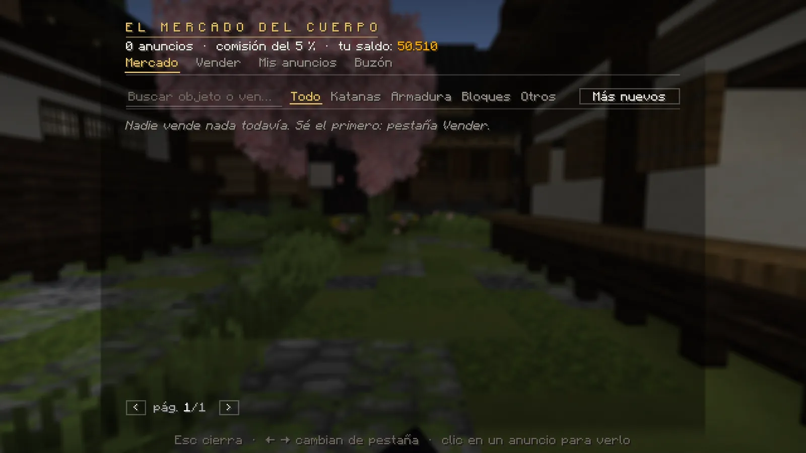
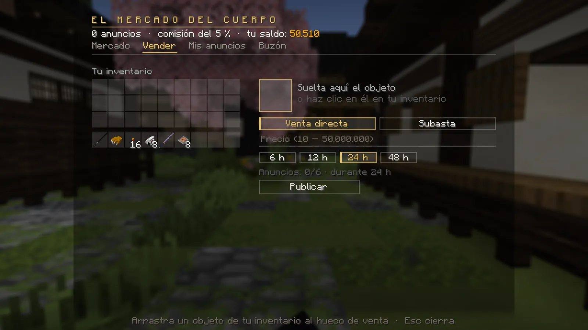
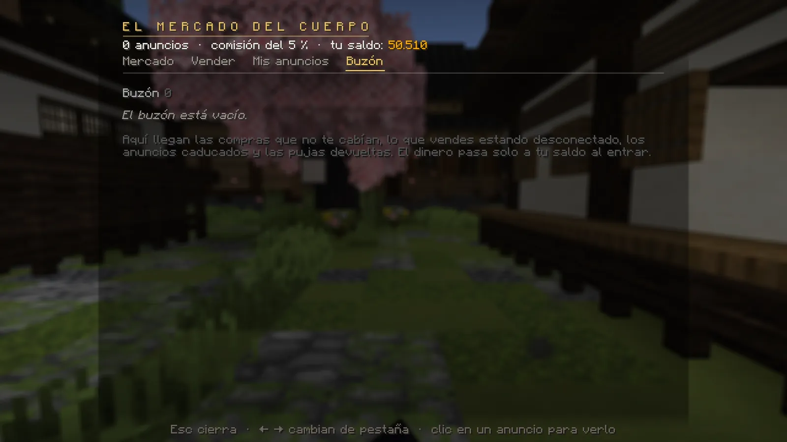

# El Mercado

El Mercado del Cuerpo es la casa de subastas entre jugadores: vendes lo que te sobra y compras lo que otros venden.

## Cómo se abre

- **K → Subastas**, o con **`/mercado`** (también `/subastas`).
- **Cazador:** se abre cuando el herrero te forja tu primera katana.
- **Demonio:** tras su primer rito (o si ya tenía su katana de cazador).
- Si aún no puedes entrar verás *«Puertas cerradas»* y el motivo.

## Las cuatro pestañas

<figure markdown="span">
  { loading=lazy }
  <figcaption>Pestaña Mercado: buscador, categorías (Todo, Katanas, Armadura, Bloques, Otros) y orden.</figcaption>
</figure>

| Pestaña | Para qué |
|---|---|
| **Mercado** | Los anuncios de todos. Busca por objeto o vendedor, filtra y ordena. Un clic en un anuncio abre su ficha con **Comprar** o **Pujar**. |
| **Vender** | Arrastra un objeto de tu inventario al hueco de venta (o haz clic en él), elige el tipo de venta, el precio y la duración, y pulsa **Publicar**. |
| **Mis anuncios** | Lo que tienes a la venta y las subastas en las que pujas. |
| **Buzón** | Lo que te ha llegado: compras que no te cabían, anuncios caducados… **Recoger** o **Recoger todo**. |

<figure markdown="span">
  { loading=lazy }
  <figcaption>Vender: tu inventario, el hueco de venta, venta directa o subasta y la duración (6, 12, 24 o 48 h).</figcaption>
</figure>
<figure markdown="span">
  { loading=lazy }
  <figcaption>Buzón: aquí llega lo que no te cabía. El dinero pasa solo a tu saldo al entrar.</figcaption>
</figure>

## Reglas

- **Venta directa** (precio fijo) o **subasta** (puja inicial y, si quieres, un precio de compra directa).
- Duración: **6, 12, 24 o 48 horas**. Se vende **la pila entera**.
- Como mucho **6 anuncios** a la vez. Precio entre 10 y 50.000.000.
- Comisión del **5 %**: la paga el vendedor al cobrar (el resumen te dice *«Recibirás X»*).
- **Pujas:** cada una supera a la anterior al menos un 5 %. El dinero de tu puja **se reserva** y te lo devuelven al
  momento si te superan. Si a una subasta le quedan menos de 2 minutos, cada puja la alarga.
- Una subasta con pujas **no se puede retirar**; una venta directa, sí.
- Al caducar: sin pujas, vuelve al vendedor; con pujas, gana el que más pujó. Todo va al inventario o al **buzón**.

## El buzón

Al buzón llega lo que te corresponde y no te cabe: compras, anuncios caducados, pujas devueltas, lo que había en tu casa
al acabar el alquiler, o lo que tenías en el cursor al salir del juego. **El dinero pasa solo a tu saldo** cuando entras.
Al entrar te avisa: *«✉ Tienes N objetos esperando en el buzón del Mercado»*.

## Qué no se puede vender

- Los objetos **ligados** (tu uniforme inicial, tu hoja personal, objetos de misión…).
- El atrezo de los encargos y la foto.
- El **Trofeo del Dojo**.
- Las ofrendas y trofeos de la sangre de los demonios.
- La katana del kit de un rango VIP.

Sí se venden, por ejemplo: reliquias, hojas personalizadas, metal nichirin premium, ropa, bloques y comida.
