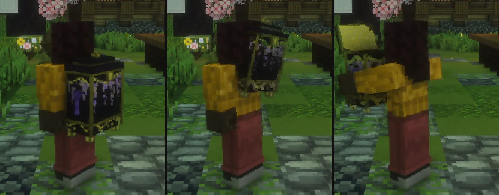
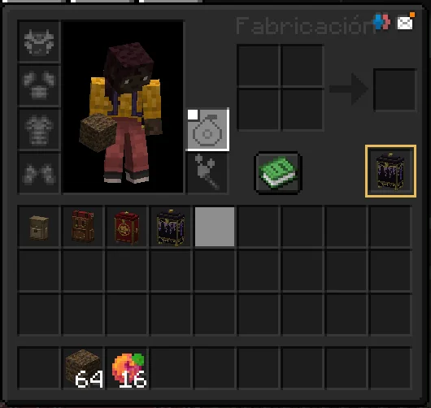
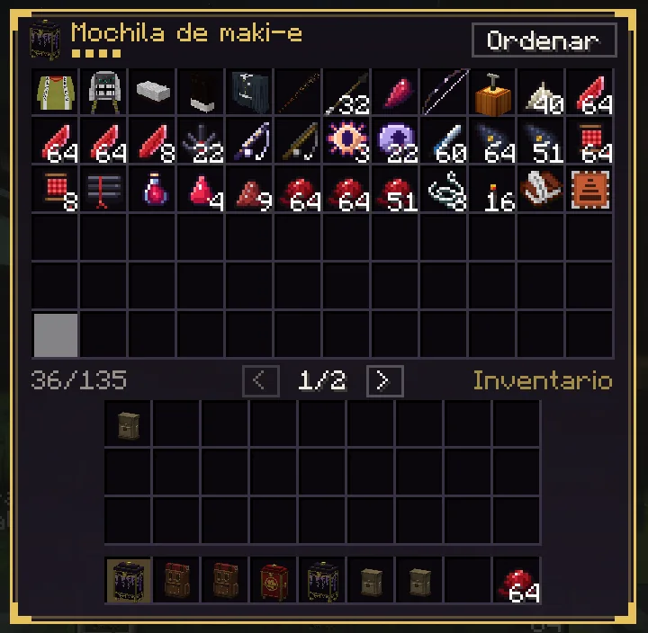
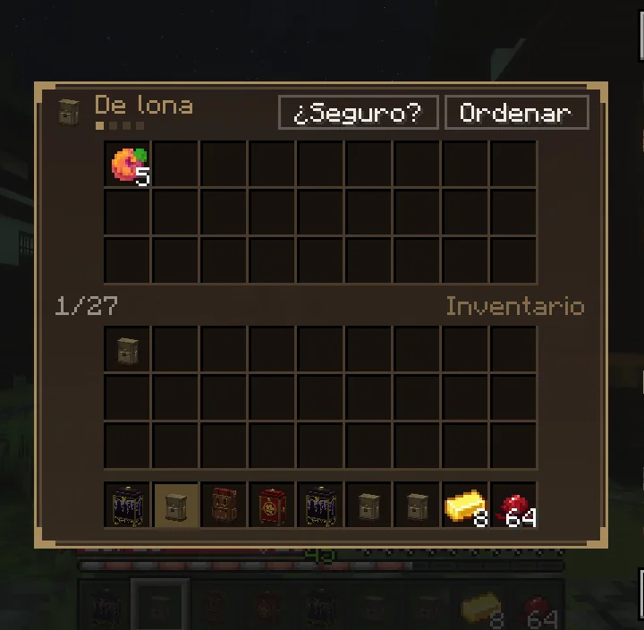

# Las mochilas

Las mochilas de DemonCraft solo sirven para una cosa: <strong>guardar</strong>. No dan vida, ni velocidad, ni imán, ni comen por ti. Son cuatro, cada una se ve distinta y se lleva a la espalda.

<figure markdown="span">
  { loading=lazy }
  <figcaption>A la espalda, te la descuelgas, la pones delante y se abre la tapa: menos de un segundo.</figcaption>
</figure>

## Las cuatro

| Mochila | Huecos | Cómo se consigue |
|---|---|---|
| **De lona** | 27 | Te la da Genzo al empezar. También en la [tienda de Kohei](tiendas.md#mejorar-tu-mochila), estantería *Mochilas* (500), o fabricándola: cuatro de cuero, cuatro de hilo y un cofre. |
| **De viaje** | 54 | Mejorando la de lona: 8 lingotes de oro. |
| **Lacada** | 81 | Mejorando la de viaje: 8 diamantes. |
| **De maki-e** | 135 | Mejorando la lacada: 1 lingote de netherita y 1 plantilla de mejora. |

## Llevarla y abrirla

- **A la espalda:** en el inventario (++e++) hay una casilla nueva con el dibujo de una mochila, a la derecha, debajo de la mesa de fabricación. Pon ahí la tuya (o ++shift++ + clic sobre ella). También con **++shift++ + clic derecho** con ella en la mano. Mientras la llevas a la espalda se ve y no ocupa hueco en tu inventario.
- **Abrirla:** la tecla ++b++ abre la de la espalda y, si no llevas ninguna, la primera que tengas encima. Con ella en la mano, **clic derecho**. La tecla se cambia en *Opciones → Controles*.

Los demás ven cómo la abres. Si venías corriendo te paras; al cerrarla te la cuelgas otra vez y puedes seguir andando.

<figure markdown="span">
  { width="460" loading=lazy }
  <figcaption>La casilla de la espalda, marcada en dorado, con la mochila puesta.</figcaption>
</figure>

!!! warning "Cuándo no se abre"
    En combate (con la [marca de combate](../cazador/combate.md#la-marca-de-combate) o si una criatura te acaba de golpear), en un duelo, con una técnica en marcha, nadando, en el aire o montado. Si te atacan con ella abierta, se cierra sola.

## La ventana

<figure markdown="span">
  { loading=lazy }
  <figcaption>La de maki-e: arriba lo que llevas dentro, abajo tu inventario. Las grandes tienen páginas.</figcaption>
</figure>
<figure markdown="span">
  { loading=lazy }
  <figcaption>Mejorar pide un segundo clic: «¿Seguro?».</figcaption>
</figure>

- **Ordenar** junta lo que se apila y lo pone por tipos.
- **Mejorar** te dice lo que pide y lo que tienes. Dos clics: el primero pregunta. Lo de dentro no se mueve.
- Las grandes tienen **páginas**: con la rueda del ratón o con las flechas.
- ++shift++ + clic mueve de la mochila al inventario y al revés, como en un cofre.

Dentro cabe todo lo que cabía en las de antes, también lo de las misiones y los materiales. Lo único que no entra es otra mochila.

## Mejorarla

Los materiales se compran en la [tienda de Kohei](tiendas.md#mejorar-tu-mochila), estantería *Mochilas*, los dos bandos. También vale el mismo objeto sin marca, si lo tienes.

| Para subir a | Pide | Cuesta en la tienda |
|---|---|---|
| **De viaje** (54) | 8 lingotes de oro | 3.200 |
| **Lacada** (81) | 8 diamantes | 24.000 |
| **De maki-e** (135) | 1 lingote de netherita y 1 plantilla de mejora | 8.000 |

Se mejora desde la propia ventana, con los materiales en el inventario.

## Es tuya

- Va **ligada**: no se tira, no se vende en el Mercado y no se pierde al morir (la de la espalda tampoco).
- Lo de dentro se guarda en el servidor, cada vez que la cierras.
- Con **el Colgante de las Almas** o una [reliquia](../misiones/reliquias.md), ojo: tienen que ir en el inventario, no dentro de la mochila.

## Tu mochila de antes

Las mochilas de antes de la actualización 2.0 se cambian solas por una de estas en cuanto el juego las ve: al entrar, al abrir un cofre donde la tengas, al recogerla… Te lo dice el chat.

| La tenías de | Ahora es la |
|---|---|
| Cuero | De lona |
| Cobre o hierro | De viaje |
| Oro | Lacada |
| Diamante o netherita | De maki-e |

**No se pierde nada.** Cada objeto sigue en su mismo hueco. Si tenías mejoras de capacidad y pilas de más de 64, ahora están en pilas normales, en los primeros huecos libres; las mejoras que llevara puestas están dentro, como un objeto más.

Si lo que llevabas no cabe de ninguna forma en los huecos de la mochila nueva, lo que sobra se queda en unos huecos **de sobra**, en rojo, al final: de ahí se puede sacar pero no meter. Cuando los vacías, desaparecen.

Las mochilas puestas en el suelo de tu casa se cambian al abrirlas o romperlas: pasan a tu inventario, con todo dentro. Las nuevas no se ponen en el suelo.
