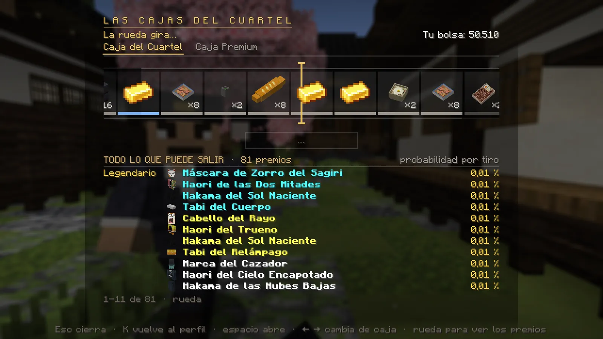
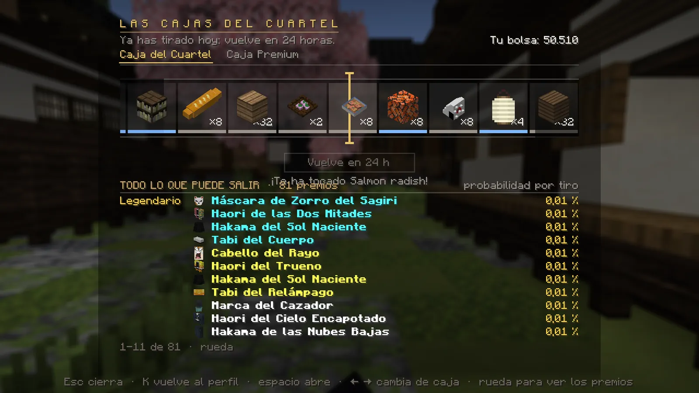

# Cajas y objetos

## La Caja del Cuartel (K → Caja)

- **Una tirada gratis cada 24 horas.** Pulsa **«Abrir la caja»** (o ++space++) y la rueda gira.
- Necesitas **un hueco libre** en el inventario; si no lo tienes, la tirada no se gasta.
- Debajo ves **todo lo que puede salir** con su probabilidad: bolsas de dinero, comida, bloques, decoración, el
  uniforme… y, muy rara vez, piezas de los kits VIP o una bolsa de 20.000. Los premios raros se anuncian a todo el servidor.

<figure markdown="span">
  { loading=lazy }
  <figcaption>La rueda gira… y abajo, todos los premios posibles con su probabilidad.</figcaption>
</figure>
<figure markdown="span">
  { loading=lazy }
  <figcaption>«¡Te ha tocado…!»: la próxima tirada, en 24 horas.</figcaption>
</figure>

**Caja Premium:** en la misma pantalla. Cada tirada gasta un lingote de **metal nichirin premium** y da una de cinco
**hojas personalizadas** (20 % cada una). El lingote se consigue en la [tienda](../vip.md#otros-extras-de-la-tienda) y
se puede regalar o vender.

!!! demonio "Si eres demonio"
    La Caja del Cuartel es del Cuerpo: *«Un demonio no tiene llave»*.

## Objetos ligados

Muchos objetos importantes (tu uniforme inicial, tu hoja personal, la mochila del tutorial, objetos de misión…) están
**ligados a ti**: si los tiras vuelven a tu inventario, **no se pierden al morir** y no se pueden vender.

## Mochila, cofre de ender y buzón

- **Mochila:** te la da Genzo al empezar. Se abre con ++b++.
- **Cofre de ender:** funciona en cualquier sitio y es solo tuyo.
- **Lo que llevas a medias al salir** (en el cursor o en una mesa de trabajo) no se pierde: vuelve a tu inventario, a
  tu cofre de ender o, si no cabe, a tu buzón del Mercado.

## Objetos de misión

Los objetos de misión, el metal de la forja, las reliquias y el atrezo de los encargos **no sirven de ingrediente**:
no se gastan en la mesa de trabajo, el yunque, el horno ni en ninguna otra mesa. Si pierdes uno que necesitas para una
misión, pide ayuda al staff.

## Tu skin

Puedes cambiar la skin de tu personaje con **`/skin`**:

- `/skin set mojang <nombre>` — usa la skin de una cuenta de Minecraft.
- `/skin set web classic <enlace>` — usa una skin desde un enlace (`slim` para brazos finos).
- `/skin clear` — quita la skin que pusiste.
