# Cajas y objetos

## La Caja del Cuartel (K → Caja)

- **Una tirada gratis cada 24 horas.** Abre la caja con **K → Caja** o, desde cualquier sitio, con **`/caja`**, y pulsa
  **«✦ Abrir gratis ✦»** (o ++space++).
- Necesitas **un hueco libre** en el inventario; si no lo tienes, la tirada no se gasta.
- **Te avisamos cuando está lista**: al entrar en el servidor y en cuanto se cumplen tus 24 horas, el chat te dice
  *«✦ Tu tiro gratis de la Caja del Cuartel está listo.»* con un botón **[ Abrir la caja ]** (un aviso por tirada). Y
  mientras lo tengas listo, la pestaña **Caja** de la K late con una estrella.
- **Si ya has tirado, la cuenta atrás exacta** hasta la siguiente: *«Ya has tirado hoy · el siguiente tiro gratis, en
  23:10:48»*, y el botón dice *«Vuelve en 23:10:48»*. Al llegar a cero, se enciende solo.
- Cada tirada gratis suma, además, experiencia del [Pase Estelar](../pase.md#como-se-sube).

Cómo es la pantalla:

- **La rueda** gira unos 7 segundos y se tiñe del color de lo que pasa por el centro; suena una campanilla cuando cruza algo
  raro y, al final, un latido cada vez más deprisa.
- **La revelación**, más grande cuanto más raro es el premio: *«¡LEGENDARIO!»*, *«¡RARO!»*, *«¡POCO COMÚN!»* o *«¡TE HA
  TOCADO!»*, con el premio en 3D; si es dinero, lo que entra al banco. Un clic (o ++space++) la cierra.
- **El escaparate**: debajo de la rueda, los cuatro escalones (legendario, raro, poco común y común), cada uno con sus premios
  pasando en 3D, lo que suma su probabilidad y cuántos premios tiene. Un clic en un escalón abre su lista, y el botón
  **«Lista»** / **«Escaparate»** cambia de vista. En la lista, cada premio con su probabilidad.
- Lo que puede salir: bolsas de dinero, comida, bloques, decoración, el uniforme, la ropa de los personajes… y, muy rara vez,
  piezas de los kits VIP o una bolsa de 20.000. Los premios raros y los legendarios se anuncian a todo el servidor.

<figure markdown="span">
  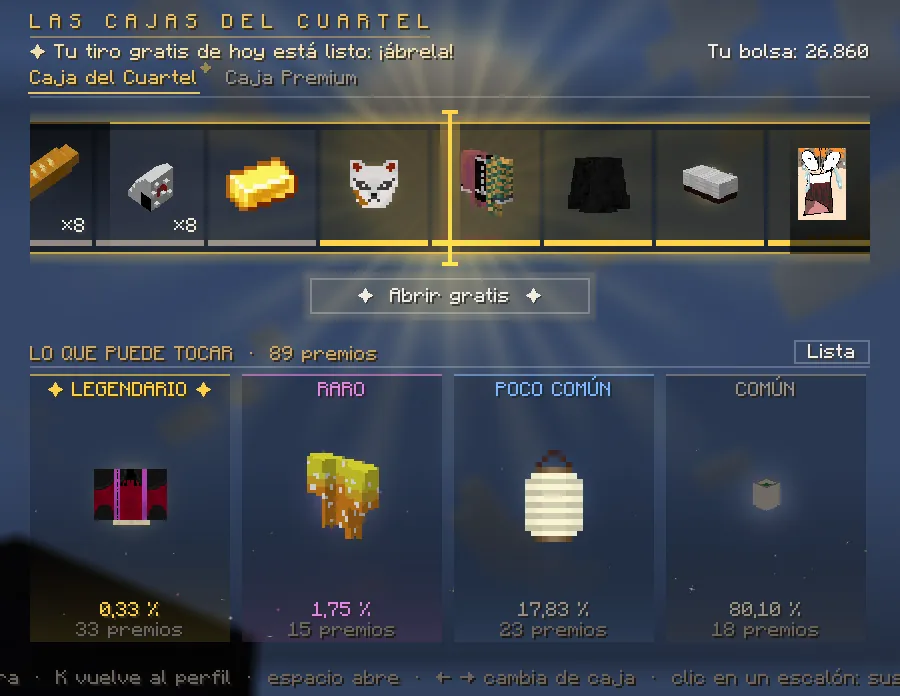{ loading=lazy }
  <figcaption>El tiro listo: la pestaña lleva su estrella y, debajo de la rueda, el escaparate con los cuatro escalones.</figcaption>
</figure>
<figure markdown="span">
  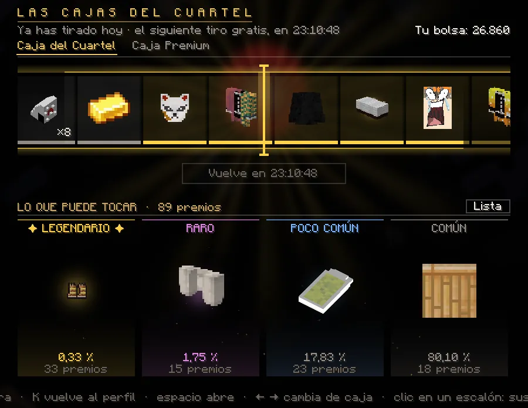{ loading=lazy }
  <figcaption>Ya has tirado: la cuenta atrás exacta hasta el siguiente tiro.</figcaption>
</figure>
<figure markdown="span">
  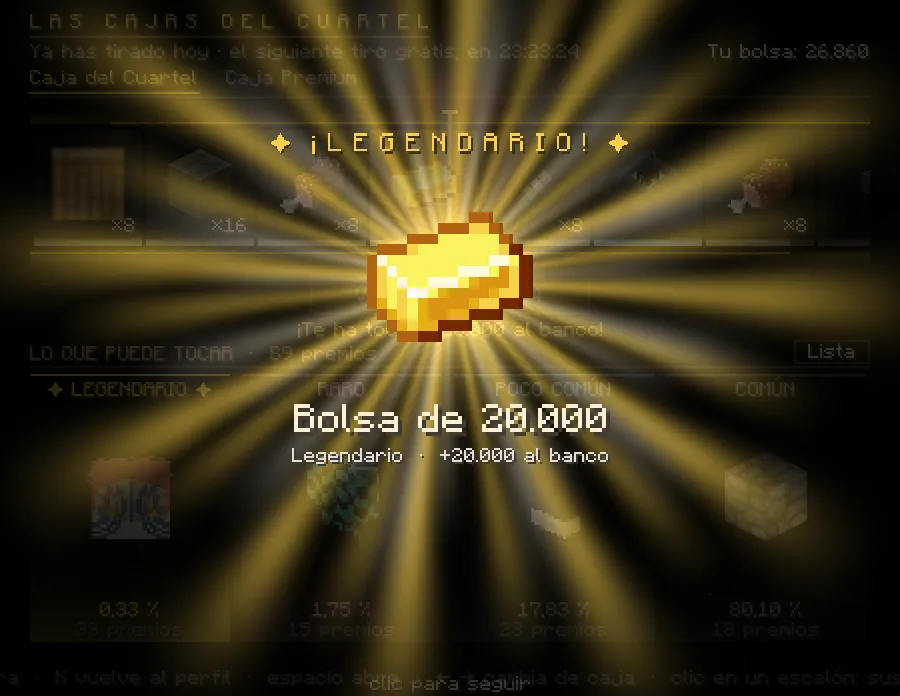{ loading=lazy }
  <figcaption>Cuanto más raro, más grande la revelación: ¡legendario!</figcaption>
</figure>

## La Caja Premium: las cinco hojas legendarias

En la misma pantalla, en la pestaña **Caja Premium**. Cada lingote de **metal nichirin premium** es una tirada y da una de
las **cinco hojas legendarias**, al **20 %** cada una (se pueden repetir). El lingote se consigue en la
[tienda](../vip.md#otros-extras-de-la-tienda) (y la fila dorada del [Pase Estelar](../pase.md) trae uno en el nivel 40), y se
puede regalar o vender.

| Hoja | Elemento | Al rematar |
|---|---|---|
| **Hoja del Fénix Escarlata** | Fuego | Alza un fénix de fuego. |
| **Hoja del Invierno Eterno** | Hielo | Brotan picos de hielo del suelo y estallan. |
| **Hoja del Relámpago Dorado** | Rayo | Cae un rayo del cielo. |
| **Hoja del Eclipse** | La luna y el vacío | Un vacío se traga a tu presa y sale la luna. |
| **Hoja del Dragón de Marea** | Agua | Despierta un dragón de agua que sube en espiral. |

Lo que tienen las cinco:

- **Su propio modelo**, con la hoja animada y **luz propia**: de noche se ven encendidas.
- **Su elemento**: sueltan sus partículas mientras las llevas en la mano, dejan su estela y su silbido en cada tajo, suenan
  al desenvainar y al golpear, y al rematar sacan **su escena**.
- **Su tajo** (el golpe del clic izquierdo) pega **10** a las criaturas y a los jefes, con cualquier respiración. **Contra un
  jugador**, y en las formas y las habilidades de Epic Fight, pegan como una nichirin normal.
- **Toman tu respiración**: lanzan las formas de la que tengas activa, como tu hoja personal. Llevan **Reparación** y se
  gastan como cualquier katana (Hotaru te las repara).

### Abrir la caja

<ol class="pasos" markdown>
<li markdown>En **K → Caja** (o con `/caja`), pasa a **Caja Premium** (arriba, o con las flechas ← →). Debajo de la rueda ves el **escaparate**: las cinco hojas en 3D.</li>
<li markdown>Pulsa **«Abrir con 1 lingote»** (o ++space++). Necesitas el lingote encima y **un hueco libre** en el inventario: si no, no se gasta nada.</li>
<li markdown>La **rueda** gira 8 segundos, con un latido que se acelera (mientras gira, la pantalla no se cierra). Al pararse llega la **revelación**: tu hoja en grande, su nombre y lo que hace. Ya está en tu inventario.</li>
<li markdown>**Todo el servidor lo lee en el chat** («✦ CAJA PREMIUM · … ha abierto una Caja Premium y le ha tocado la Hoja del…») y a tu alrededor se alza un haz de luz del color de tu hoja, con anillos y fuegos artificiales.</li>
</ol>

Se abre de una en una: la siguiente tirada, cuando se pare la rueda. Las cinco hojas que daba antes la caja (Abismo,
Ceniza Blanca, Tormenta Negra, Jade y Sakura) **ya no salen**; quien tenga alguna la conserva tal cual, solo de aspecto.

<figure markdown="span">
  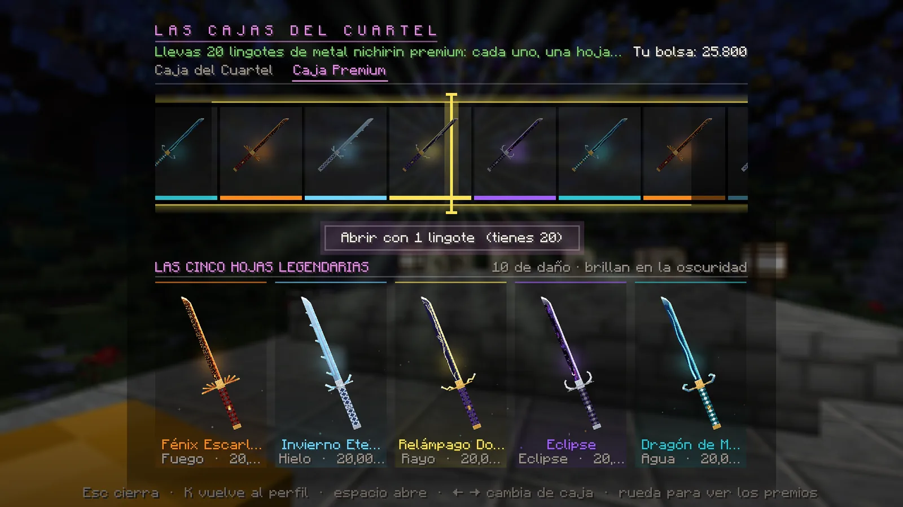{ loading=lazy }
  <figcaption>La Caja Premium: la rueda y, debajo, el escaparate de las cinco hojas.</figcaption>
</figure>
<figure markdown="span">
  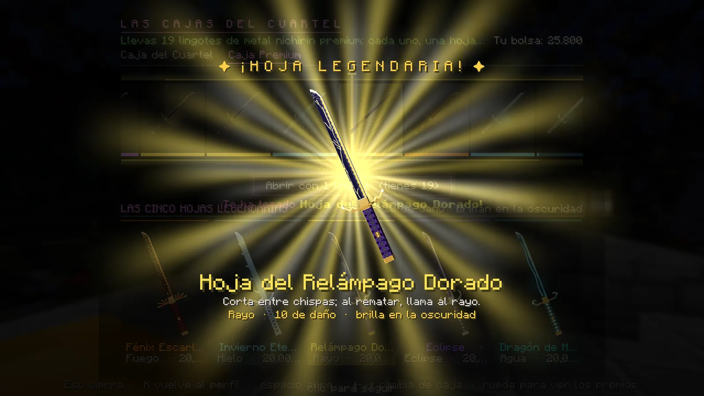{ loading=lazy }
  <figcaption>Al pararse la rueda, la revelación: tu hoja, su nombre y lo que hace.</figcaption>
</figure>

<figure markdown="span">
  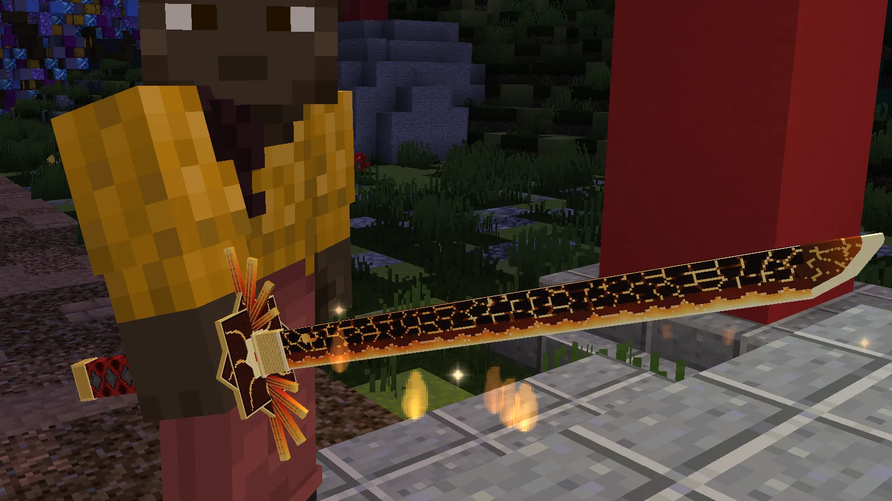{ loading=lazy }
  <figcaption>Hoja del Fénix Escarlata: corta en llamas.</figcaption>
</figure>
<figure markdown="span">
  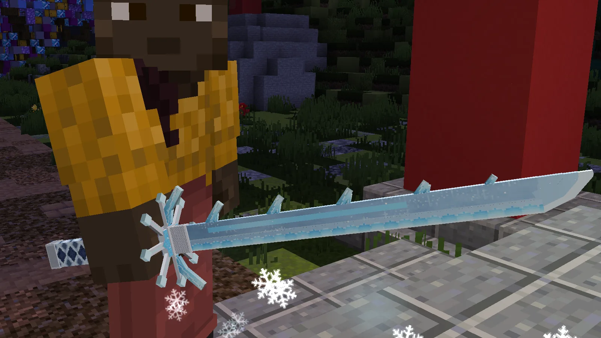{ loading=lazy }
  <figcaption>Hoja del Invierno Eterno: corta en escarcha.</figcaption>
</figure>
<figure markdown="span">
  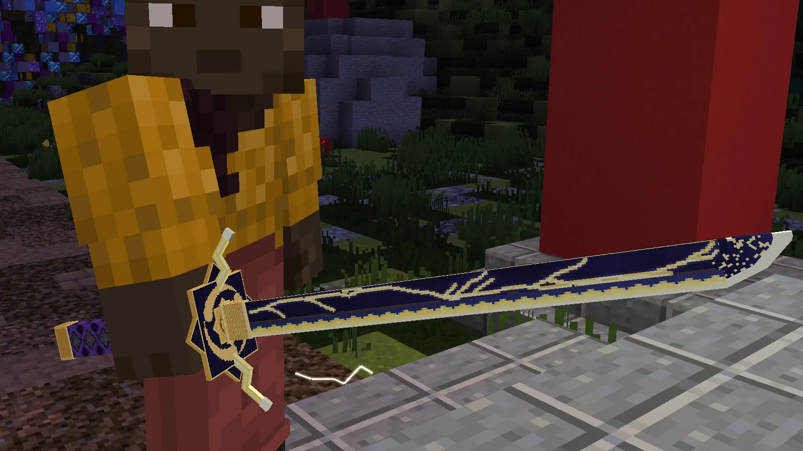{ loading=lazy }
  <figcaption>Hoja del Relámpago Dorado: corta entre chispas.</figcaption>
</figure>
<figure markdown="span">
  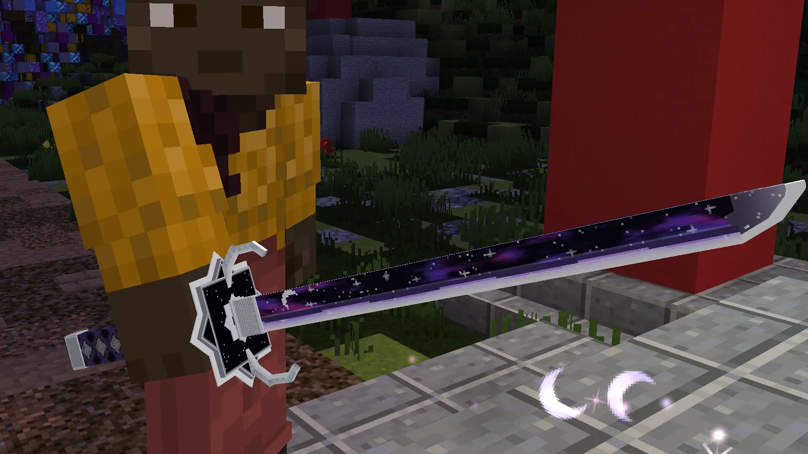{ loading=lazy }
  <figcaption>Hoja del Eclipse: corta con polvo de estrellas.</figcaption>
</figure>
<figure markdown="span">
  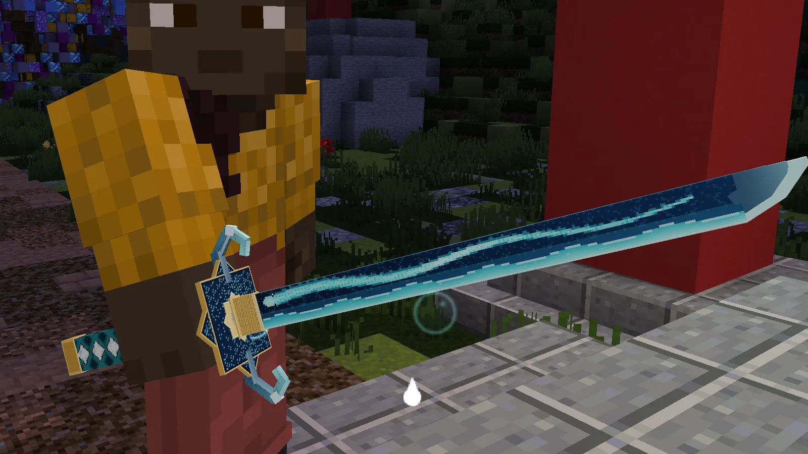{ loading=lazy }
  <figcaption>Hoja del Dragón de Marea: corta como la marea.</figcaption>
</figure>

<figure markdown="span">
  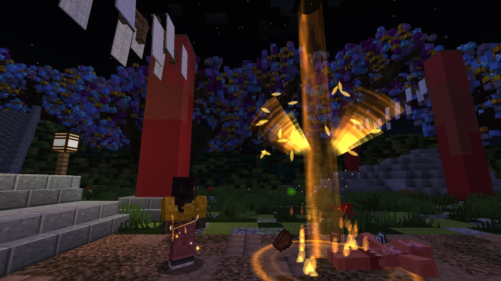{ loading=lazy }
  <figcaption>El remate del Fénix: un fénix de fuego alza el vuelo.</figcaption>
</figure>
<figure markdown="span">
  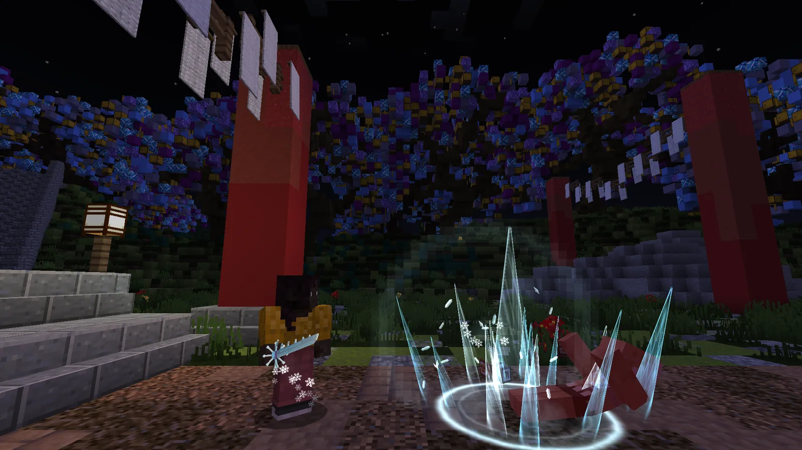{ loading=lazy }
  <figcaption>El del Invierno Eterno: picos de hielo que estallan.</figcaption>
</figure>
<figure markdown="span">
  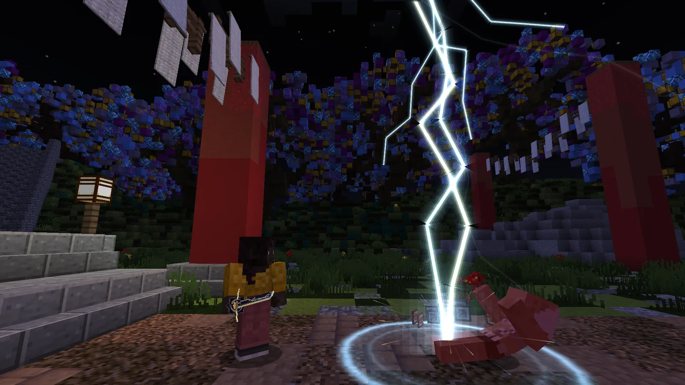{ loading=lazy }
  <figcaption>El del Relámpago Dorado: un rayo del cielo.</figcaption>
</figure>
<figure markdown="span">
  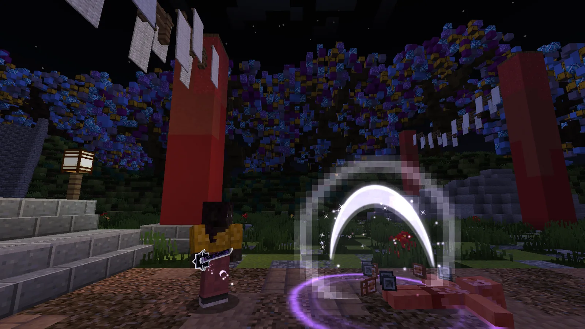{ loading=lazy }
  <figcaption>El del Eclipse: el vacío y la luna.</figcaption>
</figure>
<figure markdown="span">
  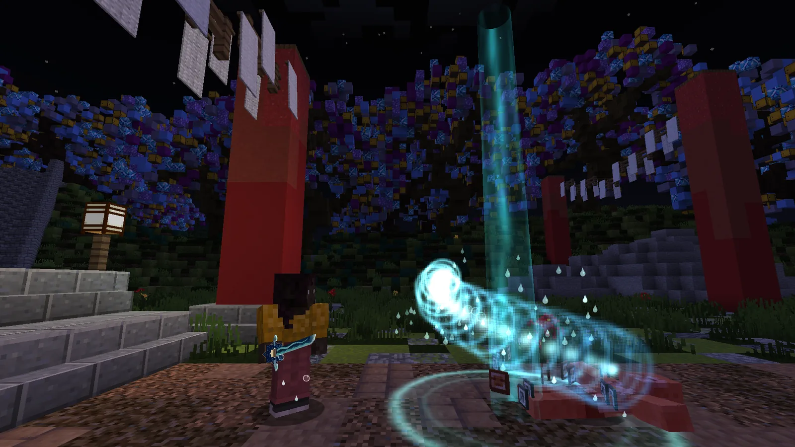{ loading=lazy }
  <figcaption>El del Dragón de Marea: un dragón de agua en espiral.</figcaption>
</figure>

!!! demonio "Si eres demonio"
    La Caja del Cuartel y la Caja Premium son del Cuerpo: a ti, **K → Caja** (o `/caja`) te abre **tu** caja, la
    [Caja de Sangre](#la-caja-de-sangre-demonios). Si tienes lingotes de metal nichirin premium, guárdalos para cuando vuelvas
    a ser humano (o regálalos).

## La Caja de Sangre (demonios)

La caja premium del demonio. Siendo demonio, **K → Caja** (o **`/caja`**) te abre **tu** caja, la única que ves; un cazador
nunca la ve. Cada vial de **Sangre Premium** es una tirada y da una de las **cinco armas legendarias que no son espadas**, al
**20 %** cada una (se pueden repetir). El vial se consigue en la [tienda](../vip.md#otros-extras-de-la-tienda) (y la fila
dorada del [Pase Estelar](../pase.md) trae uno en el nivel 40), y se puede regalar o vender.

| Arma | Cómo pelea | Contra los cazadores del Cuerpo | Al rematar |
|---|---|---|---|
| **Guadaña de la Luna Sangrienta** | la más lenta; guardia, sin parada | cada tajo te devuelve medio corazón; al tercer golpe seguido, una media luna de sangre alcanza a otros tres (un 30 % del golpe) | la luna sangrienta se alza y la siega cae |
| **Naginata del Dragón Infernal** | guardia y parada | les prende la llama negra 3 s; al tercer golpe seguido, la llama estalla alrededor (2 de daño, y prende) | un dragón de fuego infernal sube en espiral |
| **Hacha del Loto Helado** | guardia, sin parada | les hiela (lentos 1,5 s); al tercer golpe seguido, el loto de hielo los congela | un loto de hielo florece y estalla |
| **Kusarigama del Trueno Negro** | la más rápida; guardia y parada | en cada golpe, el trueno negro salta por la cadena a otros dos cercanos (2 de daño) | el trueno negro cae del cielo |
| **Tridente del Abismo** | guardia, sin parada | los arrastra hacia ti y les debilita; al tercer golpe seguido, un remolino atrae a los de alrededor | las fauces del abismo se lo tragan |

Lo que tienen las cinco:

- **Su tajo** (el golpe del clic izquierdo) pega **10** a las criaturas y a los jefes. **Contra un jugador**, y en las
  habilidades de Epic Fight, pegan como un arma de sangre (8; la kusarigama, 7,5).
- **Lo suyo contra los cazadores del Cuerpo** vale contra los de las patrullas y la élite de la noche: no contra jugadores ni
  contra los jefes (tampoco los cazadores con nombre de tus misiones). Lo de cada golpe, como mucho cada 2 segundos al mismo
  cazador.
- **Son de demonio**: solo obedecen a un demonio, como las [armas de sangre](../demonio/mercado.md#las-armas-de-sangre-hozuki):
  con ellas en la mano no hay garras, cubriéndote no salen artes y el endurecimiento de Hozuki las templa.
- **Su propio modelo**, que brilla de noche, con su sonido, su estela y la escena de su remate.
- **No van ligadas**: se pueden regalar.

### Abrir la Caja de Sangre

<ol class="pasos" markdown>
<li markdown>Siendo demonio, abre **K → Caja** (o `/caja`): sale la Caja de Sangre, en rojo. Debajo de la rueda ves el **escaparate**: las cinco armas girando en 3D (pasa el ratón por una para ver su ficha).</li>
<li markdown>Pulsa **«Abrir con 1 vial»** (o ++space++). Necesitas el vial encima y **un hueco libre** en el inventario: si no, no se gasta nada.</li>
<li markdown>La **rueda** gira 8 segundos, se tiñe del color del arma que pasa y late cada vez más deprisa (mientras gira, la pantalla no se cierra). Al pararse llega la **revelación**: *«☾ ¡ARMA LEGENDARIA! ☾»*, tu arma en grande entre rayos de su color, su nombre y lo que hace. Ya está en tu inventario.</li>
<li markdown>**Todo el servidor lo lee en el chat** (*«☾ CAJA DE SANGRE · … ha abierto una Caja de Sangre y le ha tocado…»*) y a tu alrededor se alza una columna de luz del color de tu arma, con fuegos artificiales.</li>
</ol>

Se abre de una en una: la siguiente tirada, cuando se pare la rueda.

<figure markdown="span">
  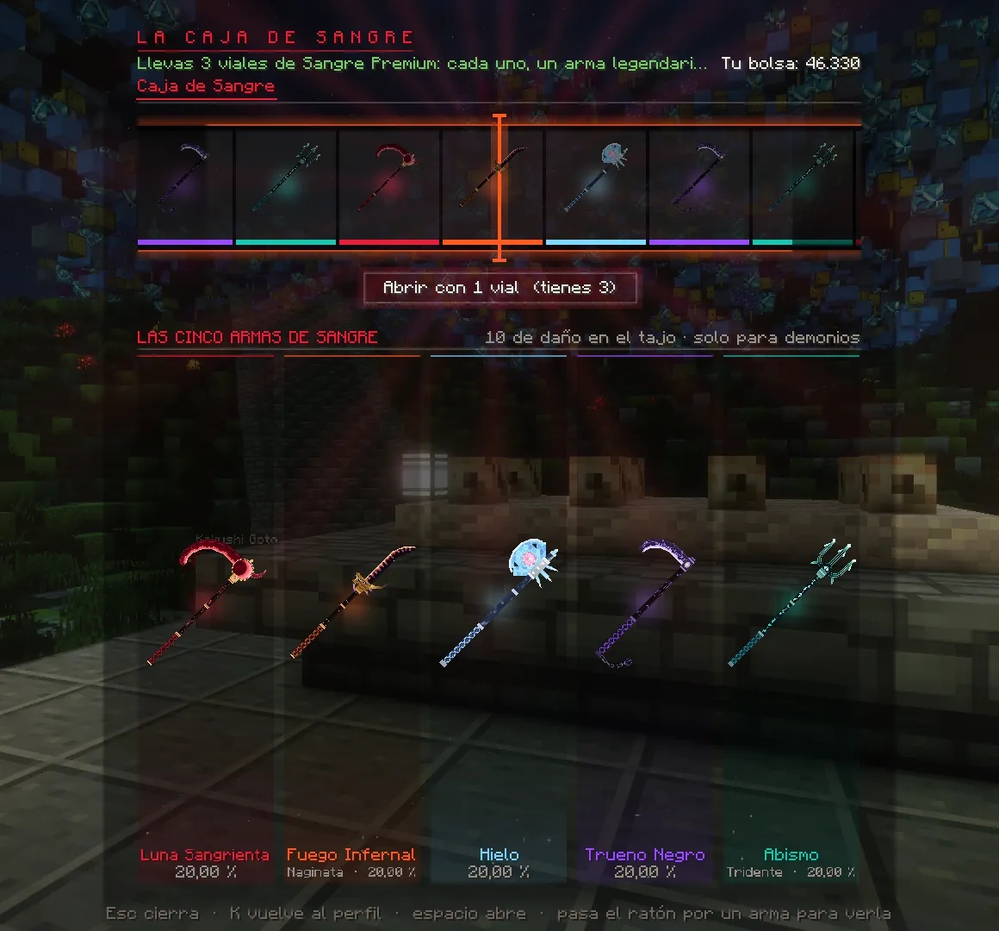{ loading=lazy }
  <figcaption>La Caja de Sangre: la rueda y, debajo, el escaparate de las cinco armas.</figcaption>
</figure>
<figure markdown="span">
  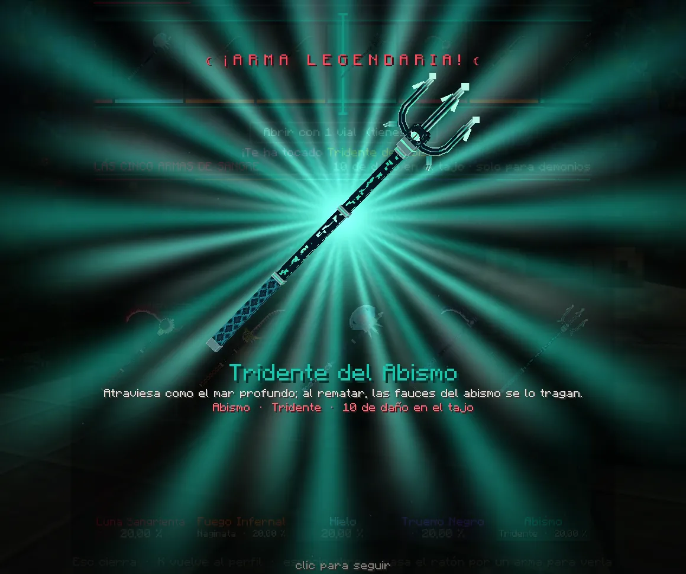{ loading=lazy }
  <figcaption>Al pararse la rueda, la revelación: tu arma, su nombre y lo que hace.</figcaption>
</figure>

<figure markdown="span">
  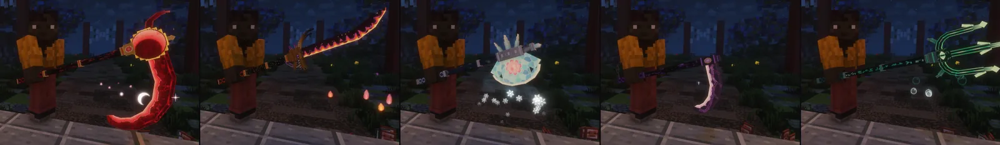{ loading=lazy }
  <figcaption>Las cinco en la mano, de izquierda a derecha: la guadaña, la naginata, el hacha, la kusarigama y el tridente.</figcaption>
</figure>

<figure markdown="span">
  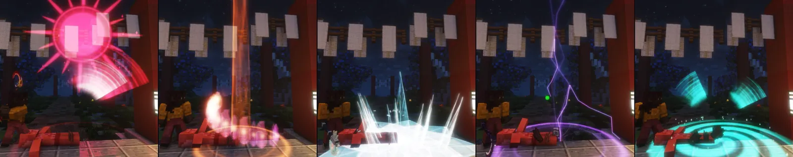{ loading=lazy }
  <figcaption>Sus remates, en el mismo orden: la luna sangrienta, el dragón de fuego infernal, el loto de hielo, el trueno negro y las fauces del abismo.</figcaption>
</figure>

## Objetos ligados

Muchos objetos importantes (tu uniforme inicial, tu hoja personal, la mochila del tutorial, objetos de misión…) están
**ligados a ti**: si los tiras vuelven a tu inventario, **no se pierden al morir** y no se pueden vender.

## Mochila, cofre de ender y buzón

- **Mochila:** te la da Genzo al empezar. Se abre con ++b++.
- **Cofre de ender:** funciona en cualquier sitio y es solo tuyo.
- **Lo que llevas a medias al salir** (en el cursor o en una mesa de trabajo) no se pierde: vuelve a tu inventario, a
  tu cofre de ender o, si no cabe, a tu buzón del Mercado.

## El botín que no te cabe: la consigna

El botín que ganas sin pedirlo (los materiales, pergaminos y planos de lo que cazas, lo de los jefes y los encargos) entra en
tu inventario, **nunca en la mano que llevas vacía** (así un demonio no gasta sin querer un pergamino con su siguiente arte).
Si no te cabe:

- Espera en tu **consigna** y el chat te lo dice: *«Botín de la noche: … (no te cabe: queda en tu consigna · /botin)»*.
- **Te llega solo** en cuanto haces hueco, y de vez en cuando te recuerda lo que tienes esperando.
- **`/botin`** te dice qué te espera y te da lo que quepa.
- No cae al suelo ni se pierde al morir.

## Objetos de misión

Los objetos de misión, el metal de la forja, las reliquias y el atrezo de los encargos **no sirven de ingrediente**:
no se gastan en la mesa de trabajo, el yunque, el horno ni en ninguna otra mesa.

Si una misión te pide llevar encima algo que **te dio la propia historia** y ya no lo tienes (por ejemplo, lo guardaste en
un cofre), **háblale a quien te lo pide**: te lo devuelve («de nuevo») y, si era lo único que faltaba, el paso se completa.
Necesitas un hueco libre. Si aun así te falta algo, pide ayuda al staff.

## Tu skin

Puedes cambiar la skin de tu personaje con **`/skin`**:

- `/skin set mojang <nombre>` — usa la skin de una cuenta de Minecraft.
- `/skin set web classic <enlace>` — usa una skin desde un enlace (`slim` para brazos finos).
- `/skin clear` — quita la skin que pusiste.
