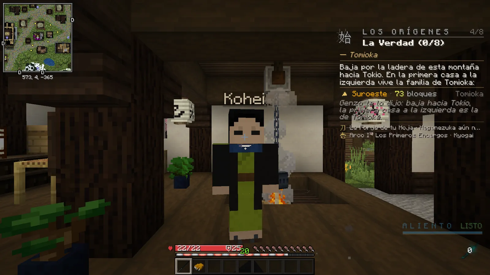
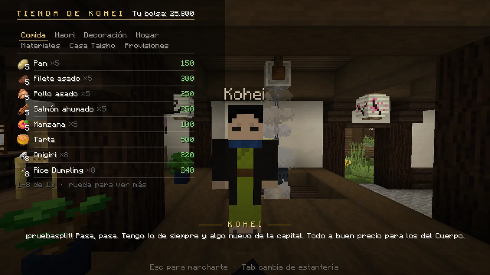
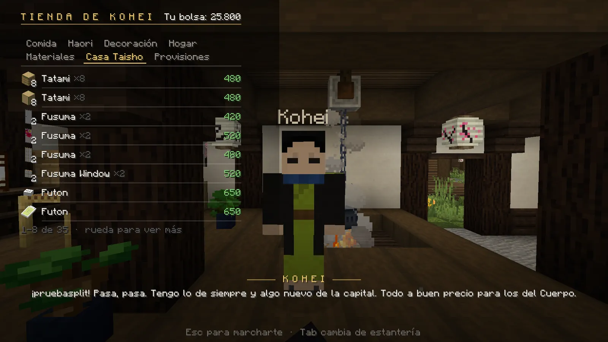

# Tiendas y forja

## La tienda de Kohei (Tokio)

La tienda principal es la de **Kohei**, en Tokio. El tutorial te manda allí, y desde la llegada del cuervo a Tokio
está a un paseo.

<figure markdown="span">
  { loading=lazy }
  <figcaption>Kohei, en su tienda de Tokio.</figcaption>
</figure>
<figure markdown="span">
  { loading=lazy }
  <figcaption>La tienda: estanterías arriba, artículos con su precio y tu bolsa.</figcaption>
</figure>
<figure markdown="span">
  { loading=lazy }
  <figcaption>La estantería «Casa Taisho»: tatamis, puertas correderas y futones para tu casa.</figcaption>
</figure>

**Cómo se compra:**

1. Haz **clic derecho** sobre Kohei. Si tienes una misión con él, el primer clic es para la misión y la tienda se abre con el siguiente.
2. Cambia de estantería con un clic o con ++tab++.
3. **Un clic en un artículo** compra un lote (la cantidad viene al lado del nombre).

- Tienes **15 minutos** para comprar desde que le hablas, y tienes que estar cerca de él.
- Necesitas **hueco en el inventario** antes de pagar.
- Al pasar el ratón por un artículo ves su descripción o *«te faltan X»* si no te llega.

| Estantería | Qué hay |
|---|---|
| **Comida** | Pan, carne, pescado, onigiri, dango… |
| **Haori** | Haoris de personaje: son ropa, **no protegen** (0 de armadura) y ocupan el sitio del peto del uniforme. Los que protegen se forjan en la [Aldea de los Herreros](aldea.md). |
| **Decoración** y **Hogar** | Cofres, barriles, hornos, cuadros, marcos, faroles, macetas… para tu casa. |
| **Materiales** | Tablones, piedra, ladrillos, cristal, lana… |
| **Casa Taisho** | Muebles japoneses: tatamis, fusuma, futón, braseros, linternas de papel… |
| **Provisiones** | Lo que piden algunas entregas de misión (hierro, carbón, miel, velas, cuerda…). |

!!! demonio "Si eres demonio"
    Kohei te atiende, pero solo con *«lo de casa»*: Hogar, Materiales y Casa Taisho.

## Mostradores que se desbloquean

Al terminar algunas campañas y encargos, el personaje que te ayudó **abre su mostrador**: háblale cuando no tenga
ninguna misión para ti y verás la estantería **«Desbloqueado»** con remedios y objetos especiales (por ejemplo,
ungüentos de glicina o botiquines). Los demonios no pueden comprar en ellos.

## La forja y la Aldea de los Herreros

Si pierdes tu katana, los herreros te la **reforjan** por un precio. Está explicado en
[Tu katana nichirin](../cazador/katana.md#si-pierdes-tu-katana-la-reforja).

Para **equiparte** (prendas que protegen de los demonios, máscaras, amuletos, el temple de tu katana) ve a la
**[Aldea de los Herreros](aldea.md)**.
