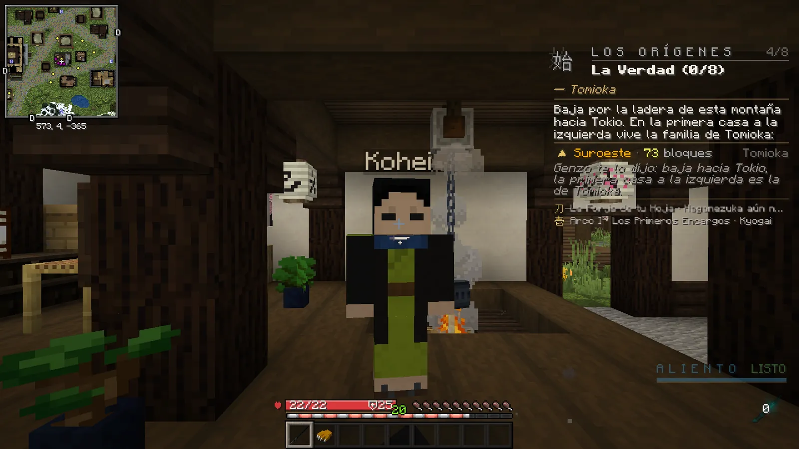
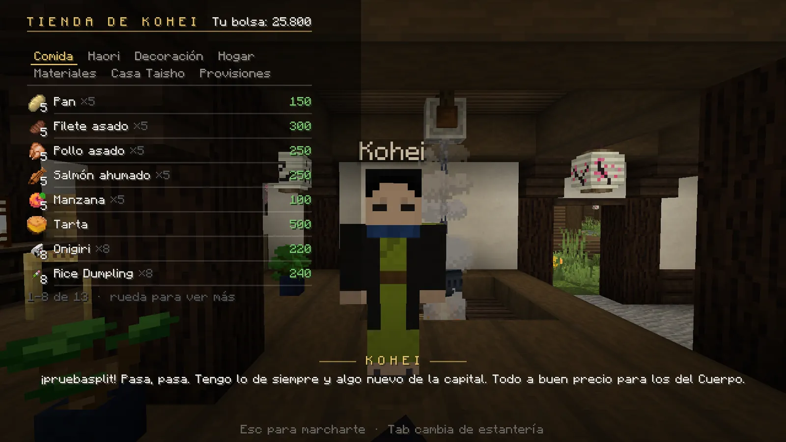
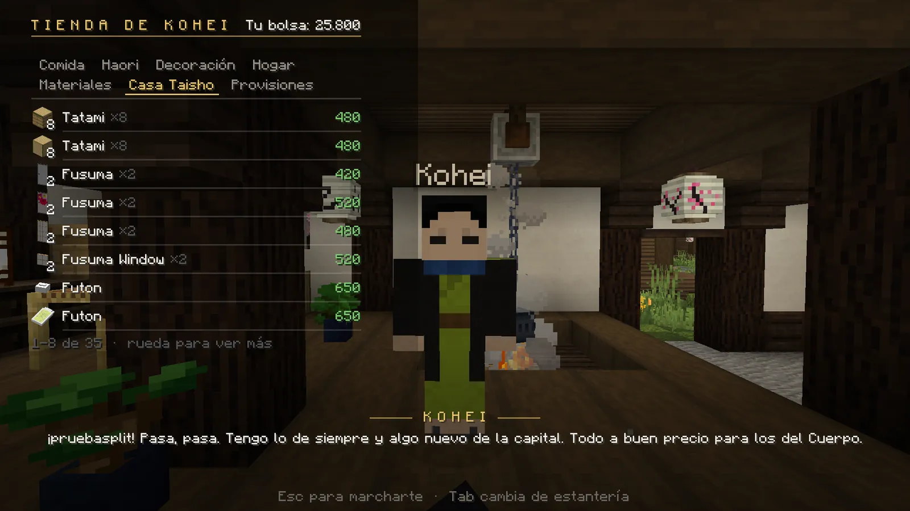

# Tiendas y forja

## La tienda de Kohei (Tokio)

La tienda principal es la de **Kohei**, en Tokio. El tutorial te manda allí, y desde la llegada del cuervo a Tokio
está a un paseo.

<figure markdown="span">
  { loading=lazy }
  <figcaption>Kohei, en su tienda de Tokio.</figcaption>
</figure>
<figure markdown="span">
  { loading=lazy }
  <figcaption>La tienda: estanterías arriba, artículos con su precio y tu bolsa.</figcaption>
</figure>
<figure markdown="span">
  { loading=lazy }
  <figcaption>La estantería «Casa Taisho»: tatamis, puertas correderas y futones para tu casa.</figcaption>
</figure>

**Cómo se compra:**

1. Haz **clic derecho** sobre Kohei. Si tienes una misión con él, el primer clic es para la misión y la tienda se abre con el siguiente.
2. Elige la estantería arriba (con un clic o con ++tab++). Si tiene varias **baldas** (como «Muebles»: Luz, Salón, Jardín…),
   salen en una segunda fila debajo. Si una fila no cabe, se desliza con la rueda del ratón encima de ella o con sus flechas «‹ ›».
3. **Un clic en un artículo** compra un lote (la cantidad viene al lado del nombre).

- Tienes **15 minutos** para comprar desde que le hablas, y tienes que estar cerca de él.
- Necesitas **hueco en el inventario** antes de pagar.
- Al pasar el ratón por un artículo ves su descripción o *«te faltan X»* si no te llega.

| Estantería | Qué hay |
|---|---|
| **Comida** | Pan, carne, pescado, onigiri, dango… |
| **Haori** | Haoris de personaje: son ropa, **no protegen** (0 de armadura) y ocupan el sitio del peto del uniforme. Los que protegen se forjan en la [Aldea de los Herreros](aldea.md). |
| **Decoración** y **Hogar** | Cofres, barriles, hornos, cuadros, marcos, faroles, macetas… para tu casa. |
| **Materiales** | Tablones, piedra, ladrillos, cristal, lana… |
| **Casa Taisho** | Muebles japoneses: tatamis, fusuma, futón, braseros, linternas de papel… |
| **Muebles** | Decoración japonesa en 3D y las mesas de juego, en siete baldas ([ver abajo](#los-muebles-japoneses)). |
| **Provisiones** | Lo que piden algunas entregas de misión (hierro, carbón, miel, velas, cuerda…). |
| **Mochilas** | La mochila de lona y lo que hace falta para mejorarla: oro, diamante, netherita y su plantilla ([ver abajo](#mejorar-tu-mochila)). |

!!! demonio "Si eres demonio"
    Kohei te atiende, pero solo con *«lo de casa»*: Hogar, Materiales, Casa Taisho y Muebles. Y las **Mochilas**.

## Los muebles japoneses

En la estantería **Muebles** hay **40 piezas** de decoración japonesa en 3D, diseñadas para DemonCraft (de **600 a
16.000**), y las tres mesas de juego. Se ponen en **tu casa o tu parcela**.

| Balda | Piezas |
|---|---|
| **Luz** | Andon de Papel, Chōchin del Festival y Chōchin del Oni (dan luz), Fūrin de Cristal (se mece y tintinea). |
| **Salón** | Biombo Dorado de las Grullas, Kakejiku de la Luna de Sangre, Kakejiku del Dragón, Soporte de Katanas, Kabuto del Samurái, Armadura del Samurái Carmesí, Taiko de la Fiesta (se toca), Ikebana de Camelias, Furisode del Ocaso Expuesto. |
| **Jardín** | Tōrō de Piedra (da luz), Wagasa de Jardín, Shishi-odoshi (el bambú se llena, se vuelca y golpea la piedra), Bonsái de Pino Negro, Bonsái de Cerezo en Flor (suelta pétalos), Jardín Zen en Miniatura, Estanque de los Koi (con dos carpas nadando), Banco de la Casa de Té, Torii del Santuario (se pasa por debajo). |
| **Mesa** | Juego de Té Ceremonial, Kotatsu, Chabudai con la Cena, Zabuton Morado, Zabuton Índigo y Zaisu de Laca. |
| **Puertas y paredes** | Noren de la Glicina y Noren del Oni (se pasa a través), Panel Shōji, Kamidana del Hogar, Máscara Hannya, Máscara del Zorro. |
| **Figuras** | Daruma de la Suerte, Maneki-neko (saluda con la pata), Komainu «A» y Komainu «Un», Barriles de Sake, Incensario de Bronce (echa humo). |
| **Juegos** | Mesa de Ajedrez, Mesa de Pulso y Diana de Dardos: [las mesas de juego](../social/juegos.md). |

- **Las piezas grandes ocupan varios bloques** (el biombo, 2 × 2; el torii, 3 × 3): solo se colocan si hay sitio para todas
  sus partes, y se quitan enteras devolviéndote un solo objeto.
- Cada una necesita su **apoyo**: el suelo, la pared (los kakejiku, las máscaras, el kamidana) o el techo (los chōchin, el
  fūrin, los noren). Si se lo quitas, se cae y vuelve a ser objeto.
- **Siéntate** con clic derecho en los zabuton, el zaisu y el banco (en plena pelea, no). El taiko solo lo tocan los que
  viven en la casa.
- Al acabar el alquiler vuelven a tu buzón, como todo lo que pusiste.

## Mejorar tu mochila

En la estantería **Mochilas** de Kohei se vende la mochila de lona y, de uno en uno, lo que hace falta para subir de nivel la tuya
(la que se abre con ++b++). Cada nivel tiene más huecos que el anterior. Se mejora desde la ventana de la propia mochila, con lo
de dentro intacto: [ver las mochilas](mochilas.md).

| Artículo | Precio | Para qué |
|---|---|---|
| Mochila de lona | 500 | La básica, de 27 huecos. |
| Lingote de oro para mochilas | 400 | Ocho: de la de lona a la **de viaje** (54 huecos). |
| Diamante para mochilas | 3.000 | Ocho: de la de viaje a la **lacada** (81 huecos). |
| Lingote de netherita para mochilas | 6.000 | Uno, con la plantilla: de la lacada a la **de maki-e** (135 huecos). |
| Plantilla de mejora de mochila | 2.000 | La que pide la de maki-e. |

- Subir a la de viaje cuesta 3.200; a la lacada, 24.000; y a la de maki-e, 8.000.
- **Solo sirven para mejorar mochilas**: no valen para armaduras, herramientas ni ninguna otra receta.
- Los demonios también pueden comprarlos.

## Mostradores que se desbloquean

Al terminar algunas campañas y encargos, el personaje que te ayudó **abre su mostrador**: háblale cuando no tenga
ninguna misión para ti y verás la estantería **«Desbloqueado»** con remedios y objetos especiales (por ejemplo,
ungüentos de glicina o botiquines). Los demonios no pueden comprar en ellos.

## Otras tiendas de Tokio

Atienden a los dos bandos, en el centro de la ciudad:

| Tienda | Quién | Qué vende |
|---|---|---|
| **Tienda de animales** | Criadora Aiko | [Mascotas de casa](mascotas.md), su comida, su agua y sus cosas. |
| **Floristería** | Florista Sumire | [Macetas](plantas.md), regadera, abono, remedio y tijeras. Y te compra lo que cosechas. |
| **Regalos y joyas** | Orfebre Sadaji | [Regalos para ellas](../social/relaciones.md#que-regalarles) y el anillo de compromiso. |

En la plaza del Tablón de Encargos está además el **Contador Soemon**: si eres cazador de rango alto, te cambia los méritos que te
sobran por dinero u objetos ([el trueque](trueque.md)).

## La forja y la Aldea de los Herreros

Si pierdes tu katana, los herreros te la **reforjan** por un precio. Está explicado en
[Tu katana nichirin](../cazador/katana.md#si-pierdes-tu-katana-la-reforja).

Para **equiparte** (prendas que protegen de los demonios, máscaras, amuletos, el temple de tu katana) ve a la
**[Aldea de los Herreros](aldea.md)**. Lo mejor de todo está en [la forja mayor](forja-mayor.md).
