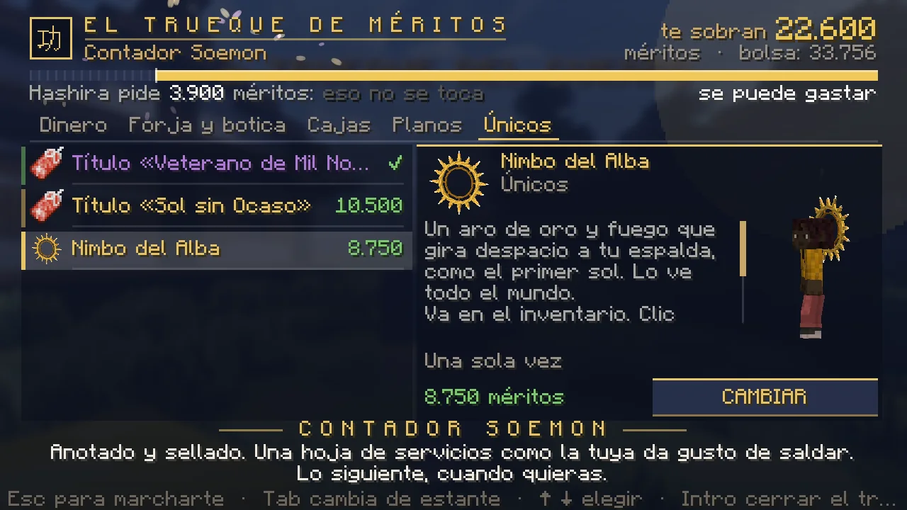
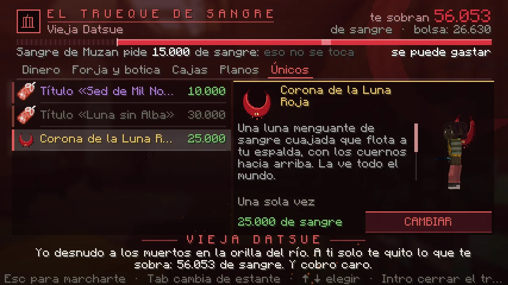

# El trueque

¿Eres de rango alto y se te acumula la sangre o los méritos sin saber para qué? Hay quien te los compra. Caro: nadie regala nada.

## Con quién y dónde

| Bando | Con quién | Dónde | Cómo se llega |
|---|---|---|---|
| Demonio | **La Vieja Datsue** | El [Mercado de la Noche](../demonio/mercado.md), en la sala del castillo donde despiertas, contra la pared del este, enfrente del Mensajero de Muzan | K → Lugares → Mercado de la Noche |
| Cazador | **El Contador Soemon** | Tokio, la plaza del Tablón de Encargos, donde te deja el viaje rápido | K → Lugares → Tokio |

Clic derecho y se abre su pantalla. Escribe **`/trueque`** para saber cuánto te sobra.

<figure markdown="span">
  { loading=lazy }
  <figcaption>El Contador Soemon: arriba, lo que te sobra; a la izquierda, los estantes; a la derecha, la ficha.</figcaption>
</figure>
<figure markdown="span">
  { loading=lazy }
  <figcaption>La Vieja Datsue, con la Corona de la Luna Roja en el probador.</figcaption>
</figure>

## Qué es «lo que te sobra»

Lo que tienes **por encima del umbral del rango que ya pagas**. Es lo único que se puede gastar: lo que tu rango pide no se toca nunca, y la barra de arriba de la pantalla te lo enseña (oscuro lo que no se toca, vivo lo que te sobra).

- **No baja tu rango**, ni tu edad de la sangre, ni tus puntos del árbol.
- La sangre que espera a su rito y los méritos que esperan tus días de servicio tampoco se tocan: tu ascenso sigue ahí.
- Lo que cuesta morir se calcula igual que siempre, sobre lo que tengas de más. **Lo que has gastado ya no se puede perder al morir.**
- Si aún no estás arriba del todo, lo que te sobra es lo que llevas hacia el siguiente rango: gastarlo lo retrasa. Por eso solo se trata desde **Kinoto** (cazador) y **Luna Inferior** (demonio).

## Qué hay

Los precios son para quien lleva decenas de horas de sobra: un demonio arriba del todo gana unos 500 de sangre por hora y un cazador, unos 175 méritos.

| Estante | Qué | Sangre | Méritos | Tope |
|---|---|---|---|---|
| Dinero | Bolsa de 5.000 | desde 1.500 | desde 530 | Hasta 30.000 a la semana. **Cada bolsa de la semana sale un 15 % más cara** (la sexta, 3.020 de sangre) |
| Forja y botica | Núcleo de sangre ×3 / Vial de marechi ×3 | 1.500 | 530 | 3 a la semana |
| | Esquirla de Luna Superior / Tsuba de Pilar | 2.000 | 700 | 2 a la semana |
| | Lágrima de la Luna de Sangre / Loto negro | 3.000 | 1.050 | 1 a la semana |
| | Elixir de la Finca ×3 / Elixir de la Luna Roja ×3 | 1.000 | 350 | 3 a la semana |
| Cajas | Tirada de la Caja del Cuartel / Ficha de Sangre | 2.000 | 700 | 2 a la semana |
| | Metal nichirin premium / Sangre Premium | 40.000 | 14.000 | 1 cada 30 días |
| Planos | Un plano o pergamino **legendario**, el que elijas | 15.000 | 5.250 | 1 cada 14 días (se puede vender) |
| Únicos (solo Hashira y Sangre de Muzan) | Título «Veterano de Mil Noches» / «Sed de Mil Noches» | 10.000 | 3.500 | Una vez |
| | Título «Sol sin Ocaso» / «Luna sin Alba» (pide el anterior) | 30.000 | 10.500 | Una vez |
| | **Nimbo del Alba** / **Corona de la Luna Roja** | 25.000 | 8.750 | Una vez |

La semana va de lunes a domingo, hora de España. Los títulos solo se consiguen aquí.

## El Nimbo y la Corona

Lo más caro no da ninguna ventaja: da envidia. Un aro de oro y fuego que gira despacio a tu espalda, o una luna de sangre con los cuernos hacia arriba. Lo ve todo el mundo.

- Va en tu inventario: no se tira, no se vende ni se pierde al morir, y solo te responde a ti.
- **Clic derecho** con él en la mano: te lo pones o te lo quitas.
- Si se te pierde, el personaje te lo repone gratis.
- La Corona solo se ve en un demonio y el Nimbo, en un cazador. Si cambias de bando se queda contigo, guardado.

## Cómo se cierra un trato

<ol class="pasos" markdown>
<li markdown>**Elige el estante y la fila.** A la derecha sale la ficha con lo que da y, si no se puede, por qué.</li>
<li markdown>**Pulsa el botón.** Te pide **otro clic para confirmar**.</li>
<li markdown>**Si no te cabe, no te cobra nada.** Haz hueco y vuelve.</li>
</ol>

No se trata en combate ni en un duelo.
