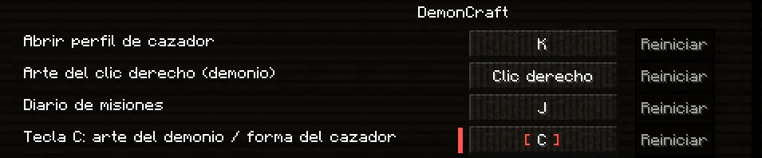

# Controles

La primera vez que abres el juego, DemonCraft coloca sus teclas y te deja un resumen en el chat. Estas son las que vas a usar.

## Combate

| Tecla | Qué hace |
|---|---|
| ++"Clic izq."++ | Atacar. Encadenando golpes haces combos. Con la katana nichirin, también corriendo. |
| ++"Clic der."++ | **Cazador:** lanzar la forma de respiración elegida (con la katana nichirin en la mano principal). |
| ++r++ / ++shift+r++ | Pasar a la forma siguiente / a la anterior. |
| ++z++ · ++x++ · ++c++ | **Cazador:** las [técnicas del Cuerpo](../cazador/rangos.md#la-senda-del-cazador) y las formas de otras respiraciones que hayas puesto en cada tecla (desde los rangos Kanoe, Hinoto y Kinoe; [cómo](../cazador/respiraciones.md#las-teclas-z-x-y-c)). |
| ++e++ | **Cazador:** cuando sale «Pulsa E», el [golpe crítico](../cazador/combate.md#el-golpe-critico). Sin el aviso, abre el inventario como siempre. |
| ++f++ (mantener) | Bloquear. Si lo pulsas justo antes del golpe, haces una **parada**. |
| ++alt++ izquierdo | Esquivar (voltereta). |
| ++g++ | Fijar el objetivo. |
| ++h++ | **La Marca del Cazador** (en el rango Hashira, o con cualquier rango si tienes un [rango VIP del Cuerpo](../vip.md#la-marca-de-cada-pilar); [ver](../cazador/rangos.md#la-marca-del-cazador)). |
| ++o++ | Pasar lo que llevas en la mano a la **otra mano**: así se llevan las dos hojas gemelas de los rangos del Sonido y de La Bestia ([ver](../vip.md#las-gemelas-del-sonido-y-de-la-bestia)) y lo de la mano izquierda de [las Lunas](../vip.md#las-lunas-rangos-de-demonio). |
| ++y++ | Habilidades de combate. |

!!! info "Siempre en modo combate"
    Peleas siempre en **modo combate** (combos, bloqueo y esquiva), lleves lo que lleves en la mano: cada golpe tiene su
    animación y su ritmo, y pulsar más deprisa no pega más. Para picar o romper un bloque, **míralo** y pica como siempre.

!!! warning "O te cubres o atacas"
    Con el bloqueo puesto (++f++) o con un escudo levantado no sale ninguna técnica (ni formas ni artes), y tras cada técnica
    tienes **4 segundos** para recuperarte, contados desde que acaba. Y ojo: una técnica del rival
    [puede romperte la guardia](../cazador/combate.md#las-tecnicas-contra-la-guardia).

## Demonio

| Tecla | Qué hace |
|---|---|
| ++"Clic der."++ con la mano vacía o con un arma | Lanzar el arte de tu casilla *Clic der.* (apuntando al aire o a un enemigo). Con un arma: espadas, abanicos, hoces y hachas ([ver](../demonio/artes.md#el-arte-del-clic-derecho-tambien-con-un-arma)). |
| **Arte del clic derecho (demonio)** | La tecla de ese arte, en *Controles*: de serie, el clic derecho. Si le pones otra, esa lanza el arte y el clic derecho vuelve a ser solo el de usar ([ver](../demonio/artes.md#cambiar-su-tecla)). |
| ++z++ · ++x++ · ++c++ | Lanzar el arte que hayas puesto en cada tecla. Se abren con tu rango de sangre: Z en el 3, X en el 6 y C en el 9 ([cómo elegirlas](../demonio/artes.md#ponerlas-en-las-teclas)). |
| ++e++ | Cuando sale «MORDISCO», el [mordisco](../demonio/combate.md#el-mordisco). Sin el aviso, abre el inventario como siempre. |
| ++f++ (mantener) con las manos vacías | [Cubrirte con los brazos](../demonio/combate.md#cubrirte-con-los-brazos). Con un arma de sangre, te cubres con ella. |
| Agachado + ++"Clic der."++ sobre un vecino | Devorar. |

## Movimiento (parkour)

| Tecla | Qué hace |
|---|---|
| ++shift++ en el aire | Agarrarte a un borde, deslizarte o rodar al caer. |
| ++ctrl++ junto a una pared | Correr por la pared. |
| ++ctrl+p++ | Activar o desactivar el parkour. |

## Menús y utilidades

| Tecla | Qué hace |
|---|---|
| ++k++ | **Tu perfil** (la K): misiones, lugares, rango, dinero, clan, Mercado… [Ver la K](menu-k.md). |
| ++j++ | Abre la K directamente en *Misiones*. |
| ++m++ | Mapa del mundo. |
| ++b++ | Abrir tu mochila. |
| ++i++ | Junto a la placa de una casa o al cartel de una parcela: verla ([casas y parcelas](../economia/casas.md)). |
| ++v++ | Menú del chat de voz (grupos, ajustes). |
| ++n++ | Silenciar tu micrófono. |
| ++tab++ | Lista de jugadores (con tu rango, tu bolsa y el estado de la noche). |
| ++f1++ · ++f2++ · ++f5++ | Ocultar la interfaz · captura de pantalla · cambiar de cámara. |

En el inventario, sobre un objeto: ++r++ muestra cómo se fabrica y ++u++ para qué sirve.

## Cambiar las teclas

Todas se cambian en *Opciones → Controles → Teclas*. Las propias del servidor están en la categoría **DemonCraft**. Allí
está también **«Arte del clic derecho (demonio)»**: de serie pone «Clic derecho»; si le pones una letra o un botón lateral
del ratón, esa tecla lanza el arte del clic derecho y el clic derecho queda solo para usar las cosas.

<figure markdown="span">
  { loading=lazy }
  <figcaption>La categoría DemonCraft: «Arte del clic derecho (demonio)», de serie en el clic derecho.</figcaption>
</figure>

Si ya tenías las teclas de DemonCraft de antes, al entrar se te pone sola la ++o++ para la otra mano (solo si esa tecla
estaba sin asignar y la O quedaba libre) y te avisa. Los packs de shaders se eligen en *Opciones → Vídeo*.

??? tip "Volver a las teclas de DemonCraft"
    Con el juego **cerrado**, borra el archivo `config/demoncraft-controles.txt` de la carpeta del juego
    (con el launcher, `%APPDATA%\.demoncraft`). La próxima vez que lo abras se vuelven a poner y sale el resumen en el chat.
