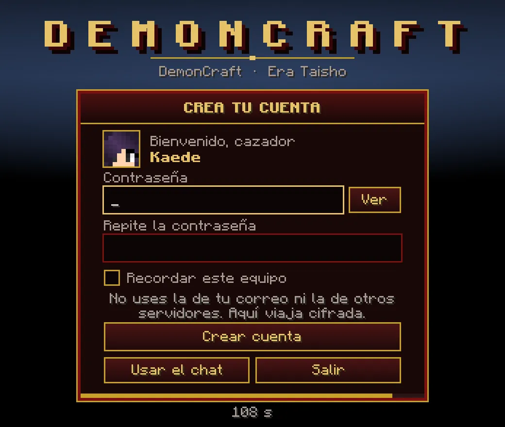

# Cómo entrar

Dos formas de instalarlo, una dirección y una contraseña. En cinco minutos estás dentro.

## Lo que necesitas

- **Minecraft Java Edition** (versión 1.20.1 con Forge: el launcher lo instala por ti).
- Un PC con al menos **8 GB de RAM** (el juego usa 4 GB por defecto).
- Para el **DemonCraft Launcher**: Windows y el **launcher oficial de Minecraft** con tu cuenta de Microsoft.
- Si usas otro launcher (CurseForge, Prism, etc.), tienes el **zip del pack** (opción B).

## Opción A · DemonCraft Launcher (recomendada)

<ol class="pasos" markdown>
<li markdown>**Descarga el instalador** desde [la página de descargas del launcher](https://github.com/slava1222/demoncraft-launcher/releases/latest) (el archivo `DemonCraft-Launcher-Setup-….exe`).</li>
<li markdown>**Ábrelo.** Si Windows muestra un aviso azul de SmartScreen, pulsa *Más información* → *Ejecutar de todas formas* (el instalador no está firmado, es normal).</li>
<li markdown>**Pulsa JUGAR.** La primera vez descarga el pack, Java si hace falta y Forge, y crea el perfil **DemonCraft** en el launcher oficial. Las siguientes veces solo actualiza lo que haya cambiado.</li>
<li markdown>**Se abre el launcher oficial** con el perfil DemonCraft ya elegido: entra con tu cuenta y pulsa *Jugar*. El juego entra directo al servidor.</li>
</ol>

!!! tip "Consejos del launcher"
    - La **memoria** del juego se cambia en *Ajustes* del DemonCraft Launcher (no en el launcher oficial: cada vez que
      pulsas JUGAR se vuelve a escribir el perfil).
    - **No metas mods tuyos** en la carpeta `mods`: el launcher la deja igual que el pack y borra lo que sobra.
    - Los **shaders** sí puedes usarlos: copia el pack de shaders en la carpeta `shaderpacks` y elígelo en el juego con ++o++.
    - El launcher se actualiza solo: si ves «Hay una versión nueva del launcher», pulsa *Instalar y reiniciar*.

## Opción B · El zip del pack (CurseForge y otros launchers)

1. Descarga [**DemonCraft-Modpack.zip**](https://github.com/slava1222/demoncraft-launcher/releases/download/modpack/DemonCraft-Modpack.zip).
2. **CurseForge:** *Minecraft* → *Create Custom Profile* → *Import* y elige el zip. Dale al menos 4 GB de memoria y pulsa *Play*.
3. **Otros launchers:** instala Minecraft **1.20.1** con **Forge 47.4.23** y copia dentro las carpetas `mods` y `resourcepacks` del zip.

!!! warning "Al actualizar, cambia la carpeta `mods` entera"
    Cuando salga una versión nueva del pack, vuelve a descargar el zip y sustituye **toda** la carpeta `mods`. Si queda
    un mod viejo, el servidor no te deja entrar.

## La dirección del servidor

Dirección: <code>demoncraft.world</code> <button type="button" data-copiar="demoncraft.world">Copiar</button>

Con el launcher ya viene puesta. Con el zip también aparece en *Multijugador*; si no, añádela a mano en
*Multijugador → Añadir servidor*.

Si al entrar ves **«¡No estás en la lista blanca del servidor!»**, el servidor está con lista blanca: pide acceso en el
[Discord](https://discord.gg/mdwAvAMBvr).

## Tu cuenta: crear la contraseña

La primera vez que entras, el servidor te pide **crear una contraseña** para proteger tu nombre. Es la contraseña de tu
personaje en DemonCraft, no la de tu cuenta de Microsoft.

<figure markdown="span">
  { width="560" loading=lazy }
  <figcaption>La pantalla de registro: escribe la contraseña dos veces, marca «Recordar este equipo» y pulsa «Crear cuenta». La barra de abajo es el tiempo que te queda.</figcaption>
</figure>

- Tienes **2 minutos** para registrarte (1 minuto para iniciar sesión las siguientes veces).
- La contraseña debe tener **8 caracteres o más**, sin espacios, sin tu nombre dentro, con al menos 4 caracteres
  distintos y no puede ser de las más usadas (`12345678`, `password`…).
- **«Recordar este equipo»**: tu PC queda de confianza y las próximas veces entras sin escribir nada (dura 30 días sin
  usarse, como mucho 5 equipos). No la marques en un ordenador prestado.
- Si la pantalla fallara, pulsa **«Usar el chat»** y escribe `/register <contraseña> <contraseña>` (o `/login <contraseña>`).
- Para cambiarla: `/changepassword <actual> <nueva>` (o `/cambiarclave`). Al cambiarla se cierran tus equipos de confianza.

!!! danger "Si olvidas la contraseña"
    No hay recuperación automática. Pide ayuda al staff en el Discord: comprobarán que eres tú y te pondrán una
    temporal. Y nunca uses la contraseña de tu correo ni la de otros servidores.

??? question "Tengo cuenta premium, ¿también necesito contraseña?"
    Sí, en general todos crean una. Solo entran sin contraseña los nombres que el staff haya marcado como premium
    protegidos. Si te interesa, pregúntalo en el Discord.
