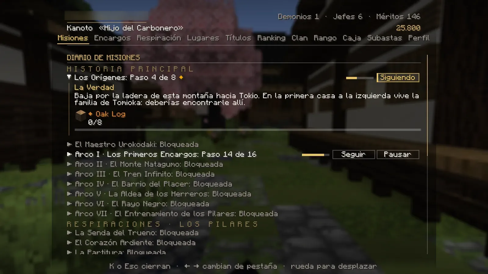
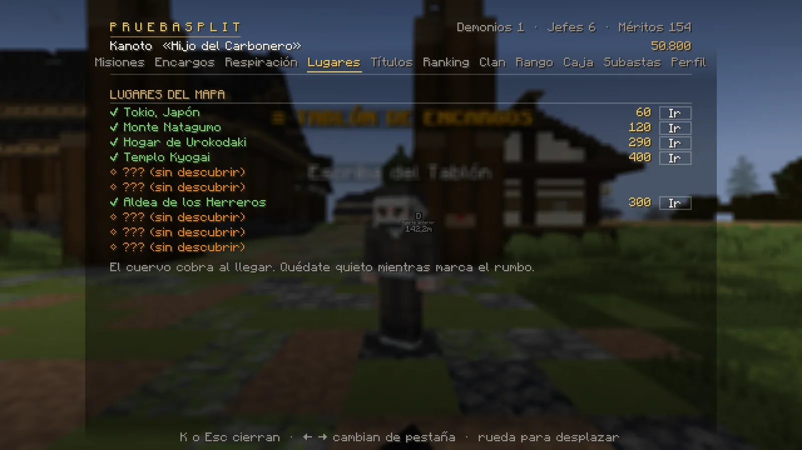
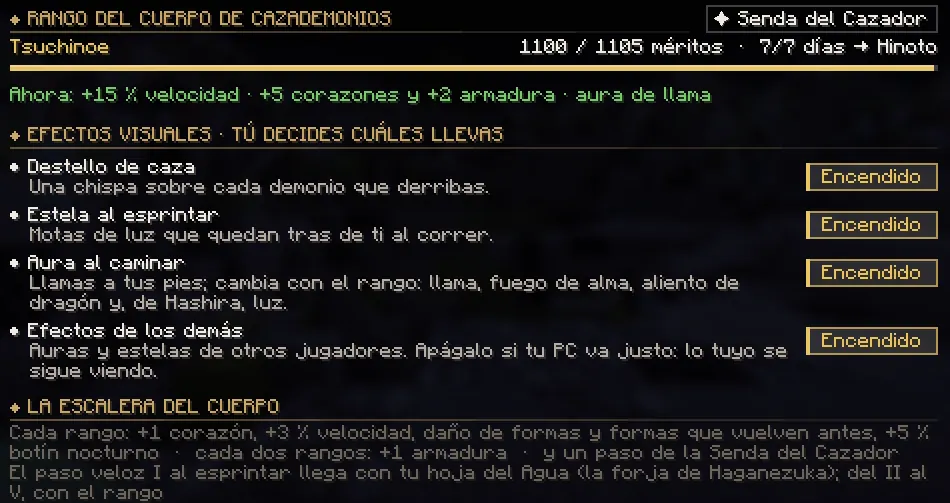
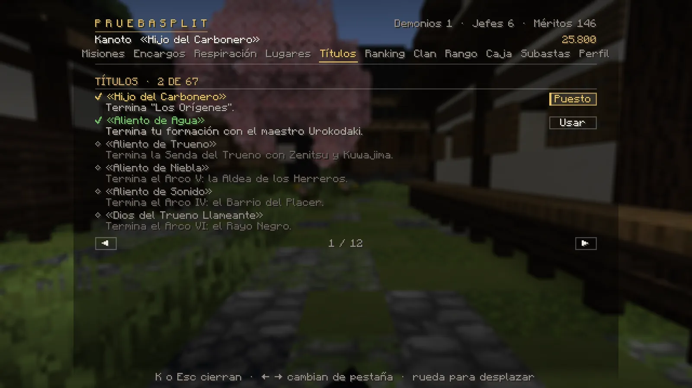
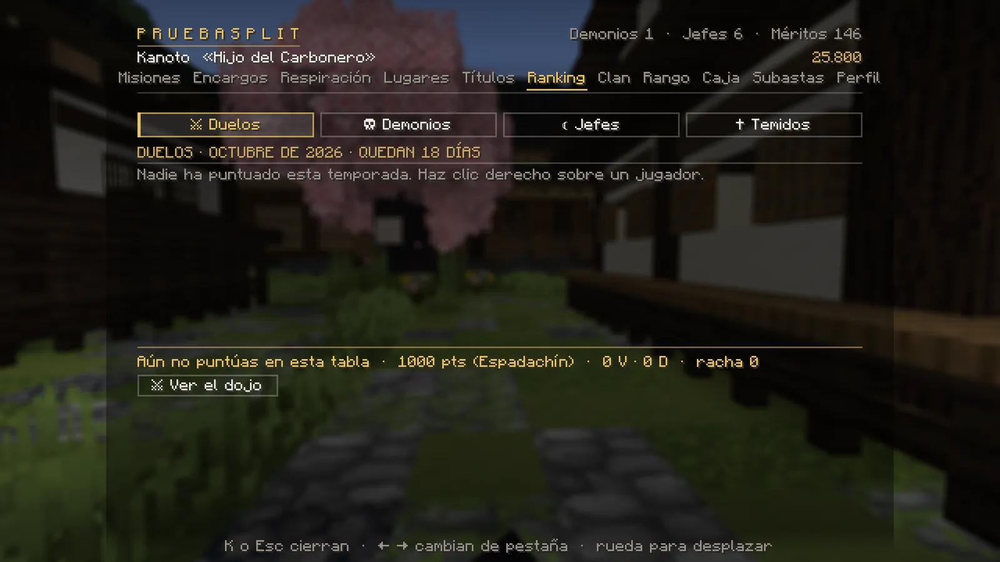
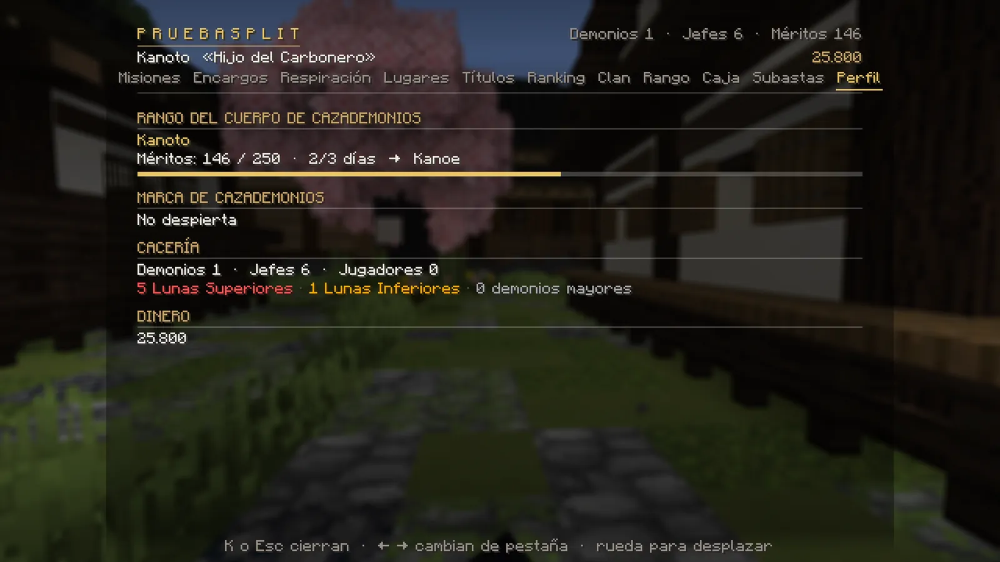
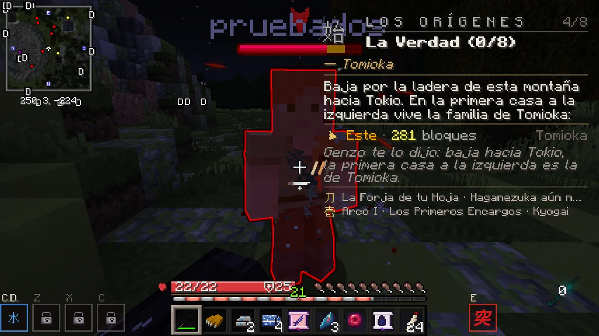
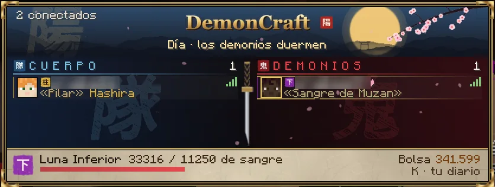

# La K y la pantalla

Pulsa la <strong>K</strong> y tendrás delante casi todo el servidor: tus misiones, a dónde puedes viajar, tu rango, tu dinero, tu clan y el Mercado.

## La K, tu perfil

- ++k++ la abre y la cierra (también ++esc++). ++j++ la abre directamente en *Misiones*.
- Cambias de pestaña con las flechas ++arrow-left++ ++arrow-right++ o con el ratón. La rueda desplaza la lista.
- Arriba ves tu cara, tu nombre (en dorado si eres cazador, en rojo si eres demonio), tu rango y tu título; a la derecha,
  tus cifras (demonios, jefes y méritos) y tu **dinero**.

| Pestaña | Para qué sirve | Más info |
|---|---|---|
| **Misiones** | Tu diario: historia, respiraciones y campañas. *Seguir*, *Pausar* y ver cada paso. | [Misiones](../misiones/index.md) |
| **Encargos** | Los encargos que tienes abiertos y los rumores de quién necesita ayuda. | [Encargos](../misiones/encargos.md) |
| **Halloween** | Solo durante el evento: tu camino de las calabazas, la tienda de la Anciana y la clasificación. | [Halloween](../eventos/halloween.md) |
| **Respiración** | El árbol de respiraciones: cuál tienes activa, tus formas, el entrenamiento y tus teclas Z, X y C. | [Respiraciones](../cazador/respiraciones.md) |
| **Lugares** | La Ciudadela, Yamanote, el Ryōtei, el Gran Dojo (desde tu primera nichirin) y los lugares que has descubierto, con el precio del viaje y el botón **Ir**. | [Viajar](../mundo/viajar.md) · [La Ciudadela](../ciudadela/index.md) · [Yamanote](../ciudadela/yamanote.md) · [El Ryōtei](../ciudadela/ryotei.md) · [El Gran Dojo](../social/duelos.md#el-gran-dojo) |
| **Títulos** | Todos los títulos, cómo se consiguen y cuál llevas puesto. | [Títulos](../social/chat.md#titulos) |
| **Ranking** | Clasificaciones: duelos, demonios cazados, jefes y los demonios más temidos. | [Duelos](../social/duelos.md) |
| **Clan** | Fundar o gestionar tu clan. | [Clanes](../social/clanes.md) |
| **Rango** | Tu rango del Cuerpo, lo que te falta para el siguiente, tus efectos visuales y el botón **«✦ Senda del Cazador»**. | [Rangos](../cazador/rangos.md) · [La Senda](../cazador/rangos.md#la-senda-del-cazador) |
| **Caja** | La Caja del Cuartel (un premio gratis cada 24 horas, con la cuenta atrás del siguiente) y la Caja Premium. Cuando tienes el tiro gratis listo, la pestaña late con una estrella **✦**. | [Cajas](../economia/objetos.md#la-caja-del-cuartel-k-caja) |
| **✦ Pase** | El Pase Estelar: tus niveles, sus recompensas y los desafíos de la semana. Si tienes algo por recoger, la pestaña lo cuenta (**✦3**). | [Pase Estelar](../pase.md) |
| **Subastas** | El Mercado entre jugadores. | [Mercado](../economia/mercado.md) |
| **♥ Relaciones** | Las ocho mujeres de Tokio y del Barrio del Placer: tus corazones con cada una, por dónde anda y, si tienes pareja, cómo está y cuánto aguanta sin ti. | [Relaciones](../social/relaciones.md) |
| **Perfil** | Tu ficha: rango, cacería y dinero. Con el Colgante de las Almas, también tus almas guiadas y tus campanadas. | [El Colgante](../misiones/colgante.md#en-la-k) |

!!! demonio "Si eres demonio"
    Tu K cambia: no tienes *Respiración* ni *Rango*, y a cambio tienes **Sangre** (tu rango de sangre, el árbol,
    la [Senda del Demonio](../demonio/senda.md) y los encargos de la noche) y **Artes** (tus artes de sangre, sus teclas y el
    [Árbol de la Sangre](../demonio/artes.md#el-arbol-de-la-sangre)). *Caja* te abre la tuya, la
    [Caja de Sangre](../economia/objetos.md#la-caja-de-sangre-demonios), y el *Pase* es el de los demonios. *Encargos* pasa a
    ser «Susurros de la noche» y *Lugares*, «Las puertas de Nakime» (con el [Mercado de la Noche](../demonio/mercado.md)).
    [Ver el camino del demonio](../demonio/index.md).

<figure markdown="span">
  { loading=lazy }
  <figcaption>Misiones: cada cadena con su paso actual y los botones Seguir y Pausar.</figcaption>
</figure>
<figure markdown="span">
  { loading=lazy }
  <figcaption>Lugares: el precio del viaje y el botón Ir.</figcaption>
</figure>
<figure markdown="span">
  { loading=lazy }
  <figcaption>Rango: méritos, días de servicio, efectos visuales y el botón de la Senda del Cazador.</figcaption>
</figure>
<figure markdown="span">
  { loading=lazy }
  <figcaption>Títulos: los que tienes, los que te faltan y cómo se consiguen.</figcaption>
</figure>
<figure markdown="span">
  { loading=lazy }
  <figcaption>Ranking: duelos, demonios, jefes y temidos.</figcaption>
</figure>
<figure markdown="span">
  { loading=lazy }
  <figcaption>Perfil: tu ficha y tu dinero.</figcaption>
</figure>

!!! warning "Con la K abierta no ves el chat"
    Mientras tienes la K (o cualquier menú del servidor) abierta, no se ven los mensajes del chat ni los avisos.
    Ciérrala si esperas una respuesta.

## La pantalla mientras juegas

<figure markdown="span">
  { loading=lazy }
  <figcaption>Arriba a la izquierda el minimapa; arriba a la derecha la tarjeta de misión; abajo, la barra de vida, tus teclas (C.D., Z, X y C) y la E del golpe crítico.</figcaption>
</figure>

| Elemento | Dónde | Qué te dice |
|---|---|---|
| **Minimapa** | Arriba a la izquierda | Lo que te rodea y tus coordenadas. El mapa grande, con ++m++. |
| **Tarjeta de misión** | Arriba a la derecha | El paso que sigues, quién lo da, la flecha y la distancia. |
| **Barra de vida** | Encima de la barra de objetos | Tu vida en números («20/20») y tu armadura. Con poca vida, los bordes laten en rojo. |
| **Marca de combate** | Justo encima de la barra de vida | Solo en plena pelea con otro jugador: «⚔ EN COMBATE» y los segundos que te quedan; al acabar, «✓ FUERA DE COMBATE». [Ver la marca](../cazador/combate.md#la-marca-de-combate). |
| **Tus teclas** | Abajo a la izquierda | Lo que lanzas con el clic derecho (**C.D.**; si eres demonio y le has puesto otra tecla en Controles, verás esa), ++z++, ++x++ y ++c++: tus formas y técnicas del Cuerpo si eres cazador, tus artes si eres demonio. Cada una con su espera (la sombra baja y cuenta los segundos) y un **candado** si tu rango aún no la abre. Mientras dura una técnica se apagan todas; al acabar, cuentan los **4 s** para recuperarte (también la raya de debajo). |
| **Golpe crítico** | Junto a tus teclas (si no cabe, a la derecha de la barra de objetos) | **突** el del cazador ([la estocada](../cazador/combate.md#el-golpe-critico)) y **噛** el del demonio ([el mordisco](../demonio/combate.md#el-mordisco)): listo, o los segundos que le faltan. |
| **Pase Estelar** | A la derecha, debajo de la tarjeta de misión | Al ganar experiencia del pase, una tarjeta pequeña: cuánta («✦ +120»), de dónde viene y la barra de tu nivel. Lo que llega seguido se suma en la misma. Al subir de nivel, brilla. [Ver el pase](../pase.md) |
| **Tarjetas grandes** | En el centro | Capítulos, «LUGAR DESCUBIERTO», respiración aprendida, un nivel nuevo del Pase Estelar… |

## La lista de jugadores (++tab++)

**Mantén pulsado ++tab++** y se abre la lista de quién está en el servidor: una caja de laca negra con marco dorado, el cielo de
ahora arriba y un bando a cada lado de la katana. Al soltar, se va.

<figure markdown="span">
  { width="640" loading=lazy }
  <figcaption>La lista con Tab: el cielo de ahora arriba, un bando a cada lado y, abajo, lo tuyo. Los nombres están difuminados.</figcaption>
</figure>

- **Arriba, el cielo.** DemonCraft y cómo está la noche, en tus palabras: el día, la noche cerrada, la hora del buey y la **Luna de
  Sangre** tienen su color, su kanji y su luna (o su sol) sobre las montañas. Y cuántos estáis conectados.
- **Dos bandos.** 隊 Cuerpo a la izquierda y 鬼 Demonios a la derecha, cada uno con su cuenta. Los VIP salen los primeros; después, por rango.
- **Cada fila.** La cara del jugador, el sello de su rango (el tronco celeste de cada rango del Cuerpo o el kanji de su rango de
  sangre), la etiqueta de su clan, su nombre y su título, y la latencia en cuatro barras (verde, dorado, naranja, rojo). Tu propia
  fila lleva un filete dorado. Un **♥** junto al nombre: [está casado](../social/relaciones.md#prometerse-y-casarse).
- **Abajo, lo tuyo.** Tu rango, tu progreso hacia el siguiente (méritos o sangre, y los días de servicio si te faltan), tu **bolsa**
  y, si tienes un VIP de pago, tu **+10 %**.

Con pocos jugadores cada fila va a dos líneas y con mucha gente se aprieta y baja de tamaño lo justo: con los sesenta del máximo
también caben todos, a cualquier tamaño de ventana y con cualquier escala de interfaz. Los títulos de los VIP están vivos:
[cada rango con su paleta y su manera de moverse](../vip.md#tu-titulo-en-la-lista).

Quien aún no ha actualizado el pack sigue viendo la lista de siempre, con el título de los VIP en el degradado de su rango.
