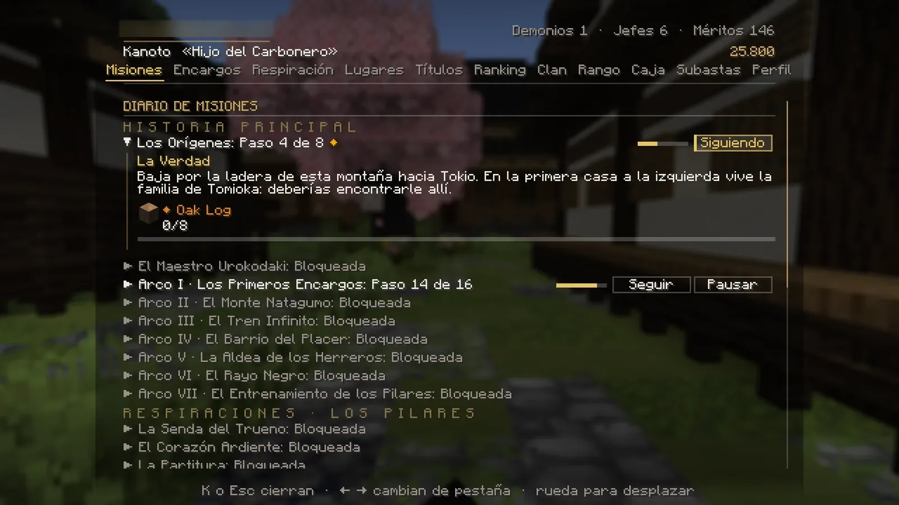
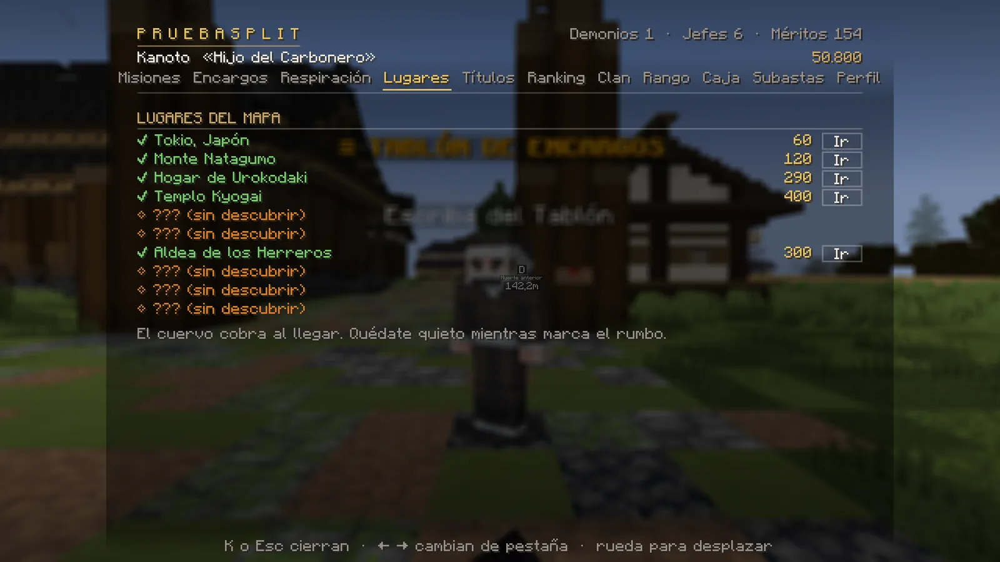
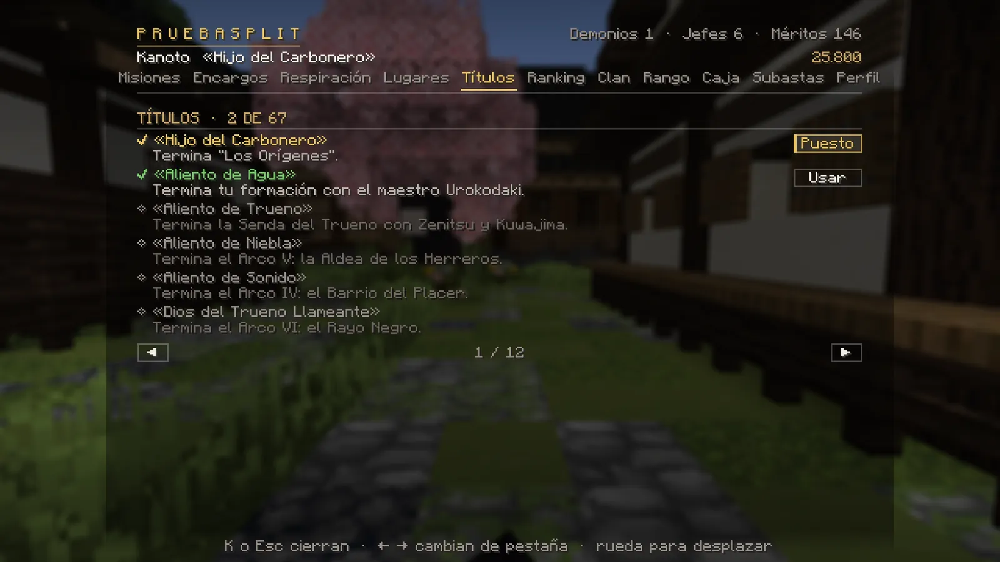
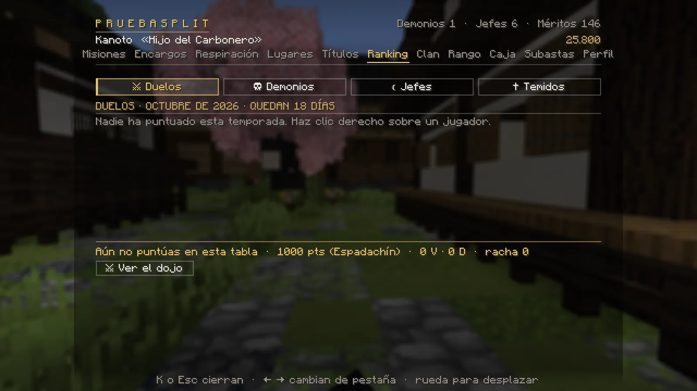
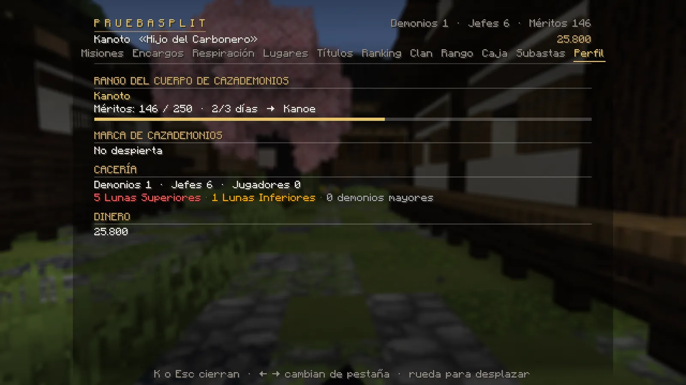
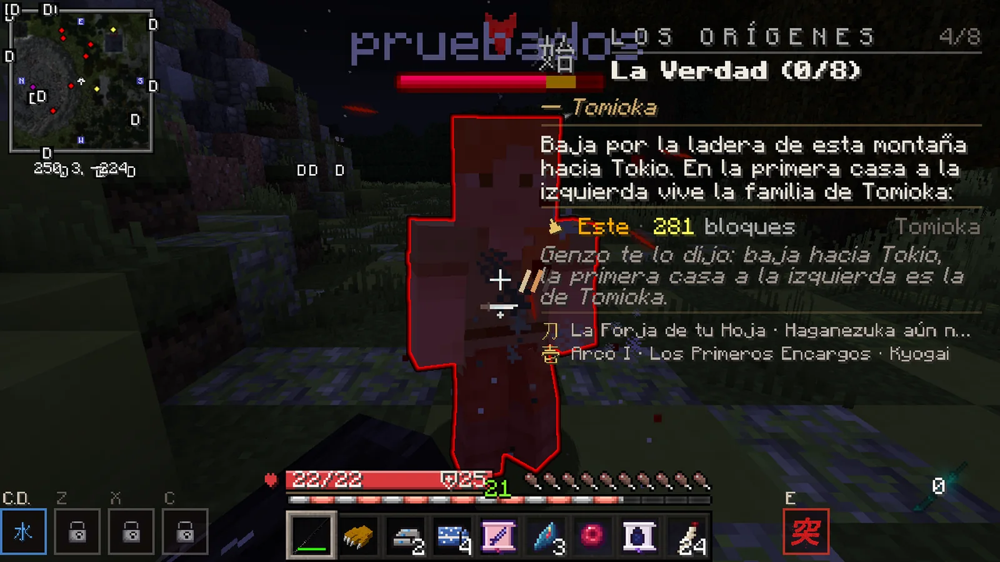
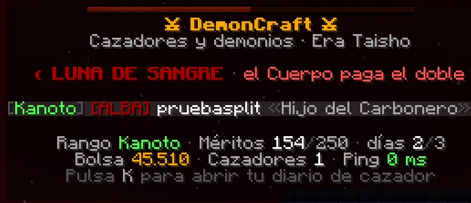

# La K y la pantalla

Pulsa ++k++ y tendrás delante casi todo el servidor: tus misiones, a dónde puedes viajar, tu rango, tu dinero, tu clan y el Mercado.

## La K, tu perfil

- ++k++ la abre y la cierra (también ++esc++). ++j++ la abre directamente en *Misiones*.
- Cambias de pestaña con las flechas ++arrow-left++ ++arrow-right++ o con el ratón. La rueda desplaza la lista.
- Arriba ves tu nombre, tu rango y tu título; a la derecha, tus cifras (demonios, jefes y méritos) y tu **dinero**.

| Pestaña | Para qué sirve | Más info |
|---|---|---|
| **Misiones** | Tu diario: historia, respiraciones y campañas. *Seguir*, *Pausar* y ver cada paso. | [Misiones](../misiones/index.md) |
| **Encargos** | Los encargos que tienes abiertos y los rumores de quién necesita ayuda. | [Encargos](../misiones/encargos.md) |
| **Halloween** | Solo durante el evento: tu camino de las calabazas, la tienda de la Anciana y la clasificación. | [Halloween](../eventos/halloween.md) |
| **Respiración** | El árbol de respiraciones: cuál tienes activa, tus formas, el entrenamiento y tus teclas Z, X y C. | [Respiraciones](../cazador/respiraciones.md) |
| **Lugares** | Los lugares que has descubierto, con el precio del viaje y el botón **Ir**. | [Viajar](../mundo/viajar.md) |
| **Títulos** | Todos los títulos, cómo se consiguen y cuál llevas puesto. | [Títulos](../social/chat.md#titulos) |
| **Ranking** | Clasificaciones: duelos, demonios cazados, jefes y los demonios más temidos. | [Duelos](../social/duelos.md) |
| **Clan** | Fundar o gestionar tu clan. | [Clanes](../social/clanes.md) |
| **Rango** | Tu rango del Cuerpo, lo que te falta para el siguiente y tus efectos visuales. | [Rangos](../cazador/rangos.md) |
| **Caja** | La Caja del Cuartel: un premio gratis cada 24 horas. | [Cajas](../economia/objetos.md) |
| **Subastas** | El Mercado entre jugadores. | [Mercado](../economia/mercado.md) |
| **Perfil** | Tu ficha: rango, cacería y dinero. | |

!!! demonio "Si eres demonio"
    Tu K cambia: no tienes *Respiración*, *Rango* ni *Caja*, y a cambio tienes **Sangre** (tu rango de sangre, el árbol
    y los encargos de la noche) y **Artes** (tus artes de sangre y sus teclas). *Encargos* pasa a ser «Susurros de la
    noche» y *Lugares*, «Las puertas de Nakime» (con el [Mercado de la Noche](../demonio/mercado.md)). [Ver el camino del demonio](../demonio/index.md).

<figure markdown="span">
  { loading=lazy }
  <figcaption>Misiones: cada cadena con su paso actual y los botones Seguir y Pausar.</figcaption>
</figure>
<figure markdown="span">
  { loading=lazy }
  <figcaption>Lugares: el precio del viaje y el botón Ir.</figcaption>
</figure>
<figure markdown="span">
  { loading=lazy }
  <figcaption>Rango: méritos, días de servicio y efectos visuales.</figcaption>
</figure>
<figure markdown="span">
  { loading=lazy }
  <figcaption>Títulos: los que tienes, los que te faltan y cómo se consiguen.</figcaption>
</figure>
<figure markdown="span">
  { loading=lazy }
  <figcaption>Ranking: duelos, demonios, jefes y temidos.</figcaption>
</figure>
<figure markdown="span">
  { loading=lazy }
  <figcaption>Perfil: tu ficha y tu dinero.</figcaption>
</figure>

!!! warning "Con la K abierta no ves el chat"
    Mientras tienes la K (o cualquier menú del servidor) abierta, no se ven los mensajes del chat ni los avisos.
    Ciérrala si esperas una respuesta.

## La pantalla mientras juegas

<figure markdown="span">
  { loading=lazy }
  <figcaption>Arriba a la izquierda el minimapa; arriba a la derecha la tarjeta de misión; abajo, la barra de vida, tus teclas (C.D., Z, X y C) y la E del golpe crítico.</figcaption>
</figure>

| Elemento | Dónde | Qué te dice |
|---|---|---|
| **Minimapa** | Arriba a la izquierda | Lo que te rodea y tus coordenadas. El mapa grande, con ++m++. |
| **Tarjeta de misión** | Arriba a la derecha | El paso que sigues, quién lo da, la flecha y la distancia. |
| **Barra de vida** | Encima de la barra de objetos | Tu vida en números («20/20») y tu armadura. Con poca vida, los bordes laten en rojo. |
| **Tus teclas** | Abajo a la izquierda | Lo que lanzas con el clic derecho (**C.D.**), ++z++, ++x++ y ++c++: tus formas si eres cazador, tus artes si eres demonio. Cada una con su espera (la sombra baja y cuenta los segundos) y un **candado** si tu rango aún no la abre. Mientras dura una técnica se apagan todas; al acabar, cuentan los **4 s** para recuperarte (también la raya de debajo). |
| **Golpe crítico** | Junto a tus teclas (si no cabe, a la derecha de la barra de objetos) | Solo cazadores: **突** cuando está listo o los segundos que le faltan. [Ver el golpe crítico](../cazador/combate.md#el-golpe-critico). |
| **Tarjetas grandes** | En el centro | Capítulos, «LUGAR DESCUBIERTO», respiración aprendida… |

## La lista de jugadores (++tab++)

Además de quién está conectado (con su rango, su clan y su título), muestra el **estado de la noche** («☀ Día»,
«☾ Noche · hora del buey»…, o **LUNA DE SANGRE**) y, abajo, tu rango, tus méritos y tu **bolsa** (tu dinero).

<figure markdown="span">
  { width="640" loading=lazy }
  <figcaption>La lista con Tab durante una Luna de Sangre: el Cuerpo paga el doble.</figcaption>
</figure>
