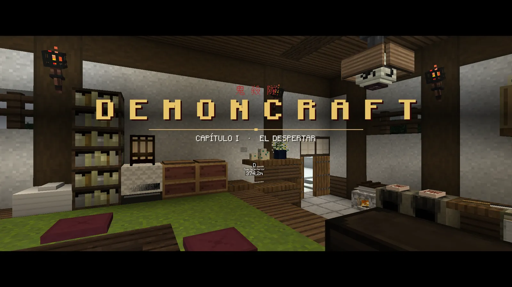
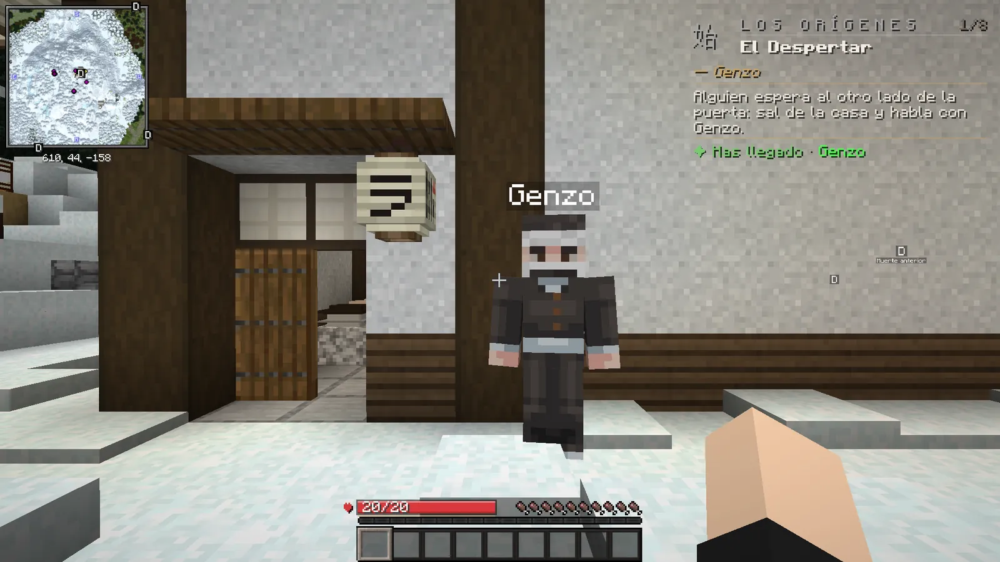
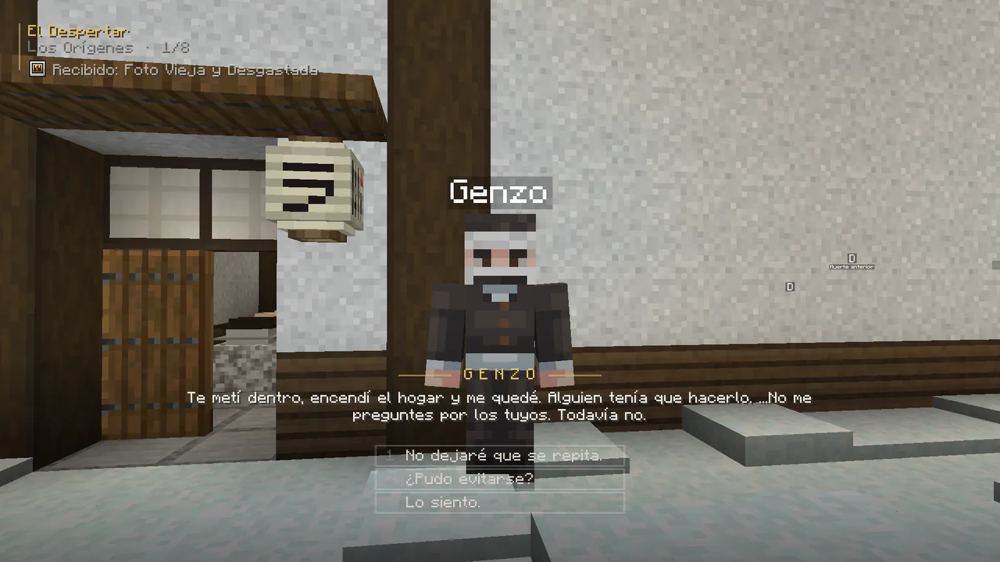
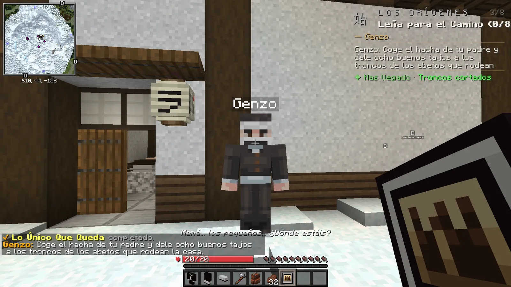

# Tus primeros minutos

Despiertas en una casa en la montaña sin recordar casi nada. El tutorial te enseña lo básico jugando: no hay que leer nada antes.

## La escena inicial

Al crear tu cuenta empieza una escena de unos 25 segundos: abres los ojos en un futón, en una casa de la montaña nevada.
Mientras dura no te puedes mover y nada te hace daño. No se puede saltar (si se corta la conexión, la verás otra vez).

<figure markdown="span">
  { loading=lazy }
  <figcaption>La escena inicial termina con la tarjeta del primer capítulo.</figcaption>
</figure>
<figure markdown="span">
  { loading=lazy }
  <figcaption>Fuera te espera Genzo. Haz clic derecho sobre él para hablar.</figcaption>
</figure>

## Hablar con los personajes

- Para hablar con alguien, haz **clic derecho** sobre él.
- El texto se escribe solo. Un **clic**, ++space++ o ++enter++ lo completa y pasa al siguiente.
- Cuando hay respuestas, elige con el ratón o con las teclas ++1++ a ++6++. Las respuestas normales solo cambian el
  tono de la conversación. Las **decisiones** de verdad llevan el símbolo ⚖ y sí cambian lo que pasa después.
- Arriba a la izquierda verás lo que acabas de recibir y en qué paso de la misión estás.

<figure markdown="span">
  { loading=lazy }
  <figcaption>Una conversación con respuestas: pulsa 1, 2 o 3 (o haz clic en la que quieras).</figcaption>
</figure>

## Tu primer equipo

Genzo te da tu primer equipo: el **uniforme del Cuerpo** (pecho, pantalón y botas), un **hacha**, una **mochila**
(se abre con ++b++), comida y una **foto vieja**. Casi todo va **ligado** a ti: no se puede tirar y no se pierde al morir.

!!! tip "Mirar un objeto"
    Algunos objetos se «miran» cogiéndolos en la mano y haciendo **clic derecho**. La foto es el primero.

## El tutorial: «Los Orígenes»

La primera misión te enseña lo básico, un paso cada vez:

- golpear troncos para conseguir leña (el mapa **no se rompe**: cada golpe te da un tronco);
- bajar a **Tokio**, la ciudad principal;
- **alquilar una casa** con el dinero que te dan ([cómo funcionan las casas](../economia/casas.md));
- **comprar** algo en la tienda de Kohei;
- abrir tu perfil con ++k++.

Hasta que no lo terminas no puedes coger encargos ni usar el tablón del día, así que hazlo primero: dura unos 15 minutos.

## La tarjeta de misión

Arriba a la derecha tienes siempre **la misión que sigues**: qué hay que hacer, quién te la dio, una **flecha** con el
rumbo y los **bloques** que faltan. Cuando llegas pone *«Has llegado»*. Debajo, en pequeño, otras misiones abiertas.

<figure markdown="span">
  { loading=lazy }
  <figcaption>La tarjeta de misión (arriba a la derecha) y el aviso del paso completado (abajo).</figcaption>
</figure>

Al completar partes importantes de la historia aparece una **tarjeta de capítulo** en grande. No te quita el control:
puedes seguir jugando mientras se ve.

## Y después, ¿qué?

1. Te mandarán con un **maestro** que te enseñará tu primera **respiración** y te pondrá a prueba.
2. Cuando estés preparado, un herrero te forjará **tu propia katana nichirin**. Con ella llegan las formas de
   respiración, el Mercado y los duelos.
3. A partir de ahí: más maestros y respiraciones, [encargos](../misiones/encargos.md), campañas, el
   [tablón diario](../misiones/encargos.md#encargos-del-dia), [rangos](../cazador/rangos.md)… y la noche.

!!! cazador "Consejos para la primera hora"
    - Deja siempre **2 o 3 huecos libres** en el inventario: sin sitio, un paso de misión no se completa.
    - De noche, **sin katana y bajo techo** no te aparece ningún demonio. Hasta tener la tuya, ve con cuidado.
    - Mientras no tengas tu katana, ningún jugador demonio puede atacarte.
    - El dinero no se pierde al morir: se queda en tu banco.
