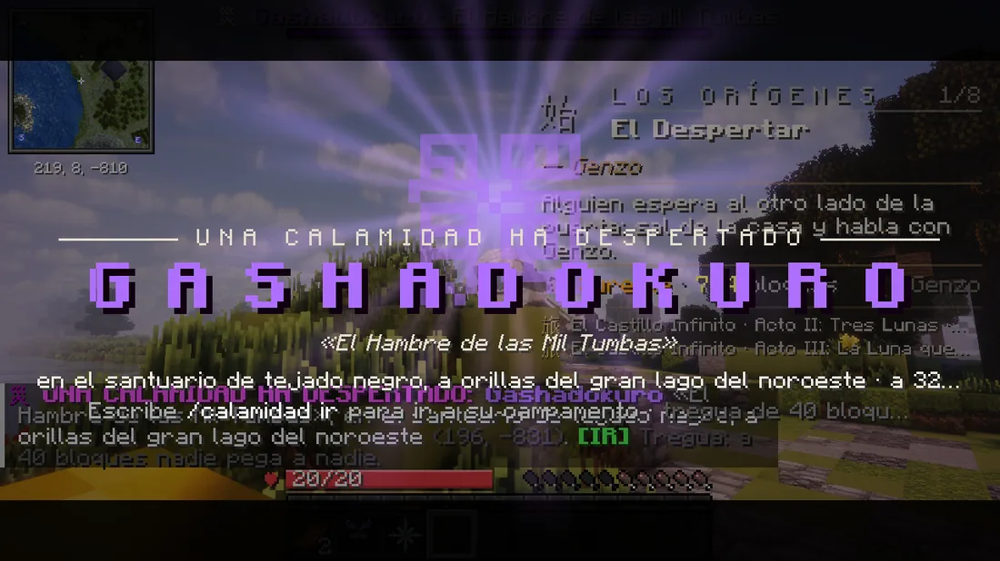
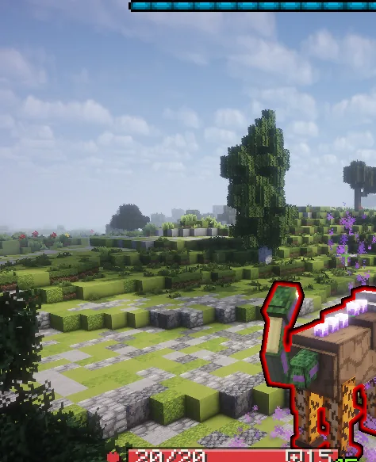
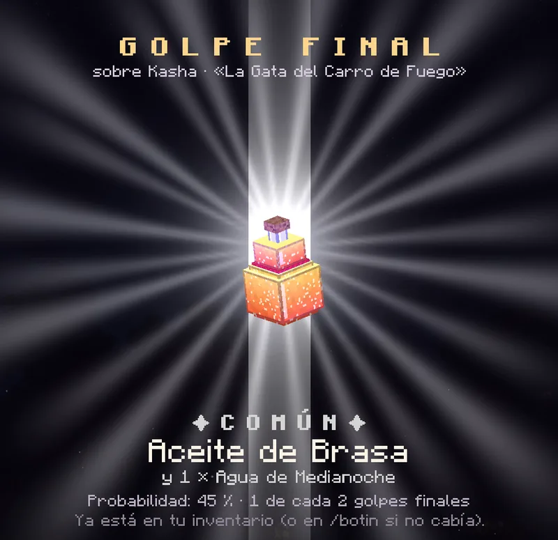

# Las Calamidades

Tres criaturas enormes despiertan por el mapa unas dos veces por semana. Para vencerlas hace falta todo el servidor, y el golpe final se lleva el botín.

<figure markdown="span">
  { loading=lazy }
  <figcaption>Cuando una despierta, todos lo ven: quién es, dónde y cómo llegar.</figcaption>
</figure>

## Cuándo y dónde

- **Unas dos veces por semana**, una de lunes a jueves y otra de viernes a domingo, a una hora al azar **entre las 18:00 y las 22:30** (hora de España).
- **Diez minutos antes** sale un aviso: *«Algo enorme se mueve bajo…»*, con el sitio.
- Despierta en **uno de los 14 claros** del mapa: templos, pagodas, santuarios, un volcán, un puente…
- Hace falta **gente conectada**: si hay muy pocos, espera un rato a que lleguen. Y durante una jornada del [Torneo del Dojo](../social/duelos.md) no despierta: espera a que acabe.
- Si nadie la vence en **75 minutos**, se retira.

## Cómo llegar

Pulsa **[IR]** en el chat o usa **`/calamidad ir`**: te lleva al campamento, a unos pasos de la pelea. **Se puede una vez por Calamidad**, y no en combate, en un duelo ni desde la Fortaleza. Si ya lo has usado, `/calamidad` te dice dónde está para ir andando.

`/calamidad` también te dice cuánta vida le queda y cuánto falta para que se retire.

## Las tres criaturas

| Calamidad | Qué es | Ojo con |
|---|---|---|
| **Gashadokuro**, *El Hambre de las Mil Tumbas* | Un esqueleto gigante | Sus manos, que caen del cielo, y la lluvia de huesos |
| **Nue**, *La Bestia del Trueno Púrpura* | Una bestia rápida que salta | Sus rayos. Cuando está cargada, pegarle a mano da calambre: usa técnicas |
| **Kasha**, *La Gata del Carro de Fuego* | Una gata enorme envuelta en llamas | Sus embestidas en línea y el fuego que deja |

<figure markdown="span">
  { loading=lazy }
  <figcaption>El Nue. Cada una tiene sus ataques y cambia de fase al perder vida.</figcaption>
</figure>

## Cómo se pelea

- **Tregua:** a **40 bloques** de una Calamidad viva, nadie puede dañar a otro jugador. Cazadores y demonios, todos contra ella.
- **Eclipse:** a **64 bloques** el sol no quema a los demonios, para que puedan pelear de día. Cuando ella cae o se retira, el eclipse dura **un minuto más**: si eres demonio, busca sombra.
- **Sus golpes se avisan:** una mancha de color aparece en el suelo y se va llenando. Sal de ahí antes de que se llene.
- **Pega poco, pero aguanta mucho:** tiene muchísima vida, y **cuantos más seáis en la pelea, más tiene**. Ningún arma la tumba de golpe: cada golpe y cada jugador tienen un tope.
- **Hay que estar en la pelea:** un golpe desde fuera (un arco a mucha distancia, lo alto de una torre) no le hace nada. Te lo dirá: *«Estás demasiado lejos»*.

## Qué se gana

**El golpe final se lo lleva todo:** quien la remata recibe el botín, con su propia revelación en pantalla, y todo el servidor se entera.

| Probabilidad | Qué sale |
|---|---|
| 45 % | Dos o tres pociones extrañas |
| 28 % | El amuleto de esa Calamidad |
| 15 % | Su **haori** (o kimono, si eres demonio) |
| 7 % | Tres pociones y un **título** propio |
| 4 % | El **Corazón de Calamidad** |
| **1 %** | Su **arma mítica**: una hoja para el cazador, una guadaña, una kusarigama o una naginata para el demonio |

El equipo va ligado a ti. Si algo no te cabe, va a [`/botin`](../comandos.md).

**Quien haya ayudado** (al menos un 2 % de su vida) se lleva **1.500 de dinero** y **6 méritos** o **20 de sangre**.

<figure markdown="span">
  { loading=lazy }
  <figcaption>La revelación de quien da el golpe final.</figcaption>
</figure>

### Las pociones

| Cazador | Demonio | Qué hace |
|---|---|---|
| Elixir de Médula | Médula Negra | Tres minutos: las Calamidades y sus esbirros te hacen un 25 % menos |
| Tónico del Trueno Púrpura | Sangre de Tormenta | Tres minutos: piernas ligeras y saltos largos; la descarga del Nue no te alcanza y te hace un 20 % menos |
| Aceite de Brasa | Ceniza del Carro | Tres minutos: el fuego no te quema y la Kasha te hace un 20 % menos |
| Agua de Medianoche | Sangre de Tumba | Cuatro minutos viendo en la oscuridad; a 32 pasos, los demonios (o los cazadores del Cuerpo) brillan veinte segundos |

### Los amuletos

- **Amuleto del Osario, del Trueno Púrpura y de la Rueda Ardiente** (cazador) y **Colgante del Osario, de la Tormenta y del Carro** (demonio): contra su Calamidad, te hace un 20 % menos y le haces un 10 % más. Van en el hueco de amuleto.
- **Corazón de Calamidad**: contra cualquiera de las tres, te hacen un 15 % menos y les haces un 15 % más. Va en el hueco de abalorio.

También pueden salir pociones y amuletos en los [Sucesos](../misiones/sucesos.md).
