# Halloween 2026: La Noche de las Calabazas

Hasta el <strong>1 de noviembre a las 2:00</strong> (hora de Madrid), cada noche salen de la tierra los <strong>Kabocha-oni</strong>: esqueletos con cabeza de calabaza tallada que no obedecen a nadie. Cázalos para llenar <strong>el camino de las calabazas</strong> y ganar el kit de Halloween, y gasta sus almas en la tienda de la Anciana.

## Las calabazas

Salen **de noche**, **cerca de quien está fuera**: se ve cómo salen de la tierra delante de ti. Bajo techo salen muchas menos
y en los refugios de glicinas, las [zonas seguras](../mundo/noche.md#zonas-seguras), la Aldea de los Herreros, el dojo y el
castillo, ninguna. Al alba se deshacen.

| Calabaza | Qué hace | Vale |
|---|---|---|
| **Kabocha-oni** | Anda a tirones y muerde | 1 calabaza y 1 alma |
| **Aulladora** (fantasma) | Grita: te frena, te ciega un momento y puede asustarte | 1 y 1 |
| **Ancestral** (podrida, con katana rota) | Una por jugador y noche, mucho más dura; avisa al salir | **5** y 3 |
| **Rey Calabaza** (jefe) | Una vez al día, de **22:00 a 2:00**, donde hay gente: llama a los suyos, lanza calabazas que caen del cielo (mira el aviso en el suelo) y da pisotones | **25 y 20 a todos los que le hieran** |

- **El doble del día**: las **10 primeras** calabazas de cada día cuentan doble.
- **Cazar en grupo** no le quita la calabaza a nadie: cuenta para quien la mata y para todos los que le quitaron un cuarto de
  la vida (al Rey, a todos los que le hirieron de verdad).
- **La zona embrujada**: cada noche hay una (Natagumo, el Templo Kyogai, el Tren Infinito, el Barrio del Placer, la casa de
  Urokodaki o Tokio). Allí salen más y dan **un alma más**.
- **La Luna Calabaza**: algunas noches, niebla naranja, más calabazas y **almas dobles** hasta el alba.
- **El 31 de octubre**, la Gran Noche de Difuntos: Luna Calabaza segura y un Rey más fuerte, con premio doble.
- **Si mueres**, tus calabazas se deshacen y tienes un minuto de calma.

<figure markdown="span">
  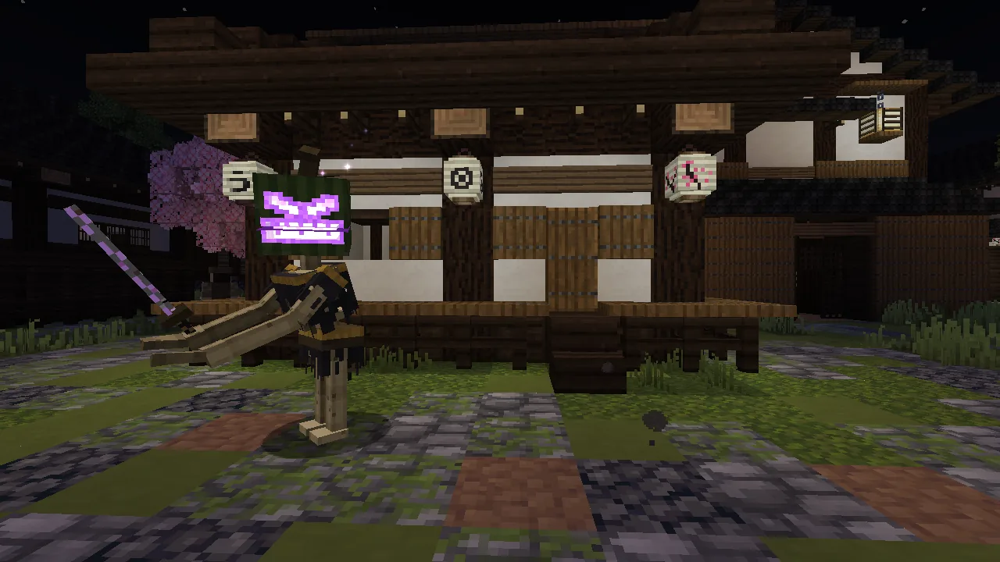{ loading=lazy }
  <figcaption>La ancestral: armadura negra, katana rota y fuego morado. Vale 5.</figcaption>
</figure>
<figure markdown="span">
  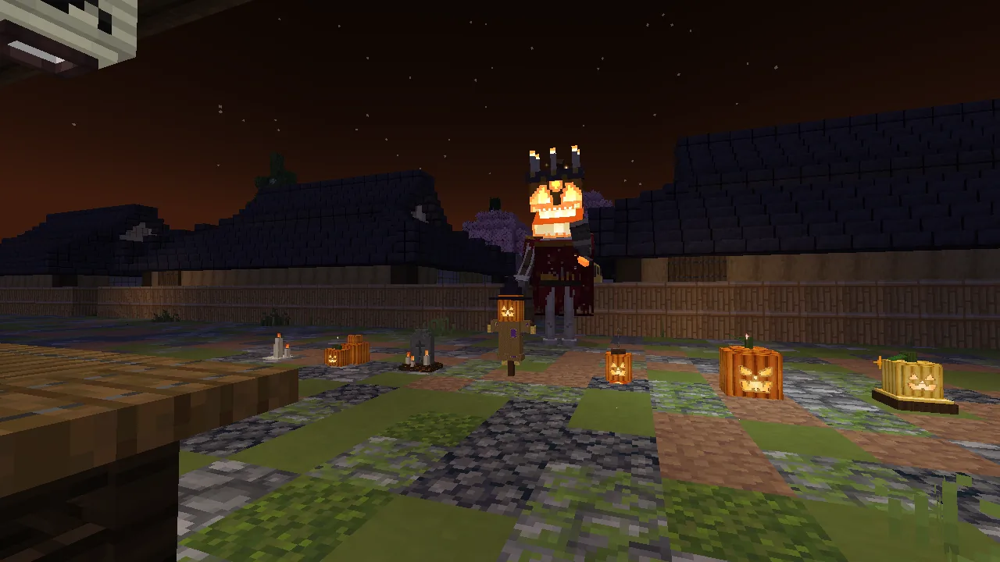{ loading=lazy }
  <figcaption>El Rey Calabaza, con su corona de velas. Todos los que le hieran se llevan su parte.</figcaption>
</figure>

## El camino de las calabazas

Cada fase se **reclama** en la pantalla del evento (`/halloween` o **K → Halloween**): haz sitio en el inventario y pulsa
**Reclamar**. El premio depende de tu bando:

| Fase | Calabazas | Cazador | Demonio |
|---|---|---|---|
| 1 | 50 | Polainas de la Noche de Difuntos | Vendas de la Noche de Difuntos |
| 2 | 100 | Hakama de la Noche de Difuntos | Hakama del Oni de las Calabazas |
| 3 | 150 | Haori de la Noche de Difuntos | Haori del Oni de Difuntos |
| 4 | 200 | Máscara de Kabocha (la cabeza tallada de una calabaza, con el fuego dentro) | la misma |
| 5 | 250 | **Hoja de la Calabaza** (pide tener ya tu katana) | **Farol del Rey Calabaza** (ver abajo) |
| 6 | 350 | Calabaza de Oro para tu casa y el título «Cazador de Calabazas» | la Calabaza de Oro y «Devorador de Calabazas» |
| 7 | 500 | Máscara del Señor de la Noche de Difuntos y su título (se anuncia) | la máscara y «Señor Oni de la Noche de Difuntos» |

- Todo va **ligado** (no se tira, no se pierde al morir, no se vende). La ropa no se gasta y es **la misma armadura** que
  llevas debajo (el uniforme o tu ropa de demonio): no da ventaja contra jugadores ni contra demonios.
- **Solo contra calabazas**: cada prenda del kit, **+5 %** de daño; la hoja o el farol, **+15 %**.
- Con el kit entero y la hoja (o el farol), un aura de brasas a tus pies.

<figure markdown="span">
  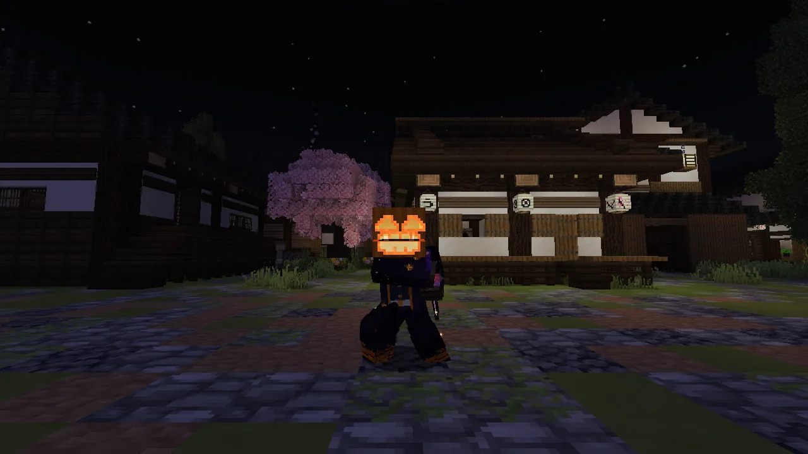{ loading=lazy }
  <figcaption>El kit del cazador: la máscara de calabaza encendida y el haori de la noche de difuntos.</figcaption>
</figure>
<figure markdown="span">
  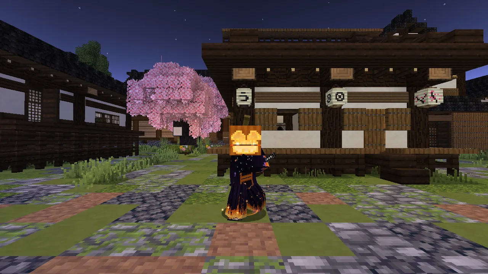{ loading=lazy }
  <figcaption>El del demonio: el haori del oni con su obi de calabaza y, en la otra mano, el farol.</figcaption>
</figure>

!!! demonio "Si eres demonio: el Farol del Rey Calabaza"
    - En **cualquier mano** cuenta como la hoja del cazador: **+15 %** contra calabazas. Mejor en la **izquierda**: la
      derecha queda libre para tus garras, y tus zarpazos dejan **arañazos de fuego**.
    - **Agáchate (++shift++) y haz clic derecho: los Fuegos del Rey.** Del farol salen calabacitas de fuego —**3, o 5 con
      las cuatro prendas del kit puestas**— que giran a tu alrededor y se lanzan a las calabazas que tengas a la vista
      (hasta 14 bloques): cada una quita 3 y las frena. **Cada 40 segundos.** Solo hacen daño a las calabazas.
    - Agachado, porque con la mano derecha vacía tu clic derecho es tu arte de sangre. Si llevas el farol en la derecha,
      basta el clic.

<figure markdown="span">
  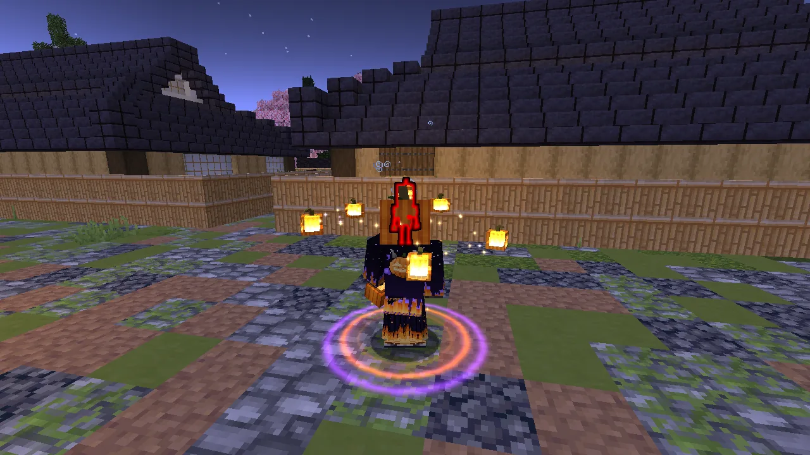{ loading=lazy }
  <figcaption>Los Fuegos del Rey: un aro de fuego fatuo y las calabacitas girando antes de lanzarse.</figcaption>
</figure>
<figure markdown="span">
  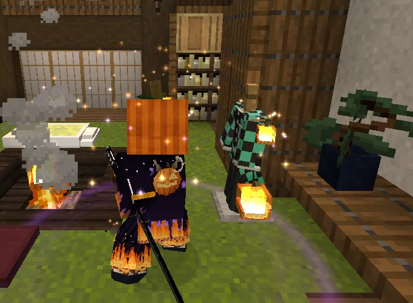{ loading=lazy }
  <figcaption>El Haori del Oni de Difuntos: la calabaza con cuernos y la luna a la espalda.</figcaption>
</figure>
<figure markdown="span">
  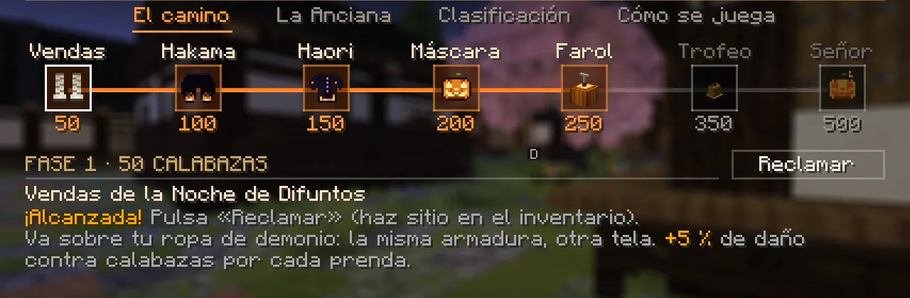{ loading=lazy }
  <figcaption>El camino del demonio: vendas, hakama, haori, máscara y farol.</figcaption>
</figure>

## La Anciana de las Calabazas

Las **almas de calabaza** se gastan en su tienda (pestaña *La Anciana* de la pantalla del evento):

| Qué | Almas | Para qué |
|---|---|---|
| Dulces de calabaza ×3 | 6 | Regeneración y ver de noche (al demonio no le alimenta, pero la magia le llega) |
| Fuegos de Difuntos ×8 | 8 | Cohetes naranjas y morados |
| Vela de Difunto · Farolillo de Calabaza · Montón de Calabazas | 12 · 20 · 25 | Decoración para tu casa |
| Calabaza Tallada Demoníaca · Lápida con Velas · Espantapájaros Calabaza | 30 · 35 · 45 | Decoración para tu casa |

Las decoraciones se ponen en **tu casa alquilada**; al acabar el alquiler vuelven a tu buzón.

<figure markdown="span">
  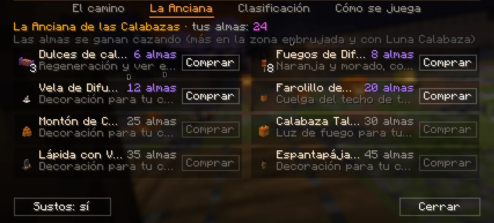{ loading=lazy }
  <figcaption>La Anciana de las Calabazas: lo que cuesta cada cosa en almas.</figcaption>
</figure>
<figure markdown="span">
  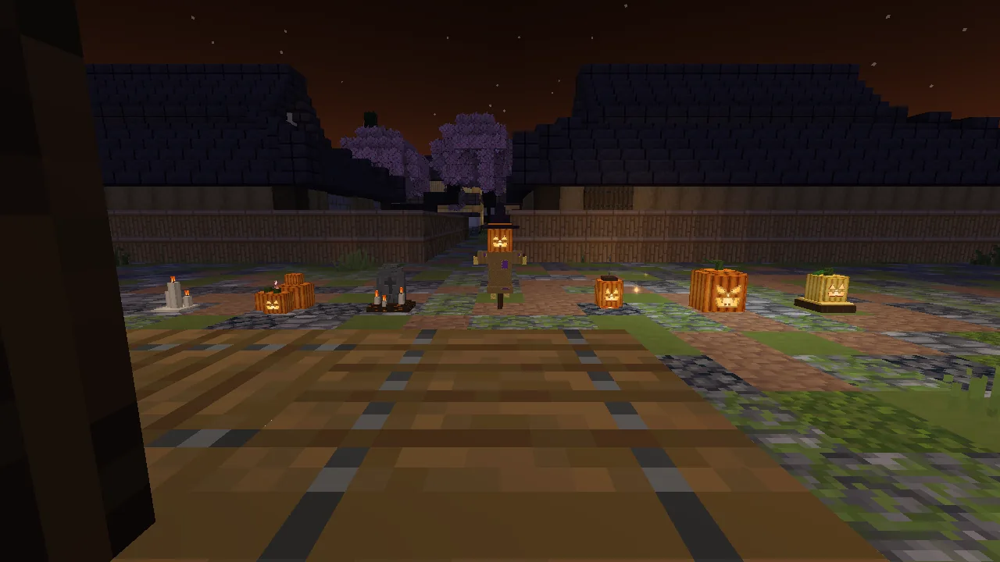{ loading=lazy }
  <figcaption>Las decoraciones, de noche.</figcaption>
</figure>

## La clasificación y los sustos

- La pantalla tiene la **Clasificación**: los diez primeros y tu puesto. Al acabar el evento, los tres primeros ganan el título
  «Leyenda de Halloween 2026».
- **Los sustos**: de vez en cuando, de noche cerrada y si estás tranquilo, algo te dará un buen susto (como mucho un par al
  día). Se apagan con **`/halloween sustos off`** o el botón *Sustos* de la pantalla.
- Cuando acabe, tienes **una semana más** para reclamar tus fases y gastar tus almas.

## El recuerdo de Shion

Solo para quien ya tiene el **[Colgante de las Almas](../misiones/colgante.md)**, y solo mientras dura Halloween (hasta el
**1 de noviembre a las 2:00**).

- **De noche, dentro del cementerio del sur**, habla con la sepulturera **Kasane** y elige **«El recuerdo de Shion»**. Kasane
  enciende una vela en la tumba sin nombre y vuelves a librar la pelea del final de la cadena, ahora **en ámbar** y con la
  **barra amarilla**, sin escena y sin las ayudas de la historia.
- **No te mata ni gasta tu colgante**: si te tumba, te suelta con un cuarto de tu vida y se acaba (pídeselo otra vez a
  Kasane). Lo demás, como otro jugador o una caída, cuenta como siempre.
- **Solo lo ves y lo oyes tú.** Como mucho hay **cuatro** recuerdos a la vez en todo el servidor: si no queda sitio, Kasane
  te pide que vuelvas en un rato.
- **La primera victoria** te da el **Haori de las Flores de Shion** (el del demonio, el **Haori del Recuerdo de Shion**, sobre
  su ropa), **30 almas de calabaza** para [la Anciana](#la-anciana-de-las-calabazas) y el título **«Guardián del Recuerdo de
  Shion»** («Sombra del Recuerdo de Shion», si eres demonio). Si no te cabe el haori, Kasane te lo guarda: haz hueco y vuelve
  a hablar con ella.
- **Las siguientes victorias**: **10 almas de calabaza**, una vez al día.
- El haori va ligado y es de aspecto: la misma prenda que llevas debajo, sin ventajas.

<figure markdown="span">
  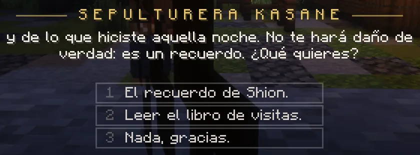{ loading=lazy }
  <figcaption>De noche, en el cementerio: Kasane te ofrece el recuerdo o el libro de visitas.</figcaption>
</figure>
<figure markdown="span">
  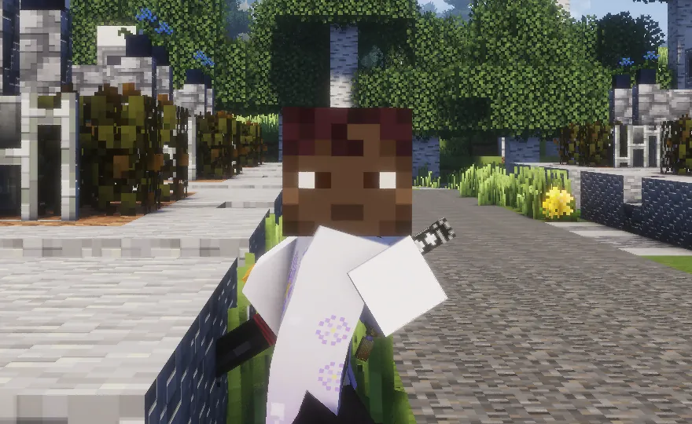{ loading=lazy }
  <figcaption>El Haori de las Flores de Shion, el del cazador: blanco, con flores lilas.</figcaption>
</figure>

## Comandos

| Comando | Qué hace |
|---|---|
| `/halloween` | La pantalla del evento: el camino, la Anciana, la clasificación y cómo se juega (también **K → Halloween**). |
| `/halloween sustos on` · `off` | Encender o apagar tus sustos. |
