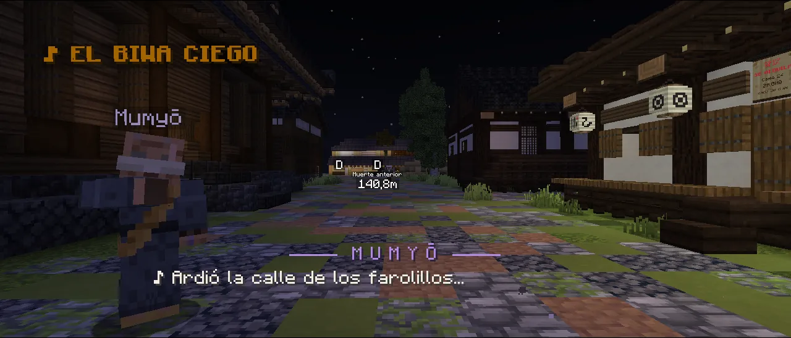
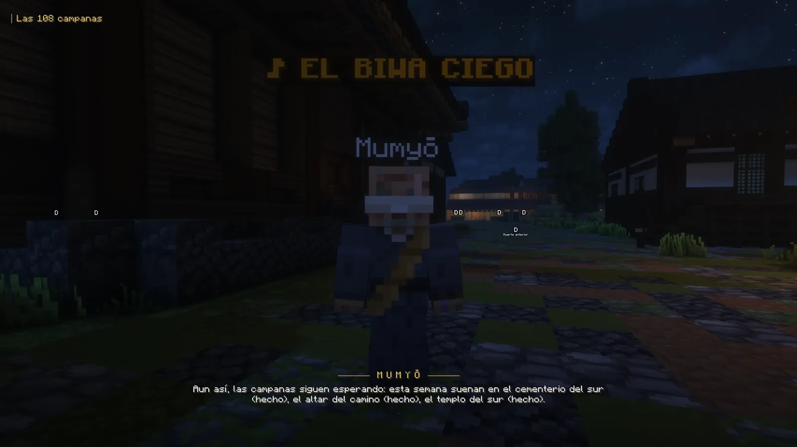
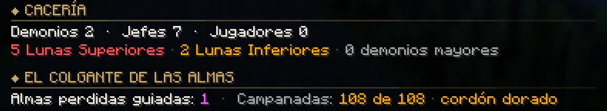

# El Colgante de las Almas

Una leyenda de Tokio para cazadores y demonios. Mumyō, el biwa ciego, canta la balada de <strong>Shion</strong>, la niña que no podía morir y que desapareció hace doscientos años con un colgante al cuello. Búscala: al final te espera el <strong>Colgante de las Almas</strong>, que te devuelve a la vida una vez cada 24 horas.

## Para quién es

| Bando | Qué necesitas antes |
|---|---|
| **Cazador** | Haber terminado el **Arco II · El Monte Natagumo**. |
| **Demonio** | Haber completado **«Los Ojos de Muzan»** en tu historia de la sangre (el paso que abre el Rito del Hambre). |

- Es **la misma historia para los dos bandos**: sus tres personajes atienden igual a cazadores y a demonios.
- **Un colgante por persona.** Si ya lo conseguiste, no puedes repetir la cadena, tampoco cambiando de bando.
- Si aún no puedes empezarla, Mumyō te dice qué te falta.

## Dónde empieza

En **Tokio, junto a la plaza de llegada**, toca el biwa **Mumyō**, un músico ciego, bajo el rótulo **«♪ EL BIWA CIEGO»**.
Háblale y escucha su balada.

<figure markdown="span">
  { loading=lazy }
  <figcaption>Mumyō, junto a la plaza de llegada de Tokio: así empieza la balada.</figcaption>
</figure>

Por el camino conocerás a la **farolera Tsuru**, en su calle de Tokio, y a la **sepulturera Kasane**, al pie del
**cementerio del sur** (pasado el bosque que hay más allá de la finca de las glicinas). Los tres siguen ahí cuando acabas:
con ellos llega [lo que viene después](#despues-de-la-leyenda).

## Qué esperar

- **17 etapas** con giros y **decisiones de verdad**: lo que eliges cambia lo que pasa, lo que ganas y **el final** (hay tres).
- **Escenas** de cine y **encuentros de noche**: almas errantes que salen de las tumbas, rastros que seguir, alguien a quien
  proteger y un enemigo con nombre. Para investigar, agáchate junto a lo que brilla, como en las demás misiones.
- **Siete etapas son de noche.** Si llegas de día, la tarjeta te avisa y te dice cuánto falta para que anochezca.
- Cuatro etapas tienen un **reto opcional «sin caer»** que paga un extra. El del estanque, además, te deja algo para
  después: [Kohaku](#kohaku-tu-companero).
- **Es larga**: unos cien minutos de historia, más lo que esperes a que caiga la noche. La tarjeta de misión te guía siempre.
- **Cada etapa paga**: más de 20.000 en toda la cadena (al demonio, además, sangre). Al final, el **colgante** y el título
  **«Portador de Almas»**.
- Deja **un par de huecos** en el inventario: sin sitio, la etapa del colgante espera a que lo hagas.

## La pelea final

Al final de la historia te espera una pelea propia, distinta de los jefes de siempre. Sin destripar nada:

- **Solo de noche, en el cementerio del sur, y solo para quien está en esa etapa.** Primero una escena; después, su barra
  de jefe, que solo ves tú. Los demás pueden mirar, pero sus golpes no le hacen nada: **solo tú le haces daño**. Mientras
  dura, la noche no manda nada más alrededor del cementerio (ni demonios ni cazadores del Cuerpo).
- **Ningún golpe le quita más del 5 % de su vida** y **tiene dos vidas**: la primera vez que le vacías la barra, vuelve, y
  más rápida.
- **Todas sus habilidades se avisan antes:**

| Lo que ves | Qué hacer |
|---|---|
| Un anillo que se abre por el suelo | **Salta** cuando te llegue. |
| Círculos lila bajo tus pies | **Sal de ellos**: en algo más de un segundo salen manos que agarran. |
| Fuegos que giran a su alrededor y luego van a por ti | **Rómpelos**: caen de un golpe. |
| Desaparece | **Mira atrás**: aparece a tu espalda. |
| Una cadena lila os une y te roba vida | **Aléjate 15 bloques** y se rompe. |
| Se parte en tres figuras | Solo una es la de verdad: **la que brilla**. Golpear una copia la rompe, pero te ciega un instante. |
| Una lluvia que marca en el suelo dónde caerá | **Muévete.** |

- Casi todo su daño es de magia: **la armadura no lo para**. Si te quedas quieto, no aguantas ni un minuto: muévete,
  esquiva y come entre ataque y ataque.
- **Lo que hiciste en la historia ayuda.** Según lo que respondas al principio y si superas sin caer el reto del estanque,
  en plena pelea tendrás momentos a tu favor: el chat te avisa (*«¡ahora!»*) y durante unos segundos no se mueve y recibe
  más daño.
- **Ve en cuanto anochezca**: una vez empieza, el amanecer no la corta.
- Si caes, te alejas del cementerio más de 10 segundos o sales del juego, la pelea se acaba y vuelve a empezar de cero (a
  los 30 segundos puedes probar otra vez, si sigue siendo de noche).

Al ganar llega la última escena: mientras dura nada te hace daño y, si se corta (por ejemplo, porque te desconectas), se
repite la próxima vez que puedas verla. Después te quedan unas pocas etapas para cerrar la historia, según lo que decidiste.

## Lo que hace el colgante

El colgante **te devuelve a la vida una vez cada 24 horas reales** (cuentan aunque no estés jugando). Si vas a morir (un
demonio, un jefe, una caída, el fuego, ahogado o **a manos de otro jugador**), la muerte no llega a pasar:

- Te levantas con **la mitad de tu vida** y **2 segundos** en los que nada te hace daño (tampoco puedes pegar), con unos
  segundos de regeneración y de resistencia. Se apaga el fuego, se van el veneno y la marchitez y recuperas el aire; si te
  mataba el fuego o la lava, tienes además resistencia al fuego para salir de ella.
- Las almas **apartan**, sin hacerles daño, a los que tengas encima.
- **No pierdes nada**: ni lo que [cuesta morir](../cazador/combate.md#si-mueres), ni vuelves al Hospital (o al castillo, si
  eres demonio), y nadie se apunta tu muerte.
- Ves el colgante subir ante tus ojos y el chat te lo dice: *«El Colgante de las Almas te ha devuelto a la vida. Volverá a
  estar listo en 24 horas.»* Los de alrededor ven un remolino de almas.

### Cómo se lleva

- Funciona **en tu inventario** (cualquier hueco, también la barra) **o en la otra mano**. Guardado en un cofre o en una
  mochila, o colgado en su [altar](#el-altar-de-tu-casa), no te salva.
- **Es tuyo**: se ata a ti la primera vez que lo llevas (su descripción dice «Portador: …»). Si lo coge otro, no le responde.
  Va **ligado**: no se tira ni se pierde al morir.
- **Clic derecho** con él en la mano: lo **duermes** o lo **despiertas**. Dormido no te salva, pero **guarda la carga** para
  cuando la quieras gastar (y se recarga igual).
- Su descripción te dice cómo está: **despierto**, **recargándose** (y cuánto le falta) o **dormido**, y cuántas veces te ha
  devuelto a la vida.
- **Se ve al cuello**, también por encima de la armadura: **encendido** cuando está listo y **apagado** mientras se recarga o
  duerme.

### Cuándo no te salva

- En un **duelo** del dojo: allí nadie muere y el colgante no se gasta.
- Con **`/kill`** o cayendo al **vacío**.
- Si **sales del juego en plena pelea**: con la [marca de combate](../cazador/combate.md#la-marca-de-combate) mueres al salir,
  como siempre.
- **Dormido**, **recargándose**, colgado en el altar o fuera de tu inventario.
- Si otra cosa ya te salva en ese instante, se usa esa y el colgante no se gasta.

!!! demonio "Si eres demonio"
    La cadena es la misma y sus tres personajes te atienden como a cualquiera. Te paga también **sangre** (y las campanas y
    las almas perdidas, también), y los títulos tienen tu versión: «Campana del Ocaso», «Pastor de Almas Perdidas» y
    «Barquero de la Otra Orilla».

## Después de la leyenda

Con el colgante en tu poder, los tres personajes de la historia tienen algo más para ti.

### Las 108 campanas

Habla con **Mumyō** y acepta (*«Las tocaré.»*). Desde entonces, **cada semana** (de lunes a domingo, la misma para todos)
suenan **tres de seis templos**: Mumyō te dice cuáles y cuáles llevas hechos.

- La campana de las almas **solo la ves tú**, llevando tu colgante, y solo mientras su rito esté pendiente. Al llegar al
  templo, el chat te dice qué pide.
- **Tocarla es agacharte (++shift++) a menos de 3 bloques** de ella. Vale de día y de noche.

| Templo | Su rito |
|---|---|
| **El templo del sur** | Tres toques **a compás**: cada uno cuando se apaga la nota del anterior (entre 1,5 y 3,5 segundos después). |
| **El santuario del monte** | Enciende las **tres velas** de alrededor (agáchate junto a cada una) y toca la campana antes de que pase **un minuto** desde la primera. |
| **El altar del camino** | Un toque y **12 segundos agachado** junto a la campana, sin levantarte, sin alejarte y sin recibir daño. |
| **El cementerio del sur** | Tócala con **una flor** en la mano (se la queda). |
| **El estanque del sur** | Un toque, **5 segundos dentro del agua** del estanque y otro toque, en menos de dos minutos. |
| **La ladera del ermitaño** | Un toque: el **eco** sale volando y se posa lejos. Llega a él en **40 segundos** y vuelve a tocarla antes de un minuto. |

- Cada rito libera **9 almas** y paga **300** (al demonio, también **15 de sangre**); **los tres de la semana, 1.200 más**.
  Con un [rango VIP](../vip.md), un 25 % más.
- Con **108 almas** (doce ritos: cuatro semanas como poco), **el cordón de tu colgante se vuelve de hilo de oro** (en la mano,
  en la barra y al cuello) y ganas el título **«Campanero de las Almas»**.
- Si mueres o sales del juego a medias, ese rito vuelve a empezar.

<figure markdown="span">
  { loading=lazy }
  <figcaption>Mumyō te dice qué tres templos suenan esta semana y cuáles llevas hechos.</figcaption>
</figure>

### Las almas perdidas

- **De noche**, si llevas tu colgante, van apareciendo almas perdidas que lloran en los sitios con historia del mapa (la
  calle que ardió, el estanque del sur, el andén del tren, el Barrio del Placer, la Aldea de los Herreros…), a entre 40 y
  200 bloques de ti. Las primeras veces, el colgante **tiembla** y el chat te dice dónde. **Solo las ves tú.**
- **Coge el colgante en la mano** y un aviso sobre la barra de objetos te dice **a cuántos metros y hacia dónde** llora la
  más cercana (*«Un alma perdida llora a 8 m al norte»*).
- **Acércate** a ella y te seguirá. **Llévala andando al cementerio del sur**: al entrar, descansa. Mientras te sigue, el aviso te
  indica hacia dónde queda el cementerio.
- **Sin atajos**: si viajas de golpe (el cuervo, la biwa…), cambias de mundo o mueres, se asusta y vuelve a su sitio. Al
  amanecer, las que esperaban se van; las que te siguen, no. Como mucho tienes tres a la vez.
- Las **seis primeras de cada día** pagan **150** (al demonio, también **6 de sangre**); las demás cuentan igual. Con un rango
  VIP, un 25 % más.
- Títulos: **«Guía de Almas»** a las 25 y **«Barquero de las Ciento Ocho»** a las 108.

### Kohaku, tu compañero

Si en la etapa **«Eco del Río»** protegiste al alma de Kohaku **sin caer ni una vez** (su reto opcional), con el colgante ya en
tu poder puedes llamarle con **`/kohaku`**: el niño fantasma, todavía empapado, flota a tu lado y te saluda de vez en cuando.
Otra vez **`/kohaku`** para despedirle.

- **Una mascota a la vez**: al llamarle se guarda la de tu rango VIP, y si sacas la del rango (`/vip mascota`), Kohaku se va.
- Si sales del juego con él fuera, vuelve contigo al entrar. En el tatami del dojo te espera fuera.
- Ese reto es la única forma de tenerle.

### El altar de tu casa

La farolera **Tsuru** te regala un **Altar de las Almas** para tu casa de alquiler: cuelgas en él el colgante para que
descanse y, pase lo que pase, nunca se pierde. [Cómo funciona](../economia/casas.md#el-altar-de-las-almas).

### El libro de visitas

Al terminar la cadena, la sepulturera **Kasane** escribe tu nombre en el **libro de visitas del cementerio**: tu número de
firma, el día, tu bando y unas marcas según lo que hiciste en la historia. **Háblale para leerlo**: se abre por tu página,
con doce firmas por página y **«Mi firma»** para volver a la tuya.

### En la K

En **K → Perfil**, quien tiene el colgante ve la sección **«El Colgante de las Almas»**: las almas perdidas que ha guiado y
sus campanadas (de 108; con el cordón de oro, *«108 de 108 · cordón dorado»*).

<figure markdown="span">
  { loading=lazy }
  <figcaption>K → Perfil: las almas guiadas y las campanadas, con el cordón dorado.</figcaption>
</figure>

### En Halloween

Mientras dura el evento, Kasane te ofrece además **el recuerdo de Shion**: [ver Halloween](../eventos/halloween.md#el-recuerdo-de-shion).
