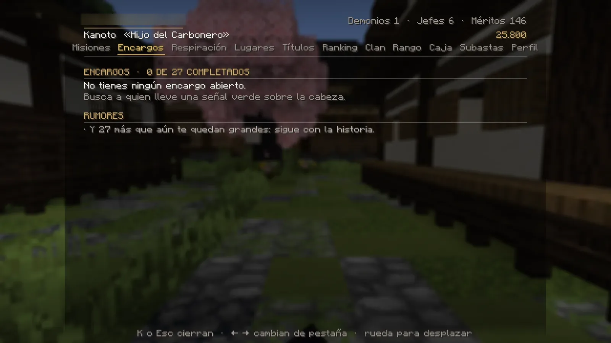
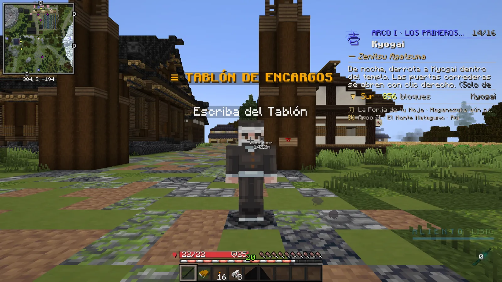
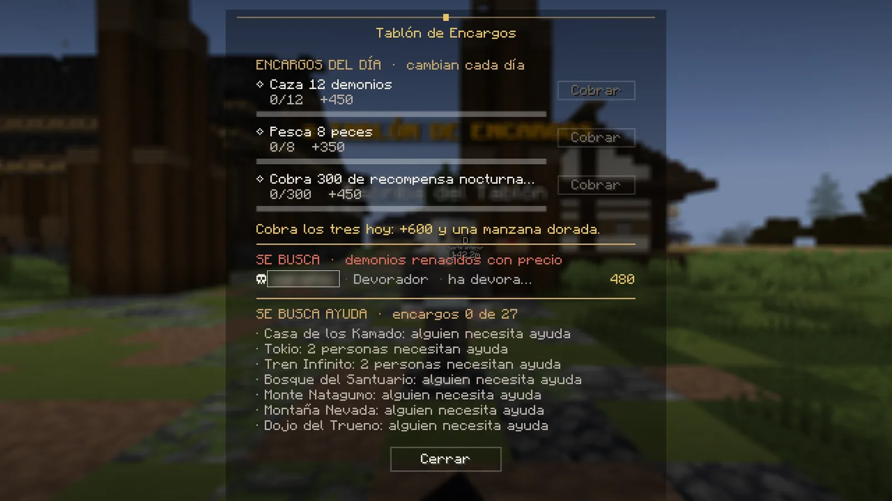

# Encargos y tablón

## Encargos

Los **encargos** son misiones cortas de la gente del mundo. Quien tiene uno lleva una **señal sobre la cabeza** (solo
la ves tú, a menos de 28 bloques):

- **Verde:** tiene un encargo que aún no conoces. Háblale para aceptarlo.
- **Dorada:** te espera para seguir o cerrar uno que ya tienes.

Al aceptarlo pasa a ser la misión que **sigues** y la tarjeta te guía hasta terminarlo. Después vuelve a tu historia.

- Para coger encargos tienes que haber terminado el tutorial. Los de combate piden además tu katana nichirin.
- Puedes tener varios abiertos a la vez. **No se repiten.**
- En **K → Encargos** ves los abiertos y los **rumores**: en qué zonas hay alguien que necesita ayuda.
- Por número de encargos completados ganas títulos: **Buen Vecino** (1), **Manos Dispuestas** (5), **Alma
  Caritativa** (10) y **Leyenda de DemonCraft** (todos).

| Mecánica | Cómo funciona |
|---|---|
| **Búsqueda** | Los objetos brillan en el suelo: pásales por encima y se cuentan solos (no van al inventario). |
| **Rescate** | Al acercarte salen los atacantes: acaba con ellos y luego haz clic derecho a la víctima. |
| **Defensa** | Solo de noche y dentro de la zona: aguanta las oleadas. Si caes, vuelve a empezar. |
| **Escolta** | Tu acompañante te sigue: espérale. |
| **Contrarreloj** | Arriba aparece un reloj. Si sales del juego, el reloj se para. |

!!! info "Lo de tu encargo es solo tuyo, y se va contigo"
    Lo que un encargo pone en el mapa para ti (la gata Mochi de la abuela Tome, los objetos de una búsqueda, la persona a la
    que rescatas o acompañas) **desaparece si sales del servidor o te alejas mucho de la zona del encargo**, y **vuelve a
    salir cuando regresas** a ella. No pierdes lo que llevabas hecho; una escolta, eso sí, vuelve a empezar desde su punto
    de salida.

<figure markdown="span">
  { loading=lazy }
  <figcaption>K → Encargos: tus encargos abiertos y los rumores por zona.</figcaption>
</figure>

## Encargos del día

En **Tokio**, junto al punto donde te deja el cuervo, está el **Escriba del Tablón** (rótulo «☰ TABLÓN DE ENCARGOS»).
Háblale para abrir el tablón.

<figure markdown="span">
  { loading=lazy }
  <figcaption>El Escriba del Tablón, en Tokio.</figcaption>
</figure>
<figure markdown="span">
  { loading=lazy }
  <figcaption>El tablón: los tres encargos del día, el «Se busca» y los rumores.</figcaption>
</figure>

- Cada día hay **tres tareas**, las mismas para todos: una de **caza** (cazar demonios, cobrar recompensa nocturna o
  abatir un demonio con nombre), una de **oficio** (pescar, comprar en una tienda o viajar con el cuervo) y otra cualquiera.
- Cada una paga **entre 250 y 600** y **+3 méritos**. Si cobras las tres: **+600 y una manzana dorada**.
- Se cobran en el tablón con **Cobrar** (a menos de 10 bloques del escriba). Si se te olvida, la próxima vez que
  juegues se te abona lo que cumpliste.
- **Cambian cada día** a las 02:00 (hora de España; a la 01:00 en horario de invierno).

En el tablón también ves:

- **Se busca:** los jugadores demonio con precio por su cabeza. Si le das caza a uno, cobras la recompensa.
- **Se busca ayuda:** en qué zonas hay vecinos con encargos para ti.

!!! demonio "Si eres demonio"
    El tablón es del Cuerpo: el escriba no te atiende. El tuyo es el [Tablón de la Noche](../demonio/mercado.md#el-tablon-de-la-noche)
    del Mensajero de Muzan, en el Mercado de la Noche: tres encargos al día y uno a la semana. Y tus
    [encargos de la noche](../demonio/vida.md), que se cobran solos.
