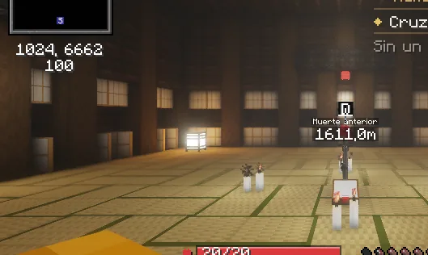

# La Fortaleza

La campaña más larga de los cazadores: dos partes en un mundo propio, para quien ya ha terminado la historia principal.

## Para quién es

| Parte | Qué necesitas antes | Dónde empieza |
|---|---|---|
| **La Fortaleza Dimensional Infinita** (14 capítulos y un epílogo) | Haber terminado el **Arco VII** de la historia | Con **Goto**, en la puerta de Fujikasane |
| **El Castillo Infinito** | Haber terminado la Fortaleza | Otra vez con **Goto** |

Es para **cazadores**. Lo que pasa dentro lo descubres jugando.

<figure markdown="span">
  { loading=lazy }
  <figcaption>Se juega en un mundo propio, con sus salas, sus puertas y sus peleas.</figcaption>
</figure>

## Cómo funciona

- **La Antesala** es tu base: allí están los personajes de la campaña y las puertas a las salas.
- **Cada sala es solo tuya:** tienes tu propia copia, así que nadie te estorba.
- **Salir:** `/fortaleza salir`, fuera de combate, o hablar con el kakushi del Ancla. Sales al almacén de Tokio.
- **Si mueres o sales del juego dentro de una sala**, vuelves a la Antesala o delante de la puerta y puedes intentarlo otra vez.

## Ir acompañado

**No hay grupos**, pero puedes llevar a quien quieras: **quien cruza la puerta contigo** entra en tu copia y pelea a tu lado. La misión **avanza y paga solo a quien la lleva**. En la primera parte, los jefes ganan algo de vida por cada acompañante que les pega.

## Consejos

- **Agáchate junto a lo que brilla** para investigar, como en las demás misiones, y lee el **cuaderno** que te dan: guarda lo que vas descubriendo.
- **Atiende a los avisos:** en estas peleas lo que te pega se ve venir. Hay jefes que no se vencen solo a golpes: fíjate en lo que te dicen y en lo que hay en la sala.
- **Lleva comida y tu mejor equipo.** Algunas peleas son largas.
