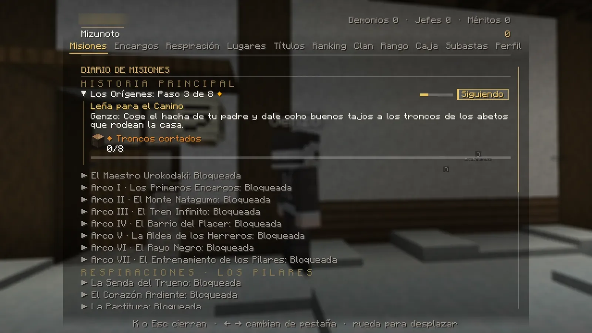

# Cómo funcionan las misiones

No hace falta memorizar nada: la tarjeta de arriba a la derecha te dice siempre qué hacer y hacia dónde ir. Aquí tienes cómo funciona por dentro.

## Tipos de misión

| Tipo | Qué es | Dónde se ve |
|---|---|---|
| **Historia principal** | La historia del cazador, en arcos. | K → Misiones |
| **Respiraciones · Los Pilares** | Cada maestro te enseña su respiración en su propia cadena. | K → Misiones |
| **Campañas del Cuerpo** | Misiones largas con investigación, decisiones y finales distintos. | K → Misiones |
| **Encargos** | Vecinos con un problema (señal verde sobre la cabeza). | K → Encargos |
| **Encargos del día** | Tres tareas que cambian cada día. Se cobran en el tablón de Tokio. | [Tablón](encargos.md#encargos-del-dia) |

Los demonios tienen su propia historia, sus susurros y sus encargos de la noche ([ver](../demonio/vida.md)).

## El diario (K → Misiones)

<figure markdown="span">
  { loading=lazy }
  <figcaption>El diario: cada cadena con su paso y su barra. Haz clic en una para ver el paso, lo que pide y su progreso.</figcaption>
</figure>

- **Seguir / Siguiendo:** elige qué misión te guía en la tarjeta de arriba a la derecha.
- **Pausar / Reanudar:** aparca una misión (retira lo que tenía en el mundo; al reanudarla empieza ese paso entero).
- **Abandonar:** solo en las campañas. Hay que pulsarlo dos veces. La campaña vuelve a empezar, pero **lo que ya cobraste no se cobra otra vez**.
- Una cadena **bloqueada** te dice qué te falta (*«Primero debes completar…»* o *«Necesitas la Respiración de…»*).

## La tarjeta de misión

Muestra el paso que sigues, quién te lo dio, un resumen, una **flecha** con el rumbo y los **bloques** que faltan (o
*«Has llegado»*). Si el paso no tiene sitio fijo, pone *«Sin un lugar fijo: lo de arriba se hace donde estés»*. En las
campañas también ves la lista de objetivos y, si hay prisa, un reloj.

## Qué te pueden pedir

| Objetivo | Cómo se cumple |
|---|---|
| Hablar / entregar | Clic derecho al personaje (con lo que pide en el inventario). |
| Cazar demonios | De noche. Si el paso tiene zona, solo cuentan los que caen dentro. |
| Aguantar la noche | Unos 8 minutos de noche sin morir, donde quieras. Si te mata otro jugador, no se pierde. |
| Quedarse en un sitio | Salir pausa el tiempo, no lo reinicia. |
| Golpes, carreras, entrenamientos | Golpear un poste o una roca (no se rompen), correr, o un entrenamiento del aliento. |
| **Investigar** | **Agáchate 2 segundos** junto a la pista (o clic derecho al bloque). Las pistas solo las ves tú. |
| **Rastrear / patrullar** | Sigue las huellas o la columna de luz, en orden. |
| **Rescatar, escoltar, defender** | Acaba con los atacantes, acompaña al personaje o aguanta la posición. |
| **Decisiones ⚖** | En algunas conversaciones eliges de verdad: cambia lo que pasa y lo que ganas. |

!!! warning "Inventario lleno = el paso espera"
    Si no tienes sitio para la recompensa, el paso **no se completa**: el personaje te dice cuántos huecos necesitas.
    Deja siempre 2 o 3 libres.

## Jefes

- Los jefes de la historia salen **solo de noche** en su sitio. De día: *«De día no hay rastro de…»*.
- Si otro jugador ya está peleando contra él, entras en **cola**. Puedes ayudarle: si le quitas al menos un 10 % de
  vida, también cuenta para ti.
- Si mueres, el rastro «se enfría»: vuelve a hablar con quien te dio el paso para retomarlo.
- En algunas peleas aparece un **Pilar** a ayudarte. Solo pelea en la tuya.
- Al jefe le puedes golpear **siempre**, también mientras lanza una técnica.
- Ningún golpe le quita más de **un cuarto de su vida**: hacen falta varios golpes y formas. Ningún jefe te mata de un
  solo golpe, pero si te quedas quieto delante te tumba en pocos segundos.
- Lo que invoca un jefe (peces, árboles…) tiene tope: como mucho **tres** a la vez.
- Las **cacerías con nombre** son al revés: el demonio te busca a ti de noche, al aire libre.

## Recompensas

Dinero (*«+X a tu banco»*), **méritos** para tu rango, objetos, **títulos** y, al aprender respiraciones o forjar tu
katana, sus tarjetas especiales. Con un [rango VIP](../vip.md) las misiones pagan un 25 % más.
