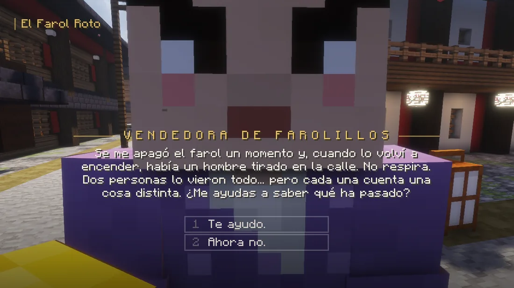
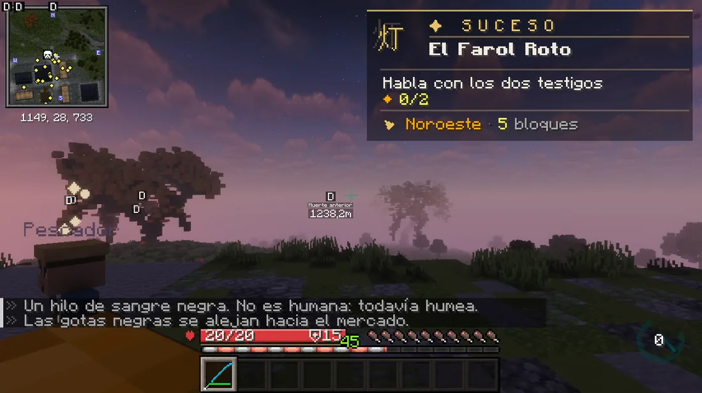

# Los Sucesos

Misiones cortas que te salen mientras vas por el mapa. Alguien se te acerca, te cuenta lo que pasa y tú decides si le ayudas. Y hay secretos que nadie te va a contar.

## Cómo empiezan

Según **dónde estés** (la ciudad, el campo, el bosque, un camino), **la hora** y **tu bando**, alguien se te acerca: un vecino si eres cazador, el **Emisario de la Noche** si eres demonio. Pulsa **[ESCUCHAR]** en el chat o hazle **clic derecho**, y decide: ayudar o «Ahora no».

<figure markdown="span">
  { loading=lazy }
  <figcaption>Te cuentan lo que pasa y tú decides. Si dices que no, no pasa nada: se van.</figcaption>
</figure>

- Te sale **como mucho uno cada 12 minutos** y **6 al día**. El mismo no se repite en 2 horas.
- No te salen en combate, en un duelo, en una escena, en un refugio o en una zona segura, ni cerca de una [Calamidad](../eventos/calamidades.md).
- **Si eres cazador:** necesitas haber terminado «Los Orígenes». Los de noche tienen pelea y piden además tu **primera nichirin**. Los de día no tienen pelea: se investiga.
- **Si eres demonio:** todos son de noche.

## Cómo se juegan

Mientras dura, un **panel** ocupa el sitio de la tarjeta de misión: qué hacer ahora, cuánto llevas, hacia dónde ir y, si hay prisa, un reloj. Una columna de luz, que solo ves tú, marca el sitio.

<figure markdown="span">
  { loading=lazy }
  <figcaption>El panel: qué hacer, cuánto llevas y hacia dónde. Lo que descubres sale en el chat.</figcaption>
</figure>

- **Hablar:** clic derecho al personaje. Léelo con atención: a veces lo que te cuentan no cuadra.
- **Pistas y objetos que brillan:** agáchate a su lado.
- **Esconderte, meditar, vendar a alguien:** agachado y sin moverte hasta que acabe.
- **Devorar** (demonio): agachado y clic derecho, como siempre.
- **Decidir:** muchas veces hay que elegir, y lo que eliges cambia lo que pasa y lo que ganas.

Todo es solo tuyo: los enemigos solo van a por ti y los personajes solo te hablan a ti. Otros jugadores pueden ayudarte a pelear.

**Lo pierdes si** mueres o te alejas demasiado (te avisa antes). También hay un tiempo máximo de 15 minutos. **`/suceso`** te dice qué te falta y **`/suceso abandonar`** lo deja, sin premio.

## Qué puede salirte

=== "Cazador"

    | Suceso | Dónde y cuándo | Qué te espera |
    |---|---|---|
    | **El Farol Roto** | La ciudad, de noche | Un muerto y dos testigos. Uno miente |
    | **La Niña del Bosque** | Bosque o campo, de noche | Sigue su rastro y tráela de vuelta |
    | **Mercancía Maldita** | La ciudad, de día | Alguien vende amuletos que no debería |
    | **Las Campanas Solas** | Campo o bosque, de noche | Campanillas que suenan sin viento y un poema |
    | **El Viajero Herido** | Un camino o el campo, de noche | Véndale y llévale a un sitio seguro |
    | **El Ladrón de Glicina** | Campo o camino, de día | Alguien se lleva lo que protege al pueblo |

=== "Demonio"

    | Suceso | Dónde | Qué te espera |
    |---|---|---|
    | **El Testigo** | La ciudad | Un humano que no debe hablar, y sus guardias |
    | **La Ofrenda** | Campo o camino | Un altar, un sacerdote y algo que huele raro |
    | **El Cazador Solitario** | Bosque o camino | Alguien te sigue. Espérale |
    | **La Medicina de Sangre** | Ciudad o campo | Uno de los tuyos, encadenado |
    | **El Rival** | Campo o bosque | Otro demonio caza en tu territorio |
    | **Los Faroles de Glicina** | La ciudad | Una calle que apesta a glicina |

## Los secretos

Hay **sitios del mapa** donde, **de noche**, pasan cosas: dos para cazadores y dos para demonios. Se activan solos al llegar, y solo los ve quien los despierta. No vamos a decirte dónde están.

- **Una vez por semana** cada secreto, por jugador.
- Son más difíciles que los Sucesos y **pagan mejor**.
- Alguno pide llevar algo **en la mano**. Si notas algo raro en un sitio, fíjate en el mensaje.
- El cazador necesita su primera nichirin.

## Qué se gana

Dinero, **méritos** o **sangre**, experiencia del [Pase Estelar](../pase.md) y una tirada de objetos de las [Calamidades](../eventos/calamidades.md#las-pociones):

| Tirada | Suceso | Secreto | Qué sale |
|---|---|---|---|
| Normal | 90 % | 74 % | Una o dos pociones extrañas de tu bando |
| Raro | 8 % | 20 % | Un amuleto de una Calamidad |
| Épico | 1,5 % | 4,5 % | Cuatro pociones de las mejores |
| Legendario | 0,5 % | 1,5 % | El **Corazón de Calamidad** |
