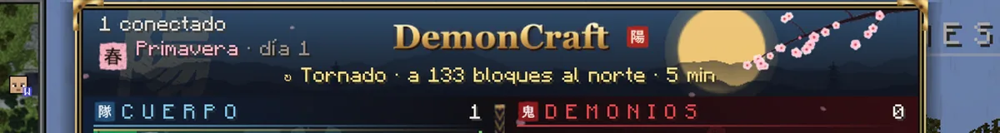
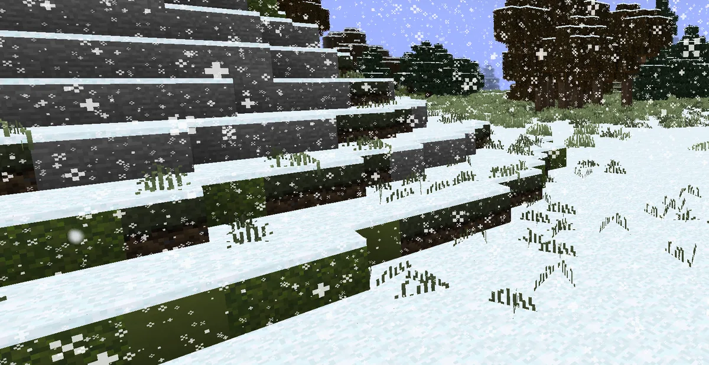
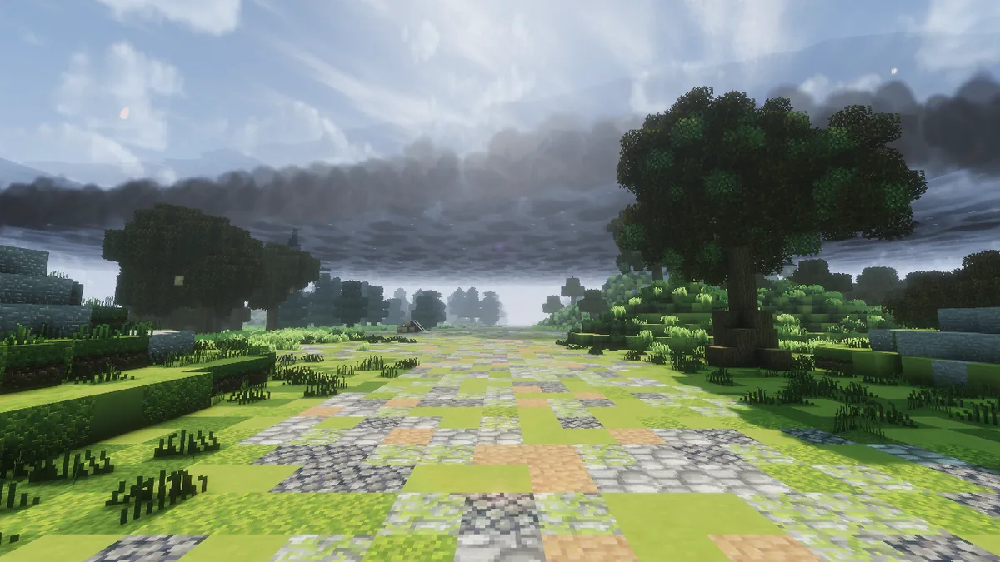
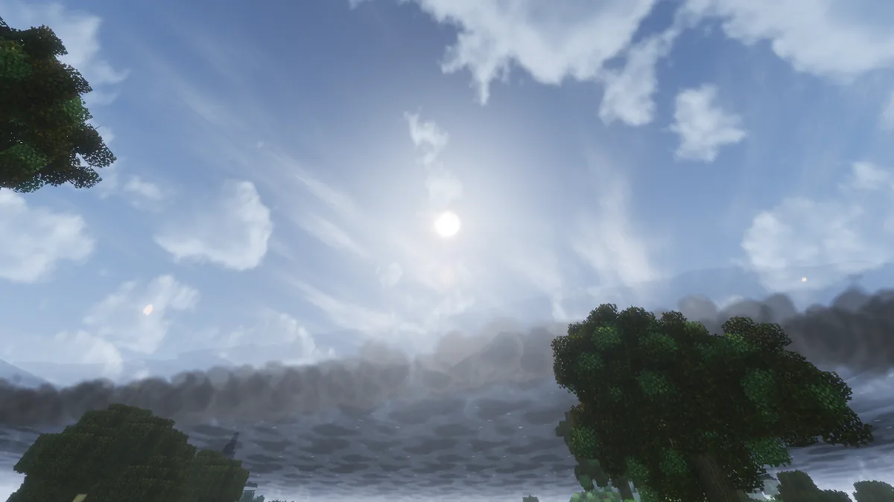
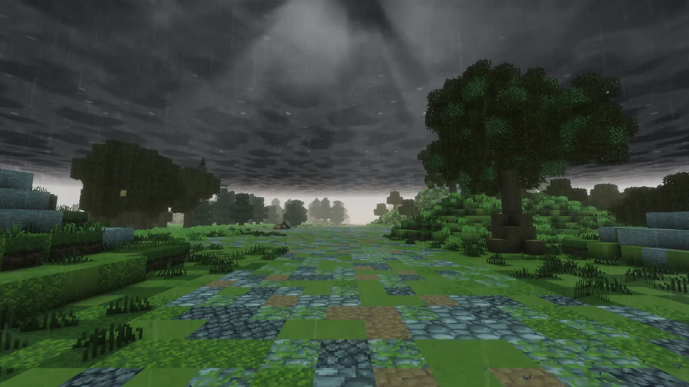
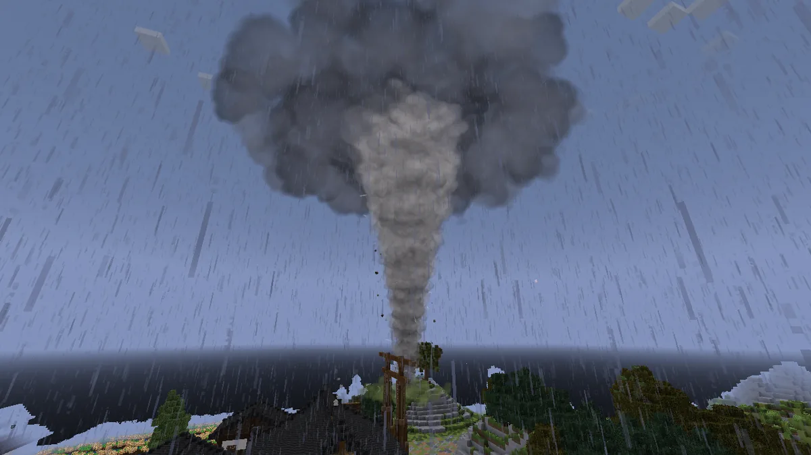
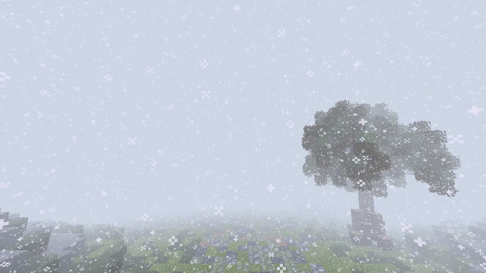
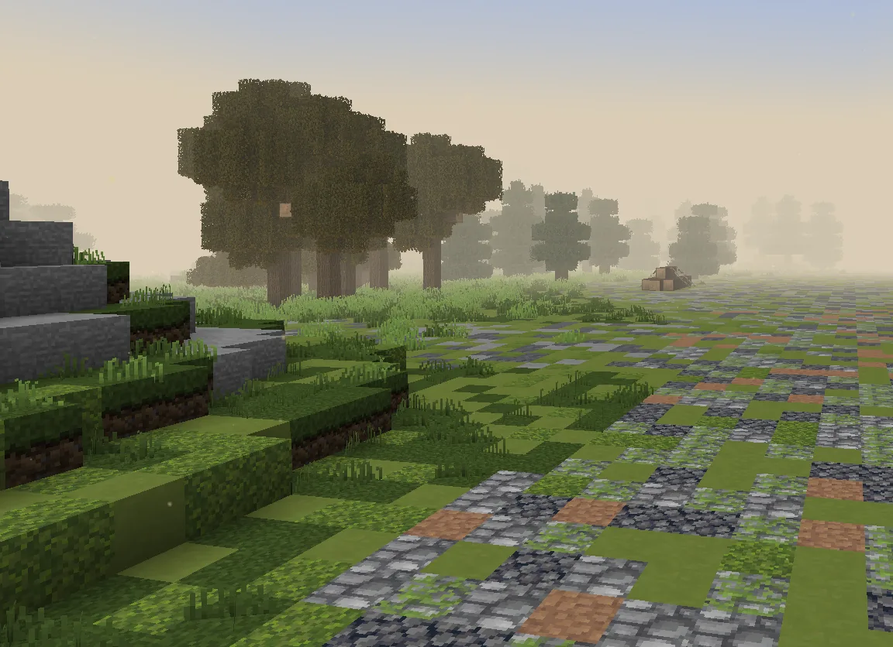

# Las estaciones

En DemonCraft pasan las estaciones: <strong>primavera, verano, otoño e invierno</strong>. Cada una tiene su tiempo,
sus colores y sus <strong>desastres naturales</strong>, que se ven y se sienten en todo el mapa.

## En qué estación estamos

Pulsa **Tab**: arriba a la izquierda de la lista sale el sello de la estación (春 primavera, 夏 verano, 秋 otoño, 冬 invierno) con su
día. Si hay un desastre en marcha, la línea de debajo del logotipo dice qué es, dónde está y cuánto le queda.

<figure markdown="span">
  { loading=lazy }
  <figcaption>La primavera, su día y el tornado que anda cerca: «a 133 bloques al norte · 5 min».</figcaption>
</figure>

| Estación | El tiempo | Lo que verás |
|---|---|---|
| **Primavera** | lluvias frecuentes | pétalos de cerezo y glicina que caen de esos árboles |
| **Verano** | sol casi siempre | luciérnagas sobre la hierba por la noche |
| **Otoño** | viento y lluvias | árboles rojos y naranjas, hojas que caen y vuelan |
| **Invierno** | nevadas | la nieve cubre todo el mapa y se derrite despacio; copos y vaho al respirar |

<figure markdown="span">
  { loading=lazy }
  <figcaption>En invierno la nieve cubre el mapa entero.</figcaption>
</figure>

## Los desastres naturales

Llegan de vez en cuando, según la estación. Avisan en el chat un minuto antes y se forman poco a poco. **Ninguno rompe nada ni te
mata**, pero te complican la vida si te pillan **al raso**: bajo techo estás a salvo.

### La tormenta eléctrica

Primavera, verano y otoño. **Cubre todo el mapa**:
- llega como un frente que se ve venir desde el horizonte, con una nube oscura delante;
- el cielo se cierra, llueve y se oscurece todo;
- dentro de las nubes relampaguea, y el trueno llega unos segundos después;
- al final se va por el otro lado.

Bajo las nubes más negras **caen rayos sobre quien va al raso**: antes sale un **círculo rojo** en el suelo, así que apártate. El rayo
quita una parte de tu vida, nunca toda.

<figure markdown="span">
  { loading=lazy }
  <figcaption>El frente llega: la nube rodillo cruza el cielo.</figcaption>
</figure>
<figure markdown="span">
  { loading=lazy }
  <figcaption>El borde de la tormenta pasando por encima.</figcaption>
</figure>
<figure markdown="span">
  { loading=lazy }
  <figcaption>Debajo, el cielo cerrado y los relámpagos dentro de las nubes.</figcaption>
</figure>

### El tornado

Primavera, verano y otoño, de día. Es un embudo que recorre el mapa, levanta polvo y bloques, y suena de lejos:
- **cerca te arrastra** hacia él;
- **si llegas a su base, te atrapa**: te sube dando vueltas y te suelta lejos, con caída lenta. Duele, pero no mata.

Se le ve venir: nunca aparece encima de nadie.

<figure markdown="span">
  { loading=lazy }
  <figcaption>El tornado y su nube, en mitad de la tormenta.</figcaption>
</figure>

### La ventisca

Solo en invierno. Es un frente con un **muro de nieve** que se ve llegar:
- **dentro**: todo se vuelve blanco, apenas se ve y el viento te frena (más si andas de cara a él);
- **la nieve del mapa**: mientras dura, cuaja mucho más deprisa.

<figure markdown="span">
  { loading=lazy }
  <figcaption>Dentro de la ventisca.</figcaption>
</figure>

### El vendaval y la ola de calor

- **El vendaval** (sobre todo en otoño) sopla en todo el mapa: hojas y polvo barren el suelo y el viento frena a quien anda de cara a él.
- **La ola de calor** (verano) es de día y sin una nube: calima dorada en el horizonte y polvo que flota al sol. Al sol te entra hambre;
  a la sombra, bajo techo o en el agua se pasa mejor.

<figure markdown="span">
  { loading=lazy }
  <figcaption>La calima de la ola de calor.</figcaption>
</figure>

!!! tip "En la Ciudadela"
    La Ciudadela comparte el cielo con el mapa: tiene la misma estación y verás llegar los mismos desastres. Como es una ciudad libre de
    daños, allí no te harán nada.

## Cada cuánto pasan

Son raros: como mucho uno a la vez y casi un día entre uno y otro. Más o menos, por semana: dos o tres tormentas, un par de vendavales,
algún tornado cada dos semanas y, en invierno, una ventisca cada pocos días.

Para saber cómo está el tiempo ahora, escribe `/estacion`.
