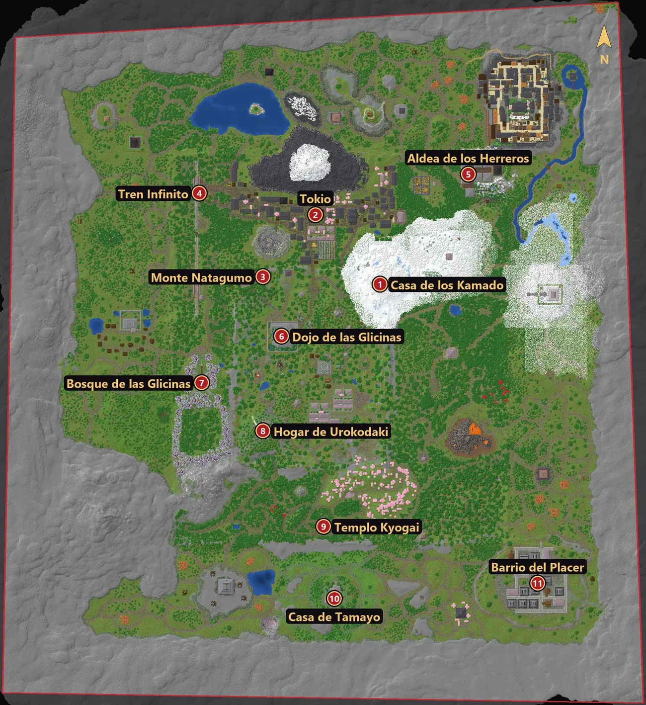
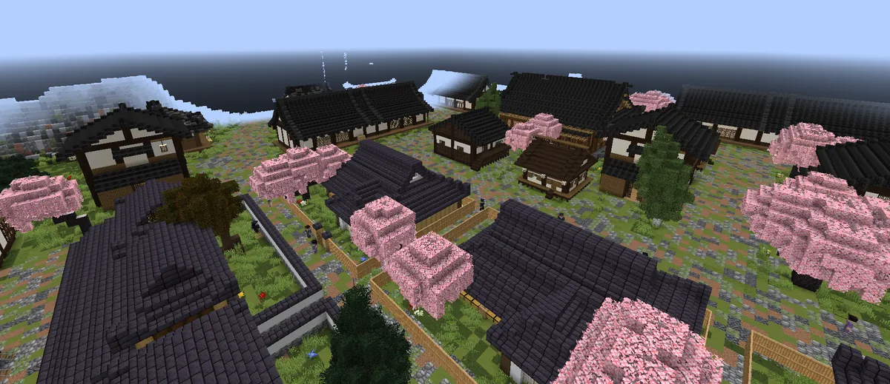
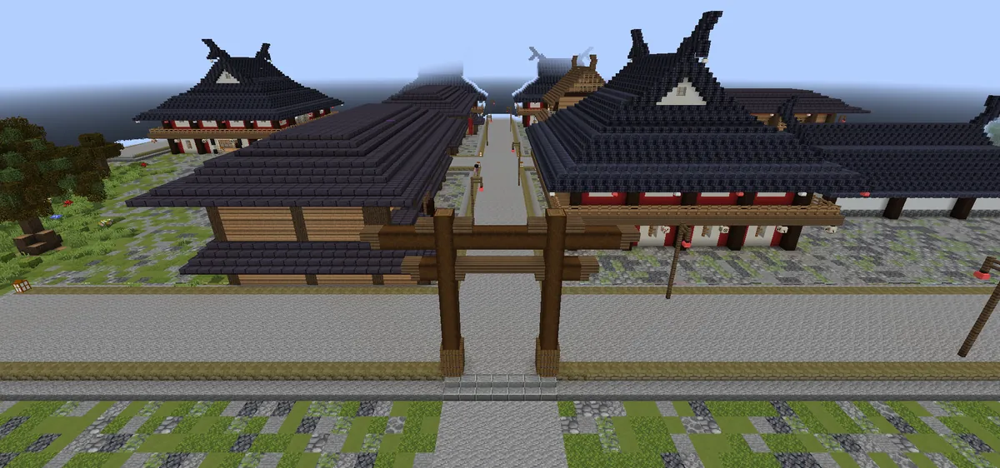
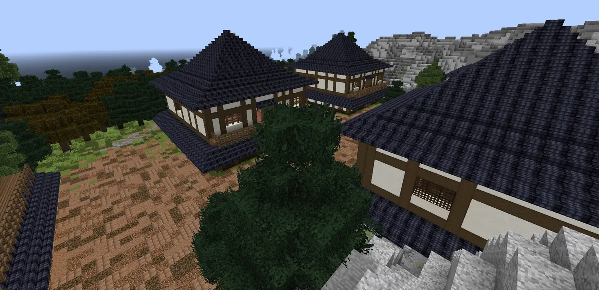
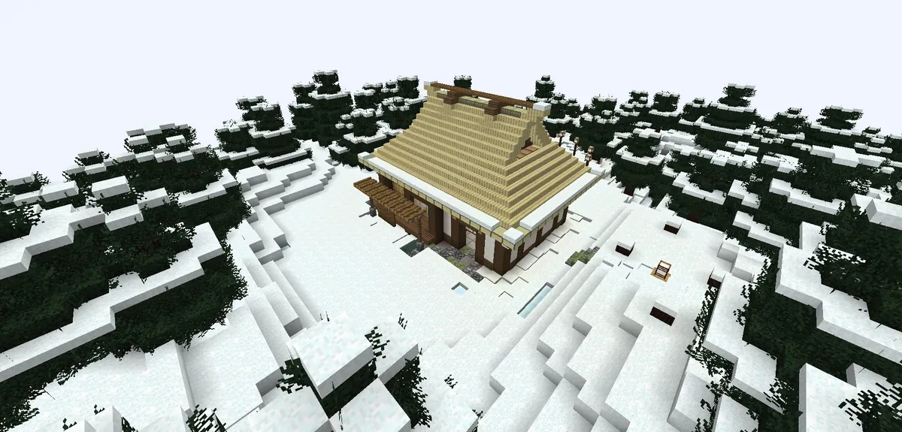
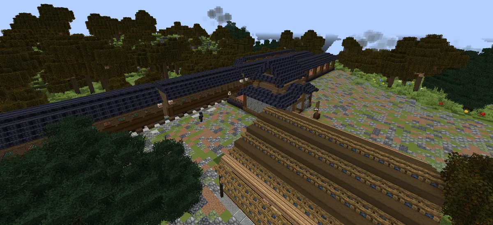
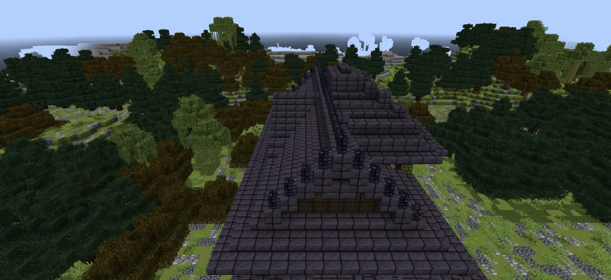
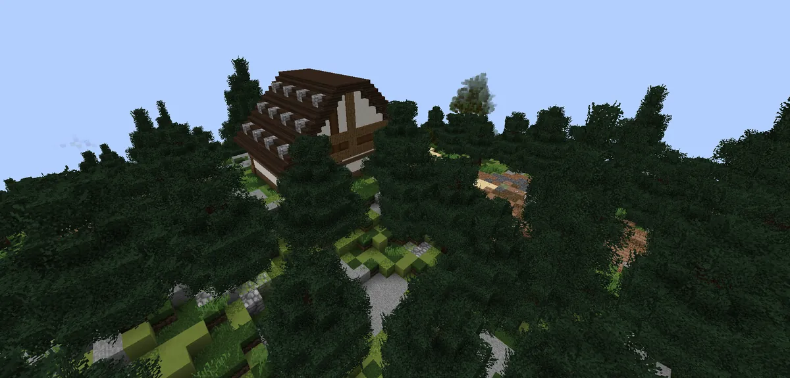
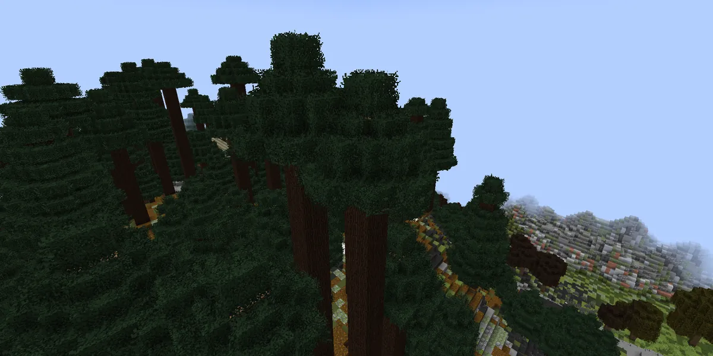
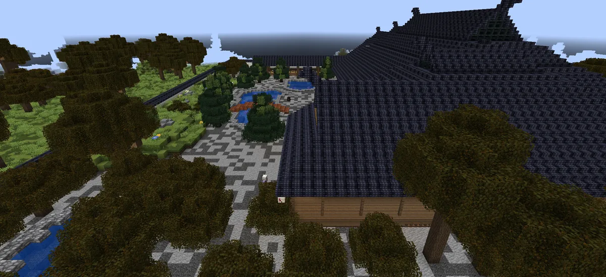

# El mapa

Un mundo cerrado y hecho a mano: una ciudad, aldeas, montañas, bosques de glicinas y un distrito que nunca duerme. Haz clic en el mapa para verlo en grande.

<figure markdown="span">
  { loading=lazy }
  <figcaption>El mundo visto desde arriba. El norte está arriba; la línea roja es el borde del mapa. <a href="../assets/img/mapas/mapa-mundo-grande.webp" target="_blank" rel="noopener">Ver el mapa a tamaño completo</a>.</figcaption>
</figure>

## Los lugares

| N.º | Lugar | Qué hay |
|---|---|---|
| 1 | **Casa de los Kamado** | Donde despiertas y donde reaparece el cazador al morir. Es un refugio. |
| 2 | **Tokio** | La ciudad principal: la tienda de Kohei, el tablón de encargos, las casas de alquiler y mucha vida. |
| 3 | **Monte Natagumo** | Un monte de arañas, peligroso de noche. |
| 4 | **Tren Infinito** | La estación y las vías. |
| 5 | **Aldea de los Herreros** | Herreros, forja y entrenadores. |
| 6 | **Dojo de las Glicinas** | Donde se libran los [duelos](../social/duelos.md). Refugio sin demonios. |
| 7 | **Bosque de las Glicinas** | Un bosque protegido por las flores que los demonios no soportan. |
| 8 | **Hogar de Urokodaki** | La casa de un maestro, entre los árboles. |
| 9 | **Templo Kyogai** | Un templo apartado al sur. |
| 10 | **Casa de Tamayo** | Una casa escondida al sur. |
| 11 | **Barrio del Placer** | El distrito de las casas de té, al sureste. |

## Descubrir lugares

La primera vez que entras en uno de estos lugares aparece la tarjeta **«LUGAR DESCUBIERTO»**. Desde entonces puedes
volver con el [cuervo](viajar.md) (K → Lugares → **Ir**).

<figure markdown="span">
  { loading=lazy }
  <figcaption>Tokio</figcaption>
</figure>
<figure markdown="span">
  { loading=lazy }
  <figcaption>Barrio del Placer</figcaption>
</figure>
<figure markdown="span">
  { loading=lazy }
  <figcaption>Aldea de los Herreros</figcaption>
</figure>
<figure markdown="span">
  { loading=lazy }
  <figcaption>Casa de los Kamado</figcaption>
</figure>
<figure markdown="span">
  { loading=lazy }
  <figcaption>Tren Infinito</figcaption>
</figure>
<figure markdown="span">
  { loading=lazy }
  <figcaption>Templo Kyogai</figcaption>
</figure>
<figure markdown="span">
  { loading=lazy }
  <figcaption>Hogar de Urokodaki</figcaption>
</figure>
<figure markdown="span">
  { loading=lazy }
  <figcaption>Monte Natagumo</figcaption>
</figure>
<figure markdown="span">
  { loading=lazy }
  <figcaption>Finca de las Glicinas</figcaption>
</figure>

!!! tip "El mapa en el juego"
    Pulsa ++m++ para abrir el mapa del mundo. Se va dibujando con lo que exploras, y puedes poner tus propios puntos.
