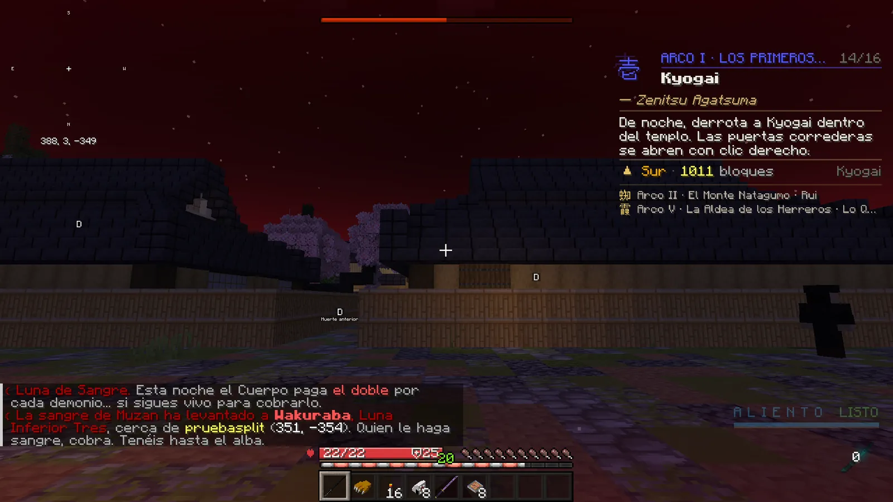
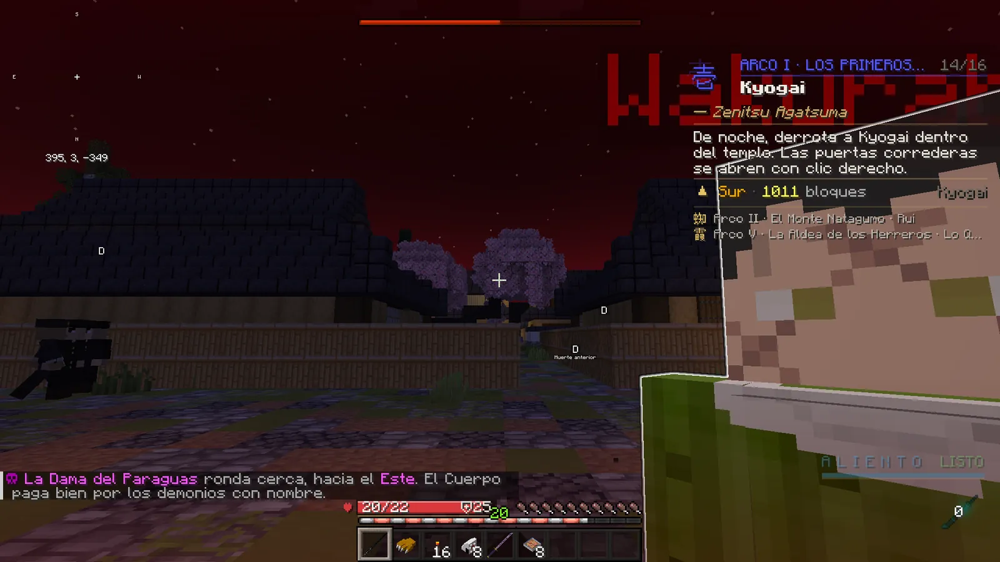

# La noche

El día pasa deprisa y la noche es de los demonios. Cuanto más avanzas, más y más duros vienen a por ti… y mejor paga el Cuerpo.

## El ciclo

- **El día dura la mitad** de lo normal. La noche dura unos **8 minutos**: un día completo son unos 15 minutos.
- Al anochecer verás **«🌙 Cae la noche…»**. La parte más peligrosa es la **hora del buey**, a mitad de la noche.
- Las camas no se usan: la noche no se salta.

## Los encuentros

De noche, a cada cazador le van llegando demonios a su medida. Antes de cada encuentro suena un **latido lejano**:
date la vuelta, suelen venir **por la espalda**.

| Encuentro | Qué es |
|---|---|
| **Acechador** | Un demonio que te sigue desde lejos. |
| **Manada** | Dos a cuatro demonios que llegan juntos desde el mismo lado. |
| **Emboscada** | Varios demonios que salen del suelo a tu alrededor (cuando ya llevas un tiempo en el Cuerpo). |
| **Demonio con nombre** | Un demonio élite con nombre propio, brillo y **barra morada**. Uno como mucho por noche. Paga mucho más. |

- La dificultad sube con tu **progreso**: tener katana, tu rango y los arcos de la historia que hayas terminado.
- **Sin katana**, solo te sigue algún acechador lejos, y **bajo techo no te aparece ninguno**.
- Bajo techo los encuentros llegan a la mitad de ritmo.
- Si mueres, tus demonios se retiran y tienes **90 segundos de calma**.

## La recompensa nocturna

- Cada demonio que matas suma a tu **recompensa nocturna** (los normales poco; los élite y los demonios con nombre, mucho más).
- **Racha:** si encadenas muertes con menos de 45 segundos entre una y otra, cada una vale un 10 % más (hasta ×1,5).
- **Se cobra al amanecer** con un parte: *«☀ Amanece. Buena caza. Has dado caza a N demonios… El Cuerpo te paga +X»*.
  Cada rango del Cuerpo suma un 5 % y un [rango VIP](../vip.md), un 25 %. Si sales a media noche, cobras lo que llevabas.
- Además, cada demonio te da **+1 mérito** (el de nombre, +4).

## Refugios

| Refugio | Dónde |
|---|---|
| ❀ **Casa de las Glicinas** | Incluye el Dojo de las Glicinas. |
| ❀ **Puerta de glicinas del Fujikasane** | La entrada del Bosque de las Glicinas. |
| ⌂ **Casa de los Kamado** | Donde reaparece el cazador. |

Dentro no aparece ningún demonio y los que te seguían se retiran. Pero **desde dentro tampoco puedes cazarlos**, y el
**demonio con nombre te espera fuera**. Las [zonas seguras](#zonas-seguras) también son refugio.

## Zonas seguras

Hay sitios del mapa (bares, plazas…) marcados como **zonas seguras**. Al entrar en una lo ves en la pantalla:
«☮ Zona segura · *nombre*: aquí no se pelea.» Al salir: «Sales de la zona segura · *nombre*.»

- Dentro **nadie pelea con nadie**: ni golpes, ni formas, ni artes, ni lo que dejan (lentitud, veneno, ceguera…). Desde
  dentro tampoco se le pega a nadie de fuera.
- **Si llevas la marca de combate** (la franja «⚔ EN COMBATE» encima de tu vida), la zona **no te protege** hasta que se
  acabe: dentro te pueden pegar y puedes pegar. Al acabarse, te avisa: «ya estás a salvo».
  [Ver la marca](../cazador/combate.md#la-marca-de-combate).
- También son **refugio de la noche**: dentro no salen demonios ni calabazas de Halloween, y no van a por quien está dentro.
  Como en los demás refugios, desde dentro no puedes cazarlos.
- Los duelos del dojo van aparte. Y a un demonio jugador, las patrullas del Cuerpo le siguen buscando dentro: eso no es PvP.

## La Luna de Sangre

Algunas noches la luna sale roja (hay un 10 % de probabilidad cada noche, con al menos tres noches tranquilas entre una
y otra):

- La niebla y los bordes de la pantalla se tiñen de rojo y una barra arriba cuenta lo que queda de noche.
- **Salen el doble de demonios**, más duros, y **la recompensa nocturna se paga doble**.
- A mitad de la noche, **la sangre de Muzan levanta una Luna Inferior** cerca de algún cazador. Todo el servidor recibe
  el aviso con las coordenadas: *«Quien le haga sangre, cobra. Tenéis hasta el alba»*.
- Todos los cazadores que le hagan **al menos un 5 % de daño** y sigan conectados cuando caiga cobran **2.500**, ganan
  **15 méritos** y el título **«Cazador de Lunas»**, además de materiales de la Aldea y, a veces, un
  [plano](../economia/aldea.md#los-planos-raros-y-legendarios): raro (30 %) o legendario (desde la 1.5, solo el 1,5 %). Si
  nadie la derrota, se deshace en humo al amanecer.

<figure markdown="span">
  { loading=lazy }
  <figcaption>El cielo rojo de la Luna de Sangre, con el aviso en el chat.</figcaption>
</figure>
<figure markdown="span">
  { loading=lazy }
  <figcaption>La Luna Inferior aparece con su nombre en grande y su barra de vida.</figcaption>
</figure>

!!! demonio "La noche de un demonio"
    A los demonios no les salen estos encuentros (la noche es suya). En cambio, si su notoriedad es alta, les buscan
    **patrullas del Cuerpo**. En Luna de Sangre van a por todos los demonios, y de **élite**, pero de una en una: **un solo
    cazador de élite vivo a la vez** a por cada demonio (el siguiente, como pronto, un minuto después) y con **la mitad de vida**
    que antes, de **8 a 25** ([ver](../demonio/combate.md#los-cazadores-del-cuerpo)). La sangre que cazan cuenta doble, y cada
    cazador que rompen suma a su [paga de la noche](../demonio/vida.md#la-paga-de-la-noche), que también se cobra al amanecer.
