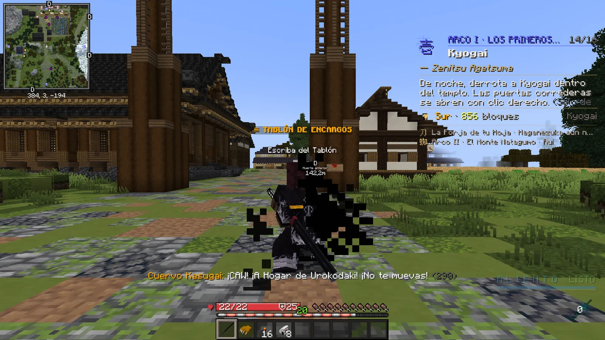

# Viajar

Por el mapa se viaja con el cuervo: abre la K, ve a <strong>Lugares</strong> y pulsa <strong>Ir</strong>.

## El cuervo Kasugai

<ol class="pasos" markdown>
<li markdown>**Descubre el lugar.** Solo puedes viajar a sitios que ya hayas pisado (sale la tarjeta «LUGAR DESCUBIERTO»).</li>
<li markdown>**K → Lugares → Ir.** Al lado de cada lugar ves lo que cuesta ir desde donde estás.</li>
<li markdown>**Quédate quieto 3 segundos** mientras el cuervo marca el rumbo. Si te mueves o te hacen daño, se cancela sin cobrar.</li>
<li markdown>**Llegas** y se te cobra: *«Has llegado a … -precio»*.</li>
</ol>

<figure markdown="span">
  { loading=lazy }
  <figcaption>K → Lugares: precio de cada viaje y el botón Ir.</figcaption>
</figure>
<figure markdown="span">
  { loading=lazy }
  <figcaption>«¡CAW! ¡No te muevas!»: el cuervo marca el rumbo durante 3 segundos.</figcaption>
</figure>

!!! tip "La Ciudadela"
    **La Ciudadela**, el mundo de las parcelas, sale **la primera** en K → Lugares, abierta a todos desde el principio: **200**
    cada viaje entre los dos mundos (también para volver), con las mismas reglas. [Ver la Ciudadela](../ciudadela/index.md).

!!! tip "El Gran Dojo"
    Cuando ya tienes tu **primera espada nichirin**, sale también **«El Gran Dojo»**, donde se pelean los duelos y el torneo: es
    **gratis** y su **Ir** te lleva al momento a su plaza (lo mismo que `/torneo ver`; vuelves igual). [Ver el Gran Dojo](../social/duelos.md#el-gran-dojo).

## Cuánto cuesta

- **60 + 0,4 por cada bloque** de distancia en línea recta, con un **tope de 1.200**.
- Con un [rango VIP](../vip.md) pagas **la mitad**.
- Ejemplos desde Tokio: Monte Natagumo 120 · Dojo de las Glicinas 160 · Tren Infinito 240 · Aldea de los Herreros 300 ·
  Templo Kyogai 400 · Barrio del Placer 540.

## Reglas

- Entre un viaje y otro hay que esperar **45 segundos**.
- No puedes viajar si un enemigo te ha golpeado hace poco, ni con un duelo en marcha.
- Tampoco en plena pelea con otro jugador: con la [marca de combate](../cazador/combate.md#la-marca-de-combate), «En combate no
  se viaja: espera N s». Si la coges mientras esperas los 3 segundos, el viaje se cancela. Vale también para la biwa.
- **Antes de tener tu cuervo** (al principio de tu formación), te lleva un **arriero** por el mismo precio.
- Las **waystones** no se usan y las **barcas** están desactivadas.

!!! demonio "Los demonios viajan con la biwa"
    Un demonio no tiene cuervo: cuando avanza en su historia, **Nakime** le abre sus puertas (K → Lugares pasa a
    llamarse «Las puertas de Nakime»). Funciona solo de noche, cobra igual que el cuervo y salir del castillo es
    gratis. [Más sobre la vida del demonio](../demonio/vida.md).
