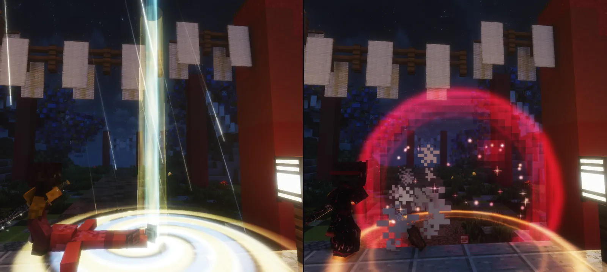
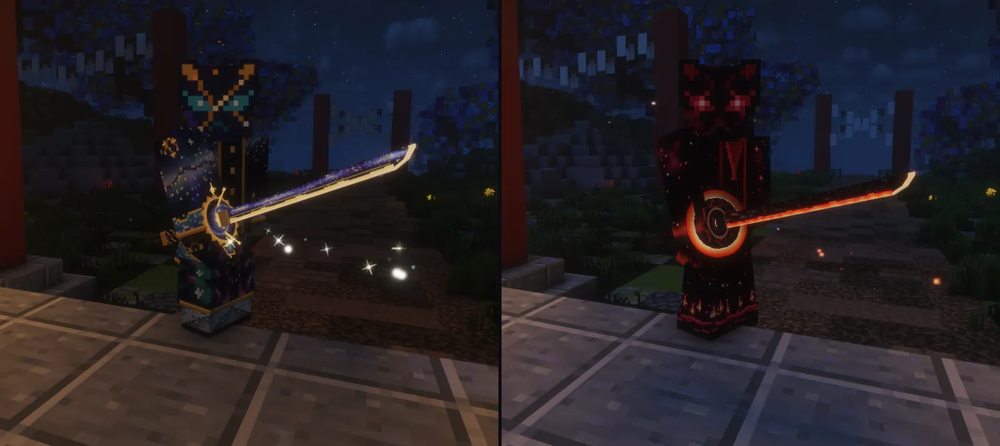
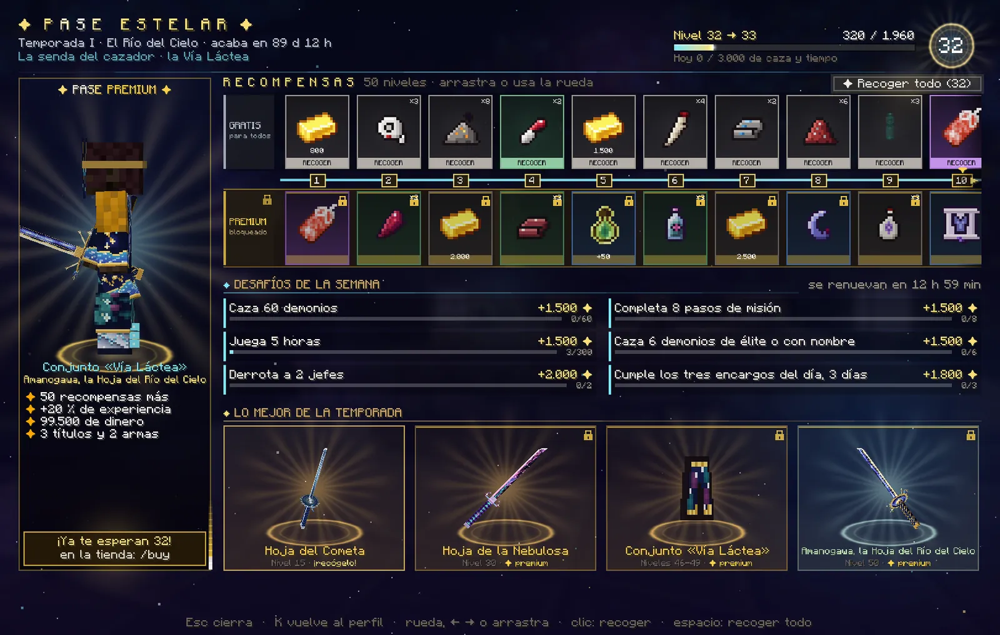
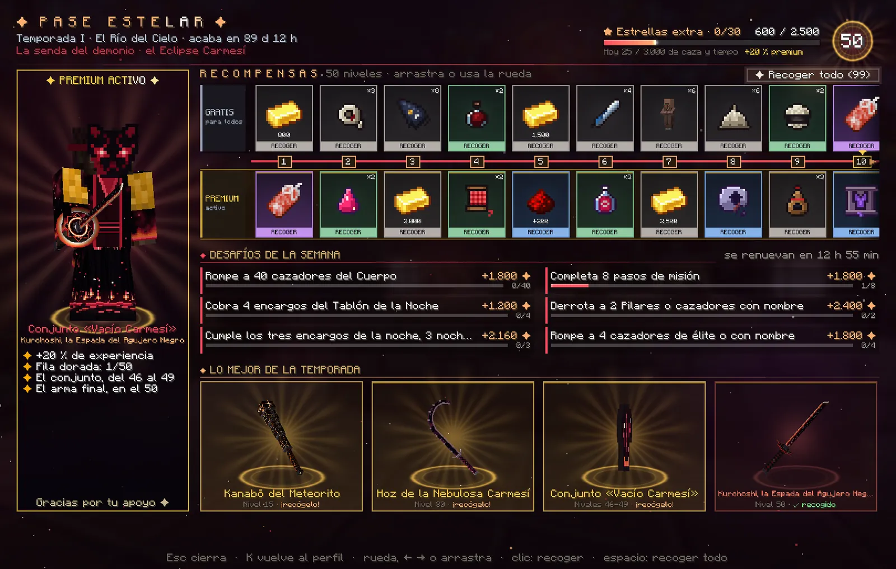
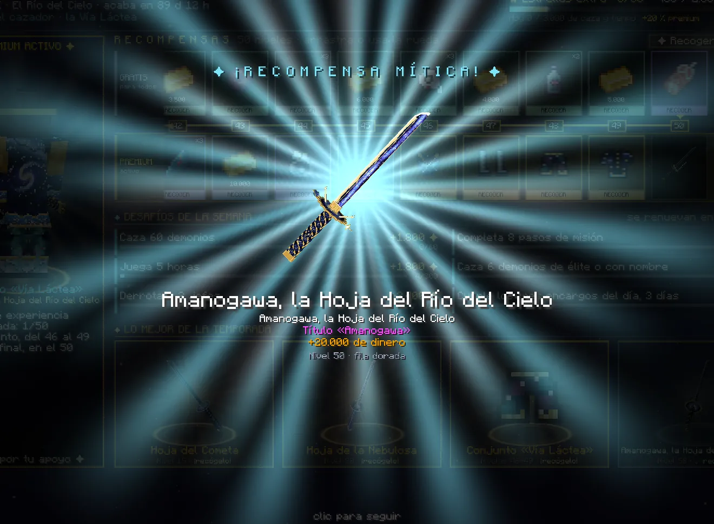

# El Pase Estelar

Temporada I, <strong>«El Río del Cielo»</strong>: 50 niveles que se suben jugando, con una recompensa <strong>gratis</strong> en cada uno y otra <strong>dorada</strong> para quien tiene el Pase Premium. Lo abres con <strong>K → ✦ Pase</strong> o con <strong><code>/pase</code></strong>.

## La temporada I: «El Río del Cielo»

**25 de octubre de 2026**
Empieza la temporada.

**22 de enero de 2027**
Último día para ganar experiencia y para conseguir el Pase Premium.

**29 de enero de 2027**
Último día para recoger lo que ganaste. Después, el pase se cierra.

Las fechas van en hora de Madrid. Lo que ya hayas recogido es tuyo para siempre: [qué pasa al acabar](#cuando-acaba-la-temporada).

## Cómo funciona

- **50 niveles.** En cada uno hay dos recompensas: la de la **fila gratis**, para todos, y la de la **fila dorada**, para
  quien tiene el [Pase Premium](#el-pase-premium).
- **Cada bando, la suya.** El cazador recorre **la Vía Láctea** (azul y oro) y el demonio, **el Eclipse Carmesí** (negro y
  sangre). Valen lo mismo, pero cada uno recibe lo de su bando: vendas del Cuerpo o de mortaja, méritos o sangre, la Hoja
  del Cometa o el Kanabō del Meteorito…
- **Lo que recoges cuenta para los dos bandos.** Si cambias de bando, los niveles que ya recogiste no se vuelven a cobrar
  con lo del otro; tus títulos del pase pasan solos a los de tu nuevo bando.
- **Pasado el nivel 50**, cada 2.500 de experiencia es una **estrella extra**: 1.500 de dinero (3.000 más con el Pase
  Premium), hasta 30 por temporada. Se recogen en la carta **★ EXTRA**, al final de la pista.

## Cómo se sube

Se gana **experiencia del pase** jugando. El nivel 1 pide 1.000 y cada nivel, 30 más que el anterior (el 50, 2.470): la
temporada entera son **86.750**.

| Qué haces | Experiencia |
|---|---|
| Un paso de misión (de la historia, de un encargo o de un susurro) | 100 |
| Terminar una misión | 300 |
| Cobrar un encargo del día (del Cuerpo o de la noche) | 120 |
| Los tres encargos del día | 250 más |
| Subir de rango en el Cuerpo, o que tu sangre madure | 700 |
| Tu primera entrada del día | 200 |
| El tiro gratis de la [Caja del Cuartel](economia/objetos.md#la-caja-del-cuartel-k-caja) | 30 |
| Demonio: cobrar un encargo del [Tablón de la Noche](demonio/mercado.md#el-tablon-de-la-noche) · el de la semana | 30 · 150 |
| Cazador: cazar un demonio · uno con nombre de la noche · un jefe (las Lunas y los jefes de las cacerías, de la Luna de Sangre y de las misiones) | 6 · 40 · 250 |
| Demonio: romper a un cazador del Cuerpo · uno de élite · un cazador con nombre o un Pilar | 6 · 40 · 250 |
| Derrotar a un jugador del otro bando | 120 |
| Cada 5 minutos de juego (sin estar AFK) | 25 |
| Demonio: devorar a un humano · recoger un loto de sangre | 10 · 5 |
| Cumplir un [desafío de la semana](#los-desafios-de-la-semana) | de 800 a 2.000 |

- **Lo que se repite** (cazar, el PvP, el tiempo de juego, devorar y los lotos) cuenta hasta **3.000 al día**: lo que pasa de
  ahí se pierde, y a las 0:00 (hora de Madrid) vuelve a contar. La pantalla te dice cuánto llevas: «Hoy 1.240 / 3.000 de
  caza y tiempo». Lo demás no tiene tope.
- Un paso o una misión solo dan experiencia **la primera vez** que los haces.
- **El Pase Premium suma un 20 %** a toda la experiencia, también a la de los desafíos.
- **El PvP** solo cuenta contra jugadores del otro bando y fuera del dojo; no entre dos del mismo clan ni desde la misma
  conexión, y la misma pareja cuenta una vez cada 6 horas.
- No cuentan las criaturas de un encuentro de misión, lo que invoca otro jugador ni los aliados.

### Los desafíos de la semana

**Seis cada semana**, de lunes a domingo: se renuevan el lunes a las 0:00 (hora de Madrid) y son los mismos para todos los de
tu bando. Los dos primeros (cazar y los pasos de misión) salen siempre; los otros cuatro cambian cada semana. Cada uno, al
cumplirlo, da su experiencia de una vez y el chat te lo dice: *«✦ Desafío de la semana cumplido: …»*.

| Desafío | Cazador | Demonio | Experiencia |
|---|---|---|---|
| Cazar (siempre) | 60 demonios | 40 cazadores del Cuerpo | 1.500 |
| Pasos de misión (siempre) | 8 | 8 | 1.500 |
| De élite o con nombre | 6 demonios | 4 cazadores | 1.500 |
| Jefes | 2 | 2 Pilares o cazadores con nombre | 2.000 |
| Los tres encargos del día | 3 días | 3 noches | 1.800 |
| Jugadores del otro bando (distintos) | 3 demonios | 3 cazadores | 2.000 |
| Jugar | 5 horas | 5 horas | 1.500 |
| Viajar | 6 veces en cuervo | 6 veces con la biwa | 800 |
| Terminar | una misión o un encargo | una misión o un susurro | 1.500 |
| Abrir la Caja del Cuartel | 4 días | — | 1.000 |
| Devorar humanos | — | 10 | 1.200 |
| Recoger lotos de sangre | — | 15 | 1.000 |
| Cobrar encargos del Tablón de la Noche | — | 4 | 1.000 |

Con el Pase Premium, un 20 % más (la pantalla ya te enseña lo que vas a cobrar). Si cambias de bando a mitad de semana,
tienes los del otro bando y empiezan de cero.

## Las recompensas

- **Fila gratis**, para todos: unos **59.300** de dinero en la temporada, materiales y botica de tu bando, tres decoraciones
  para tu casa, tres títulos y, en el **nivel 15**, tu primera arma del pase.
- **Fila dorada**, con el Pase Premium: una recompensa en **cada** nivel. Unos **99.500** de dinero, lo raro de tu bando
  (planos de la Luna o pergaminos de los Kizuki, esquirlas, lágrimas de la Luna de Sangre o lotos negros, núcleos o viales),
  cuatro accesorios (dos legendarios), méritos o sangre, el **Torii del Santuario**, una **tirada de tu caja**, tres
  títulos, las armas de los niveles **30 y 50** y el **conjunto estelar**, del 46 al 49.

Los niveles que más importan (*cazador / demonio*):

| Nivel | Fila gratis | Fila dorada |
|---|---|---|
| 1 | 800 | Título «Portador Estelar» / «Portador del Eclipse» y 1.500 |
| 10 | Título «Mirada al Cielo» / «Ojos de la Luna Roja» y 2.000 | Plano raro: haori del Cazador de Lunas / pergamino raro: kimono de los Doce |
| 13 | Fūrin de Cristal / Chōchin del Oni | Omamori de la Luna Menguante / Amuleto de la Luna Roja |
| 15 | **Hoja del Cometa** / **Kanabō del Meteorito** | 100 méritos / 400 de sangre, y 4.000 |
| 18 | 1.500 | Netsuke de la grulla / del murciélago |
| 20 | Kakejiku del Dragón / de la Luna de Sangre, y 2.500 | Lágrima de la Luna de Sangre / loto negro, y 5.000 |
| 25 | 3.000 y un núcleo de sangre / un vial de sangre marechi | Título «Guardián de la Vía Láctea» / «Señor del Vacío», y 150 méritos / 600 de sangre |
| 30 | Título «Cazador de Cometas» / «Devorador de Cometas» y 4.000 | **Hoja de la Nebulosa** / **Hoz de la Nebulosa Carmesí** |
| 35 | Tōrō de Piedra | Omamori del Sol Naciente / Ojo de la Luna Superior (legendarios) |
| 40 | 5.000 | **Una tirada de tu caja**: un lingote de metal nichirin premium / un vial de Sangre Premium |
| 41 | Botica | 200 méritos / 800 de sangre |
| 44 | Botica | Netsuke del Dragón de Hierro / del Orochi (legendarios) |
| 45 | 6.000 | **Torii del Santuario** y 12.000 |
| 46 a 49 | Botica y dinero | **El conjunto estelar**, una pieza por nivel |
| 50 | Título «Viajero del Río del Cielo» / «Errante del Eclipse» y 10.000 | **Amanogawa** / **Kurohoshi**, su título y 20.000 |

Lo demás son materiales, botica y dinero: en la pantalla del pase, pasa el ratón por cada carta para ver lo que trae. Las
decoraciones son las de la [tienda de Tokio](economia/tiendas.md), para tu casa; la tirada del nivel 40 se abre en tu caja
([la Premium](economia/objetos.md#la-caja-premium-las-cinco-hojas-legendarias) o
[la de Sangre](economia/objetos.md#la-caja-de-sangre-demonios)).

### Las armas del pase

La del nivel 15 es de la fila gratis; las de los niveles 30 y 50, de la dorada.

| Arma | Su golpe | Lo suyo |
|---|---|---|
| **Hoja del Cometa** · cazador, nivel 15 | como una nichirin | corta con la cola de un cometa; al rematar, una estrella fugaz atraviesa a tu presa |
| **Hoja de la Nebulosa** · cazador, nivel 30 | su tajo pega **10** a criaturas y jefes | corta con polvo de estrellas; al rematar, nace una estrella |
| **Amanogawa, la Hoja del Río del Cielo** · cazador, nivel 50 | su tajo pega **11** a criaturas y jefes | corta con la Vía Láctea; al rematar, cae una lluvia de estrellas y se abre la galaxia |
| **Kanabō del Meteorito** · demonio, nivel 15 | **11** y lento, como el Kanabō del Oni; guardia, sin parada | a los cazadores del Cuerpo les aplasta (lentos 1,5 s) y alcanza a tres; al rematar, cae un meteorito |
| **Hoz de la Nebulosa Carmesí** · demonio, nivel 30 | su tajo pega **10** a criaturas y jefes; guardia y parada | a los cazadores del Cuerpo, cada tajo les desangra 3 s y te devuelve medio corazón; al rematar, nace una nebulosa de sangre |
| **Kurohoshi, la Espada del Agujero Negro** · demonio, nivel 50 | katana: su tajo pega **11** a criaturas y jefes; guardia y parada | contra los cazadores del Cuerpo, cada tajo te cura medio corazón y, al tercero seguido, el horizonte atrae a los de cerca y les hiere; al rematar, un agujero negro se lo traga y estalla en una supernova carmesí |

- Las tres hojas del cazador **toman tu respiración**: lanzan las formas de la que tengas activa, como tu hoja personal, y
  llevan Reparación.
- **Contra un jugador**, y en las formas y las habilidades de Epic Fight, las de la fila dorada pegan como un arma normal: la
  nichirin, o un arma de sangre (la hoz, 7,5; Kurohoshi, 8). Lo que hacen las del demonio contra los cazadores del Cuerpo,
  solo contra los que no son jugadores ni jefes.
- Las del demonio **solo obedecen a un demonio**, como las [armas de sangre](demonio/mercado.md#las-armas-de-sangre-hozuki):
  con ellas en la mano no hay garras, cubriéndote no salen artes y el endurecimiento de Hozuki las templa.
- Todas brillan de noche, tienen su sonido y su estela, y rematan con su escena.

<figure markdown="span">
  { loading=lazy }
  <figcaption>Los remates del nivel 50: Amanogawa (izquierda), con su lluvia de estrellas y la galaxia, y Kurohoshi (derecha), con su agujero negro.</figcaption>
</figure>

### El conjunto estelar

Una pieza en cada nivel del **46 al 49** de la fila dorada. Es el mejor conjunto del juego, y no se forja ni se vende.

| Nivel | Cazador: la Vía Láctea | Demonio: el Vacío Carmesí |
|---|---|---|
| 46 | Máscara de la Constelación | Máscara del Horizonte |
| 47 | Polainas del Cometa | Vendas del Meteoro Rojo |
| 48 | Pantalón de las Nebulosas | Hakama de las Estrellas Muertas |
| 49 | Haori de la Vía Láctea | Haori del Vacío Carmesí |

- **Con las cuatro piezas:** 14 de armadura y 12 de dureza (el conjunto legendario: 10 y 8), un **23 % menos de daño** de los
  enemigos del otro bando que no son jugadores, 30 % de firmeza y +10 % de velocidad (las polainas o las vendas, además, un
  40 % menos de daño por caída).
- **Contra las técnicas de un jugador del otro bando** (sus formas o sus artes), el **18 %**: el tope, con el conjunto solo y
  sin el amuleto legendario ([cómo funciona](economia/aldea.md#contra-las-artes-de-un-demonio-jugador)).
- **Con dos piezas:** ves de noche y ves brillar a los demonios cercanos (el demonio: a los cazadores del Cuerpo, y tiene
  menos hambre).
- **Con las cuatro:** golpeas un 10 % más fuerte a los jefes (el demonio, a los cazadores de élite y con nombre); la
  **Estrella fugaz**: un golpe mortal te deja en pie con un escudo de 10, cada 5 minutos (el demonio, la **Sangre de Luna
  Superior**); y la **Lluvia de estrellas** (el demonio, el **Meteorito carmesí**): cada 20 segundos, tu golpe a un enemigo
  hace caer una estrella del cielo que le quita 6 (nunca lo remata).
- Como el resto del equipo, la defensa y las habilidades valen contra los enemigos que no son jugadores, y nunca en el dojo.
- Con el conjunto entero, su aura: estrellas que giran a tu alrededor, y más con el arma del pase en la mano.

<figure markdown="span">
  { loading=lazy }
  <figcaption>El conjunto estelar: la Vía Láctea del cazador con Amanogawa y el Vacío Carmesí del demonio con Kurohoshi.</figcaption>
</figure>

## El Pase Premium

- Se consigue en la [tienda](vip.md#otros-extras-de-la-tienda) (en el juego, `/buy`), con tu nombre de jugador exacto y
  estando conectado. Llega en unos minutos: su título en pantalla, una celebración a tu alrededor y un anuncio a todo el
  servidor.
- Te da **la fila dorada entera** (una recompensa más en cada nivel), **un 20 % más de experiencia** en todo y, pasado el
  50, 3.000 más por cada estrella extra.
- **Si lo consigues a mitad de temporada**, lo dorado de todos los niveles que ya pasaste **te espera para recogerlo al
  momento**: el chat y la pantalla te dicen cuántas recompensas son.
- Es **de esta temporada**: vale hasta que acabe la temporada I.
- Sin él, al subir de nivel el chat te recuerda lo que te habrías llevado con el Premium.

## La pantalla y cómo se recoge

<figure markdown="span">
  { loading=lazy }
  <figcaption>La del cazador, sin el Premium: a la izquierda, él mismo con el conjunto y el arma del final; en medio, la pista y los desafíos; abajo, lo mejor de la temporada.</figcaption>
</figure>
<figure markdown="span">
  { loading=lazy }
  <figcaption>La del demonio, con el Premium y en el nivel 50: todo late, listo para recoger.</figcaption>
</figure>

- **Arriba**: la temporada y lo que le queda, tu senda, tu nivel con su barra y lo que llevas hoy de lo que se repite.
- **A la izquierda, el Pase Premium**: tú mismo **vestido con el conjunto estelar y el arma del nivel 50**, girando (es un
  probador: no te pone nada de verdad), y lo que trae. Sin el Premium, cuántas recompensas doradas te esperan ya y dónde se
  consigue: un clic te deja `/buy` escrito en el chat.
- **La pista**: los 50 niveles en dos filas, la **gratis** arriba y la **dorada** abajo, con tu progreso entre las dos. Se
  mueve con la rueda del ratón, con ++arrow-left++ ++arrow-right++ o arrastrando. Cada carta va del color de lo que da (común,
  poco común, rara, épica, legendaria o mítica) y lo grande se ve en 3D. **Lo que ya puedes recoger late** y pone
  «RECOGER»; lo recogido lleva su ✓ y lo dorado sin el Premium, su candado. Pasa el ratón por una carta para ver lo que trae
  y lo que te falta.
- **Debajo, los desafíos de la semana**, con su barra y su experiencia.
- **«Lo mejor de la temporada»**: si tu pantalla tiene sitio (con la interfaz pequeña), las tres armas y el conjunto girando
  sobre su pedestal; un clic te lleva a su nivel en la pista.
- ++esc++ cierra y ++k++ te devuelve a la K.

### Recoger

<ol class="pasos" markdown>
<li markdown>Haz **clic en una carta** que late para recogerla, o pulsa **«Recoger todo»** (o ++space++) para llevarte de una vez todo lo que tengas listo en las dos filas.</li>
<li markdown>Cada recompensa pide **sitio para todo lo que trae**. Si no te cabe, no se gasta nada (*«Haz sitio en el inventario: hacen falta…»*) y «Recoger todo» se para ahí, con lo de antes ya recogido.</li>
<li markdown>Lo **grande** (un título, la tirada de tu caja, un accesorio legendario, un arma, una pieza del conjunto) **se revela en grande** en la pantalla (haz clic para seguir) y lo celebra una constelación a tu alrededor. Las armas y las piezas del conjunto, además, **se anuncian a todo el servidor**.</li>
</ol>

<figure markdown="span">
  { loading=lazy }
  <figcaption>Al recoger lo grande, la revelación: Amanogawa, la recompensa mítica del nivel 50.</figcaption>
</figure>

- El dinero va a tu banco; los méritos y la sangre, a tu rango.
- Las armas, el conjunto y los accesorios van **ligados**: no se tiran ni se venden y vuelven contigo al morir.
- Si tienes algo por recoger, la pestaña **✦ Pase** de la K lo dice con una estrella y el número.

### El aviso de experiencia

- Cada vez que ganas experiencia del pase sale una **tarjeta pequeña a la derecha** de la pantalla (debajo de la misión que
  sigues): *«✦ +120»*, de dónde viene y la barra de tu nivel. En plena caza, lo que llega seguido se suma en la misma tarjeta.
- **Al subir de nivel**: el título grande *«✦ NIVEL 18 ✦»*, su sonido y una línea en el chat con el botón
  **[ Abrir el Pase ]**.

## Cuando acaba la temporada

- **Al acabar el 22 de enero de 2027** ya no se gana experiencia ni se puede conseguir el Pase Premium.
- Tienes **una semana más, hasta el 29 de enero**, para recoger lo que ganaste (también las estrellas extra): un aviso en el
  chat te dice cuánto te queda por recoger y hasta qué día.
- Después, **el pase se cierra**. Lo que ya recogiste (las armas, el conjunto, los títulos, las decoraciones…) sigue siendo
  tuyo. Si llega otra temporada, empezará de cero y con su propio Pase Premium.
