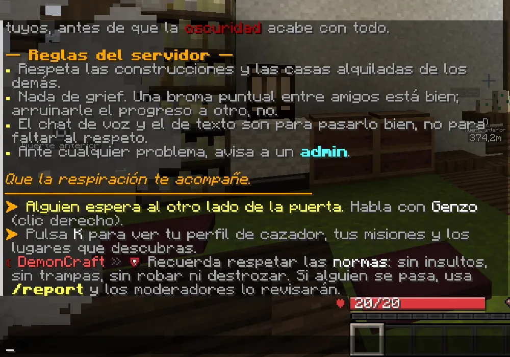
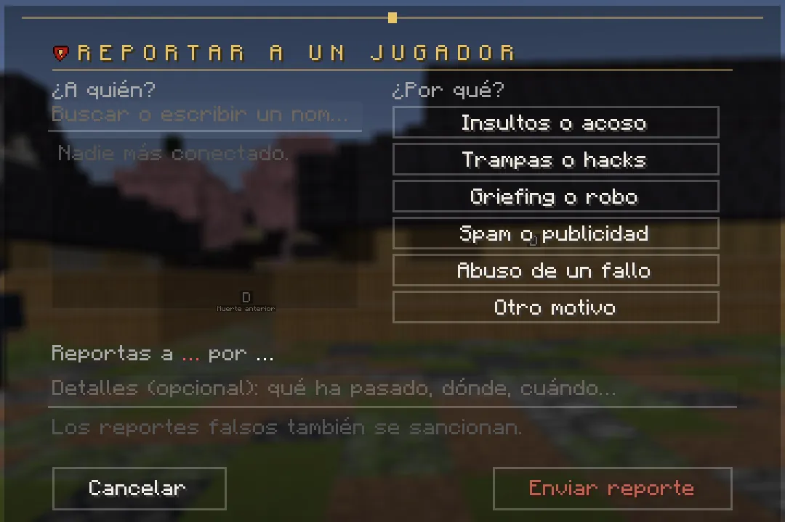

# Chat, voz y reportes

## El chat

Cada mensaje lleva delante tu **prefijo** (staff o VIP), el **kanji de tu rango** en su color, la **etiqueta de tu
clan** y tu nombre. Un demonio lleva **[鬼]** en rojo.

- **Pasa el ratón por un nombre** para ver su tarjeta: rango, título, clan y duelos. **Clic** en el nombre: retarle a
  duelo. **Mayús + clic**: escribir su nombre.
- **Chat de clan:** empieza el mensaje por **`!`**.
- **Privados:** `/msg <jugador> <texto>` (también `/tell` y `/w`). `/me <acción>` para describir lo que haces.
- Si escribes más de 4 mensajes en 5 segundos: *«Despacio: espera un momento antes de escribir otra vez»*.
- **`/discord`** te da el enlace del Discord del servidor.

<figure markdown="span">
  { width="700" loading=lazy }
  <figcaption>Al entrar ves la bienvenida con las normas. Cada 15 minutos salen avisos del servidor.</figcaption>
</figure>

## Chat de voz

DemonCraft tiene **chat de voz por proximidad**: oyes a quien está cerca (hasta unos 48 bloques).

- ++v++ abre el menú de la voz: micrófono, volumen, **grupos** (para hablar con tu gente estés donde estés) y el modo
  (hablar con una tecla o por voz).
- ++n++ silencia tu micrófono.
- También: `/voicechat join`, `/voicechat invite <jugador>`, `/voicechat leave`.

## Títulos

Cada hazaña te da un **título**: terminar arcos, aprender respiraciones, encargos, duelos, cazar demonios con nombre…
Ninguno da ventajas: son reconocimiento.

- En **K → Títulos** ves todos (los que tienes con ✔ y cómo se consiguen los que te faltan). Pulsa **Usar** para ponértelo.
- Tu título se ve en la **lista de jugadores** (++tab++) y en tu **tarjeta del chat**.
- Al ganar uno, se anuncia a todo el servidor.

<figure markdown="span">
  { loading=lazy }
  <figcaption>K → Títulos: «Puesto» es el que llevas; «Usar» para cambiarlo.</figcaption>
</figure>

## Reportar a alguien

Si alguien insulta, hace trampas, roba o destroza, escribe **`/report <jugador>`** (o `/reportar`).

<figure markdown="span">
  { width="640" loading=lazy }
  <figcaption>Elige a quién, el motivo y, si quieres, cuenta qué ha pasado. Llega a los moderadores.</figcaption>
</figure>

- Motivos: insultos o acoso, trampas o hacks, griefing o robo, spam o publicidad, abuso de un fallo u otro motivo.
- Puedes enviar **un reporte por minuto** (6 por hora). Cuando un moderador lo revise, te llega un aviso.
- **Los reportes falsos también se sancionan.** Si es urgente, avisa también en el Discord.

## Sanciones

El staff puede **avisarte**, **silenciarte**, **expulsarte**, **banearte** o **congelarte** (no te mueves ni puedes
hacer nada mientras te revisan; no te desconectes). **Tres avisos en una semana** te silencian una hora
automáticamente. El silencio afecta al chat y a los privados; si alguien molesta por voz, repórtalo.
