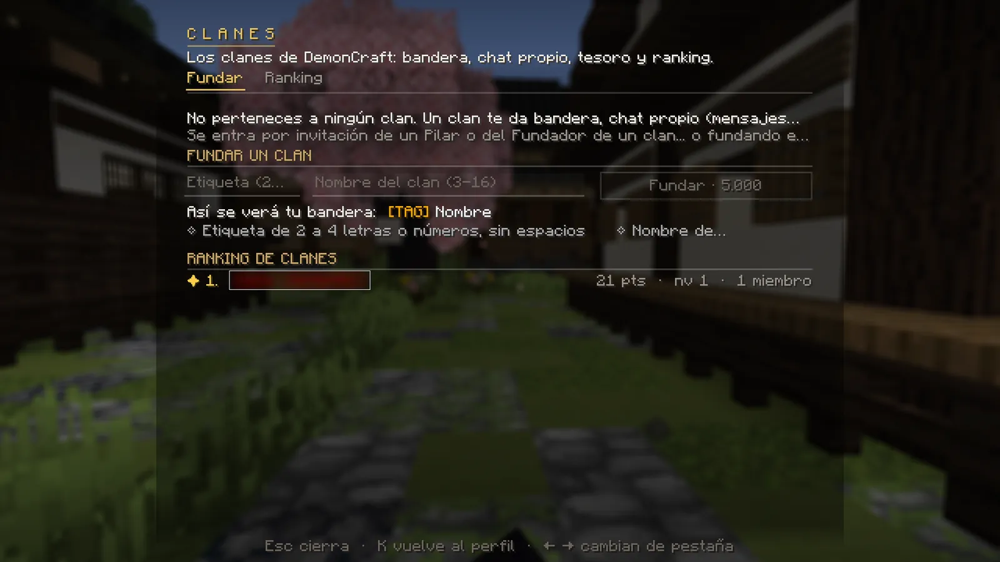
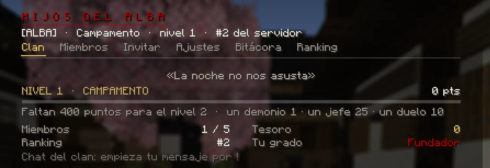
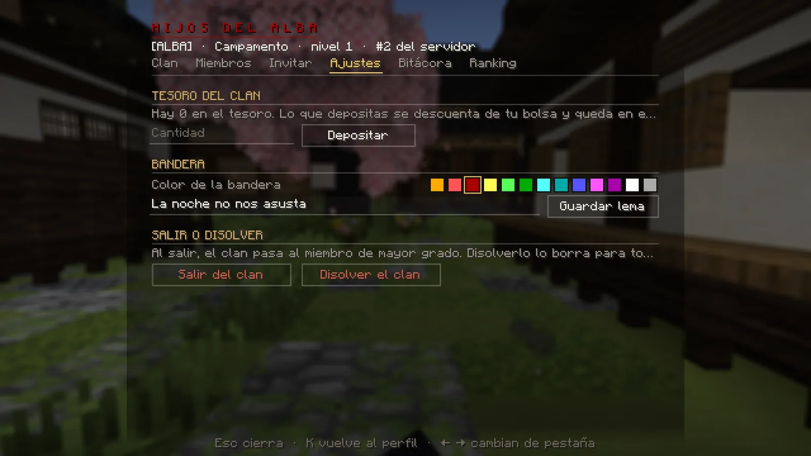
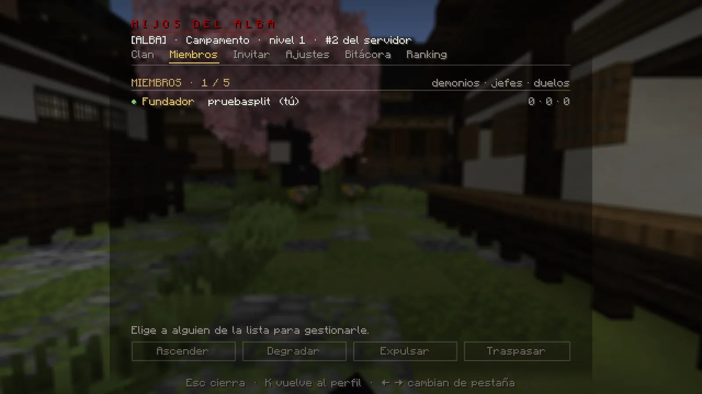

# Clanes

<p class="dc-entradilla">Un clan te da bandera junto a tu nombre, chat propio, un tesoro común y un puesto en el ranking. Cazadores y demonios pueden estar en el mismo clan.</p>

## Fundar un clan

- Desde **K → Clan → Fundar** (escribes la etiqueta y el nombre, y ves cómo quedará tu bandera) o con:

```
/clan fundar <etiqueta> <nombre>
```

- **La etiqueta va primero:** de 2 a 4 letras o números, sin espacios (se guarda en mayúsculas).
- **El nombre:** de 3 a 16 caracteres.
- Cuesta **5.000** y no puedes estar en otro clan. Se anuncia a todo el servidor.

<figure markdown="span">
  { loading=lazy }
  <figcaption>Sin clan, K → Clan te deja fundar uno: etiqueta, nombre y una vista previa de tu bandera.</figcaption>
</figure>

## Entrar en un clan

Solo por **invitación** de un Pilar o del Fundador. Te llega un aviso y tienes **2 minutos** para responder:
`/clan aceptar` o `/clan rechazar` (también desde K → Clan). Se entra con el grado más bajo.

<div class="galeria" markdown>
<figure markdown="span">
  { loading=lazy }
  <figcaption>K → Clan: lema, nivel, puntos, miembros, tesoro, puesto en el ranking y tu grado.</figcaption>
</figure>
<figure markdown="span">
  { loading=lazy }
  <figcaption>Ajustes: aportar al tesoro, color de la bandera, lema y salir o disolver.</figcaption>
</figure>
<figure markdown="span">
  { loading=lazy }
  <figcaption>Miembros: elige a alguien para ascenderlo, degradarlo, expulsarlo o traspasarle el clan.</figcaption>
</figure>
</div>

## Grados

| Grado (cazador) | Grado (demonio) | Puede… |
|---|---|---|
| **Fundador** | Fundador | Todo: nombrar Pilares, lema, color, traspasar, disolver y **retirar del tesoro**. |
| **Pilar** | Luna del Clan | Invitar, expulsar, ascender y degradar a quien tenga menos grado. |
| Veterano | Veterano | Aportar al tesoro y hablar en el chat del clan. |
| Cazador | Colmillo | Igual. |
| Aspirante | Siervo | Igual (es el grado de entrada). |

## Niveles y plazas

El clan sube de nivel con lo que hacen sus miembros: **1 punto por demonio**, **25 por jefe** y **10 por duelo ganado**
(de los que puntúan). Si alguien se va, sus puntos se van con él.

| Nivel | Nombre | Puntos | Plazas |
|---|---|---|---|
| 1 | Campamento | 0 | 5 |
| 2 | Cuadrilla | 400 | 8 |
| 3 | Compañía | 1.500 | 12 |
| 4 | Estandarte | 4.000 | 16 |
| 5 | Casa de Pilares | 10.000 | 20 |

## El tesoro y el chat del clan

- **Tesoro:** cualquier miembro con **2 días de servicio** puede aportar (`/clan tesoro aportar <cantidad>` o en
  Ajustes → Depositar). **Solo el Fundador retira**, y solo por comando: `/clan tesoro retirar <cantidad>`.
- **Chat del clan:** empieza tu mensaje por **`!`** y solo lo leerán los miembros conectados. Ejemplo: `!quedamos en el dojo`.
- Los demonios del clan reciben un 10 % de la sangre que caza cualquier demonio del clan.

## Todos los comandos

| Comando | Qué hace |
|---|---|
| `/clan fundar <etiqueta> <nombre>` | Funda un clan (5.000). |
| `/clan invitar <jugador>` | Invita a alguien (Pilar o Fundador). |
| `/clan aceptar` · `/clan rechazar` | Responde a una invitación. |
| `/clan salir` | Deja el clan. Si eras el Fundador, lo hereda el de mayor grado. |
| `/clan expulsar <miembro>` | Expulsa a alguien de menor grado. |
| `/clan ascender <miembro>` · `/clan degradar <miembro>` | Sube o baja un grado. |
| `/clan traspasar <miembro>` | Le pasas el clan (tú quedas como Pilar). |
| `/clan lema <texto>` | Cambia el lema (Fundador, hasta 48 caracteres). |
| `/clan color <color>` | Color de la bandera (Fundador; por ejemplo `dark_red`). |
| `/clan tesoro aportar <cantidad>` · `/clan tesoro retirar <cantidad>` | Mueve dinero del tesoro. |
| `/clan disolver` | Disuelve el clan (Fundador; el tesoro tiene que estar a 0). |
| `/clan info [nombre o etiqueta]` · `/clan lista` | Ficha de un clan · los 10 mejores. |

!!! warning "Antes de disolver, vacía el tesoro"
    El clan no se puede disolver con dinero dentro: el Fundador tiene que retirarlo antes con `/clan tesoro retirar`.
